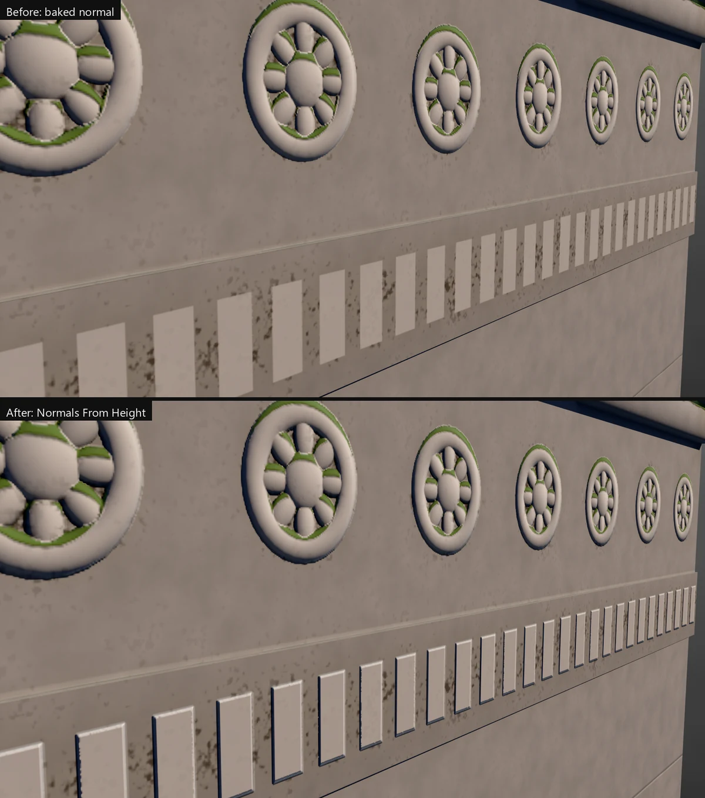
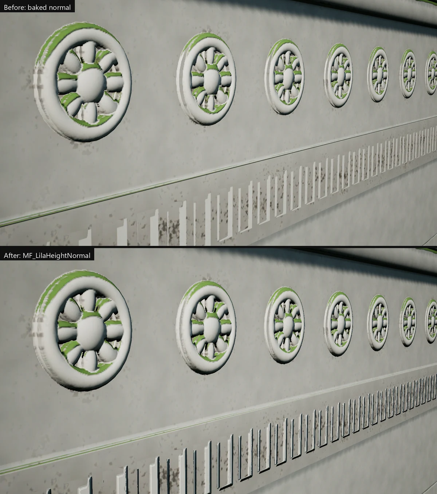

# Baking

Bake normal, AO, curvature and packed maps from high meshes (or a low baked onto itself) into textures ready for Unreal or for smart materials.

## Get it working

1. Open **Bake > Baker**.
2. Select the low mesh and press **Low** in the Baker. With no bake group yet, this makes one.
3. Select the high mesh and press **High**. No high? Tick **Self as high** on the Group tab and pick a smoothing preset.
4. Pick a target in the dropdown next to the project, such as **Unreal Engine (CRM)**, then press **Bake for** that target.
5. The Results tab shows each map as it's written. With **Unreal Engine** targets, the textures are also assigned to the low's material.

Low and High add the meshes under the selection too; Shift+click adds only the selected meshes.

## Troubleshooting

**Red patches in the Live preview, or flat spots in the normal map.** Rays started inside the high or missed it. Press **Auto Paint** on the Group tab's Cage row, then check again. **Paint** fixes what remains by hand.

**The cage looks spiky or blown out after painting.** Press **Reset Paint** on the Cage row to clear the painted offsets, then **Auto Paint** again.

**One mesh darkens another's AO (hair on a body, a strap on a dress).** Select the meshes that shouldn't occlude, pick the Low row they shouldn't darken (or the group row for every low), and press **Unlink Selected**. Shift+click also stops them projecting onto that low.

**Hard edge warnings.** A hard edge that isn't on a UV seam shows as a visible split in the normal map. Split the UVs there or soften the edge.

**Steep sides light like the flat top (bricks, dentils, stone joints).** A bake looking straight down never sees vertical walls, so the normal map has none. Bake **Detail Normal** with **Height**, as in Options below.

**Per-material resolution does nothing.** The output name needs `{material}`, so each texture set writes its own files.

## Options

**ORM or CRM for Unreal.** Both pack three greyscale maps into one texture: ORM is ambient occlusion, roughness, metallic; CRM is cavity, roughness, metallic. Prefer CRM for games. Unreal draws its own ambient occlusion at runtime (Lumen, SSAO, distance field AO), so baked AO in the material darkens the same crevices a second time. Cavity holds the fine detail that runtime AO is too coarse to catch, so it pairs with it instead of doubling it. Use ORM when a material or another engine expects baked AO.

**Base colour with emissive.** Add the **Base Colour + Emissive** map on the Maps tab: base colour in RGB, an emissive mask in A. Its channel rows can take any channel of any baked map.

**Normals from height.** For walls that light as walls, and normals that match displacement or parallax: bake **Detail Normal** and **Height** together. The material rebuilds the shape's normals from the height and lays the detail normal on top. Assigning the maps (automatic for Unreal targets, or **Assign** in the Baker) sets this up in Lila: it fills **Height Map** and ticks **Normals From Height** in the Material Editor, with the depth and UV size the bake measured. In Unreal, drop `MF_LilaHeightNormal` (in `/Game/LilaLink/Masters`) into your material: connect the height map, the sampled detail normal and the same **HeightDepth**, **HeightUVWidth** and **HeightUVHeight**. Materials LilaLink generates use it already. Texture sets show and export their normal this way when **Normals from height** is ticked in the set's settings; trim sheets turn it on for their sets when they bake a detail normal.

[Most normals are wrong. How can we fix it?](https://www.youtube.com/watch?v=FyyYLycTGyc) explains the problem well. Lila's fix differs from the one in the video.





**Per texture set.** On the Output tab, pick a material in **Texture Set** to give it its own resolution, format, bits, supersampling and padding.

```python
setBakeOutput(material="M_Outfit", resolution=4096)
```
