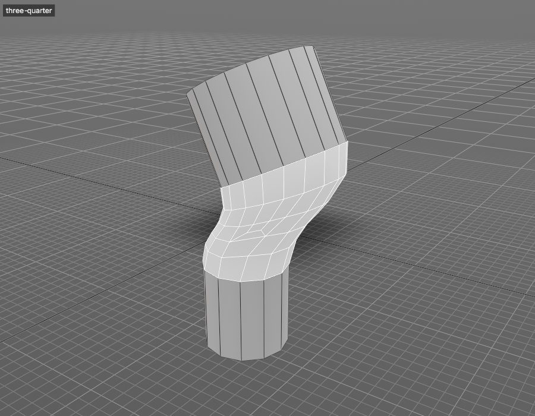

# Bridge

Joins two borders with a band of faces that follows the shape around it, even when the borders have different edge counts.



## Get it working

1. In edge mode, select two borders: two holes, two open edges, or the whole border of one slot or sliver.
2. Choose **Model > Bridge**, or tap **B** with the edges selected.
3. Adjust **Curve Type**, **Divisions** and the rest in the panel that opens. Each change redoes the bridge.

In face mode, **Bridge** deletes the selected faces and bridges the holes they leave, like Maya's face bridge.

```python
polyBridge(curveType="auto", divisions=-1)
```

## How Auto shapes the bridge

**Curve Type** **Auto** reads two rings of faces behind each border and continues them across the gap:

- Where the edge flow on both sides runs straight or on one circle, the rows follow that line or arc. A strip deleted from a cylinder, sphere or torus comes back in its original position.
- Elsewhere, each column matches the slope and bend of the faces on both sides.
- Rows are spaced to blend from the edge spacing on one side to the other.

**Divisions** `-1` picks the row count from the gap and the edges around it.

## Open ends

When the two borders are open and their ends are joined by more border (the short ends of a slot), the end rows land on that border's points and weld, so nothing is left loose:

- With **Divisions** `-1`, the row count matches the points on the end border.
- A row with no end border point within **Weld Tolerance** splits the end border edge instead.
- An end border point no row reached stays as an extra corner of the end face. The Script Editor logs how many.

Borders that meet at a point (a sliver between two curves) close to that point with no extra points there.

## Different edge counts

Borders pair by length along them. The extra edges end in 3-to-1 quads spread over the middle rows; an odd difference leaves one triangle. With **Divisions** `0` there are no middle rows to spread over, so the difference is made up with triangles. **Transition** **Triangles** fans them in the middle row instead.

## Troubleshooting

**Nothing happens and the log says nothing to bridge.** The selection isn't two borders, or one border round a slot. Edges with faces on both sides can't bridge. Select only open edges (the Modeling Toolkit's **Border** button selects them).

**The bridge twists.** Change **Bridge Offset** to step the pairing round a closed loop, or set **Start Source** and **Start Target** to the two points that must meet.

**The bridge crosses over itself.** One border was read the other way round. Turn on **Reverse Source** or **Reverse Target**.

**Auto bulges where you wanted it flat.** The faces behind the borders curve that way. Use **Blend** or **Linear**, or lower **Smoothness**.

## Options

Most options explain themselves in the panel. These need a word:

| Option | What it does |
| --- | --- |
| **Path** curve type | The band follows a curve: set **Path Curve** to a curve's name. Its ends map onto the two borders' centres. |
| **Connect** | **Loop Pairs** joins each loop to its nearest; **Open Chain** runs one bridge through every selected loop in order (wire rings with no faces work too); **Closed Chain** also joins the last to the first. |
| **Merge** | Collapses the two borders into one row at **Merge Factor** instead of making faces. |
| **Profile** | Bulges (positive) or pinches the middle rows, as a fraction of the gap; **Profile Shape** sets the falloff. |
| `pairs` flag | Further points to hold together, from Python: `polyBridge(pairs=[[12, 40], [18, 47]])`. |
