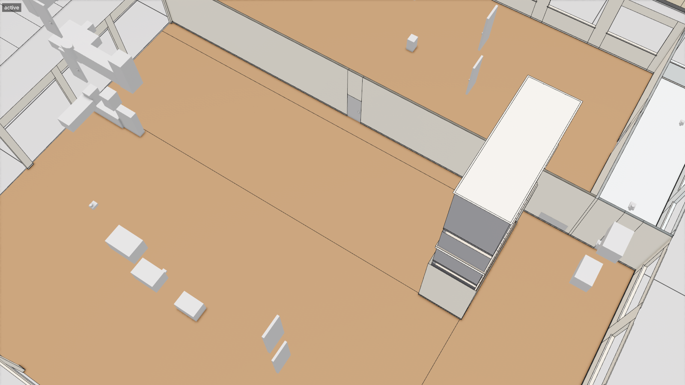

# Buildings

Turn a settlement's lots, OSM footprints or your own curves into live procedural buildings: floors, facades, shopfronts with signs, balconies, arcades, roofs and roof clutter, every part a [slot](slots.md) you can swap.


## Get it working

1. Select a settlement and pick **Level > Buildings > Create Buildings**. For a real town in one step, use **Level > Settlement > Town from OSM** with **Building Route** set to `buildings` (see [Settlement](settlement.md#real-towns-from-openstreetmap)).
2. Select a building mesh. The Attribute Editor's **Buildings** section edits the building you clicked: **Style**, **Floors**, **Bay Width**, **Seed** and **Colours**.
3. **Level > Buildings > Paint Bays**: pick a brush in the palette (**Window**, **Door**, **Shopfront**, **Wall**, **Arcade**, **Garage**, or a part such as **Balcony** or **Awning**), then click or drag across a wall's bays.

```python
buildingCreate(settlement='Town')                                    # or settlementBuildings('Town', via='buildings')
buildingCreate(curve='Footprints', floors=3, style='residential')    # closed curves, one building each
buildingEdit('building:1a2b', floors=4, toggles={'t0/f0/l1/b1': {'balcony': True}})
buildingCheck()['ok']
```

Edits, slot overrides and pins are kept by building id, so running **Create Buildings** or the settlement's buildings route again keeps them. Editing the settlement rebuilds the buildings it changed, as an undo step of its own: undo once to see the old buildings.

## Troubleshooting

**Check Buildings reports issues.** It lists modules meeting where they shouldn't, doors that don't reach the ground, buildings overlapping a neighbour, slots floating off their building and real names on signs, each with the building id and position.

**A building has the Residential style instead of yours.** The style isn't in the library. `buildingInfo(id)['warnings']` says so; run **Reload Building Styles** after adding a style file.

**Doors have steps instead of a stepped ground floor.** No ground was sampled. Give the settlement a ground, or `buildingCreate(..., ground='Terrain')`.

**A pinned building didn't change.** Pins win over regeneration. `slotPin('owner:building:<id>', remove=True)` unpins it.

**An edit takes long in a big city.** Buildings share a live mesh per 64 m cell. A smaller **Cell Size** makes edits cheaper; **Make Standalone** gives one building its own mesh.

**An FBX or glTF export of a building cell has only the shell.** Modules stay instances. Turn on **Realize** on the cell mesh's Buildings modifier (`setAttr('LilaBuildingsModifier.realize', True)`) to flatten them into the mesh before exporting.

**Buildings don't match their settlement.** **Level > Buildings > Refresh Buildings** rebuilds the ones whose settlement changed.

**A `<scene>_cache` folder appeared beside the scene.** Saving a scene with buildings writes `buildings.bin` there (about 11 KB a building), so reopening reads unchanged buildings back instead of generating them. Deleting it is safe: the buildings regenerate on the next open. Another version of Lila or Buildings ignores the file and regenerates, and the log says so. Ship it with the scene to spare the next person the wait. `buildingCache()` reports the file; `buildingCache(write=True)` writes it now.

**Memory stays high after closing a big town.** Lila keeps generated buildings in memory so a rebuild reuses them. `buildingCache(clearMemory=True)` lets them go.

## Tune it

| Option | What it does |
| --- | --- |
| Styles | Colonial centro, malecón, resort tower, modern commercial, residential, narco mansion, civic, police station, church, mausoleum, warehouse, packing plant, port shed, hangar, village adobe, rural shack. `buildingStyle(polygon=..., style='colonialCentro')` restyles a district. |
| Your own style | **Save Building Style** copies a style with your changes to your user or workspace folder. `buildingStyles(style='colonialCentro')` shows the full JSON to copy; `buildingStyleExport` and `buildingStyleImport` share it. |
| Parts | Every module is a slot (`door.shop`, `window.residential`, `sign.storefront`, `balcony.iron`, `wall.bay`, `roof.tiled`). Swap them for your kit with a [slot rule](slots.md). |
| **Age Buildings** | A Weathering preset per building or district, and palette dirt from 0 (pristine resort) to 1. |
| **Building LOD** | **Near** (shell and modules), **HLOD** (tiers and roofs) or **Far** (flat-roof blocks) per mesh. `buildingLod(lod='auto')` picks by distance from the viewport camera: near within 400 m, far past 2 km (prefs `buildings/lodNear`, `buildings/lodFar`, in cm). **Make Proxies** writes the HLOD and far meshes for export. |
| `moduleTones` | In a style's JSON, the two palette colours each module kind takes: `"moduleTones": {"arcade": ["render", "trim"], "window": [null, "trim"]}`. Names are `render`, `trim`, `roof`, `base`, `frame`, `door`, `awning` or `none`; `null` keeps the default. A material with **Second Tone** on draws the second one ([colours](slots.md#colours)). |
| **Building Trim Sheet** | Bakes the LilaBuilding trim sheet the shells are laid on (needs Trim Sheets), as a copy in the workspace's `TrimSheets` folder, or your user `trim-sheets` folder with no workspace open. |

Shop signs carry fictional business names; a sign or building name that matches a real one fails **Check Buildings**.

### Unreal

Open a World Partition level with LilaLink built into the project, then `buildingSend()`. Shells go as Nanite meshes inside Settlement's World Partition cells, modules as slots (your slot's Unreal class or mesh, else the placeholder), and the HLOD and far proxies as World Partition Custom HLOD actors in `/Game/Lila/HLOD/HL_LilaBuildings` and `HL_LilaBuildingsFar`, made when missing. **Save All** in Unreal afterwards: a send imports assets without saving them.

Materials: `MF_LilaBuildingVariation` with a generated `M_LilaBuilding` and an `MI_Bld_<style>` per style; modules share `MI_Bld_Modules`, and module materials with **Second Tone** on get an `MI_Bld_Tone_<slot>` each. Each building's colour and dirt travel in vertex colour, and modules carry their building's palette as an [instance colour](slots.md#colours): put `MF_LilaBuildingVariation` between your base colour and the material output to use them in your own material. Set its `SecondTone` input to 1 on parts that take the second palette colour; `SecondToneBase` is the colour shown where a module has none.

Sending again skips whatever the level already holds unchanged.

**"the LilaLink plugin predates Custom HLOD actors".** Rebuild LilaLink from Lila's `ue/LilaLink`.

**"custom HLOD actors need a World Partition level".** Open a World Partition level, or `buildingSend(proxies=False)`.

**Far proxies never show.** The level has no default HLOD layer: set one in World Settings under World Partition.

| Option | What it does |
| --- | --- |
| `hlodLayer` | Puts shells and modules in this HLOD layer instead of letting Lila's proxies stand in for them. |
| `hlodProxyLayer` | The proxies' Custom HLOD Actor layer; far proxies go in the same path plus `Far`. |
| `folder` | Content folder for shells and modules. |
| `MF_LilaBuildingVariation` | **PaletteStrength**, **DirtAmount**, **DirtScale**, **DirtColor**. |

## Enterable buildings

Give chosen buildings real interiors: rooms split by the building's use, a stair core, interior doors, clear glass, ceiling lamps and furnishing, all checked against your game's character.



1. Select a building mesh and tick **Enterable** in the Attribute Editor's **Buildings** section, or **Level > Buildings > Make Enterable**.
2. **Edit Rooms** (in the same section, or **Level > Buildings > Edit Rooms**) shows the plan floor by floor with the shell cut away. **Page Up** and **Page Down** change floor.
3. In the palette: **Kind** (pick a kind, click a room), **Split** (click where to cut), **Merge** and **Wall** (drag from a room into its neighbour), **Door** (drag between rooms to add one, click beside a door to remove it).

```python
buildingMakeEnterable('building:1a2b', program='bar')
buildingRoom('building:1a2b', room='l0/backroom', kind='kitchen')
buildingDoor('building:1a2b', add=['l0/sales', 'l0/toilet'])
buildingCheck()['ok']
buildingMakeEnterable(programs=['police', 'bar'], landmarks=True, limit=10)    # pick buildings across the scene
```

**Program** in the Attribute Editor re-plans the whole interior. Each room is a mesh of its own under `Interior_<id>`: model it freely, and it stays as you left it when the building changes. **Make Enterable** with **Reset Hand Edits** regenerates it. **Make Exterior** takes the interior away again.

On a sloped lot the ground floor steps with the street in 30 cm terraces, with steps at doors between levels. Floors too tight for a stair core get a dog-leg stair landing in the rooms, or a straight flight per floor, and no lift; the result's notes say which.

### Troubleshooting

**Check Buildings lists interior issues.** Rooms the entry can't reach, doors your modelling closed, stairs too steep or low and doors too narrow or low for the character. **Character Profile** sets the character; it is Unreal's default character until you change it.

**The result warns about generic rooms.** The building's use has no interior program. Pick one in **Program**.

**A door appeared on the street.** No exterior door opened into a room, so one was added (`entryAdded` in the result). Turn **Add Entry** off to skip it.

**A room edit stopped applying.** Its room is gone after a layout change. `buildingInterior('building:1a2b')['orphanEdits']` lists it.

**Interiors show in the Unreal editor but not in game.** They stream on their own runtime data layer, `DL_Interior_<id>`. Activate it from game code near the entry door: the door's slot data carries `interior=building:<id>`.

### Tune it

| Option | What it does |
| --- | --- |
| Entry doors | Exterior doors into rooms carry the tag `entry`. `slotRule('add', type='door', tag=['entry'], unrealClass='/Game/BP/BP_Door.BP_Door_C')` gives them your door Blueprint. Enterable buildings are pinned against regeneration, but rules and overrides still swap their slots. |
| Interior slots | `door.interior`, `door.interior.double`, `lamp.ceiling`, `lift` and `furnishing.*` swap like any [slot](slots.md). |
| `buildingMakeEnterable(clutter=[...])` | Library items Set Dressing strews on every room's floor and settles with physics (`clutterDensity` per m2, default 0.4). Running it again replaces the clutter. |
| `buildingRoomPresets(save=...)` | The furnishing each room kind gets. The presets are also Set Dressing arrangements named **Room: <Kind>**, for any floor. |
| `buildingSend(interiors=...)` | `levelInstance` (default): a Level Instance per interior on its own runtime data layer. `dataLayer`: the room actors themselves on the layer. `none`: interiors stay in Lila. Interior meshes collide as modelled. |
| `MF_LilaBuildingGlass` | **GlassTint**, **GlassOpacity**, **GlassRoughness** for the clear glass of enterable buildings, or edit `MI_Bld_GlassClear`. Other buildings' windows show fake interiors. |
