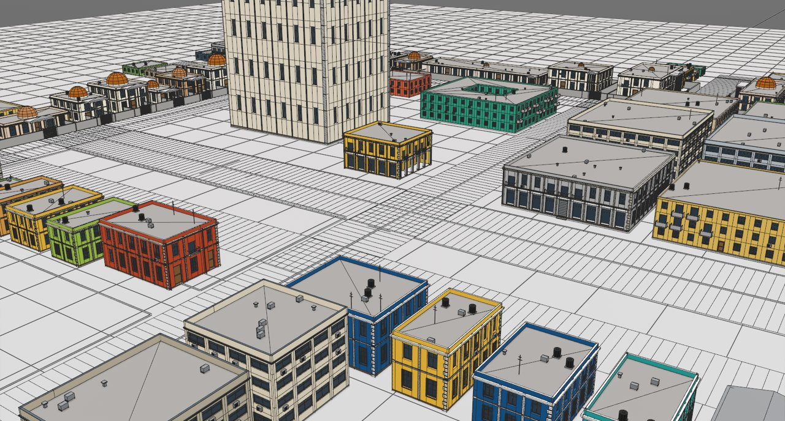

# Buildings

Turn a settlement's lots, OSM footprints or your own curves into live procedural buildings: floors, facades, shopfronts with signs, balconies, arcades, roofs and roof clutter, every part a [slot](slots.md) you can swap.



## Get it working

1. Select a settlement and pick **Level > Buildings > Create Buildings**. For a real town in one step, use **Level > Settlement > Town from OSM** with **Building Route** set to `buildings` (see [Settlement](settlement.md#real-towns-from-openstreetmap)).
2. Select a building mesh. The Attribute Editor's **Buildings** section edits the building you clicked: **Style**, **Floors**, **Bay Width**, **Seed** and **Colours**.
3. **Level > Buildings > Paint Bays**: pick a brush in the palette (**Window**, **Door**, **Shopfront**, **Wall**, **Arcade**, **Garage**, or a part such as **Balcony** or **Awning**), then click or drag across a wall's bays.

```python
buildingCreate(settlement='Town')                                    # or settlementBuildings('Town', via='buildings')
buildingCreate(curve='Footprints', floors=3, style='residential')    # closed curves, one building each
buildingEdit('building:1a2b', floors=4, toggles={'t0/f0/l1/b1': {'balcony': True}})
buildingCheck()['ok']
```

Edits, slot overrides and pins are kept by building id, so running **Create Buildings** or the settlement's buildings route again keeps them. Changing the settlement doesn't rebuild the buildings by itself: run the route again.

## Troubleshooting

**Check Buildings reports issues.** It lists modules meeting where they shouldn't, doors that don't reach the ground, buildings overlapping a neighbour, slots floating off their building and real names on signs, each with the building id and position.

**A building has the Residential style instead of yours.** The style isn't in the library. `buildingInfo(id)['warnings']` says so; run **Reload Building Styles** after adding a style file.

**Doors have steps instead of a stepped ground floor.** No ground was sampled. Give the settlement a ground, or `buildingCreate(..., ground='Terrain')`.

**A pinned building didn't change.** Pins win over regeneration. `slotPin('owner:building:<id>', remove=True)` unpins it.

**An edit takes long in a big city.** Buildings share a live mesh per 64 m cell. A smaller **Cell Size** makes edits cheaper; **Make Standalone** gives one building its own mesh.

## Tune it

| Option | What it does |
| --- | --- |
| Styles | Colonial centro, malecón, resort tower, modern commercial, residential, narco mansion, civic, police station, church, mausoleum, warehouse, packing plant, port shed, hangar, village adobe, rural shack. `buildingStyle(polygon=..., style='colonialCentro')` restyles a district. |
| Your own style | **Save Building Style** copies a style with your changes to your user or workspace folder. `buildingStyles(style='colonialCentro')` shows the full JSON to copy; `buildingStyleExport` and `buildingStyleImport` share it. |
| Parts | Every module is a slot (`door.shop`, `window.residential`, `sign.storefront`, `balcony.iron`, `wall.bay`, `roof.tiled`). Swap them for your kit with a [slot rule](slots.md). |
| **Age Buildings** | A Weathering preset per building or district, and palette dirt from 0 (pristine resort) to 1. |
| **Building LOD** | **Near** (shell and modules), **HLOD** (tiers and roofs) or **Far** (flat-roof blocks) per mesh. **Make Proxies** writes the HLOD and far meshes for export. |
| **Building Trim Sheet** | Bakes the LilaBuilding trim sheet the shells are laid on (needs Trim Sheets). |

Shop signs carry fictional business names; a sign or building name that matches a real one fails **Check Buildings**.

### Unreal

`buildingSend()` sends the shells as Nanite meshes inside Settlement's World Partition cells, the modules as slots (your slot's Unreal class or mesh, else the placeholder), the HLOD and far proxies, and `MF_LilaBuildingVariation` with a generated `M_LilaBuilding` and an `MI_Bld_<style>` per style. Each building's colour and dirt travel in vertex colour: put `MF_LilaBuildingVariation` between your base colour and the material output to use them in your own material.

<!-- W4 enterable buildings: interiors (buildingMakeEnterable), entry door slot, room presets, interior checks. Write from X:\Lila-wt\ow-log\W4.md when it lands. -->
