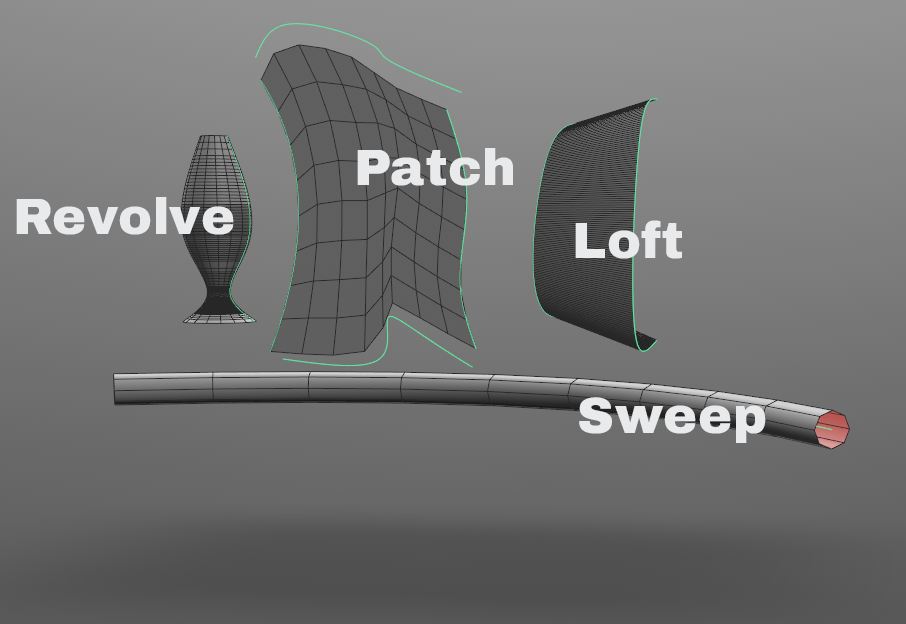
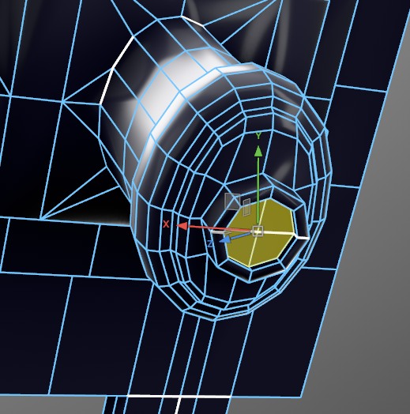
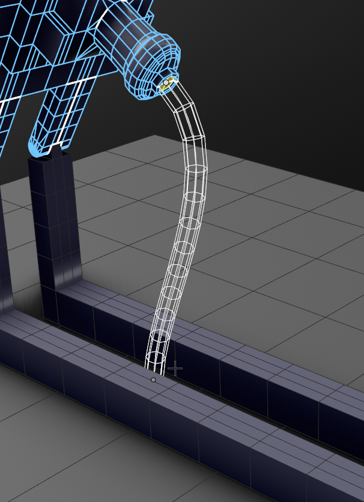
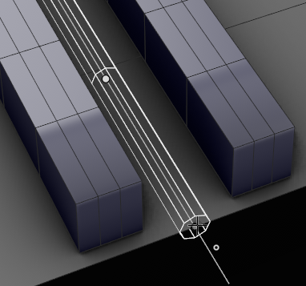
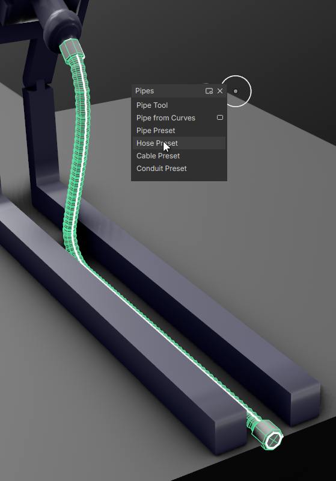
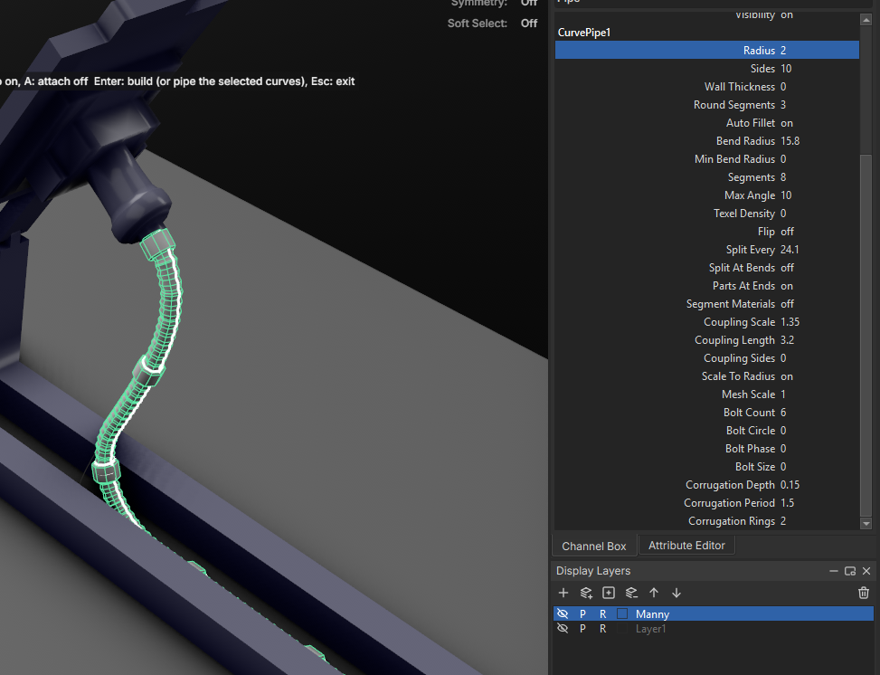

# Curves

Draw curves, then turn them into meshes with sweeps, revolves, lofts, patches and pipes. Everything lives in the **Curves** menu and the **Curve Toolkit** (top of the Curves menu).

<!-- TODO image: a hard-surface prop built from curves (images/curves/overview.png) -->

## Hotkeys

| Key | While drawing |
| --- | --- |
| **X** | Snap to grid |
| **V** | Snap to vertices and curve points |
| **C** | Snap to edges and curves |
| **N** (hold) | Draw on a mesh surface |
| **L** | Lock to a plane |
| **S** | Draw on mesh surfaces (toggle) |
| **K** | Keep the drawn curve on the surface it was drawn on |
| **Ctrl+scroll** | Offset from the surface |
| **Y** | Cycle symmetry for new curves: off, X, Y, Z |
| **Z** / **Backspace** | Remove the last point |
| **Shift+Z** | Put it back |
| **Esc** | Exit |

> Grid snap (**X**) wins over surface placement.

## EZ Curve

Click two points. When both land on a mesh, the curve follows its surface and stays out of any mesh the straight line passes through. Until you start the next curve, reshape it in place:

| Input | Does |
| --- | --- |
| Drag up / down | Bend |
| Drag sideways | Twist the bend around the line between the points |
| **Shift**+drag | Sag |
| **Ctrl**+drag | Lift off the surface |
| **Shift+scroll** | Number of points |
| **F** | Follow the surface (toggle) |
| **O** | Keep out of meshes (toggle) |
| **R** | Reset bend, twist and sag |
| **Enter** | Done; clicking also starts the next curve |

Each drag is one undo step. The same settings are in the adjust popup and the toolkit's **Tool Options**.

<!-- TODO image: an EZ curve hugging a hull, then bent off it (images/curves/ez-curve.png) -->

## Symmetry

RMB > **Symmetry** (or Curves > Symmetry) mirrors the selected curves live across a world plane. Edit the original side; the mirror follows, and pipes, sweeps and Unreal splines built from the curve get both sides. The mirrored side can't be picked or edited until **Bake Symmetry** turns it into a curve of its own.

## Insert a point

With a curve selected, RMB > **Curve Point**. Click the curve where the point should go (**Shift**+click adds more, **Ctrl**+click removes one, drag slides it along), then Shift+RMB > **Insert Point** or **Enter**. The shape doesn't change and the new points are left selected in vertex mode.

## Make a mesh

| Command | Select | Result |
| --- | --- | --- |
| **Sweep** | A path, and optionally a profile curve | The profile (or a circle or rectangle) swept along the path |
| **Revolve** | A profile curve | The profile spun around an axis |
| **Loft** | Two or more curves, in order | A surface through each curve |
| **Patch Fill** | Four curves forming a closed boundary | A quad patch filling them |
| **Curve Network** | Crossing curves in two directions | A quad surface through all of them, each curve an edge loop |
| **Border Blend** | Two edge chains, on one mesh or two | A tangent-continuous strip between them |
| **Bevel Plus** | All the closed curves at once | A capped, bevelled solid; loops inside loops become holes |
| **Roof** | A closed footprint curve | A hip roof; holes become courtyards |
| **Contour** / **Section** | Meshes | Curves sliced from them |

<!-- TODO image: a curve network surface with its U and V curves highlighted, and a border blend bridging two meshes (images/curves/network-blend.png) -->

> Results update live when you edit the curve. **Delete History** bakes it into a plain mesh.



<!-- TODO image: sweep, revolve and loft side by side (images/curves/surfaces.png) -->

## Pipes and hoses

To bring a pipe out of a mesh, select a face (circularize it first for a round start) before drawing. The pipe leaves its centre along its normal.



Place the pipe's points.



Snap to vertices, edges and surfaces.



Pick a preset.



Tune the parameters.



> To pipe existing curves, select them with the Pipe Tool active and press **Enter** without drawing.

| Key | In the Pipe Tool |
| --- | --- |
| **B**-drag or **Ctrl+scroll** | Radius of the next point, for pipes that change size |
| **+** / **-** | Sides |
| **P** | Cycle presets: pipe, hose, cable, conduit |
| **T** | Hollow wall on or off |
| **S** | Draw on surfaces |
| **F** | Start from the selected face or loop |
| **A** | Weld the pipe into the mesh (bakes it) |
| **Z** / **Backspace** | Remove the last point |
| **Shift+Z** | Put it back |

> After building, the Attribute Editor holds segments, couplings, flanges, bolt rings and hose corrugation.

### Pipes on a trim sheet

Set the pipe's **UVs** attributes to map it straight onto one strip: **uvLayout** `along` runs U along the pipe and V around it, **vMin** / **vMax** pick the strip, and **texelDensity** tiles it along the length at world scale (0.01 is one tile per metre). Caps and rims go into the **cap** rectangle, a tube's inner surface into the **inner** one. Sweeps (**extrude**), straps and cable pipes take the same attributes.

```python
pipe("Run", uvLayout="along", vMin=0.5, vMax=0.625, texelDensity=0.01)
cable(points=[[0, 300, 0], [400, 300, 0]], pipe=True, pipeOptions={"uvLayout": "along", "vMin": 0.875, "vMax": 1.0})
```

Moving a live pipe to another strip means changing these attributes. A UV tool used on a live pipe bakes it into the mesh first: its settings stop applying, and the log says so. To edit UVs by hand on purpose, bake it yourself with `bakeModifierStack("Pipe")`.

### Routing

Select the meshes to keep clear of, start **Curves > Pipe Route Tool** (or **Level > Pipes and Channels**) and click where the pipe starts and ends. It leaves and arrives along the surfaces you click and builds a live pipe; moving an obstacle reroutes it. **[** / **]** set the radius. From Python:

```python
pipeRoute(start=[-300, 100, 0], end=[300, 100, 0], obstacles=["Wall"], pipe=True, pipeOptions={"radius": 5})
```

**clearance** is the least distance from the centreline to an obstacle (the pipe radius plus a gap). Raise one axis of **axisCost** to keep runs off it (`[1, 5, 1]` avoids risers), and **bendCost** for fewer bends. **startDir** / **endDir** make it leave and arrive along an axis, for nozzles.

### Supports

Select the pipe and the walls, floors and ceilings, then **Curves > Pipe Supports**. Hangers, wall brackets, floor stands or clamps go along the pipe, each reaching to the nearest surface, and follow the pipe's path, radius and bends live.

```python
pipeSupports("Pipe", surfaces=["Ceiling", "WallA"], spacing=250)
pipeSupports("Pipe", surfaces=["Floor"], target="floor", supportMeshNode="MyStand")
```

**style** `auto` picks a hanger to a ceiling, a bracket to a wall and a stand to a floor. Your own support mesh points +Y at the surface and +Z along the pipe, and stretches along Y to reach it.

## Carved channels

Select the path curve and the mesh, then **Curves > Carve Channel** (its option box sets the profile). It cuts a U channel, V groove, half round or stepped trench along the curve: terrain, a floor, the top of a wall. It stays live as a **channelModifier** on the mesh: move the curve or change the profile and it recuts.

```python
carveChannel("RiverPath", surface="Terrain", shape="stepped", width=300, depth=150)
```

The curve can be drawn in plan: **followSurface** drops it onto the mesh. The walls take strip UVs, one tile per metre along by default. Only faces near the curve are recut, so kilometre-wide terrain carves as fast as a small mesh.

## Along a curve

<!-- TODO image: a rail mesh deformed along a curve beside an array of fence posts along the same curve (images/curves/along-curve.png) -->

| Command | Select |
| --- | --- |
| **Deform Along Curve**, **Array Along Curve** | The meshes, then the curve. A second curve is the aim curve when Up Mode is Aim Curve. |
| **Flow Along Surface** | The meshes, then the surface. Select faces on the surface (one full rectangle of quads, no poles) to flow onto those only. |

- The mesh starts at the curve's start from its lowest point along the forward axis; its pivot sets how far it sits off the curve. Use **Roll** to turn it about the curve.
- Flow maps X to U and Z against V, with height measured from Y = 0 (**Height Base**).
- The mesh's position is recorded when the curve is connected: moving the mesh afterwards carries the result with it.
- Deformed array copies butt end to end and stretch to fill their slot. **Weld** only joins open pieces (trims, profiles).
- **Instances** output does not follow later curve edits and can't be combined with deformed copies.

## Planar curves

<!-- TODO image: text curves and a curve boolean result, then the same shapes as a Bevel Plus solid (images/curves/planar.png) -->

- **Booleans**: select the target first. Loops fill even-odd, so a letter's counter stays a hole. Inputs stay live; **Hide Inputs** hides them.
- **Bevel Plus** extrudes toward the curves' plane normal: up for ground curves, toward you for curves drawn in the front view. Crossing curves are bevelled as their even-odd union, with a warning.
- **Custom bevel profile**: draw it in the front view, x as inset and y as rise. It is stretched to fit width and depth.
- **SVG import** scale is cm per px after the viewBox. `<text>`, `<use>` and `<image>` are skipped with a warning; stroke-only shapes come in as open curves.
- **Roof** gables: gable edge *i* runs from footprint point *i* to *i*+1.
- **Inset Region** (Model menu) needs flat, connected faces.

<!-- TODO image: a roof built from an L-shaped footprint with a courtyard hole (images/curves/roof.png) -->

### Text

- **Text** lies in the XY plane, first baseline at the origin (**Anchor** moves the top, middle or bottom there instead). Edit it in the **Text** section of the Attribute Editor with the text curve or anything built from it (a Bevel Plus) selected. Bold and italic use the family's own styles; when it has none they fall back to **Weight** and **Slant**. An unknown font falls back to Inter with a warning.
- **Fonts**: with a workspace open, starred fonts are saved in `.lila/fonts.json`.
- **Text Mesh** (Curves menu) makes the text and its Bevel Plus in one step.
- **Stretched or pulled vertices**: lower **Front Width** (and **Back Width**) first. A bevel wider than the thinnest strokes meets itself in a ridge and drags the faces across the letter.

## Blend and trim

<!-- TODO image: two curves joined by a G2 blend with the curvature comb on, the end dots visible (images/curves/blend.png) -->

| Key | In the Blend Curve Tool |
| --- | --- |
| Click near an end | Snap to that end (anywhere else picks a point along the curve) |
| Drag a dot | Bulge |
| **0**-**3** | Continuity of the nearest end: position, tangent, curvature, curvature rate |
| **F** | Flip the nearest end |
| **C** | Curvature comb |
| **Enter** | Build |

| Key | In the Trim Tool |
| --- | --- |
| Click | Delete the highlighted stretch |
| **E** | Extend instead |
| **M** | Extension shape: smooth, line, arc |
| **P** | Intersect as seen in the view, for curves that only cross on screen |

> Trim and extend cut against every visible curve. A curve that meets nothing is deleted when clicked.

## Cables

<!-- TODO image: a bundle of sagging cables between three anchors, draped over a mesh (images/curves/cables.png) -->

| Key | In the Cable Tool |
| --- | --- |
| Click | Place an anchor; click the first to close |
| **B**-drag or **Ctrl+scroll** | Slack (sag in depth mode) |
| **M** | Slack or sag depth |
| **+** / **-** or **Shift+scroll** | Cables per span |
| **R** | Reseed the bundle |
| **D** | Drape over the meshes the anchors are on |
| **P** | Pipe geometry |
| **[** / **]** | Pipe radius |
| **Enter** | Build; with nothing placed, cables the selected curves |

> A span running straight along gravity can't sag.

## Stitches

Select a curve and the meshes it lies on, then **Curves > Stitch**. Each stitch sits on the closest of them. The thread is real geometry: it arches out of each hole and dives into the next, in twisted plies, with UVs running along it. It stays live: edit the curve, the mesh or the settings and the stitches follow.

<!-- TODO image: saddle, zigzag and cross stitches on a leather surface (images/curves/stitches.png) -->

```python
stitch('SeamCurve', surfaces=['Shoe', 'Tongue'], preset='heavyLeather')
stitch('Hem', pattern='zigzag', stitchWidth=0.6, rows=2)
```

Presets: `running`, `topstitch`, `saddle`, `denim`, `heavyLeather`, `zigzag`, `cross`, `blanket`. **rotation** slants running stitches into a saddle stitch; **jitter** makes them look hand-sewn. Rows go to the curve's left (+**offset**) when **rowAlign** is `left`. With no mesh, **up** says which way is out of the surface.

## Straps

Select the meshes (or faces, to strap only those), start the **Strap Tool** and drag a slash across what to strap. With nothing selected it straps any visible mesh; hidden meshes and faces never count. The strap wraps around everything the slash crosses, in the plane of the slash seen edge on. Several objects crossed become one bundle.

<!-- TODO image: a crate with a buckled strap and a rope round a stack of logs (images/curves/straps.png) -->

| Key | In the Strap Tool |
| --- | --- |
| Drag | Slash across what to strap |
| **P** | Cycle presets: strap, rope, tape, metal band, zip tie |
| **Ctrl+scroll** | Width (rope: diameter) |
| **Shift+scroll** | Bridge: hollows narrower than twice this are spanned straight |
| **T** | Pulled taut: span every hollow |

> The strap rides over anything under its full width, not only its centre. Set the width on the path node; the strap's width follows it.

> The strap follows the mesh when it moves or changes. The path is a curve (**StrapPath**) you can edit after deleting its history.

## Sketch constraints

<!-- TODO image: a constrained sketch showing constraint glyphs and dimension labels (images/curves/sketch.png) -->

| Key | In the Sketch Tool |
| --- | --- |
| **L** / **A** / **R** / **S** | Line, arc, circle, select |
| **C** / **H** / **V** | Coincident, horizontal, vertical |
| **P** / **Q** / **T** | Parallel, perpendicular, tangent |
| **E** / **O** / **M** | Equal, concentric, midpoint |
| **Y** / **K** / **N** / **F** | Symmetric, collinear, point on curve, fix |
| **D** / **Shift+D** | Dimension / horizontal distance |
| **I** | Auto constraints on or off (hold **Alt** to skip them for one click) |

- Symmetric takes the mirror line last; coincident moves the first pick onto the second.
- Double-click a dimension to type a value or expression (`d1*2`, `25mm`, `+=5`).
- Constraints work within one curve: **Combine** curves first.
- A conflicting constraint is refused, naming what it clashes with.

## Grooming

<!-- TODO image: groomed hair curves on a head beside the generated hair cards (images/curves/groom.png) -->

| Key | In Sculpt Curves |
| --- | --- |
| **B**-drag or **Ctrl+scroll** | Radius |
| **M**-drag or **Shift+scroll** | Strength |
| **Shift** / **Ctrl** | Smooth / invert for that stroke |

- Pick strand and lock brushes in the **Groom** palette (see [Hair](hair.md)).
- Select a mesh with the curves and run **Groom Surface** to root them on it. Add and Density need one.
- Hair card UVs put the root at the top of its atlas cell.

## Unreal splines

**Send to Unreal** on a curve creates a spline actor in the outliner folder "Lila", resent on every save. Needs LilaLink 0.6.0. Landscape mode needs a landscape in the level; spline meshes need a mesh already sent to Unreal or an asset path.

<!-- TODO image: a Lila curve and the resulting spline actor with spline meshes in the Unreal level (images/curves/unreal-spline.png) -->

## Troubleshooting

**The pipe shows a bend warning.** A corner is tighter than the pipe can bend. Raise the bend radius or smooth the path.

**A pipe route is a straight line through an obstacle.** No way round was found within the search area: lower **clearance** or **cellSize**, or raise **margin**. The reason is in the route node's **Warning** attribute.

**Supports are missing at some stations.** No surface was within **maxReach**, or the station sits on a bend. Add the wall or ceiling to **surfaces**, or raise **maxReach**.

**A channel isn't cut, or cuts the far side of a mesh.** Only faces turned toward **up** are carved; set **up** to the surface's outward direction (a wall's normal for a channel in a wall).

**No stitches, or a warning that none fit.** The curve is shorter than one stitch. Shorten **stitchLength**.

**Stitches float off or sink into the mesh.** Only the meshes in **Surfaces** count. Select the curve and the meshes before **Stitch**, or add the meshes in the option box. A thread sinking in has a negative **restHeight**, or too high a **flatten**.

**A strap goes round the wrong thing or isn't made.** The slash crosses nothing between its ends, or crosses an open mesh, where the strap follows the cut without bridging. The reason is in the path node's **Warning** attribute.

**A curve point won't select.** Switch to vertex mode with the curve selected.

**A network or border blend won't build.** The reason is in the node's **Warning** attribute. Network messages name curves by input slot (curve0, curve1, ...); every U curve must cross every V curve.

**A deform, array or flow modifier does nothing.** It has no curve or surface connected.

**A curve kept on a surface dips through it.** Only points and handles are projected. Add points there.

**Send to Unreal fails with a feature error.** Rebuild LilaLink (0.6.0 or later).
