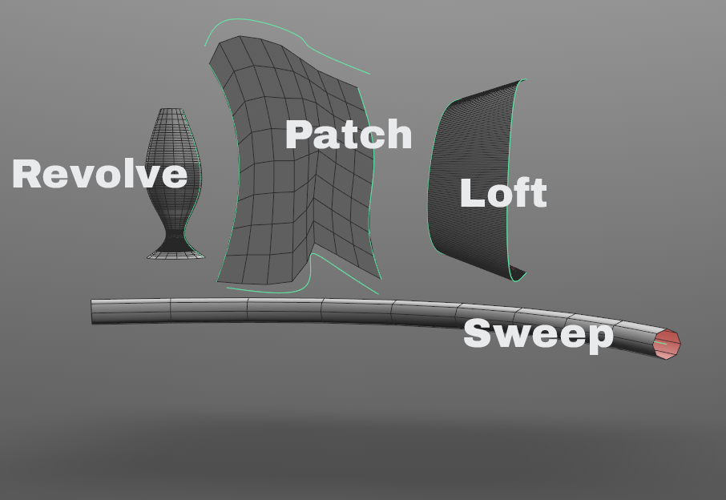
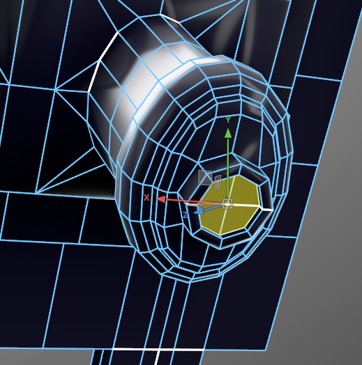
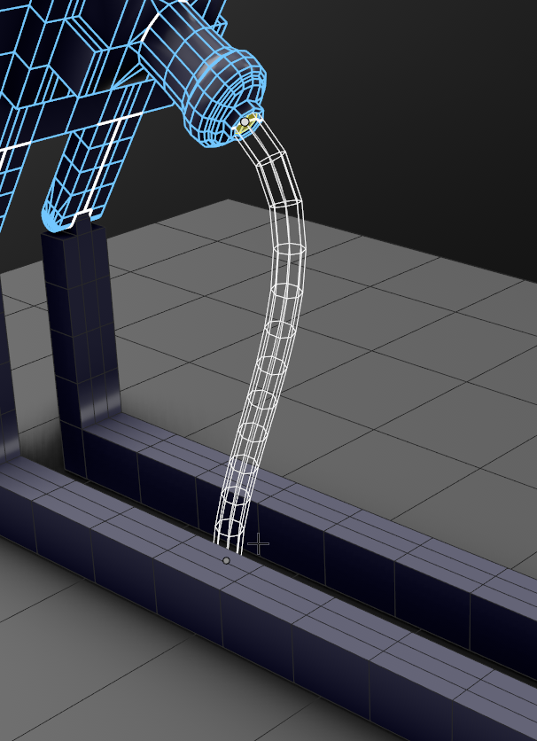
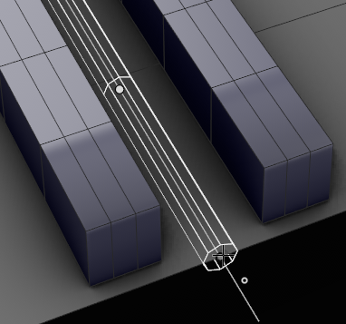
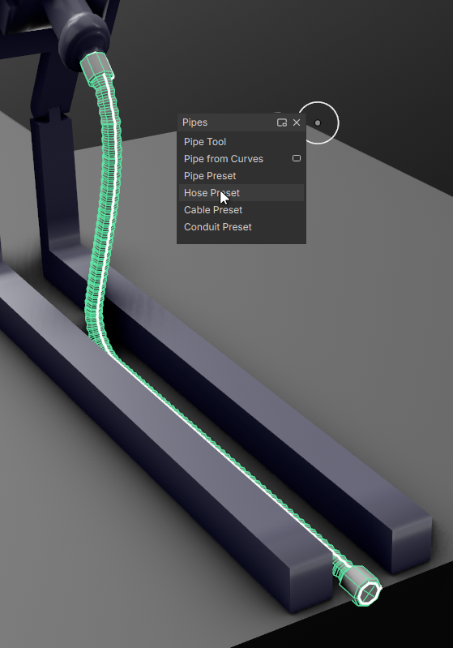
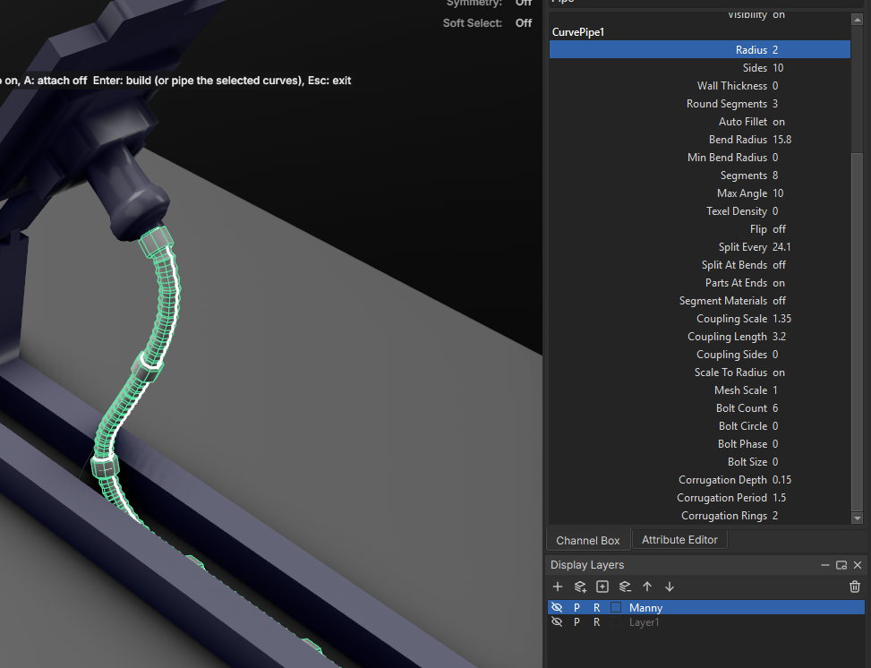

# Curves

Draw curves, then turn them into meshes with sweeps, revolves, lofts, patches and pipes. Everything lives in the **Curves** menu.

<!-- TODO image: a hard-surface prop built from curves (images/curves/overview.png) -->

## Hotkeys

| Key | While drawing |
| --- | --- |
| **X** | Snap to grid |
| **V** | Snap to vertices and curve points |
| **C** | Snap to edges and curves |
| **N** (hold) | Draw on a mesh surface |
| **L** | Lock to a plane |
| **S** | Draw on mesh surfaces (toggle) |
| **K** | Keep the drawn curve on the surface it was drawn on |
| **Ctrl+scroll** | Offset from the surface |
| **Z** / **Backspace** | Remove the last point |
| **Shift+Z** | Put it back |
| **Esc** | Exit |

> Grid snap (**X**) wins over surface placement.

## Make a mesh

| Command | Select | Result |
| --- | --- | --- |
| **Sweep** | A path, and optionally a profile curve | The profile (or a circle or rectangle) swept along the path |
| **Revolve** | A profile curve | The profile spun around an axis |
| **Loft** | Two or more curves, in order | A surface through each curve |
| **Patch Fill** | Four curves forming a closed boundary | A quad patch filling them |
| **Curve Network** | Crossing curves in two directions | A quad surface through all of them, each curve an edge loop |
| **Border Blend** | Two edge chains, on one mesh or two | A tangent-continuous strip between them |
| **Bevel Plus** | All the closed curves at once | A capped, bevelled solid; loops inside loops become holes |
| **Roof** | A closed footprint curve | A hip roof; holes become courtyards |
| **Contour** / **Section** | Meshes | Curves sliced from them |

> Results update live when you edit the curve. **Delete History** bakes it into a plain mesh.

<!-- TODO image: sweep, revolve and loft side by side (images/curves/surfaces.png) -->

## Pipes and hoses

To bring a pipe out of a mesh, select a face (circularize it first for a round start) before drawing. The pipe leaves its centre along its normal.

Then you can place the points for the pipe curve.

Consider using vertex, edge, and surface snapping to accurately place your curve points.

Apply a preset to your pipe to customize the look.

Adjust the look further with the parameters.

> To turn existing curves into pipes, with the pipe tool active, select them and press **Enter** without drawing.

| Key | In the Pipe Tool |
| --- | --- |
| **B**-drag or **Ctrl+scroll** | Radius of the next point, for pipes that change size |
| **+** / **-** | Sides |
| **P** | Cycle presets: pipe, hose, cable, conduit |
| **T** | Hollow wall on or off |
| **S** | Draw on surfaces |
| **F** | Start from the selected face or loop |
| **A** | Weld the pipe into the mesh (bakes it) |
| **Z** / **Backspace** | Remove the last point |
| **Shift+Z** | Put it back |

> After building, the Attribute Editor holds segments, couplings, flanges, bolt rings and hose corrugation.

## Along a curve

| Command | Select |
| --- | --- |
| **Deform Along Curve**, **Array Along Curve** | The meshes, then the curve. A second curve is the aim curve when Up Mode is Aim Curve. |
| **Flow Along Surface** | The meshes, then the surface. Select faces on the surface (one full rectangle of quads, no poles) to flow onto just those. |

- The mesh starts at the curve's start from its lowest point along the forward axis; its pivot sets how far it sits off the curve. Use **Roll** to turn it about the curve.
- Flow maps X to U and Z against V, with height measured from Y = 0 (**Height Base**).
- The mesh's position is recorded when the curve is connected: moving the mesh afterwards carries the result with it.
- Deformed array copies butt end to end and stretch to fill their slot. **Weld** only joins open pieces (trims, profiles).
- **Instances** output does not follow later curve edits and can't be combined with deformed copies.

## Planar curves

- **Booleans**: select the target first. Loops fill even-odd, so a letter's counter stays a hole. Inputs stay live; **Hide Inputs** hides them.
- **Bevel Plus** extrudes toward the curves' plane normal: up for ground curves, toward you for curves drawn in the front view. Crossing curves are bevelled as their even-odd union, with a warning.
- **Custom bevel profile**: draw it in the front view, x as inset and y as rise. It is stretched to fit width and depth.
- **Text** lies in the XY plane, first baseline at the origin. An unknown font falls back to Inter with a warning. Editing the text updates any bevel built on it.
- **SVG import** scale is cm per px after the viewBox. `<text>`, `<use>` and `<image>` are skipped with a warning; stroke-only shapes come in as open curves.
- **Roof** gables: gable edge *i* runs from footprint point *i* to *i*+1.
- **Inset Region** (Model menu) needs flat, connected faces.

## Blend and trim

| Key | In the Blend Curve Tool |
| --- | --- |
| Click near an end | Snap to that end (anywhere else picks a point along the curve) |
| Drag a dot | Bulge |
| **0**-**3** | Continuity of the nearest end: position, tangent, curvature, curvature rate |
| **F** | Flip the nearest end |
| **C** | Curvature comb |
| **Enter** | Build |

| Key | In the Trim Tool |
| --- | --- |
| Click | Delete the highlighted stretch |
| **E** | Extend instead |
| **M** | Extension shape: smooth, line, arc |
| **P** | Intersect as seen in the view, for curves that only cross on screen |

> Trim and extend cut against every visible curve. A curve that meets nothing is deleted when clicked.

## Cables

| Key | In the Cable Tool |
| --- | --- |
| Click | Place an anchor; click the first to close |
| **B**-drag or **Ctrl+scroll** | Slack (sag in depth mode) |
| **M** | Slack or sag depth |
| **+** / **-** or **Shift+scroll** | Cables per span |
| **R** | Reseed the bundle |
| **D** | Drape over the meshes the anchors are on |
| **P** | Pipe geometry |
| **[** / **]** | Pipe radius |
| **Enter** | Build; with nothing placed, cables the selected curves |

> A span running straight along gravity can't sag.

## Sketch constraints

| Key | In the Sketch Tool |
| --- | --- |
| **L** / **A** / **R** / **S** | Line, arc, circle, select |
| **C** / **H** / **V** | Coincident, horizontal, vertical |
| **P** / **Q** / **T** | Parallel, perpendicular, tangent |
| **E** / **O** / **M** | Equal, concentric, midpoint |
| **Y** / **K** / **N** / **F** | Symmetric, collinear, point on curve, fix |
| **D** / **Shift+D** | Dimension / horizontal distance |
| **I** | Auto constraints on or off (hold **Alt** to skip them for one click) |

- Symmetric takes the mirror line last; coincident moves the first pick onto the second.
- Double-click a dimension to type a value or expression (`d1*2`, `25mm`, `+=5`).
- Constraints work within one curve: **Combine** curves first.
- A conflicting constraint is refused, naming what it clashes with.

## Grooming

| Key | In Sculpt Curves |
| --- | --- |
| **1**-**0** | Brush |
| **B**-drag or **Ctrl+scroll** | Radius |
| **M**-drag or **Shift+scroll** | Strength |
| **Shift** / **Ctrl** | Smooth / invert for that stroke |

- Select a mesh with the curves and run **Groom Surface** to root them on it. Add and Density need one.
- Hair card UVs put the root at the top of its atlas cell.

## Unreal splines

**Send to Unreal** on a curve creates a spline actor in the outliner folder "Lila", resent on every save. Needs LilaLink 0.6.0. Landscape mode needs a landscape in the level; spline meshes need a mesh already sent to Unreal or an asset path.

## Troubleshooting

**The pipe shows a bend warning.** A corner is tighter than the pipe can bend. Raise the bend radius or smooth the path.

**A curve point won't select.** Switch to vertex mode with the curve selected.

**A network or border blend won't build.** The reason is in the node's **Warning** attribute. Network messages name curves by input slot (curve0, curve1, ...); every U curve must cross every V curve.

**A deform, array or flow modifier does nothing.** It has no curve or surface connected; the modifier stack shows why.

**A curve kept on a surface dips through it.** Only points and handles are projected. Add points there.

**Send to Unreal fails with a feature error.** Rebuild LilaLink (0.6.0 or later).
