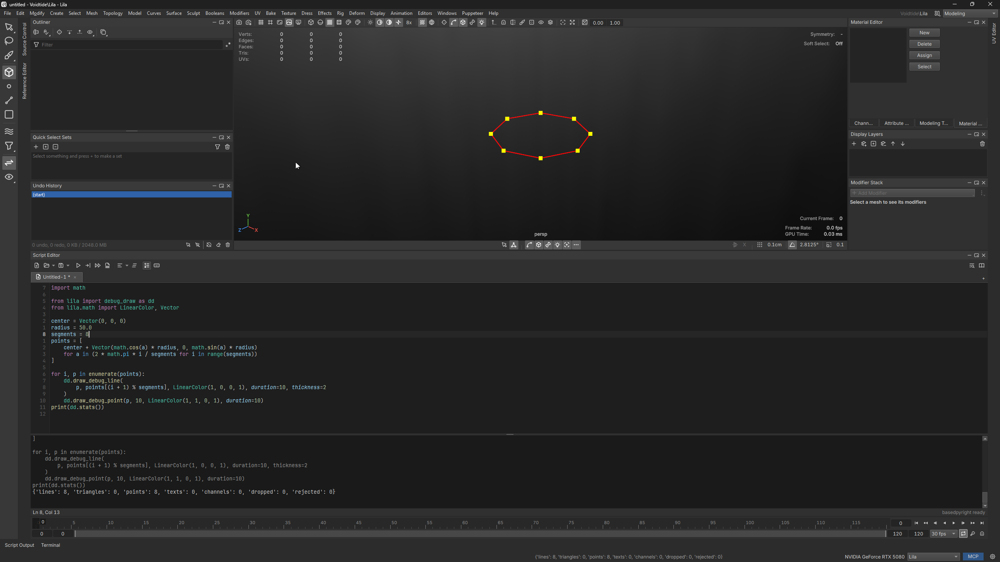

# Debug drawing

Draw lines, boxes, spheres, arrows and text in every viewport from a script or extension, like Unreal's `DrawDebugHelpers`.

> Available for Python (`lila.debug_draw`, the Kismet argument order in snake_case) and C++ (`#include <lila/DebugDraw.h>`, `lila::debugDraw`).

## Get it working

1. Open the script editor and run:

```python
from lila import debug_draw as dd
from lila.math import LinearColor, Rotator, Vector

dd.draw_debug_line((0, 0, 0), (0, 100, 0), LinearColor.RED, thickness=2)
dd.draw_debug_box(Vector(0, 50, 0), Vector(50, 50, 50), LinearColor.YELLOW, rotation=Rotator(yaw=45))
dd.draw_debug_sphere((100, 50, 0), 40)
dd.draw_debug_string((0, 120, 0), "spawn")
```

2. They show in every view and go after 5 seconds on their own.



Every draw has a `duration` in seconds. Leave it out for the default (5 s), or pass `0` for the next redraw only, which suits code that redraws on every change. A forgotten call can never leave anything behind.

Draws that stay need `persistent=True` and a channel. Clearing them is your job:

```python
ch = dd.channel("my_tool")
dd.draw_debug_lines(path_points, LinearColor.GREEN, persistent=True, channel=ch)
...
ch.clear()        # or ch.remove() when done with the channel for good
```

The same in C++, with the channel owned by your extension:

```cpp
#include <lila/DebugDraw.h>

namespace dd = lila::debugDraw;
dd::Channel ch = dd::channel(ctx, "paths");     // removed with what it holds when the extension unloads
dd::lines(points, false, {.color = lila::math::LinearColor::green(), .persistent = true, .channel = ch});
dd::sphere(center, 50.0, 16, {.duration = 0});  // the next redraw only
```

Lila clears every channel on **File > New** and **Open**, and **Show > Clear Debug Drawing** in the hotbox clears everything. **Show > Debug Drawing** hides it all without clearing.

Calls are safe from any thread, worker threads and Python threads included. In `lilabatch` they are kept and expire the same way, with nothing shown.

## Troubleshooting

**Nothing shows.** Check **Show > Debug Drawing** is on. Then look in the log for a `debug draw:` warning: NaN or infinite positions and anything over 10,000 km from the origin are dropped rather than drawn.

**`persistent draws need a channel`.** Pass `channel=dd.channel("name")` along with `persistent=True`.

**The oldest lines vanish, with an `over the limit` warning.** Something draws on every redraw without `duration=0`, or never clears its channel. Find it, or raise the limit (below).

**Thick lines look thin.** `thickness` is in pixels and capped at 32; the GPU may cap it lower.

**Points and text show through walls.** They always draw over every surface. Lines and boxes are depth tested unless `on_top=True`.

## Options

In the general prefs (`lila.prefs.set("general", key, value)`):

| Key | Default | What it does |
| --- | --- | --- |
| `/debugDraw/show` | `true` | Shows debug drawing in the views. |
| `/debugDraw/defaultDuration` | `5` | Seconds a draw lasts when it gives no duration. |
| `/debugDraw/maxDuration` | `3600` | Longest duration a draw that is not persistent may ask for. |
| `/debugDraw/maxPrimitives` | `1000000` | Lines and triangles kept at once; the oldest go first. |
| `/debugDraw/maxPoints` | `100000` | Points kept at once. |
| `/debugDraw/maxTexts` | `10000` | Strings kept at once. |

Segment counts are clamped to 3 to 256 and strings to 1024 bytes, with a warning.
