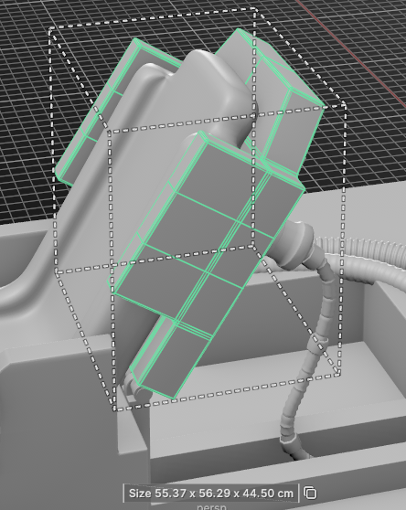
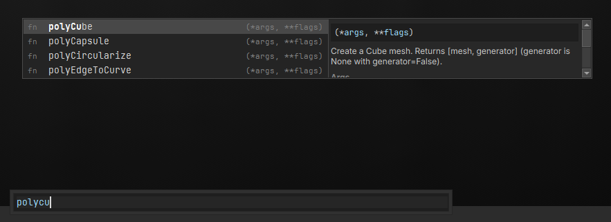
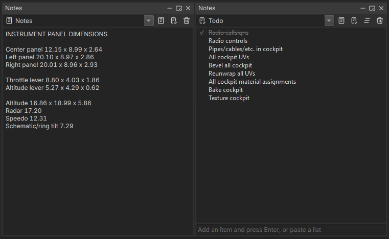
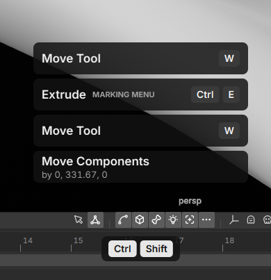
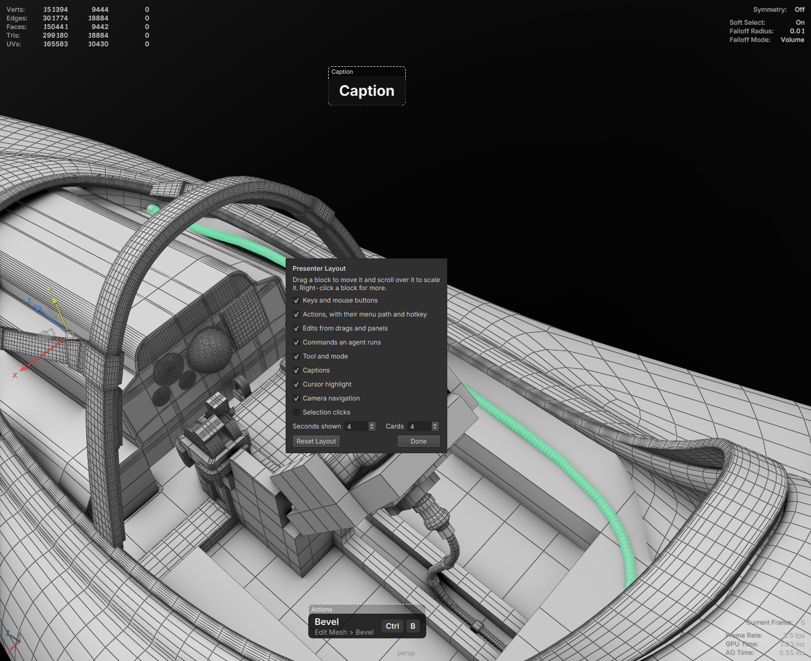

# Essentials

What everyone should know on day one.

## Reopen your last scene

Press **Enter** right after Lila opens to load the scene you last had open.

## Find any menu command

Press **Ctrl+T** and type. Every menu command is searchable, so you don't need to remember which menu it lives in.

- **Enter** runs the highlighted command.
- **Shift+Enter**, or clicking the square at the end of a row, opens the command's options.
- **Ctrl+F** switches to searching the scene.

## Hotkey cheat sheet

Hold **F1** to show every hotkey. Release it to close.

## Selection modes

| Press | To switch to |
| --- | --- |
| **Shift+\`** | Object mode |
| **Shift+1** | Vertex mode |
| **Shift+2** | Edge mode |
| **Shift+3** | Face mode |

## Floating shelf

Press **\`** (backtick) to show or hide the floating shelf near your cursor.

- **Ctrl+scroll wheel** changes the icon size.
- **Ctrl+middle-click** resets the icon size.

## Create a primitive in place

Hold **Tab** and right-click to create a primitive.

- With components selected, it's created on them straight away, centred on the selection and facing along its normal.
- Otherwise it follows your cursor, standing on whatever surface is under it. Left-click to drop it. Hold **Shift** to keep it upright instead of turning to the surface.
- While it follows the cursor, hold **B** and drag (as you would to change a brush size), or **Ctrl+scroll**, to scale it.
- **Esc** or right-click cancels.

When creating a primitive, lower **Fraction** to create only part of it.

## Snapping

Hold a key while moving to snap:

| Hold | To snap to |
| --- | --- |
| **N** | Surfaces |
| **X** | The grid |
| **V** | Vertices |
| **C** | Edges |

With **N**, objects turn to stand on the surface. Hold **Shift** as well to keep their orientation.

## Manipulator space

**W/E/R+LMB Marking Menu** picks the axes the manipulator uses. The dot marks the current one.

- **Component**: the selection's average normal; everything moves together.
- **Normal** (move only): each component moves along its own normal.

## Orient the pivot

**Modify > Orient Pivot** or **W/E+LMB Marking Menu**

Turns the object to aim along the components you select, in the order you pick them. The mesh stays where it is, so moving in **Object** space then works along the aim.

| Select | The object aims |
| --- | --- |
| Two components, or two separate groups such as two edge loops | From the first picked to the second |
| One face | Along its normal, with up along its longest edge |
| One edge | Along the edge, with up along its faces' normal |
| One closed loop | Through the loop, with up toward its first picked point |

Change the aim and up axes, what up follows, and where the pivot goes in the popup afterwards.

This also gets back a rotation that Freeze Transformations removed: select a cylinder's top and bottom loops, run Orient Pivot, then set Aim to Y.

In the popup, set **Mode** to:

- **Pivot**: turn only the object's pivot.
- **Manipulator**: pin the aim to the component manipulator. The object isn't changed.

## Pin the component pivot

**Modify > Pin Component Pivot** or **W/E+LMB Marking Menu**

Keeps the component manipulator's axes while you change the selection or switch between vertices, edges and faces. It follows the selection's centre until you move it with Edit Pivot (**D**), then stays there.

Set the axes first with Edit Pivot, or with Orient Pivot in **Manipulator** mode, which pins for you.

To stop, click **Pinned pivot ×** under the manipulator, or use **Modify > Reset Component Pivot**. Undo also works.

> **Coming from Maya?** Maya can't aim a pivot at a component or recover a frozen rotation without rotating the pivot by hand.

## Move the scene to the origin

**Modify > Scene Origin > Relocate Scene to Selection**

Select what should end up at 0,0,0 (the ground under a character, a building) and run it. The whole scene moves so the bottom centre of the selection lands on the world origin. Skin, deformers, constraints, IK, spaces and keys in every take move with it, so nothing changes shape or animates differently. It is one undo step.

Before anything changes, Lila checks that every node can follow. After the move it compares every transform and every deformed point, at several frames and in every take, with where it was. If anything is off by more than 0.00001 mm, the scene is put back as it was and the message names the node.

If it refuses:

- **May hold world-space data**: the scene has a node Lila can't move safely: Edge to Curve history, an extension node its extension doesn't describe, or a skeleton edit in progress. Finish the skeleton edit or delete the history, then run it again.
- **Object Info node ... reads ...'s world transform**: a geometry nodes group reads another object where it stands in the world, so moving both would change the result. Set that Object Info node's **Relative To** to **owner**, which reads the object against the mesh the group runs on.
- **Keyed on separate X, Y and Z curves**: with **Rotation** set, a root keyed on Euler curves can only turn about the outermost axis of its rotate order. Set **Rotation** to None, or convert its keys to a rotation curve (`convertRotationCurves`) first.
- **Links ... which moves, and ... which doesn't**: with **Only the selected hierarchies**, a skin, deformer or constraint ties something inside to something outside. Select both.
- **The parent is animated**: a hierarchy can only take a fixed move under a parent that stays still. Pick the top of the hierarchy.

Meshes and curves made by curve history (sweeps, lofts, revolves, pipes, hair cards) are rebuilt from their moved curves, so their own transforms stay where they are; anything parented under them is moved for them.

Poses saved in the scene move with their root. Poses in the workspace or user library keep their old root positions.

Options:

- **Move from**: the selection's bottom centre, its centre, its pivot, or the centre of the selected components.
- **To**: where that point lands instead of the origin.
- **Axes**: `xz` keeps every height.
- **Rotation**: **Yaw** turns the scene about the up axis so the selected object faces along the world axes; **Full** lines up its whole orientation.
- **Only the selected hierarchies**: move one character or asset instead of the whole scene.
- **Offset**: move by an exact amount instead.

In Python, `relocateScene(dryRun=True)` reports what would move without changing anything, and `from="Hero"` takes the point from an object's pivot.

### Display origin

**Modify > Scene Origin > Set Display Origin** draws the grid and world axes about the selection's bottom centre, and grid snapping (**X**) snaps to that grid, without moving anything. The HUD shows **Display Origin** while one is set. It is saved with the scene. The channel box and typed values still read world positions. **Clear Display Origin** puts the grid back.

## Measure

| Press | To |
| --- | --- |
| **Alt+M** | Measure the selection: distance, edge length, angle, circle, area or size, depending on what's selected. It shows in the viewport and is copied to the clipboard. |

Click the copy icon beside the measurement to copy it again; **Shift**+click copies every line.

For a measurement that stays in the scene, use **Display > Measure > Distance Tool**: click a start and an end point. Hold **V**, **C** or **X** while clicking to snap to vertices, edges or the grid. The Angle and Radius tools in the same menu work the same way.

## Duplicate as you go

| Press | To |
| --- | --- |
| Hold **Y** + drag a gizmo handle | Clone while moving, rotating or scaling |
| **Shift+D** | Make one more copy, stepped as far again as the last copy is from its source |

Clone once with Y, then keep pressing Shift+D to repeat the step. See [Duplicate and instance](duplicate.md) for instances and arrays.

## Symmetry

Symmetry in Lila stays exact across modeling, UVs, weights and joints.

> **Coming from Maya?** Maya's world and object symmetry pair vertices by position within a tolerance, so a vertex that drifts slightly off the axis stops matching and symmetry quietly breaks. Lila was built around symmetry from the start, so it doesn't drift.

### Radial symmetry

Pick **Radial** in the viewport toolbar's symmetry menu, or **Mesh > Symmetry Radial**. Edits, selections, sculpt and paint then repeat round the axis, **Radial Count** times. **Radial Mirror** also mirrors each wedge (rims, hubcaps, flowers).

- To start from scratch, model one wedge, then **Mesh > Symmetrize Radial**. It rebuilds the mesh exactly N-fold, welds the seams and turns radial symmetry on.
- UV edits on a radial mesh stack every wedge on one set of UVs. Turn symmetry off first to lay the wedges out separately.
- Weight paint, joints and the bake cage stay mirror-only.

**Points marked red after turning radial on.** They have no match in every wedge: the count doesn't fit the mesh. The warning names the count that fits best; use it, or run Symmetrize Radial.

## Filter the outliner

The box at the top of the outliner filters what it shows. It has a regex toggle and a clear button.

| Type | To |
| --- | --- |
| `arm*`, `joint_?`, `spine_0[1-3]` | Match with wildcards: `*` any run of characters, `?` one character, `[a-c]` one character from a range. |
| `arm leg` or `arm, leg` | Match any of several terms, separated by spaces or commas. |
| `!helper` | Exclude anything matching the term. |
| `type:mesh` | Show only that type. |
| `root\|spine` | Match against the full path. Any term containing `\|` does this. |

- Parents of matching items stay visible, dimmed, so you can see where each match sits.
- Clearing the filter restores whatever you had expanded before.
- Clicking the box selects its text, so you can type straight over it. **Esc** clears it.
- With the regex toggle on, a pattern that isn't valid shows everything rather than nothing.

> **Note:** There is no type dropdown. Typing `type:` is the only way to filter by type.

## Search the scene

Press **Ctrl+F** to search the scene for anything you'd find in the outliner. It opens the same window as Ctrl+T.

- **Enter** selects the highlighted item.
- **Shift+Enter** adds it to the selection.
- **Ctrl+Enter** toggles it in the selection.
- **Ctrl+T** switches to searching menus.

## Auto-Bevel

Lila brings many advanced modeling tools to the table including an auto-bevel that can select the appropriate edges for you.

<!-- todo image -->

## Collision from several boxes

Select a mesh and run **Mesh > Multi-Box Bounds**. Lila splits it into chunks that fit boxes and makes one `UCX_<mesh>_01`, `_02`... shape per chunk, parented under the mesh so Unreal pairs them as its collision. The command's result gives the box count, average fill (how much of each box the mesh occupies) and coverage (how much of the mesh sits inside a box).

If it needs more boxes than you have, raise **Max Boxes**; every point of the mesh stays inside some box, so a low limit gives looser boxes, not gaps. If the boxes are loose where you expect snug ones, raise **Resolution** or **Min Fill**. A thin or hollow part that comes out as one fat box wants a higher **Resolution** so the voxels are smaller than the wall. Open meshes and meshes built from overlapping shells are treated as solid.

**Oriented** gives each chunk its own tightest frame; off keeps boxes on the world axes. **Shape** defaults to `auto`, which uses a convex hull for chunks a box fits badly (a wedge); `box` forces boxes. Separate shells in a mesh (a bar sitting on a base) are kept as separate parts, so build parts as their own shells for the cleanest split; a single welded shell is split by voxels, which cannot isolate features thinner than a voxel unless you raise **Resolution**. **Padding** grows every shape. **Preview** returns the boxes without creating them.

## Split Mesh

Select a mesh and run **Mesh > Split Mesh Tool**. Drag a line across the mesh to place a cutting plane through it; the pieces preview in colours. Drag a plane's rim or centre to move it, Ctrl-drag it to turn it, and scroll over it to size its disc. Delete removes the selected plane, S adds planes where the joints of a skinned mesh meet, Enter cuts, Esc leaves without cutting. Ctrl+Z and Ctrl+Y step through plane edits before the scene's undo.

Planes mirror across the mesh's symmetry plane (its symmetry setting, or the object's X plane through the pivot), so the mesh need not be exactly symmetrical; a plane across the middle stays on it. X turns mirroring off and on. The pieces are new meshes beside the original, each hole capped.

A plane only cuts inside its disc, so a plane at the shoulder takes the arm off without slicing the legs below it. If two pieces still share a colour, the disc does not reach all the way round: scroll over the plane to widen it. Shells no plane touches, like eyes, join the nearest piece.

The option box (`splitMesh`) sets the remesh each piece gets: `none` keeps it exact, `quadRemesh`, `voxelRemesh` or `decimate` rebuilds it, and `pieceSettings` overrides that per piece.

## Spherize

Select vertices, edges or faces and run **Mesh > Shape > Spherize** (also in the Modeling Toolkit). The components move onto a sphere fitted to them and the viewport shows it: drag the disc to move the centre, the ring to change the radius, and the red, green and blue squares to stretch it into an ellipsoid. Enter accepts, Esc undoes the whole thing. Each drag is one undo step.

If the result is a lump, the fit had little to go on: with three or four points, or points nearly in one plane, Lila centres the sphere on their average instead. Set the centre by dragging, or pick **Around the Centroid**. If points shoot off to one side, check **Move Along Normals** is off; a point whose normal never reaches the sphere falls back to moving straight toward the centre.

**Amount** blends from the original shape to the sphere. **Radius** is picked from the points (average distance, the fitted radius, nearest or farthest point), or set outright with **Radius**. **Ellipsoid Scale** and **Ellipsoid Rotation** shape and turn the axes. **Move Along Normals** slides each point along its own normal onto the sphere, which keeps the surface from sliding sideways. Symmetry is respected like any other component edit.

## Auto UV

Lila has a high-end UV toolkit and the Auto UV feature can produce worthwhile results in some cases.

<!-- todo image -->

## Transfer UVs to a similar piece

Already UV'd one piece and have another like it? Select the UV'd piece, then the other, and run **Transfer Attributes** (Shift+RMB) with **Sample Space** set to **Guided**. The second piece gets the same seams and islands, laid out where the first one's are, so you UV once and reuse it.

The pieces don't need to match. They can sit anywhere, be rotated or mirrored (left and right parts), be longer or shorter, or have different topology.

- **Keep Island Shape** keeps each island exactly as copied. Turn it off to relax the islands to the new piece's shape.
- **Separate Unmatched Faces** puts faces the source doesn't have, such as a cap where the source is open, into their own island beside the layout. Turn it off to merge them into the island next to them.

> Maya requires identical topology, world position, or object position. Lila uses the source as a reference guide and generally produces a usable result.

<!-- todo image -->

## Command palette

Press **Ctrl+\`** to open the command palette. Type part of any menu item or command name and press **Enter** to run the top match, or **Up**/**Down** to pick another. Type Python and it runs instead; there's nothing to import, commands are available by name. **Shift+Enter** always runs the text as Python.

<!-- todo image: replace with the palette showing matches -->

## Script editor

The script editor has completion, signature help, auto-format, inline docs and relative line numbers, so you shouldn't need an external IDE.

- **Ctrl+Enter** runs the selection, or the whole tab. **Ctrl+Shift+Enter** runs the `# %%` cell under the cursor.
- **Ctrl+click** a command or press **F1** on it to open its reference.
- **Ctrl+Alt+L** formats the selection or the tab with ruff. **Ctrl+Alt+O** sorts imports.
- To format automatically on save, paste, typing or focus loss, turn it on in **Preferences > Scripting**. A `ruff.toml`, `.ruff.toml` or `pyproject.toml` beside the script or above it overrides the style set there.

### Where scripts are saved

The arrow on **Save** picks where a script lives:

| Location | Saved in | Use it for |
| --- | --- | --- |
| Scene | The scene file | Scripts that belong to one scene. |
| Project | `<workspace>/.lila/scripts` | Scripts shared by everyone on the project. |
| File | Anywhere on disk | Scripts kept in your own folders or source control. |
| Global | Your user prefs | Your own tools, in every project. |

The arrow on **Open** lists the scene, project and global scripts. Before a scene runs its own scripts on open, Lila asks first; change this in **Preferences > Scripting**.

### Batch run

**Batch Run** on the script editor toolbar runs a script over many scene files in background workers.

- Pick files, folders or globs (`D:/art/*.lila`, `props/**`), then narrow them by extension, include and exclude globs, or a name prefix, suffix or substring.
- In the script, `ctx.results["key"] = value` adds a column to the results, which the export button saves as CSV. `ctx.skip("reason")` skips a file.
- Choose to not save, save in place or save as a copy with a suffix and format, in an output folder that can mirror the source folders.
- **Preview** lists the files, where each one saves and whether it can be written, without running anything. Read-only files are checked out through source control. Presets save the settings for reuse, and **Retry Failed** reruns the files that failed.

## Naming conventions

Set naming rules in **Preferences > Naming**, and Lila either warns when a name breaks them or fixes it for you. This keeps scenes tidy across a studio or a large team.

## Notes and todo lists

**Windows > General Editors > Notes** keeps notes and todo lists in the scene file, so they travel with it. Make as many as you like with the buttons at the top, and edit the name in the dropdown to rename one.

- Paste a list from anywhere into a todo list with **Ctrl+V**: each line becomes an item, bullets are dropped, and `[x]` lines come in ticked.
- **Ctrl+C** copies the selected items back out as lines.
- Double-click an item to edit it, drag to reorder, and **Delete** removes it.

## Presenter mode for streams and tutorials

The **Presenter Mode** button at the right end of the viewport's bottom bar shows viewers what you're doing:

- the keys and mouse buttons you press, and Alt navigation
- each action you run, with its menu path and its hotkey
- edits from drags and panels, and commands an agent runs
- the current tool and mode
- a highlight around the cursor

Typing into text fields is never shown. Use **Presenter Caption...** from the command palette to put a line of text on screen, such as what you're about to do.

The button beside it, **Edit Presenter Layout**, lets you drag each block where you want it, scroll over a block to scale it, and pick which elements show. Turn it off again and the presenter ignores the mouse.

The presenter draws in its own windows over Lila, so capture the display in OBS rather than only the Lila window.

## AI agents

Lila supports AI agents through MCP and skills. Agents drive the same commands you do, so anything you can do from the command palette - almost everything - an agent can too.
