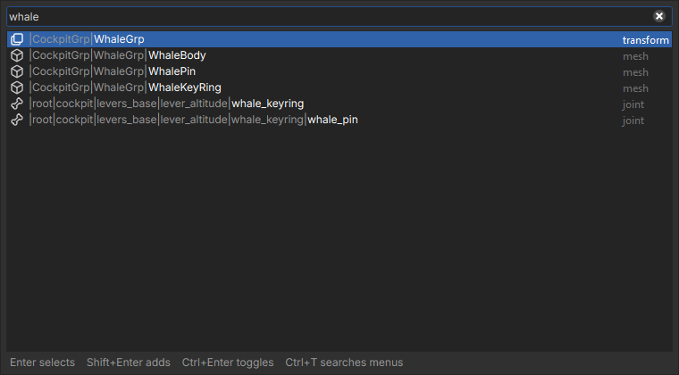
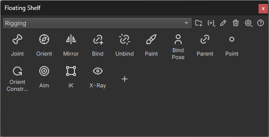
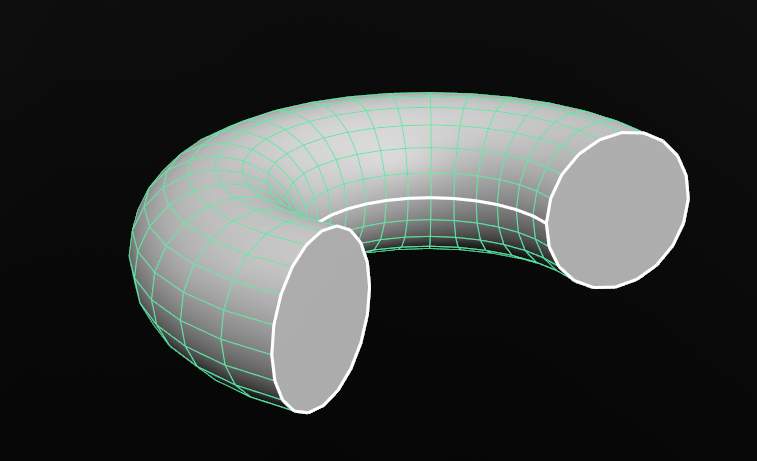
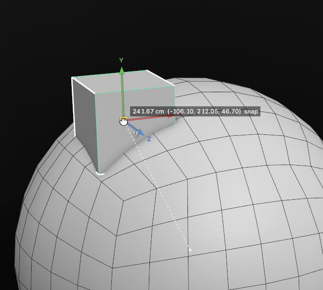

# Essentials

What everyone should know on day one.

## Find any menu command

Press **Ctrl+T** and type. Every menu command is searchable, so you don't need to remember which menu it lives in.

- **Enter** runs the highlighted command.
- **Shift+Enter**, or clicking the square at the end of a row, opens the command's options.
- **Ctrl+F** switches to searching the scene.

## Search the scene

Press **Ctrl+F** to search the scene for anything you'd find in the outliner. It opens the same window as Ctrl+T.

- **Enter** selects the highlighted item.
- **Shift+Enter** adds it to the selection.
- **Ctrl+Enter** toggles it in the selection.
- **Ctrl+T** switches to searching menus.

## Hotkey cheat sheet

Hold **F1** to show every hotkey. Release it to close.

## Selection modes

| Press | To switch to |
| --- | --- |
| **Shift+\`** | Object mode |
| **Shift+1** | Vertex mode |
| **Shift+2** | Edge mode |
| **Shift+3** | Face mode |

## Floating shelf

Press **\`** (backtick) to show or hide the floating shelf near your cursor.

- **Ctrl+scroll wheel** changes the icon size.
- **Ctrl+middle-click** resets the icon size.

## Create a primitive in place

Hold **Tab** and right-click to create a primitive, then left-click to place it.

- In object mode, it snaps to the surface you click.
- In vertex, edge or face mode, it snaps to your current component selection.

When creating a primitive, lower **Fraction** to create only part of it.

## Snapping

Hold a key while moving to snap:

| Hold | To snap to |
| --- | --- |
| **N** | Surfaces |
| **X** | The grid |
| **V** | Vertices |
| **C** | Edges |

## Filter the outliner

The box at the top of the outliner filters what it shows. It has a regex toggle and a clear button.

| Type | To |
| --- | --- |
| `arm*`, `joint_?`, `spine_0[1-3]` | Match with wildcards: `*` any run of characters, `?` one character, `[a-c]` one character from a range. |
| `arm leg` or `arm, leg` | Match any of several terms, separated by spaces or commas. |
| `!helper` | Exclude anything matching the term. |
| `type:mesh` | Show only that type. |
| `root\|spine` | Match against the full path. Any term containing `\|` does this. |

- Parents of matching items stay visible, dimmed, so you can see where each match sits.
- Clearing the filter restores whatever you had expanded before.
- Clicking the box selects its text, so you can type straight over it. **Esc** clears it.
- With the regex toggle on, a pattern that isn't valid shows everything rather than nothing.

> **Note:** There is no type dropdown. Typing `type:` is the only way to filter by type.
