# Essentials

What everyone should know on day one.

## Reopen your last scene

Press **Enter** or **Space** right after Lila opens to load the scene you last had open.

## Find any menu command

Press **Ctrl+T** and type. Every menu command is searchable.

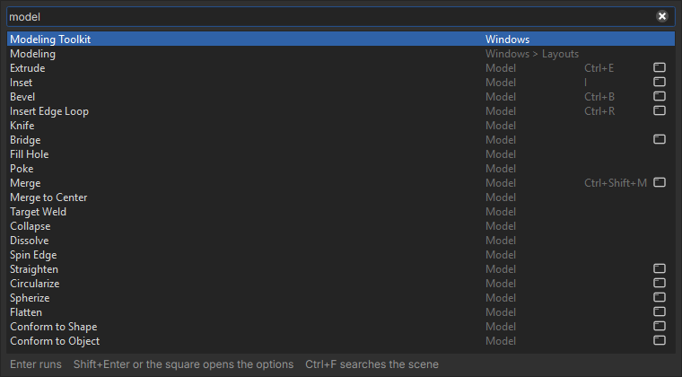

- **Enter** runs the highlighted command.
- **Shift+Enter**, or clicking the square at the end of a row, opens the command's options.
- **Ctrl+F** switches to searching the scene, **Shift+T** to [tearing off a menu](#tear-off-a-menu-as-a-palette).

## Name objects in an option box

Fields that take a mesh, curve, joint or other object have a dropdown of the scene's matches, an eyedropper that takes the mesh you click in a viewport, and a button that loads the selection. Also:

- Middle-drag objects from the Outliner onto the field.
- In a field that takes several, **Shift**-click the load button to add the selection. The eyedropper adds or removes each mesh you click until **Esc** or right-click.
- Empty, a field showing *Selected mesh* uses the selection. Middle-click a field to empty it.
- A warning icon means a name isn't in the scene or isn't the right kind. Hover it to see which.

<!-- TODO image: Stitch options with the Surfaces field's dropdown open (images/essentials/node-picker.png) -->

## Save option box presets

**Save Preset...** on an option box's **...** menu keeps its values under a name in the **Preset** menu at the top of the box. **Save Project Preset...** keeps them in the project's `.lila` folder instead, so everyone working in the project gets them.

- To share one, send the file from **... > Show Presets Folder**; the other artist uses **... > Import Preset...**.
- Fields that name scene objects aren't saved.
- Commands that take `preset=` from Python, like `quadRemesh`, accept a saved preset's name.
- For a whole studio, see [Studio setup](studio-setup.md#studio-shelves).

## Type math in number fields

Every number field, Channel Box and Attribute Editor value takes arithmetic, applied on **Enter** or when you click away:

- `*=3` triples the value. `+=`, `-=` and `/=` work the same way.
- `2048/4`, `(1+2)*4` or `sqrt(2)*10` set the result. `pi`, `round()`, `floor()`, `ceil()`, `abs()` and `sin()`/`cos()`/`tan()` in degrees work too.

Text that isn't a number leaves the value as it was.

## Hotkey cheat sheet

Hold **F1** to show every hotkey. Release it to close.

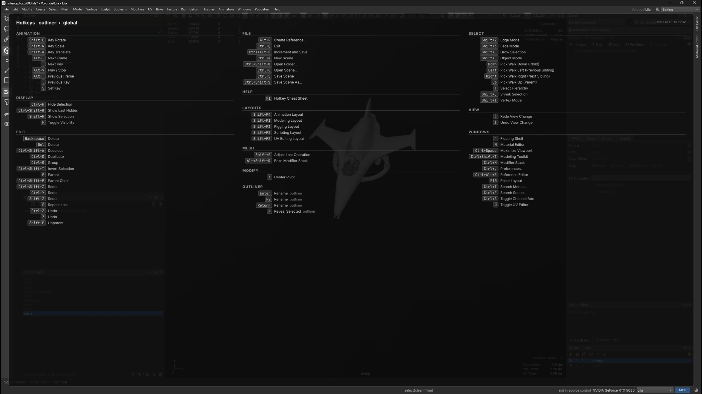

## Selection modes

| Press | To switch to |
| --- | --- |
| **Shift+\`** | Object mode |
| **Shift+1** | Vertex mode |
| **Shift+2** | Edge mode |
| **Shift+3** | Face mode |

## Frame under the cursor

| Press | To |
| --- | --- |
| **F** | Frame the selection |
| **A** | Frame everything |
| **Alt+F** | Centre the view on the surface under the cursor, keeping the zoom |

## Camera bookmarks

| Press | To |
| --- | --- |
| **Ctrl+Shift+1** to **9** | Save the view in that slot |
| **Alt+Shift+1** to **9** | Jump back to it (**[** undoes the jump) |

Each camera has its own slots, including persp and each ortho view, and they save with the scene. Space, then click **Lila**, lists them too.

## Smooth the camera

The view follows your mouse directly, with no easing. To glide instead, raise **Look smoothing** (turning: tumble and the Drone Camera's mouse look) or **Move smoothing** (travel and zoom) in **Preferences > Viewport > Camera**, or Shift-click the drone button on the viewport bar; 0.3 to 0.5 is gentle. The view eases toward where you navigate at the display's refresh rate, while picking and tools use the camera as you moved it.

## Drone Camera

Fly through large scenes with Unreal's viewport controls. Turn it on with the drone button on the viewport bar or **Display > Drone Camera**. It has no hotkey until you bind one in **Edit > Hotkey Editor**: tap the key to toggle, or hold it to fly until you let go. While it's on, nothing in the scene can be edited. Its keys show in the corner of the view while it's on.

| Press | To |
| --- | --- |
| **W A S D**, arrows or number pad | Move |
| **E** / **Q**, or **Space** / **Ctrl** with the right button held | Rise / fall |
| **Z** / **C** (hold) | Zoom in / out |
| **R** | Faster (right drag + wheel also changes speed) |
| **F** | Frame the selection; slower while right dragging |
| Right drag | Look around |
| Left drag | Move along the ground and turn |
| Middle drag, or left + right | Pan |
| Wheel | Move forward or back |
| **Esc**, or **×** on the banner | Leave |

Alt with the mouse still tumbles, tracks and dollies. The whole flight is one camera undo step, so **[** goes back to where you started. Orthographic and look-through views switch to perspective when you start flying.

## Hide the selection highlight

**Overlays > Highlight Selection** in the viewport header turns off the selection highlight, so you can see the mesh change while you adjust a modifier or attribute.

## Floating shelf

Press **\`** (backtick) to show or hide the floating shelf near your cursor.

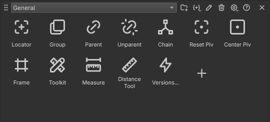

- **Ctrl+scroll wheel** changes the icon size.
- **Ctrl+middle-click** resets the icon size.

## Create a primitive in place

Hold **Tab** and right-click to create a primitive.

- With components selected, it's created on them straight away, centred on the selection and facing along its normal.
- Otherwise it follows your cursor, standing on whatever surface is under it. Left-click to drop it. Hold **Shift** to keep it upright instead of turning to the surface.
- While it follows the cursor, hold **B** and drag (as you would to change a brush size), or **Ctrl+scroll**, to scale it.
- **Esc** or right-click cancels.

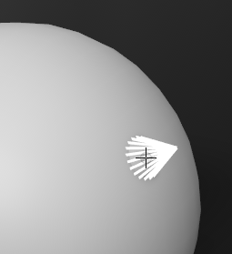

When creating a primitive, lower **Fraction** to create only part of it.

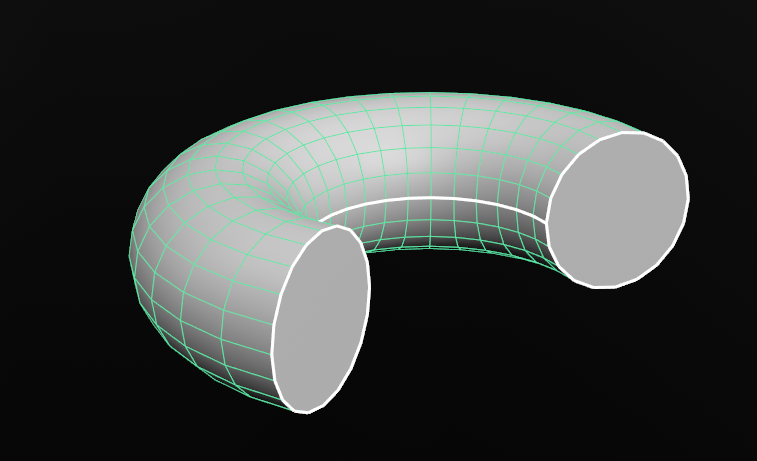

## Tear off a menu as a palette

Press **Shift+T** and type part of a menu or section name. Press **Enter** and the palette appears under your cursor; click to drop it where you want it. **Esc** or right-click puts it back.

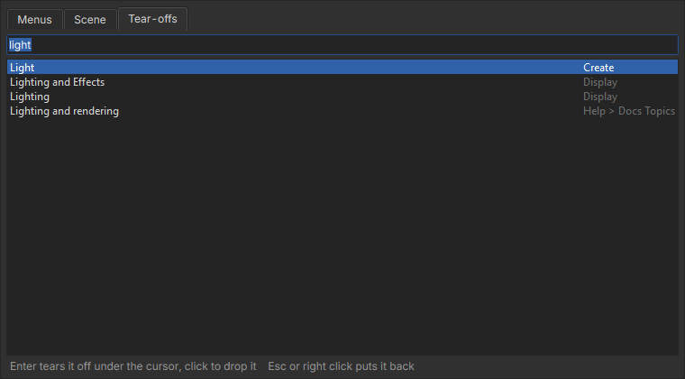

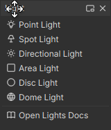

Or click the dashed line at the top of any menu to tear it off where it is (a section title tears off only that section).

> Drag items from any create-based menu, like paint from a palette.

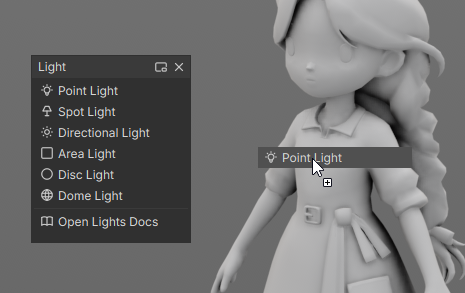

## Build your own menu

**Windows > Menu Editor** builds menus from any actions, Python or commands. Put one on the menu bar, or inside any menu as a submenu or a titled section. Press **Save** and it appears straight away, tears off like Lila's own, and **Shift+T** finds it.

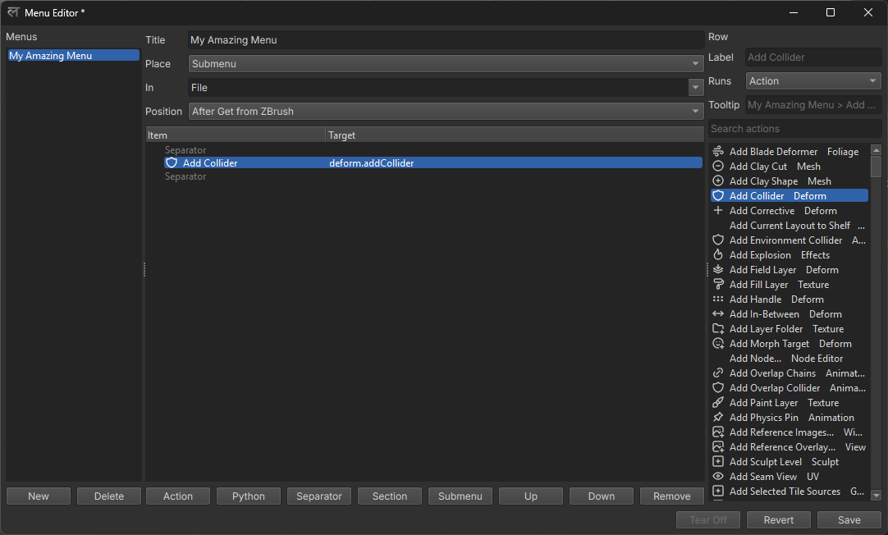

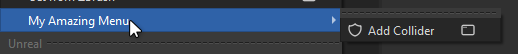

Double-click an action in the list to add it. A row with its own label, Python or a command becomes an action under **User Menus**, so the Hotkey Editor can bind it.

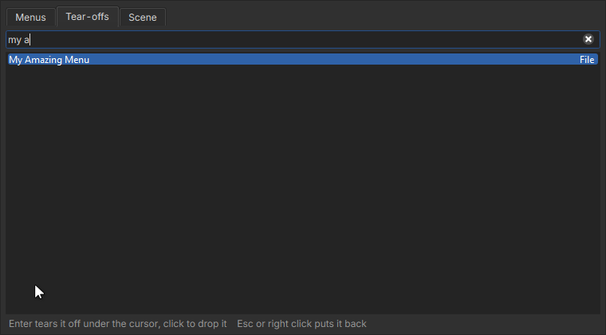

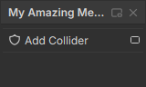

From a script:

```python
setUserMenu(menu={"title": "Kit", "parent": "Mesh", "as": "section", "items": [{"action": "mesh.bevel"}, {"action": {"python": "print('hi')"}, "label": "Say Hi"}]})
```

Menus are saved in `userMenus.json` in your prefs folder (**Help > Open Prefs Folder**).

## Snapping

Hold a key while moving to snap:

| Hold | To snap to |
| --- | --- |
| **N** | Surfaces |
| **X** | The grid |
| **V** | Vertices |
| **C** | Edges |

With **N**, objects turn to stand on the surface. Hold **Shift** as well to keep their orientation.

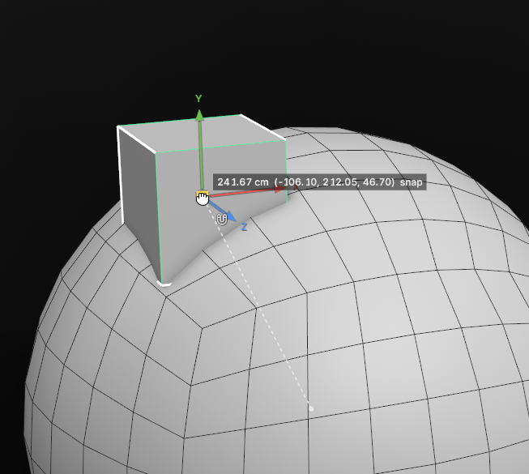

## Manipulator space

**W/E/R+LMB Marking Menu** picks the axes the manipulator uses. The dot marks the current one.

- **Component**: the selection's average normal; everything moves together.
- **Normal** (move only): each component moves along its own normal.

## Find unfrozen transforms

**Modify > Find Unfrozen Transforms**

Lists the selected objects, and everything under them, whose translate, rotate or scale isn't 0, 0, 0 and 1, 1, 1. With nothing selected, it checks every mesh, curve and group in the scene. Run it before export to catch anything left unfrozen.

- Click a row to select that object. The list stays as it is, so step through it with the arrow keys and press **F** to frame each one.
- **Rotate step** counts rotations on that increment as frozen; the steps match rotate snapping. At 90°, only objects turned by something other than quarter turns stay listed. **Invert** lists only the ones on the step.
- Dimmed values are channels that didn't put the object on the list.
- **Freeze** freezes the selected rows, and they drop off the list.

Objects missing from the list: joints, cameras, lights and locators are left out of the scene check, since their transforms place them. Select them to check them. Values within 0.0001 of identity count as frozen.

From Python: `unfrozenTransforms(scene=True, translate=False, rotateStep=90)`.

## Match pivots

**Modify > Match Pivot**, **Match Pivot Position** or **Match Pivot Orientation**, or **Match Piv** on the Modeling shelf

Select the object to copy from first, then the ones to change. Their pivots take its world position, its axes, or both. The objects don't move.

## Orient the pivot

**Modify > Orient Pivot** or **W/E+LMB Marking Menu**

Turns the object to aim along the components you select, in the order you pick them. The mesh stays where it is, so moving in **Object** space then works along the aim.

| Select | The object aims |
| --- | --- |
| Two components, or two separate groups such as two edge loops | From the first picked to the second |
| One face | Along its normal, with up along its longest edge |
| One edge | Along the edge, with up along its faces' normal |
| One closed loop | Through the loop, with up toward its first picked point |
| One curve point | Along the curve, with up along its normal |
| Two or more objects, in Object mode | Like the first one: the others take its pivot axes and position |

With a group selected, picking components on a mesh inside it turns the group instead of the mesh.

Change the aim and up axes, what up follows, and where the pivot goes in the popup afterwards.

This also gets back a rotation that Freeze Transformations removed: select a cylinder's top and bottom loops, run Orient Pivot, then set Aim to Y.

In the popup, set **Mode** to:

- **Pivot**: turn only the object's pivot.
- **Manipulator**: pin the aim to the component manipulator. The object isn't changed.

## Pin the component pivot

**Modify > Pin Component Pivot** or **W/E+LMB Marking Menu**

Keeps the component manipulator's axes while you change the selection or switch between vertices, edges and faces. It follows the selection's centre until you move it with Edit Pivot (**D**), then stays there.

Set the axes first with Edit Pivot, or with Orient Pivot in **Manipulator** mode, which pins for you.

To stop, click **Pinned pivot ×** under the manipulator, or use **Modify > Reset Component Pivot**. Undo also works.

> **Coming from Maya?** Maya can't aim a pivot at a component or recover a frozen rotation without rotating the pivot by hand.

## Measure

| Press | To |
| --- | --- |
| **Alt+M** | Measure the selection: distance, edge length, angle, circle, area or size, depending on what's selected. It shows in the viewport and is copied to the clipboard. |

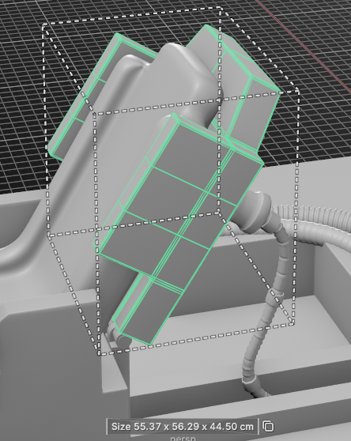

Click the copy icon beside the measurement to copy it again; **Shift**+click copies every line.

For a measurement that stays in the scene, use **Display > Measure > Distance Tool**: click a start and an end point. Hold **V**, **C** or **X** while clicking to snap to vertices, edges or the grid. The Angle and Radius tools in the same menu work the same way.

## Duplicate as you go

| Press | To |
| --- | --- |
| Hold **Y** + drag a gizmo handle | Clone while moving, rotating or scaling |
| **Shift+D** | Make one more copy, stepped as far again as the last copy is from its source |

See [Duplicate and instance](duplicate.md) for instances and arrays.

## Symmetry

Symmetry in Lila stays exact across modeling, UVs, weights and joints. **Shift+X** toggles it on the selected meshes.

> **Coming from Maya?** Maya's world and object symmetry pair vertices by position within a tolerance, so a vertex that drifts slightly off the axis stops matching and symmetry quietly breaks. Lila's doesn't drift.

### Radial symmetry

Pick **Radial** from the arrow on the viewport header's **Symmetry** button, or **Mesh > Symmetry Radial**. Edits, selections, sculpt and paint then repeat round the axis, **Radial Count** times. **Radial Mirror** also mirrors each wedge (rims, hubcaps, flowers).

- Or model one wedge, then **Mesh > Symmetrize Radial**. It rebuilds the mesh exactly N-fold, welds the seams and turns radial symmetry on.
- UV edits on a radial mesh stack every wedge on one set of UVs. Turn symmetry off first to lay the wedges out separately.
- Weight paint, joints and the bake cage stay mirror-only.

**Points marked red after turning radial on.** They have no match in every wedge: the count doesn't fit the mesh. The warning names the count that fits best; use it, or run Symmetrize Radial.

## Filter the outliner

The box at the top of the outliner filters what it shows.

| Type | To |
| --- | --- |
| `arm*`, `joint_?`, `spine_0[1-3]` | Match with wildcards: `*` any run of characters, `?` one character, `[a-c]` one character from a range. |
| `arm leg` or `arm, leg` | Match any of several terms, separated by spaces or commas. |
| `!helper` | Exclude anything matching the term. |
| `type:mesh` | Show only that type. |
| `root\|spine` | Match against the full path. Any term containing `\|` does this. |

- Parents of matching items stay visible, dimmed.
- Clearing the filter restores whatever you had expanded before.
- **Esc** clears it.
- With the regex toggle on, a pattern that isn't valid shows everything rather than nothing.

## Search the scene

Press **Ctrl+F** to search the scene for anything you'd find in the outliner. It opens the same window as Ctrl+T.

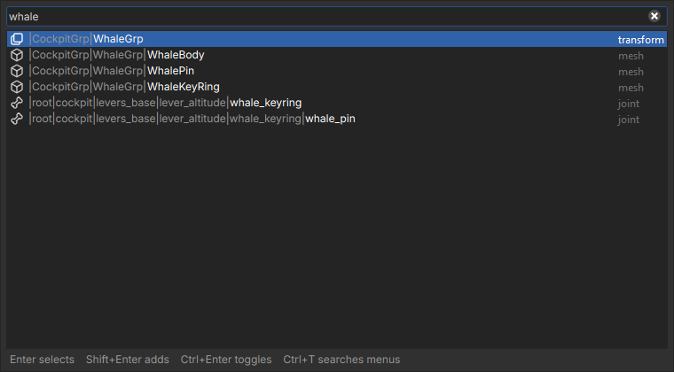

- **Enter** selects the highlighted item.
- **Shift+Enter** adds it to the selection.
- **Ctrl+Enter** toggles it in the selection.
- **Ctrl+T** switches to searching menus.

## Advanced Modeling Tools

<!-- todo images - model toolkit too? -->

### Auto-Bevel

**Modifiers > Auto Bevel**

A live bevel that picks the edges for you: folds sharper than **Min Angle**, filtered by side (outside, inside or both), length and thickness.

- **Edit Edges** shows the input mesh with the picked edges selected; add or remove edges with normal selection, then **Apply**.
- **Show Edges** keeps the picked edges highlighted when the modifier isn't selected.
- **Complete Corners** adds the loops that join folds meeting at an angle.

**The bevel is narrower than Offset.** **Clamp** shrinks the whole bevel so no face runs out of room; the modifier's status shows the offset it used. The picked edges are coloured by how much they hold it back: red edges set the offset, blue ones leave it alone. Remove the red edges with **Edit Edges**, or turn off **Clamp**.

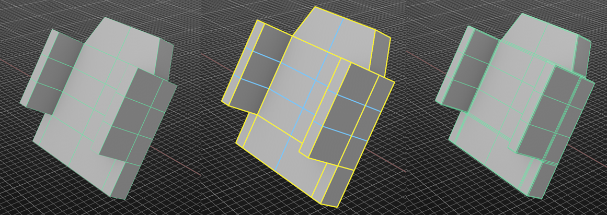

### Split Rings

**Model > Split Rings** or **Shift+RMB Marking Menu**

Subdivides one way only: adds edge loops without the cross cuts a full subdivide makes. Select edges to split every ring through them, or faces (or a whole mesh in object mode) to split them in one direction.

To add loops around a band, select its faces all the way round, such as the front face of a ring. With **Direction** on **Across**, the new loops follow the band.

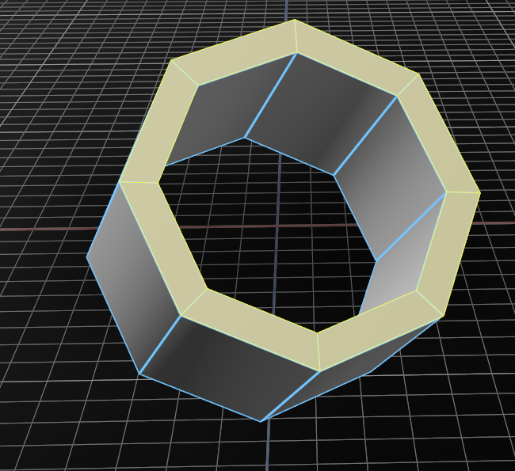

- **Count** sets the loops per ring, evenly spaced.
- **Direction** picks the way across faces: **Across** cuts the selection's short way, **Along** the long way.
- **Edge Flow** curves the new loops to follow the surface instead of lying flat.
- **Make Non-Destructive** turns it into a Split Rings modifier you can change later.

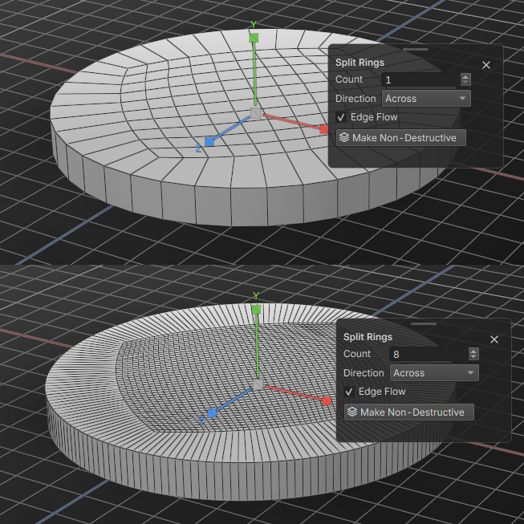

### Grid Fill

**Model > Grid Fill** or **Shift+RMB Marking Menu**

Turns a triangle fan, such as a cylinder cap, into clean quads: a grid in the middle, joined to the border by a ring of quads. Select the fan's centre vertex, or the faces to rebuild. With edges selected, it fills the holes they border the same way.

- **Grid Size** sets how much of the hole the grid takes; at 1 there's no ring.
- **Rotate** turns the grid's corners round the border.
- An odd number of border edges leaves one triangle in the ring.

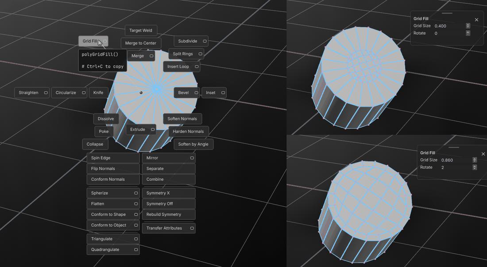

### Spherize

**Model > Spherize** or **Shift+RMB Marking Menu**

Pushes the selected components, or whole meshes in object mode, onto a sphere fitted to them.

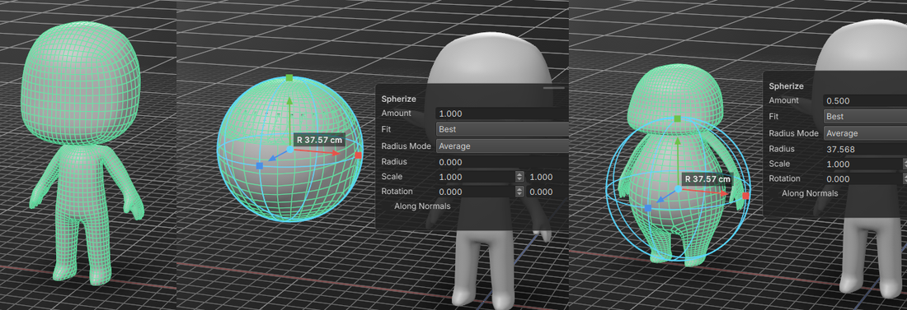

- Afterwards the sphere stays in the viewport: drag the ring to change the radius, the axis squares to stretch it into an ellipsoid, or the centre to move it. **Enter** accepts, **Esc** undoes.
- **Amount** below 1 moves part of the way, which rounds a shape out without losing it. Soft selection fades it further.
- **Along Normals** slides each point along its own normal instead of straight toward the centre.

### Circularize

**Model > Circularize** or **Shift+RMB Marking Menu**

Fits the selected edge loops, vertices, or the border of a face region to a circle. The faces inside follow, so a patch of quads comes out round. An open chain becomes an arc between its ends.

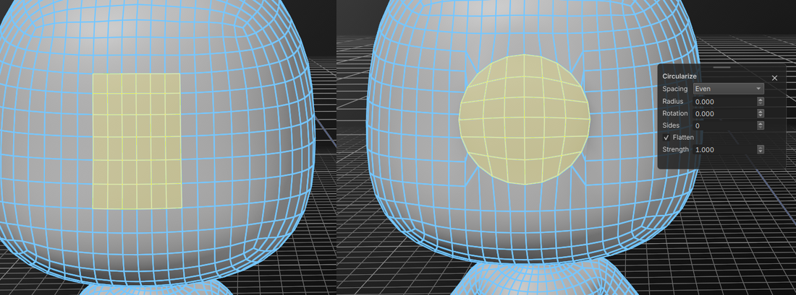

- **Spacing**: **Even** spaces the points equally round the circle, **Keep** keeps their spacing along the loop, **Project** moves each one straight out to it.
- **Radius** 0 keeps the loop's average radius.
- **Sides** of 3 or more makes a regular polygon instead.
- **Flatten** off keeps each point's height off the circle's plane, so it stays on a curved surface.

## Auto UV

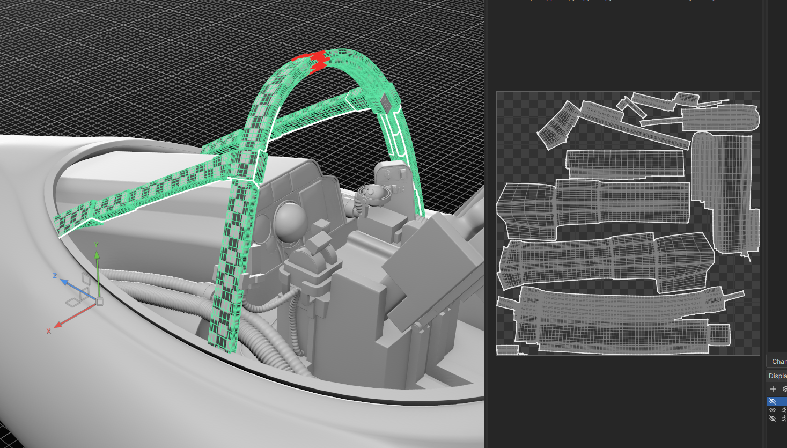

To keep seams out of sight, such as away from a first person camera or a character's face, use **UV > Add Seam View**. It drops a locator where the camera is; move it and run Auto UV again. Its **Seam View** attribute sets how hard seams avoid it, and a negative value draws them towards it instead. Add as many as you need.

For a fixed side or top view, use **UV > Add Seam Plane** instead: a plane facing the camera that sees along its axis from its own side, like an orthographic camera. An orthographic camera works the same way when picked as a view.

To make one view win over everything else, pick it in the **Seam View** row at the top of the UV Toolkit (or use **UV > Override Seam Views with Selected**). Auto UV, Auto Seams and Hose UVs then hide seams from that view alone, whatever their options say. While an override is set, the row turns into a warning naming it, their option boxes show the same warning with **Use Views** and **Views** disabled, and each run shows a toast. Click the row's **x** or use **UV > Clear Seam View Override** to go back to the options.

## Hose UVs

Select pipes, hoses, cables or rings and click **Hose** in the UV Editor's **Project** section (or **UV > Hose UVs**). Each tube becomes one straight strip with its seam along the least seen side, round ends become circles, and ring fittings get one cut across and one along. It reads the quad topology, so anything swept from a curve qualifies, whatever tool made it.

To say where the object is seen from, open the options and pick **Views**: a camera, a seam view locator or a plane (any mesh, seen along its normal like an orthographic camera). Seams along the tubes and cuts across long runs both move out of their sight. With none picked, every seam view in the scene counts.

- **Max Aspect** cuts runs longer than this many times their circumference, where least seen. 0 never cuts.
- **Max Length** cuts by length in cm instead.

Faces that are neither tube nor flat end, such as triangulated tubes or junction blobs, get Auto UV seams; the log says how many.

<!-- todo image -->

## UVs under modifiers

On a mesh whose modifiers move its surface, such as **Auto Bevel** or **Subdivision**, Unwrap, Relax, Optimize, Pack, Texel Density and the UV Editor's distortion display all work on the mesh as it exports. The UV Editor still shows and edits the base mesh's UVs. Changing a modifier later (bevel width, subdivision levels) doesn't touch the UVs; run Relax again, and bake lint points you there when it finds the result collapsed.

Subdivision's **UVs** setting, **Fit Surface** by default, spreads each island's UVs evenly over the smoothed surface so rounded bevels don't squeeze into slivers; an island corner on a straight UV edge bulges out slightly. **Blend** smooths UVs like the points and leaves slivers at island corners.

If bake lint still reports collapsed triangles, they are almost always at an island corner where a seam meets bevelled edges. Try these in order, checking bake lint after each:

1. Run **Optimize** on the mesh.
2. In the UV Editor, open up the reported corner of the island so its angle matches the surface, then run **Optimize** again.
3. Move the seam so it runs along a bevelled edge instead of ending at the bevelled corner.
4. On the **Auto Bevel** modifier, use **Edit Edges** to take that corner's edge out of the bevel.
5. **UV > Unwrap Exported Mesh** applies the modifiers and unwraps the result, so nothing collapses. The modifiers are gone afterwards; undo brings them back.

In scripts, `finalMesh=False` makes a UV command work on the base mesh alone: `uvOptimize(finalMesh=False)`.

Bake lint checks UVs as you work: hard edges off seams, collapsed, overlapping, folded and uneven islands, each one selectable from the Baker. See [UVs](uvs.md).

## Transfer UVs to a similar piece

Select the UV'd piece, then the other, and run **Transfer Attributes** (Shift+RMB) with **Sample Space** set to **Guided**. The second piece gets the same seams and islands, laid out where the first one's are.

The pieces don't need to match. They can sit anywhere, be rotated or mirrored (left and right parts), be longer or shorter, or have different topology.

- **Keep Island Shape** keeps each island exactly as copied. Turn it off to relax the islands to the new piece's shape.
- **Separate Unmatched Faces** puts faces the source doesn't have, such as a cap where the source is open, into their own island beside the layout. Turn it off to merge them into the island next to them.

Where the shapes differ a lot, the log says how many faces matched poorly. Seams there follow creases and hidden edges more than the source's; where the match is good, they stay where the source has them.

> Maya requires identical topology, world position, or object position.

<!-- todo image -->

## Drop textures onto a material

Drag image files from Explorer or Lila's file browser into the Material Editor.

- **Several files** anywhere in the editor: each goes to the slot its name ends with, such as `_BaseColor`, `_D`, `_Normal`, `_N`, `_Roughness`, `_Metallic`, `_AO`, `_Emissive`, or `_ORM`, `_ARM`, `_CRM` and `_MRO` for packed maps. Number suffixes like `_1` are ignored. Files whose names match no slot are listed in the log.
- **One file** on a slot: it goes in that slot, whatever its name.

Pasted paths can keep the quotes from Windows' **Copy as path**; Lila removes them.

## Texture colour space

Each texture's row in the Material Editor has a colour space next to wrap and filter. **Auto** reads base colour and emissive maps as sRGB and every other map as linear. Set **sRGB** or **Linear** when a file was saved the other way: a mask painted in sRGB, or a base colour stored linear. EXR and HDR files are always linear.

A file with an embedded colour profile other than sRGB, such as Adobe RGB or Display P3, is converted to sRGB as it loads. Unreal, glTF, USD and MaterialX exports carry the setting: glTF fixes each slot's encoding, so a map stored the other way is re-encoded as it's written.

If a colour texture looks washed out or too saturated compared with Photoshop, the file was probably saved in Adobe RGB with its profile stripped. Photoshop marks such a file's colour space as uncalibrated, and no app can tell what it was. In Photoshop, use **Edit > Convert to Profile > sRGB** and save it with the profile embedded.

## Command palette

Press **Ctrl+\`** to open the command palette. Type part of any menu item or command name and press **Enter** to run the top match, or **Up**/**Down** to pick another. Type Python and it runs instead; there's nothing to import, commands are available by name. **Shift+Enter** always runs the text as Python.

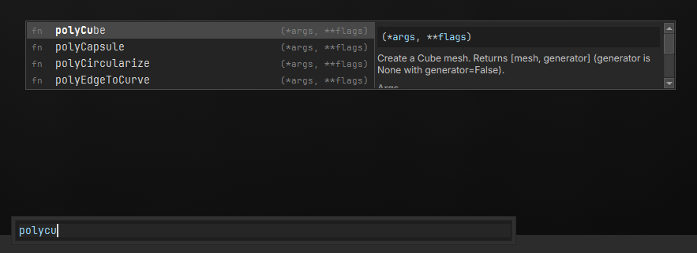

<!-- todo image: replace with the palette showing matches -->

## Script editor

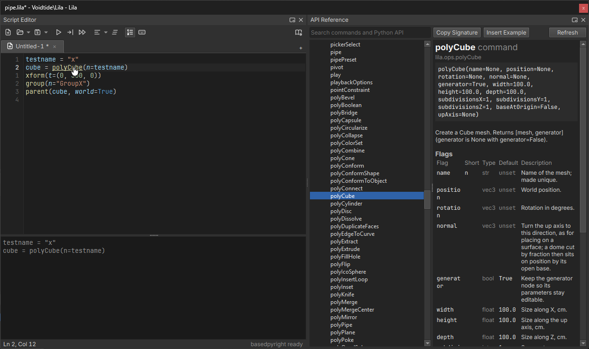

- **Ctrl+Enter** runs the selection, or the whole tab. **Ctrl+Shift+Enter** runs the `# %%` cell under the cursor.
- **Ctrl+click** a command or press **F1** on it to open its reference.
- **Ctrl+Alt+L** formats the selection or the tab with ruff. **Ctrl+Alt+O** sorts imports.
- To format automatically on save, paste, typing or focus loss, turn it on in **Preferences > Scripting**. A `ruff.toml`, `.ruff.toml` or `pyproject.toml` beside the script or above it overrides the style set there.

### Where scripts are saved

The arrow on **Save** picks where a script lives:

| Location | Saved in | Use it for |
| --- | --- | --- |
| Scene | The scene file | Scripts that belong to one scene. |
| Project | `<workspace>/.lila/scripts` | Scripts shared by everyone on the project. |
| File | Anywhere on disk | Scripts kept in your own folders or source control. |
| Global | Your user prefs | Your own tools, in every project. |

The arrow on **Open** lists the scene, project and global scripts. Before a scene runs its own scripts on open, Lila asks first; change this in **Preferences > Scripting**.

### Batch run

**Batch Run** on the script editor toolbar runs a script over many scene files in background workers.

- Pick files, folders or globs (`D:/art/*.lila`, `props/**`), then narrow them by extension, include and exclude globs, or a name prefix, suffix or substring.
- In the script, `ctx.results["key"] = value` adds a column to the results, which the export button saves as CSV. `ctx.skip("reason")` skips a file.
- Choose to not save, save in place or save as a copy with a suffix and format, in an output folder that can mirror the source folders.
- **Preview** lists the files, where each one saves and whether it can be written, without running anything. Read-only files are checked out through source control. Presets save the settings for reuse, and **Retry Failed** reruns the files that failed.

## Naming conventions

Set naming rules in **Preferences > Naming**, and Lila either warns when a name breaks them or fixes it for you.

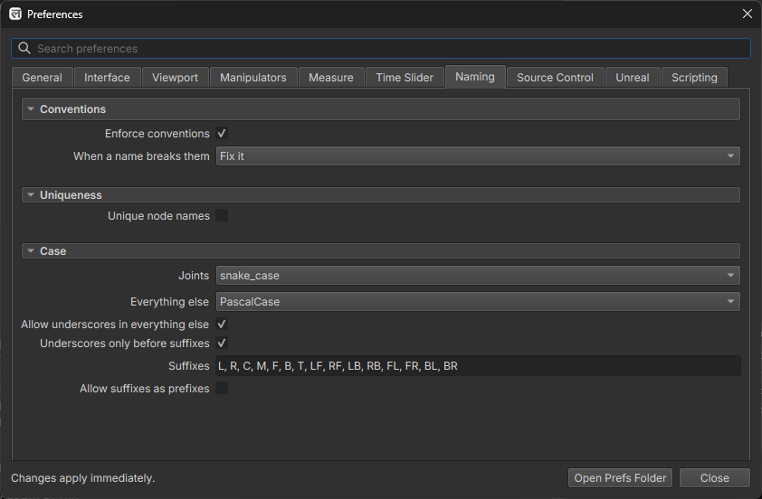

## Notes and todo lists

**Windows > Editors > Scene > Notes** keeps notes and todo lists in the scene file. Edit the name in the dropdown to rename one.

- Paste a list from anywhere into a todo list with **Ctrl+V**: each line becomes an item, bullets are dropped, and `[x]` lines come in ticked.
- **Ctrl+C** copies the selected items back out as lines.
- Double-click an item to edit it, drag to reorder, and **Delete** removes it.

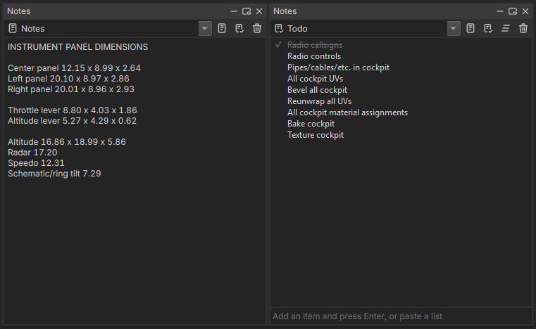

## Presenter mode for streams and tutorials

The **Presenter Mode** button on the viewport header shows viewers what you're doing:

- the keys and mouse buttons you press, and Alt navigation
- each action you run, with its menu path and its hotkey
- edits from drags and panels, and commands an agent runs
- the current tool, as an icon above the caption
- a highlight around the cursor

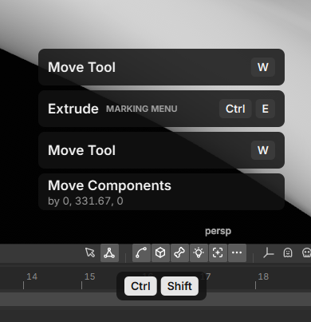

Typing into text fields is never shown. Use **Presenter Caption...** from the command palette to put a line of text on screen, such as what you're about to do.

The button beside it, **Edit Presenter Layout**, lets you drag each block where you want it (it snaps to a grid; hold Ctrl to place it freely or Shift to keep it on one axis), scroll over a block to scale it, and pick which elements show. Turn it off again and the presenter ignores the mouse.

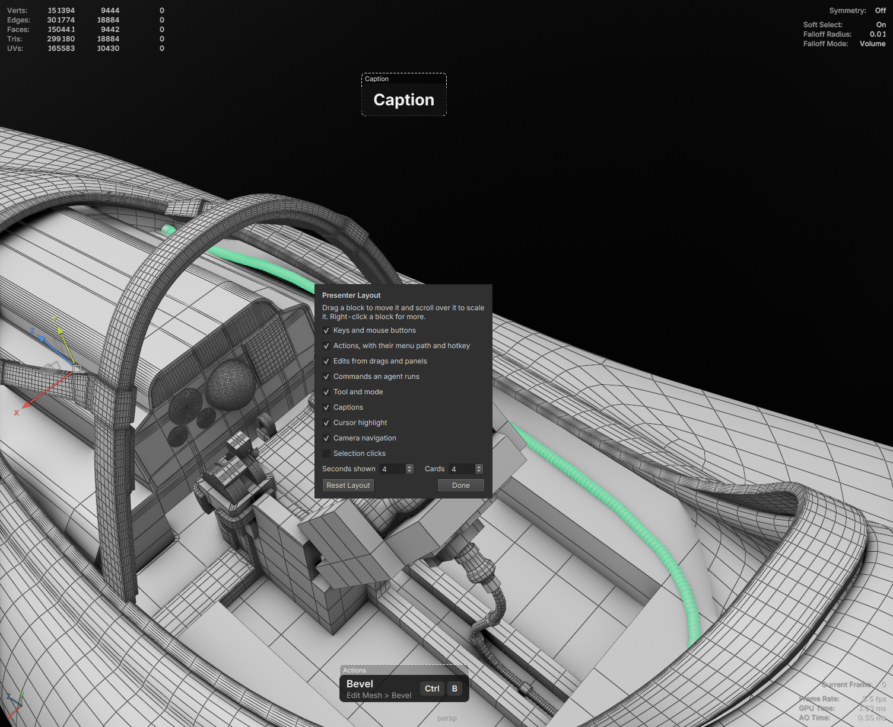

The presenter draws in its own windows over Lila, so capture the display in OBS rather than only the Lila window.

## AI agents

Lila supports AI agents through MCP and skills. Agents drive the same commands you do: ask for a geometry node setup, a material graph, a terrain or a town and the agent builds it with Lila's nodes and tools.

1. Open your project's folder in Lila (**File > Open Folder**), or a folder inside it such as a `Lila` subfolder of an Unreal project.
2. Run **Help > Set Up Agent Integration...** and click **Set Up**. It writes `.mcp.json`, a Lila section in `CLAUDE.md` and `AGENTS.md`, and Lila's skills in `.claude/skills`, to the project root: the nearest folder with `.git` or a `.uproject`.
3. Start Claude Code anywhere in the project, from any terminal, and approve the `lila` server when asked. Lila must be running.

**The `lila` tools are missing.** Lila isn't running, its MCP server is off (the MCP button in the status bar), or the server wasn't approved: run `/mcp` in Claude Code.
