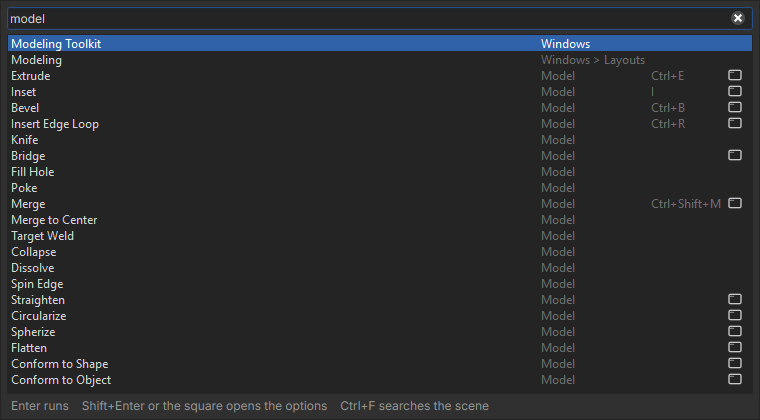
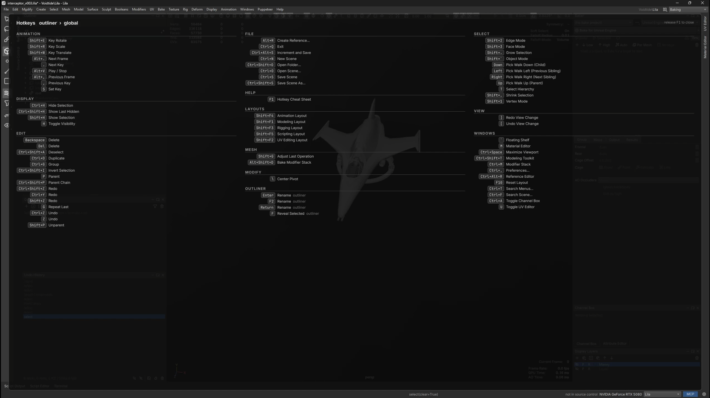
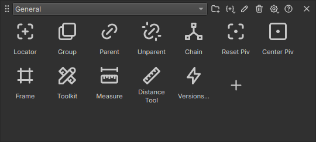
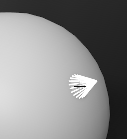
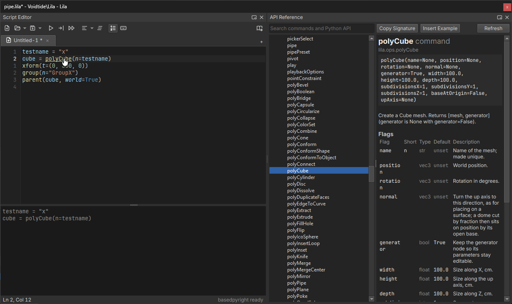
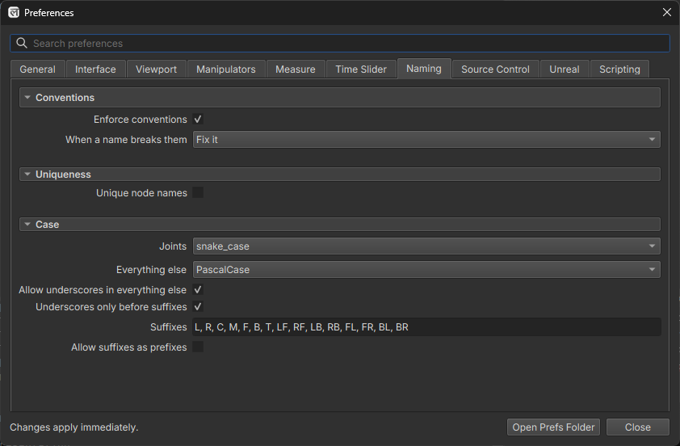

# Essentials

What everyone should know on day one.

## Find any menu command

Press **Ctrl+T** and type. Every menu command is searchable, so you don't need to remember which menu it lives in.

- **Enter** runs the highlighted command.
- **Shift+Enter**, or clicking the square at the end of a row, opens the command's options.
- **Ctrl+F** switches to searching the scene.

## Hotkey cheat sheet

Hold **F1** to show every hotkey. Release it to close.

## Selection modes

| Press | To switch to |
| --- | --- |
| **Shift+\`** | Object mode |
| **Shift+1** | Vertex mode |
| **Shift+2** | Edge mode |
| **Shift+3** | Face mode |

## Floating shelf

Press **\`** (backtick) to show or hide the floating shelf near your cursor.

- **Ctrl+scroll wheel** changes the icon size.
- **Ctrl+middle-click** resets the icon size.

## Create a primitive in place

Hold **Tab** and right-click to create a primitive, then left-click to place it.

- In object mode, it snaps to the surface you click.
- In vertex, edge or face mode, it snaps to your current component selection.

When creating a primitive, lower **Fraction** to create only part of it.

## Snapping

Hold a key while moving to snap:

| Hold | To snap to |
| --- | --- |
| **N** | Surfaces |
| **X** | The grid |
| **V** | Vertices |
| **C** | Edges |

## Symmetry

Symmetry in Lila stays exact across modeling, UVs, weights and joints.

> **Coming from Maya?** Maya's world and object symmetry pair vertices by position within a tolerance, so a vertex that drifts slightly off the axis stops matching and symmetry quietly breaks. Lila was built around symmetry from the start, so it doesn't drift.

### Radial symmetry

Pick **Radial** in the viewport toolbar's symmetry menu, or **Mesh > Symmetry Radial**. Edits, selections, sculpt and paint then repeat round the axis, **Radial Count** times. **Radial Mirror** also mirrors each wedge (rims, hubcaps, flowers).

- To start from scratch, model one wedge, then **Mesh > Symmetrize Radial**. It rebuilds the mesh exactly N-fold, welds the seams and turns radial symmetry on.
- UV edits on a radial mesh stack every wedge on one set of UVs. Turn symmetry off first to lay the wedges out separately.
- Weight paint, joints and the bake cage stay mirror-only.

**Points marked red after turning radial on.** They have no match in every wedge: the count doesn't fit the mesh. The warning names the count that fits best; use it, or run Symmetrize Radial.

## Filter the outliner

The box at the top of the outliner filters what it shows. It has a regex toggle and a clear button.

| Type | To |
| --- | --- |
| `arm*`, `joint_?`, `spine_0[1-3]` | Match with wildcards: `*` any run of characters, `?` one character, `[a-c]` one character from a range. |
| `arm leg` or `arm, leg` | Match any of several terms, separated by spaces or commas. |
| `!helper` | Exclude anything matching the term. |
| `type:mesh` | Show only that type. |
| `root\|spine` | Match against the full path. Any term containing `\|` does this. |

- Parents of matching items stay visible, dimmed, so you can see where each match sits.
- Clearing the filter restores whatever you had expanded before.
- Clicking the box selects its text, so you can type straight over it. **Esc** clears it.
- With the regex toggle on, a pattern that isn't valid shows everything rather than nothing.

> **Note:** There is no type dropdown. Typing `type:` is the only way to filter by type.

## Search the scene

Press **Ctrl+F** to search the scene for anything you'd find in the outliner. It opens the same window as Ctrl+T.

- **Enter** selects the highlighted item.
- **Shift+Enter** adds it to the selection.
- **Ctrl+Enter** toggles it in the selection.
- **Ctrl+T** switches to searching menus.

## Auto-Bevel

Lila brings many advanced modeling tools to the table including an auto-bevel that can select the appropriate edges for you.

<!-- todo image -->

## Auto UV

Lila has a high-end UV toolkit and the Auto UV feature can produce worthwhile results in some cases.

<!-- todo image -->

## Auto-UV

## Command line

Press **Ctrl+\`** to pop up a command line and type Python straight in. There's nothing to import: commands are available by name.

## Script editor

The script editor has completion, signature help, auto-format, inline docs and relative line numbers, so you shouldn't need an external IDE.

- **Ctrl+Enter** runs the selection, or the whole tab. **Ctrl+Shift+Enter** runs the `# %%` cell under the cursor.
- **Ctrl+click** a command or press **F1** on it to open its reference.
- **Ctrl+Alt+L** formats the selection or the tab with ruff. **Ctrl+Alt+O** sorts imports.
- To format automatically on save, paste, typing or focus loss, turn it on in **Preferences > Scripting**. A `ruff.toml`, `.ruff.toml` or `pyproject.toml` beside the script or above it overrides the style set there.

### Where scripts are saved

The arrow on **Save** picks where a script lives:

| Location | Saved in | Use it for |
| --- | --- | --- |
| Scene | The scene file | Scripts that belong to one scene. |
| Project | `<workspace>/.lila/scripts` | Scripts shared by everyone on the project. |
| File | Anywhere on disk | Scripts kept in your own folders or source control. |
| Global | Your user prefs | Your own tools, in every project. |

The arrow on **Open** lists the scene, project and global scripts. Before a scene runs its own scripts on open, Lila asks first; change this in **Preferences > Scripting**.

### Batch run

**Batch Run** on the script editor toolbar runs a script over many scene files in background workers.

- Pick files, folders or globs (`D:/art/*.lila`, `props/**`), then narrow them by extension, include and exclude globs, or a name prefix, suffix or substring.
- In the script, `ctx.results["key"] = value` adds a column to the results, which the export button saves as CSV. `ctx.skip("reason")` skips a file.
- Choose to not save, save in place or save as a copy with a suffix and format, in an output folder that can mirror the source folders.
- **Preview** lists the files, where each one saves and whether it can be written, without running anything. Read-only files are checked out through source control. Presets save the settings for reuse, and **Retry Failed** reruns the files that failed.

## Naming conventions

Set naming rules in **Preferences > Naming**, and Lila either warns when a name breaks them or fixes it for you. This keeps scenes tidy across a studio or a large team.

## AI agents

Lila supports AI agents through MCP and skills. Agents drive the same commands you do, so anything you can do from the command line - almost everything - an agent can too.
