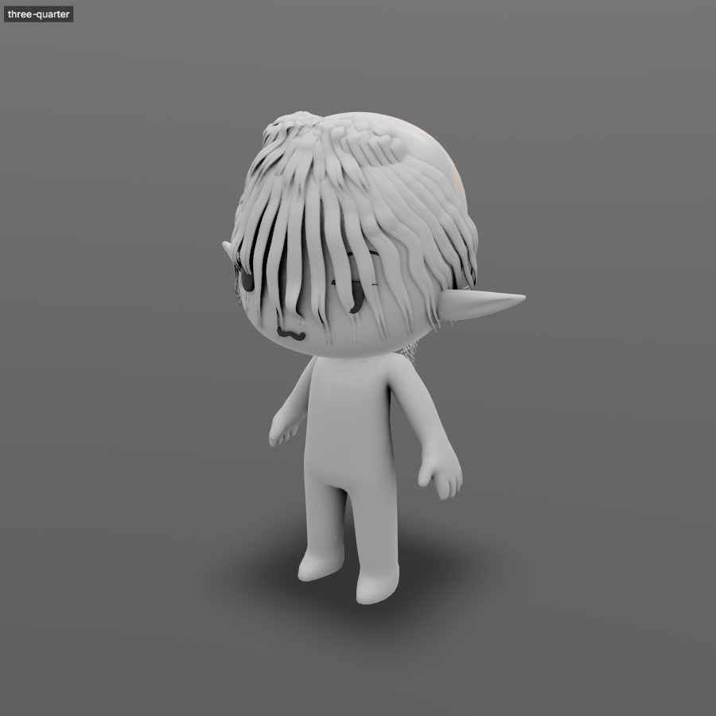

# Hair

Stylized hair drawn as locks on a head, styled with sliders, settled onto the scalp and joined into one mesh for retopology.

For realistic hair and fur grown as thousands of strands, use [Groom strands](groom-strands.md) instead.



## Get it working

1. Select the head mesh and run **Curves > Groom > New Groom**. You get `HairGroom` (which keeps the guides), `HairGuides` (the curves that show them, which you draw and brush) and `HairLocks` (the mesh). Guides mirror across X.
2. Run **Curves > Groom > Draw Hair** and drag on the head from where the lock grows. Past the edge of the head the stroke carries on at that depth, so you can draw a lock falling off it. Pen pressure sets the width along the lock.
3. Run **Curves > Groom > Groom Brushes** and brush the guides: **Comb** drags them, **Smooth** relaxes kinks, **Lift** stands them up, **Place** adds guides where you click or drag. Each stroke shows live and undoes in one step.
4. Add looks from **Curves > Groom > Style**: **Split** for chunks of chunks, then **Clump**, **Curl**, **Wave**, **Frizz**, **Noise**, **Length**, **Cut** or **Flyaways**. Each one appears in the **Groom** section of the Attribute Editor with its settings, where you also turn it off, reorder or remove it.
5. Run **Curves > Groom > Settle Hair** to drop the locks onto the scalp and onto each other under gravity.
6. Run **Curves > Groom > Hair Shell** for `HairShell`: one closed mesh over every lock. Set **Quads** in its option box to get the quad remeshed shell too, ready for retopology.

For a quick start, pick a look from **Apply Preset...** in the **Groom** section instead of building the stack by hand.

```python
g = createGroom("head", width=7.0)
groomDraw(g["groom"], points=[[0, 135, 0], [10, 125, 5], [20, 105, 10]])
split = groomAddStyle(g["groom"], style="split", count=3)
groomStack(g["groom"], edit="set", node=split, params='{"spread": 1.5}')
groomSettle(g["groom"])
groomShell(g["groom"], voxelSize=0.4)
```

## Troubleshooting

**Draw Hair says to select a groom.** Select the guides, locks or shell of a groom, or the head mesh to start one.

**Locks sink into the head.** The head isn't the groom surface. Select the guides and the head and run **Curves > Groom > Set Groom Surface**.

**Locks look doubled.** Guides mirror across X, so draw one side only, or turn off **Mirror X** in the **Groom** palette.

**HairGuides stops following the groom.** A curve command that rewrites a curve's points cut its link. Run `connectAttr("HairGroom.outGuides", "HairGuides.create")` to show the groom's guides again.

**Settle leaves locks moving.** Run it again, or raise **steps** in its option box. Lower **slip** so locks stick where they land.

**The shell has gaps between locks.** Raise the shell's **Blend**. Lower **Voxel Size** for finer detail.

## Options

Draw Hair and Groom Brushes open the **Groom** palette: pick the next stroke (lock, braid, rope, ringlet, part, ponytail, bun, bangs) or the brush there. **Part** turns nearby locks away from the line you drag; **Ponytail** and **Bun** gather where you click; **Bangs** run along the drag. Each kind keeps its own settings; middle-click a field to reset it, or **Reset** for all of the current mode or brush. **B**+drag sets the width, and up and down the thickness (the length for ponytail, bun and bangs, the reach for a parting). **Show keys** lists each tool's keys in the corner of the view.

With **Mirror X** on, draw one side. A lock started within its width of the middle roots on the mirror line, one drawn along the line becomes a single centred lock, and holding **X** widens that reach. Brushing either side edits the guides.

| Groom brush | Does |
| --- | --- |
| Place, Draw | Adds a guide where you click, many along a drag, or one in the shape you draw |
| Part | Draws a part on the scalp that hair doesn't cross |
| Flow | Lays flow arrows along the stroke; **Place** in its settings puts a whorl or a parting point instead |
| Comb, Slide | Drags the guides, or slides their roots along the scalp |
| Smooth | Relaxes kinks |
| Lift, Swing, Attract | Stands guides up, swings them round the root, or pulls tips together; **Ctrl** reverses |
| Tube | Paints the lock's width, flatness or twist |
| Cut, Length, Erase | Trims, grows or removes the guides under the brush |
| Length Keys | Click to drop keys on the scalp and drag them to scale lengths; **Enter** applies |
| Paint, Freeze | Paints a guide attribute or scalp map; Freeze holds guides back from every brush |

Shift+drag smooths with any groom brush. The palette shows only the picked brush's settings.

| Lock brush | Does |
| --- | --- |
| Grab | Moves the locks under the brush, roots stay planted |
| Twist, Widen | Turns or widens the lock; **Ctrl** reverses |
| Flatten | Presses the lock onto the scalp; **Ctrl** lifts it |
| Curl, Frizz, Clump | Paints more of that modifier where you brush |
| Split, Merge | One lock into two, or the locks under the brush into one |
| Settle | Settles only what is under the brush |

- With the guides selected and no tool active, each lock shows two handles: drag the square to widen it, the circle sideways to twist it. **Ctrl** drags finer.
- Grab settles the locks around it as it moves, so they make room. Turn it off with **Settle While Grabbing** in the **Groom** palette.
- **Save Preset** in the **Groom** section keeps the lock settings and styles, and optionally the guides. Loaded onto another head, guides stretch to fit it. Presets are `.lilagroom` files in `groom` folders: Lila's, the studio's, yours and the project's.
- A lock's look comes from `HairGroom`: width, thickness, profile (tube, ribbon, crescent, teardrop or custom), width ramp, twist and atlas cells.
- Settle stacks locks in the order you drew them: later locks rest on top.
- `HairGroom.outStrands` grows strands interpolated from the styled locks, the way [Groom strands](groom-strands.md) grows them.
- UVs run root at the top to tip at the bottom of each lock's atlas cell.
