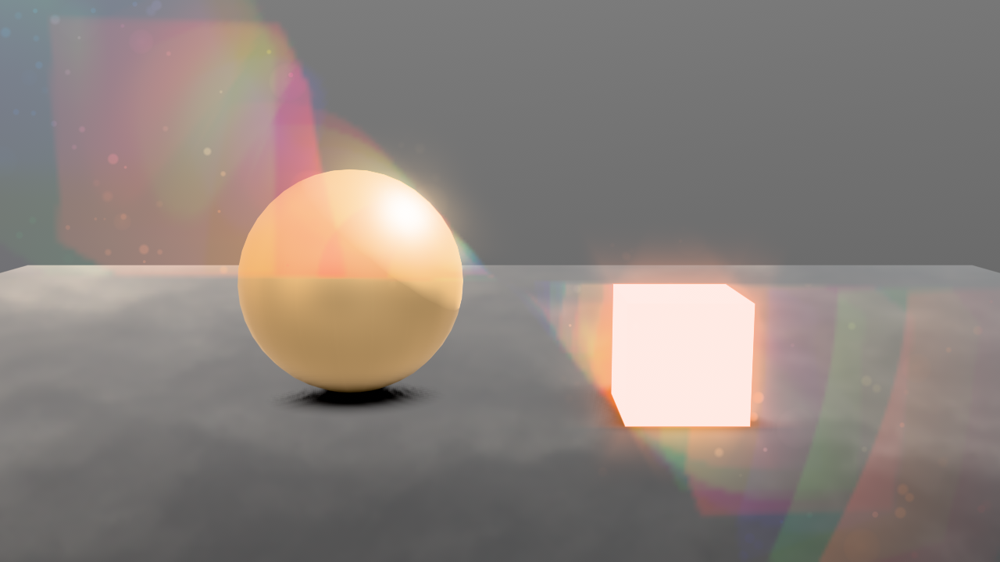

# Lens flares

Ghosts, halos, star rays and anamorphic streaks from bright light, glare from lights you choose, and dirt on the lens that lights up with them.



## Get it working

1. **Render > Post Process**, then in the Attribute Editor's **Lens** section pick a lens: **Spherical Prime**, **Anamorphic Scope**, **Vintage Glass** or **Clean Coated**.
2. For a lamp or sun to flare even when it's small on screen, select the light and turn on its **Lens Flare**.
3. Anything brighter than **Flare Threshold** now flares in the viewport and in renders.

```python
lensPreset("Anamorphic Scope", camera="shotCam")  # also sets the camera's squeeze and blades
setAttr("lamp1.lensFlare", True)
```

Star rays follow the camera's **aperture blades** (an odd count gives twice as many rays); with no camera, six. A camera's **anamorphic squeeze** stretches the ghosts and streaks wide.

**Lens dirt** is an image of smudges that bloom and flare light up. Type a built-in name into **Lens Dirt** (`dust`, `smudge`, `streaks`, `rain`) or browse to your own: a dark image with light smudges, any size (it stretches to fit the frame).

## Troubleshooting

**A light's flare doesn't show.** It draws only while the light's position is on screen, unhidden, and the view's post effects are on (**Render > Post Effects**). Raise its **Lens Flare Intensity** for a dim light.

**The whole picture fills with colour.** A large bright area (a sky, a strong emissive) is over the threshold. Raise **Flare Threshold**, or lower **Lens Flare** and **Flare Halo**.

**Lens dirt doesn't show.** It only lights where bloom or flare reach it: turn up **Bloom** or **Lens Flare**, and **Lens Dirt Intensity**.

## Options

| Option | Default | What it does |
| --- | --- | --- |
| **Lens Flare** | 0 | Strength of the picture's own flare; 0 is off. |
| **Flare Ghosts** / **Flare Ghost Spacing** | 4 / 0.35 | How many ghost images, and how far apart along the line through the centre. |
| **Flare Chroma** | 0.015 | Colour fringing of ghosts and halo. |
| **Flare Starburst** / **Flare Streak Length** | 0.4 / 0.2 | Star rays from bright points. |
| **Anamorphic Streaks** / **Anamorphic Tint** | 0 / blue | Long horizontal streaks. |
| Light: **Lens Flare Intensity** / **Lens Flare Scale** | 1 / 1 | That light's flare brightness and size. |
