<!-- Generated by Lila from its command registry and Python API. Do not edit. -->

# Geometry node reference

Every geometry node, by menu category. Diamond sockets in the editor take or give fields (kind *field* here). Inputs left unlinked use the default shown, or the implicit input named (Position, Normal, Index, ID).

## Attribute

### Attribute Statistic

Statistics of a field over the selected elements of a domain.

| Socket | Type | Kind | Default | Description |
| --- | --- | --- | --- | --- |
| `geometry` | geometry | input |  |  |
| `selection` | bool | input, field | `true` | Elements to affect. |
| `attribute` | float | input, field | `0` |  |
| `mean` | float | output |  |  |
| `median` | float | output |  |  |
| `sum` | float | output |  |  |
| `min` | float | output |  |  |
| `max` | float | output |  |  |
| `range` | float | output |  |  |
| `standardDeviation` | float | output |  |  |
| `variance` | float | output |  |  |

| Property | Options | Default | Description |
| --- | --- | --- | --- |
| `dataType` | `float`, `vector` | `float` |  |
| `domain` | `point`, `edge`, `face`, `corner`, `curve`, `instance` | `point` |  |

### Blur Attribute

Averages a field with its neighbours, repeated iterations times: points across edges, edges sharing a point, faces across edges, corners within their face, curve points along their curve. Weight scales how much the neighbours count.

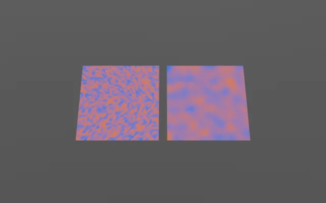

| Socket | Type | Kind | Default | Description |
| --- | --- | --- | --- | --- |
| `value` | float | input, field | `0` |  |
| `iterations` | int | input | `1` | Range 0 to 10000. |
| `weight` | float | input, field | `1` | Range 0 to 1. |
| `value` | float | output, field |  |  |

| Property | Options | Default | Description |
| --- | --- | --- | --- |
| `dataType` | `float`, `int`, `vector`, `color` | `float` |  |

### Capture Attribute

Evaluates a field on this geometry now and keeps the result with its elements, so later changes to the geometry don't change it.

| Socket | Type | Kind | Default | Description |
| --- | --- | --- | --- | --- |
| `geometry` | geometry | input |  |  |
| `value` | float | input, field | `0` |  |
| `geometry` | geometry | output |  |  |
| `attribute` | float | output, field |  |  |

| Property | Options | Default | Description |
| --- | --- | --- | --- |
| `dataType` | `float`, `int`, `vector`, `bool`, `rotation`, `color` | `float` |  |
| `domain` | `point`, `edge`, `face`, `corner`, `curve`, `instance` | `point` |  |

### Domain Size

Element counts of a component.

| Socket | Type | Kind | Default | Description |
| --- | --- | --- | --- | --- |
| `geometry` | geometry | input |  |  |
| `pointCount` | int | output |  |  |
| `edgeCount` | int | output |  |  |
| `faceCount` | int | output |  |  |
| `faceCornerCount` | int | output |  |  |
| `curveCount` | int | output |  |  |
| `instanceCount` | int | output |  |  |

| Property | Options | Default | Description |
| --- | --- | --- | --- |
| `component` | `mesh`, `points`, `curve`, `instances` | `mesh` |  |

### Named Attribute

Reads an attribute by name (uv0, color, material, or anything stored). "position" reads point positions.

| Socket | Type | Kind | Default | Description |
| --- | --- | --- | --- | --- |
| `name` | string | input |  |  |
| `attribute` | float | output, field |  |  |
| `exists` | bool | output, field |  |  |

| Property | Options | Default | Description |
| --- | --- | --- | --- |
| `dataType` | `float`, `int`, `vector`, `bool`, `rotation`, `color` | `float` |  |

### Remove Named Attribute

Deletes attributes by name from every component and domain. With pattern set to wildcard, * matches any characters (uv*).

| Socket | Type | Kind | Default | Description |
| --- | --- | --- | --- | --- |
| `geometry` | geometry | input |  |  |
| `name` | string | input |  |  |
| `geometry` | geometry | output |  |  |

| Property | Options | Default | Description |
| --- | --- | --- | --- |
| `pattern` | `exact`, `wildcard` | `exact` |  |

### Store Named Attribute

Writes a field into a named attribute on a domain. Vector values written to an existing uv or colour layer keep its layout. Colors (and vectors named Col, Cd or color:<set>) become a vertex colour set on the corners, which FBX exports; point and face values spread to the corners.

| Socket | Type | Kind | Default | Description |
| --- | --- | --- | --- | --- |
| `geometry` | geometry | input |  |  |
| `selection` | bool | input, field | `true` | Elements to affect. |
| `name` | string | input |  |  |
| `value` | float | input, field | `0` |  |
| `geometry` | geometry | output |  |  |

| Property | Options | Default | Description |
| --- | --- | --- | --- |
| `dataType` | `float`, `int`, `vector`, `bool`, `rotation`, `color` | `float` |  |
| `domain` | `point`, `edge`, `face`, `corner`, `curve`, `instance` | `point` |  |

## Color

### Combine Color

A colour from RGB, HSV or HSL channels and alpha (all 0..1, linear).

| Socket | Type | Kind | Default | Description |
| --- | --- | --- | --- | --- |
| `red` | float | input, field | `0` |  |
| `green` | float | input, field | `0` |  |
| `blue` | float | input, field | `0` |  |
| `alpha` | float | input, field | `1` | Range 0 to 1. |
| `color` | color | output, field |  |  |

| Property | Options | Default | Description |
| --- | --- | --- | --- |
| `mode` | `rgb`, `hsv`, `hsl` | `rgb` |  |

### Separate Color

A colour's RGB, HSV or HSL channels and alpha.

| Socket | Type | Kind | Default | Description |
| --- | --- | --- | --- | --- |
| `color` | color | input, field | `[1, 1, 1, 1]` |  |
| `red` | float | output, field |  |  |
| `green` | float | output, field |  |  |
| `blue` | float | output, field |  |  |
| `alpha` | float | output, field |  |  |

| Property | Options | Default | Description |
| --- | --- | --- | --- |
| `mode` | `rgb`, `hsv`, `hsl` | `rgb` |  |

## Curve

### Curve Length

Total length of all curves.

| Socket | Type | Kind | Default | Description |
| --- | --- | --- | --- | --- |
| `curve` | geometry | input |  |  |
| `length` | float | output |  |  |

### Curve Normal

Normal of the curve at each point, tilt included. minimumTwist turns as little as it can along the curve; yUp stays square to the up axis.

| Socket | Type | Kind | Default | Description |
| --- | --- | --- | --- | --- |
| `normal` | vector | output, field |  |  |

| Property | Options | Default | Description |
| --- | --- | --- | --- |
| `mode` | `minimumTwist`, `yUp` | `minimumTwist` |  |

### Curve of Point

Type `CurveOfPoint`.

The curve a point belongs to, and its index on that curve.

| Socket | Type | Kind | Default | Description |
| --- | --- | --- | --- | --- |
| `pointIndex` | int | input, field | Index |  |
| `curveIndex` | int | output, field |  |  |
| `indexInCurve` | int | output, field |  |  |

### Curve Parameter

Per curve point: how far along its curve it is as a factor and as a length, and its index on the curve. On the curve domain, the length of the curves before it.

| Socket | Type | Kind | Default | Description |
| --- | --- | --- | --- | --- |
| `factor` | float | output, field |  |  |
| `length` | float | output, field |  |  |
| `index` | int | output, field |  |  |

### Curve Tangent

Direction of the curve at each point.

| Socket | Type | Kind | Default | Description |
| --- | --- | --- | --- | --- |
| `tangent` | vector | output, field |  |  |

### Curve to Mesh

Type `CurveToMesh`.

Sweeps the profile curve along each curve (scaled by the "radius" attribute). Without a profile, gives edges. The profile's X and Z run across the path, so Curve Circle makes a tube.

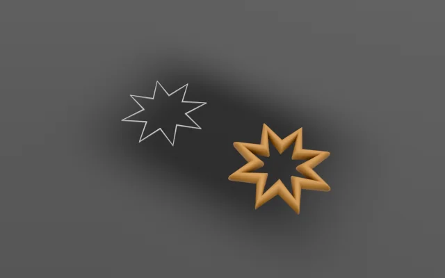

| Socket | Type | Kind | Default | Description |
| --- | --- | --- | --- | --- |
| `curve` | geometry | input |  |  |
| `profileCurve` | geometry | input |  |  |
| `fillCaps` | bool | input | `false` |  |
| `mesh` | geometry | output |  |  |

### Curve to Points

Type `CurveToPoints`.

Points along curves: evenly spaced by count or by length, or at every evaluated point. Point and curve attributes carry over. Rotation turns X along the tangent and Y onto the normal, for instancing.

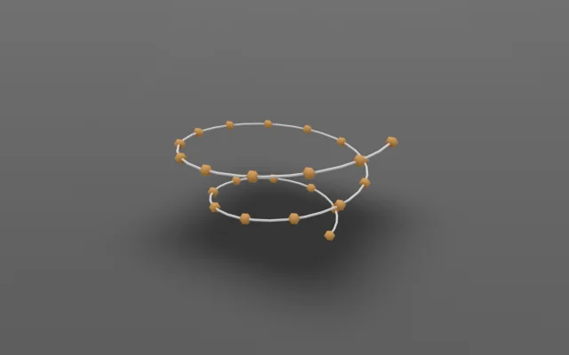

| Socket | Type | Kind | Default | Description |
| --- | --- | --- | --- | --- |
| `curve` | geometry | input |  |  |
| `count` | int | input | `10` | Range 1 to 1000000. |
| `length` | float | input | `10` | Spacing, cm (length mode). At least 1e-06. |
| `points` | geometry | output |  |  |
| `tangent` | vector | output, field |  |  |
| `normal` | vector | output, field |  |  |
| `rotation` | rotation | output, field |  |  |

| Property | Options | Default | Description |
| --- | --- | --- | --- |
| `mode` | `count`, `length`, `evaluated` | `count` |  |

### Deform Along Curve

Bends the mesh along the first curve: its forward axis runs along the curve from the start, the cross-section rides the curve's frame (tilt and radius included). Stretch fits the mesh to the curve's length.

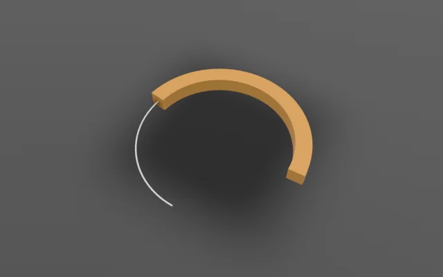

| Socket | Type | Kind | Default | Description |
| --- | --- | --- | --- | --- |
| `geometry` | geometry | input |  |  |
| `curve` | geometry | input |  |  |
| `offset` | float | input | `0` | Where the mesh starts along the curve, cm. |
| `stretch` | bool | input | `false` |  |
| `twist` | float | input | `0` | Twist from start to end, radians. |
| `roll` | float | input | `0` | Turn about the curve, radians. |
| `geometry` | geometry | output |  |  |

| Property | Options | Default | Description |
| --- | --- | --- | --- |
| `forwardAxis` | `+x`, `-x`, `+y`, `-y`, `+z`, `-z` | `+x` |  |
| `upMode` | `curveFrames`, `autoNormals` | `curveFrames` |  |

### Endpoint Selection

True for the first start and last end points of each curve.

| Socket | Type | Kind | Default | Description |
| --- | --- | --- | --- | --- |
| `startSize` | int | input, field | `1` | At least 0. |
| `endSize` | int | input, field | `1` | At least 0. |
| `selection` | bool | output, field |  |  |

### Fill Curve

Fills each curve with a face (open curves are closed first).

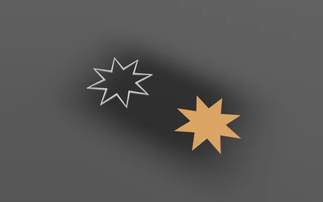

| Socket | Type | Kind | Default | Description |
| --- | --- | --- | --- | --- |
| `curve` | geometry | input |  |  |
| `mesh` | geometry | output |  |  |

| Property | Options | Default | Description |
| --- | --- | --- | --- |
| `mode` | `ngons`, `triangles` | `ngons` |  |

### Fillet Curve

Rounds (arc), cuts (chamfer) or blends (g2) curve corners by radius; a point's cornerRadius attribute wins where set.

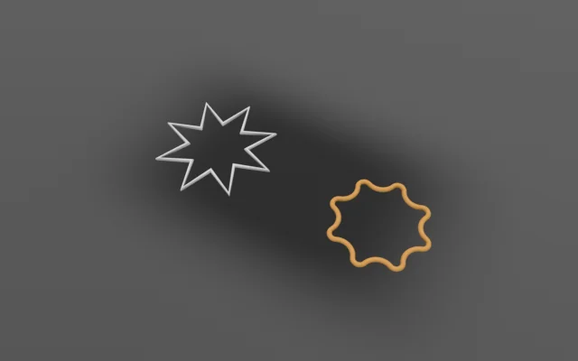

| Socket | Type | Kind | Default | Description |
| --- | --- | --- | --- | --- |
| `curve` | geometry | input |  |  |
| `radius` | float | input | `10` | cm. At least 0. |
| `curve` | geometry | output |  |  |

| Property | Options | Default | Description |
| --- | --- | --- | --- |
| `mode` | `arc`, `chamfer`, `g2` | `arc` |  |

### Interpolate Curves

Grows a curve from every point by blending the shapes of the nearest guide curves (by their first points), closer guides weighing more. For hair and grass from a few guides.

| Socket | Type | Kind | Default | Description |
| --- | --- | --- | --- | --- |
| `guideCurves` | geometry | input |  |  |
| `points` | geometry | input |  |  |
| `maxNeighbors` | int | input | `4` | Range 1 to 64. |
| `curves` | geometry | output |  |  |
| `closestIndex` | int | output, field |  | The nearest guide's index, per curve. |

### Mesh to Curve

Type `MeshToCurve`.

Chains the selected edges into poly curves.

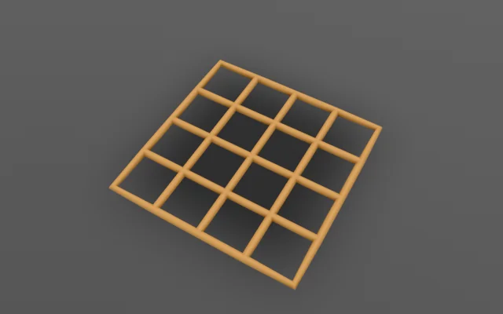

| Socket | Type | Kind | Default | Description |
| --- | --- | --- | --- | --- |
| `mesh` | geometry | input |  |  |
| `selection` | bool | input, field | `true` |  |
| `curve` | geometry | output |  |  |

### Offset Curve

Offsets each curve within its plane by a distance: outward for closed curves, to the left for open ones. Loops the offset makes are trimmed, so a curve can give several.

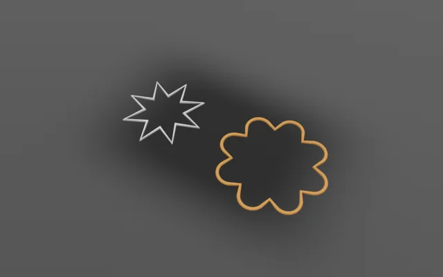

| Socket | Type | Kind | Default | Description |
| --- | --- | --- | --- | --- |
| `curve` | geometry | input |  |  |
| `distance` | float | input | `10` | cm; negative goes the other way. |
| `curve` | geometry | output |  |  |

| Property | Options | Default | Description |
| --- | --- | --- | --- |
| `join` | `round`, `miter`, `square` | `round` |  |

### Points of Curve

Type `PointsOfCurve`.

A point of a curve, picked by its place when the curve's points are sorted by weight (sort index wraps), and how many points the curve has.

| Socket | Type | Kind | Default | Description |
| --- | --- | --- | --- | --- |
| `curveIndex` | int | input, field | Index |  |
| `weights` | float | input, field | `0` | Evaluated on the points. |
| `sortIndex` | int | input, field | `0` |  |
| `pointIndex` | int | output, field |  |  |
| `total` | int | output, field |  |  |

### Resample Curve

Rebuilds curves with evenly spaced points, by count or by segment length.

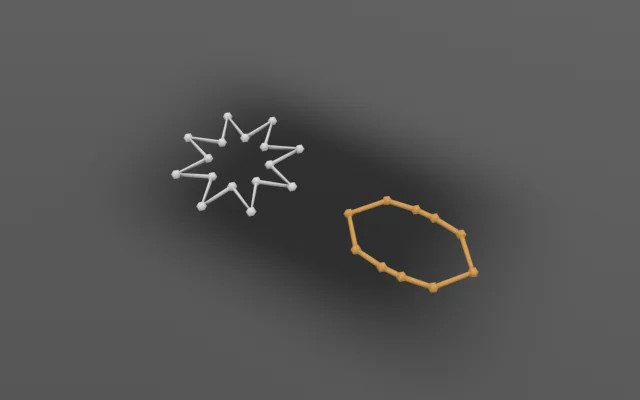

| Socket | Type | Kind | Default | Description |
| --- | --- | --- | --- | --- |
| `curve` | geometry | input |  |  |
| `count` | int | input | `10` | Range 1 to 1000000. |
| `length` | float | input | `10` | Segment length, cm (length mode). At least 1e-06. |
| `curve` | geometry | output |  |  |

| Property | Options | Default | Description |
| --- | --- | --- | --- |
| `mode` | `count`, `length` | `count` |  |

### Reverse Curve

Runs the selected curves the other way, keeping their shape and point attributes.

| Socket | Type | Kind | Default | Description |
| --- | --- | --- | --- | --- |
| `curve` | geometry | input |  |  |
| `selection` | bool | input, field | `true` | Curves to reverse. |
| `curve` | geometry | output |  |  |

### Sample Curve

Reads position, tangent, normal and a value field at a point along a curve, by factor of its length or by length. With All Curves the curves count as one, end to end.

| Socket | Type | Kind | Default | Description |
| --- | --- | --- | --- | --- |
| `curves` | geometry | input |  |  |
| `value` | float | input, field | `0` | Evaluated on the curve points. |
| `factor` | float | input, field | `0` | Range 0 to 1. |
| `curveIndex` | int | input, field | `0` |  |
| `allCurves` | bool | input | `false` |  |
| `value` | float | output, field |  |  |
| `position` | vector | output, field |  |  |
| `tangent` | vector | output, field |  |  |
| `normal` | vector | output, field |  |  |

| Property | Options | Default | Description |
| --- | --- | --- | --- |
| `dataType` | `float`, `int`, `vector`, `bool`, `rotation`, `color` | `float` |  |
| `mode` | `factor`, `length` | `factor` |  |

### Set Curve Tilt

Sets the tilt of curve points (radians around the tangent), which turns the normal and swept profiles.

| Socket | Type | Kind | Default | Description |
| --- | --- | --- | --- | --- |
| `curve` | geometry | input |  |  |
| `selection` | bool | input, field | `true` | Elements to affect. |
| `tilt` | float | input, field | `0` |  |
| `curve` | geometry | output |  |  |

### Set Handle Type

Sets the handle type of every Bezier point: auto, vector, aligned or free.

| Socket | Type | Kind | Default | Description |
| --- | --- | --- | --- | --- |
| `curve` | geometry | input |  |  |
| `curve` | geometry | output |  |  |

| Property | Options | Default | Description |
| --- | --- | --- | --- |
| `type` | `auto`, `vector`, `aligned`, `free` | `auto` |  |

### Set Spline Type

Converts curves to poly, Bezier or NURBS, keeping their shape (fitted where it can't be exact).

| Socket | Type | Kind | Default | Description |
| --- | --- | --- | --- | --- |
| `curve` | geometry | input |  |  |
| `curve` | geometry | output |  |  |

| Property | Options | Default | Description |
| --- | --- | --- | --- |
| `type` | `poly`, `bezier`, `nurbs` | `bezier` |  |

### Spline Length

Length and point count of the curve each element belongs to.

| Socket | Type | Kind | Default | Description |
| --- | --- | --- | --- | --- |
| `length` | float | output, field |  |  |
| `pointCount` | int | output, field |  |  |

### String to Curves

Type `StringToCurves`.

Text as closed Bezier outlines in the XY plane, the first baseline on y = 0. Fill Curve makes faces of it. Character is each curve's character index.

| Socket | Type | Kind | Default | Description |
| --- | --- | --- | --- | --- |
| `string` | string | input | `Text` |  |
| `size` | float | input | `10` | Em size, cm. At least 0. |
| `letterSpacing` | float | input | `0` | cm. |
| `wordSpacing` | float | input | `0` | cm. |
| `lineSpacing` | float | input | `1` | At least 0. |
| `wrapWidth` | float | input | `0` | cm; 0 breaks only at new lines. At least 0. |
| `curves` | geometry | output |  |  |
| `character` | int | output, field |  |  |

| Property | Options | Default | Description |
| --- | --- | --- | --- |
| `font` |  |  | A font file, or a family and style such as "Inter Bold"; empty for the default. |
| `align` | `left`, `center`, `right`, `justify` | `left` |  |
| `anchor` | `baseline`, `top`, `middle`, `bottom` | `baseline` |  |

### Subdivide Curve

Adds points to every segment without changing the shape. Cuts is read per point, for the segment that starts there.

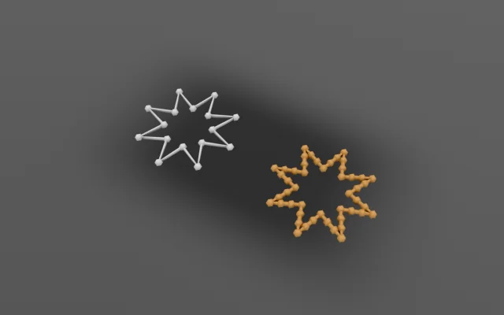

| Socket | Type | Kind | Default | Description |
| --- | --- | --- | --- | --- |
| `curve` | geometry | input |  |  |
| `cuts` | int | input, field | `1` | Range 0 to 1000. |
| `curve` | geometry | output |  |  |

### Trim Curve

Keeps the part of each curve between start and end, as factors of its length or as lengths from its start. Closed curves open; Bezier and NURBS curves come out as poly.

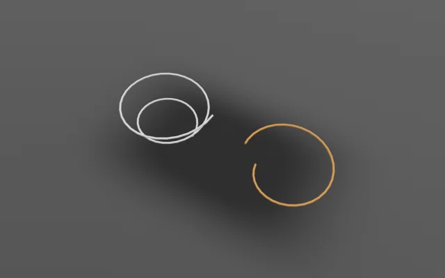

| Socket | Type | Kind | Default | Description |
| --- | --- | --- | --- | --- |
| `curve` | geometry | input |  |  |
| `selection` | bool | input, field | `true` | Curves to trim. |
| `start` | float | input, field | `0` | Range 0 to 1. |
| `end` | float | input, field | `1` | Range 0 to 1. |
| `curve` | geometry | output |  |  |

| Property | Options | Default | Description |
| --- | --- | --- | --- |
| `mode` | `factor`, `length` | `factor` |  |

## Curve Primitives

### Arc

Type `CurveArc`.

An arc: by radius and angles in the ground plane, or through three points. Resolution is the point count. Connect Center closes it through the centre, Invert Arc takes the other way round.

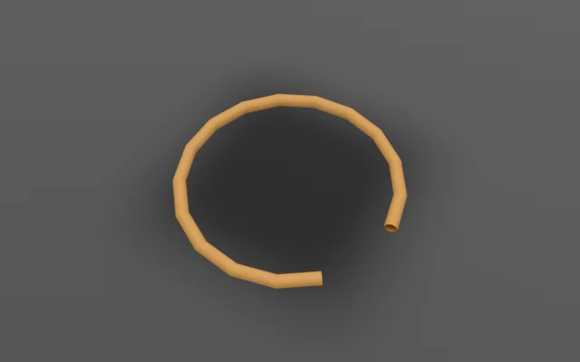

| Socket | Type | Kind | Default | Description |
| --- | --- | --- | --- | --- |
| `resolution` | int | input | `16` | Range 2 to 100000. |
| `radius` | float | input | `50` | At least 0. |
| `startAngle` | float | input | `0` | Radians. |
| `sweepAngle` | float | input | `5.497787143782138` | Radians. |
| `connectCenter` | bool | input | `false` |  |
| `invertArc` | bool | input | `false` |  |
| `curve` | geometry | output |  |  |

| Property | Options | Default | Description |
| --- | --- | --- | --- |
| `mode` | `radius`, `points` | `radius` |  |

### Bezier Segment

A cubic Bezier between two points, evaluated to a poly curve.

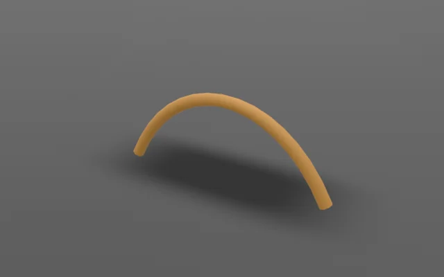

| Socket | Type | Kind | Default | Description |
| --- | --- | --- | --- | --- |
| `resolution` | int | input | `16` | Range 1 to 100000. |
| `start` | vector | input | `[-50, 0, 0]` |  |
| `startHandle` | vector | input | `[-25, 50, 0]` |  |
| `endHandle` | vector | input | `[25, 50, 0]` |  |
| `end` | vector | input | `[50, 0, 0]` |  |
| `curve` | geometry | output |  |  |

### Curve Circle

A closed circle in the ground plane. As a Curve to Mesh profile its X and Z map across the path.

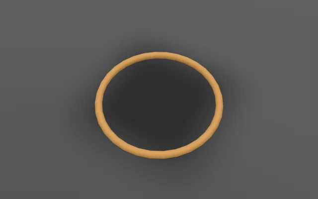

| Socket | Type | Kind | Default | Description |
| --- | --- | --- | --- | --- |
| `resolution` | int | input | `32` | Range 3 to 100000. |
| `radius` | float | input | `50` | At least 0. |
| `curve` | geometry | output |  |  |

### Curve Line

A straight two-point curve.

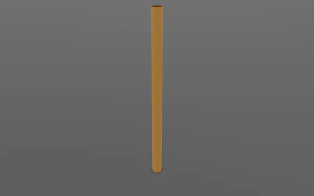

| Socket | Type | Kind | Default | Description |
| --- | --- | --- | --- | --- |
| `start` | vector | input | `[0, 0, 0]` |  |
| `end` | vector | input | `[0, 100, 0]` |  |
| `curve` | geometry | output |  |  |

### Quadrilateral

Type `CurveQuadrilateral`.

A closed four-point curve in the ground plane: rectangle, parallelogram, trapezoid, kite, or four given points.

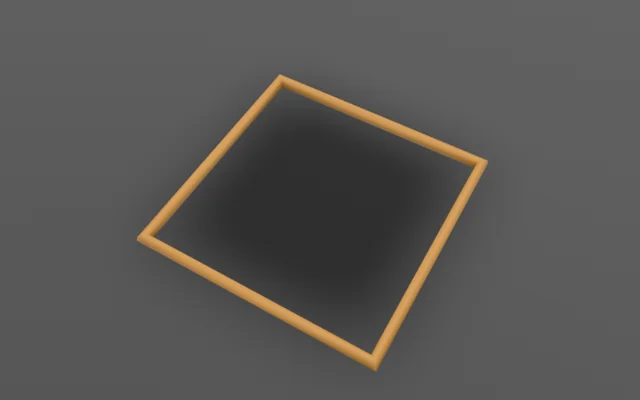

| Socket | Type | Kind | Default | Description |
| --- | --- | --- | --- | --- |
| `width` | float | input | `100` | At least 0. |
| `height` | float | input | `100` | At least 0. |
| `curve` | geometry | output |  |  |

| Property | Options | Default | Description |
| --- | --- | --- | --- |
| `mode` | `rectangle`, `parallelogram`, `trapezoid`, `kite`, `points` | `rectangle` |  |

### Spiral

Type `CurveSpiral`.

A spiral rising up the Y axis.

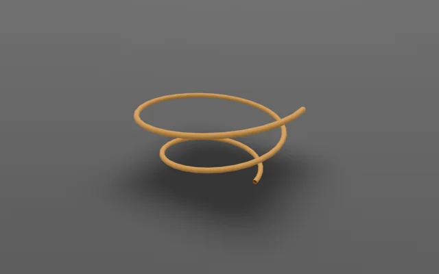

| Socket | Type | Kind | Default | Description |
| --- | --- | --- | --- | --- |
| `resolution` | int | input | `32` | Points per turn. Range 1 to 10000. |
| `rotations` | float | input | `2` | At least 0. |
| `startRadius` | float | input | `50` |  |
| `endRadius` | float | input | `100` |  |
| `height` | float | input | `100` |  |
| `reverse` | bool | input | `false` |  |
| `curve` | geometry | output |  |  |

### Star

Type `CurveStar`.

A closed star in the ground plane, alternating outer and inner points. Outer Points selects the tips.

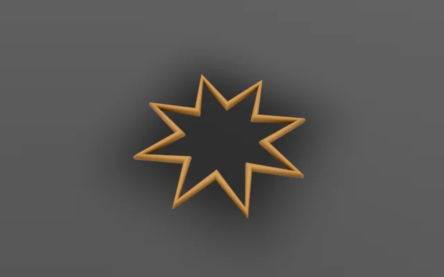

| Socket | Type | Kind | Default | Description |
| --- | --- | --- | --- | --- |
| `points` | int | input | `8` | Range 3 to 100000. |
| `innerRadius` | float | input | `25` | At least 0. |
| `outerRadius` | float | input | `50` | At least 0. |
| `twist` | float | input | `0` | Turn of the inner points, radians. |
| `curve` | geometry | output |  |  |
| `outerPoints` | bool | output, field |  |  |

## Deform

### Bend

Bends geometry round an arc across a range of the axis; past the range it carries on straight.

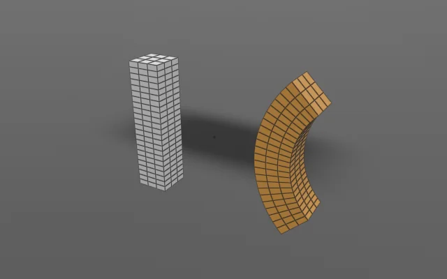

| Socket | Type | Kind | Default | Description |
| --- | --- | --- | --- | --- |
| `geometry` | geometry | input |  |  |
| `selection` | bool | input, field | `true` | Elements to affect. |
| `center` | vector | input | `[0, 0, 0]` | Origin of the deformer. |
| `rotation` | rotation | input | `[0, 0, 0]` | Turns the deformer's frame after the axis is chosen. |
| `low` | float | input | `-50` | Start of the deformed range along the axis, from the centre. |
| `high` | float | input | `50` | End of the deformed range along the axis, from the centre. |
| `angle` | float | input | `90` | Degrees bent across the range. |
| `geometry` | geometry | output |  |  |

| Property | Options | Default | Description |
| --- | --- | --- | --- |
| `axis` | `x`, `y`, `z` | `y` | Axis the deformation runs along. |

### Taper

Scales geometry across the axis, blending from the start scale to the end scale.

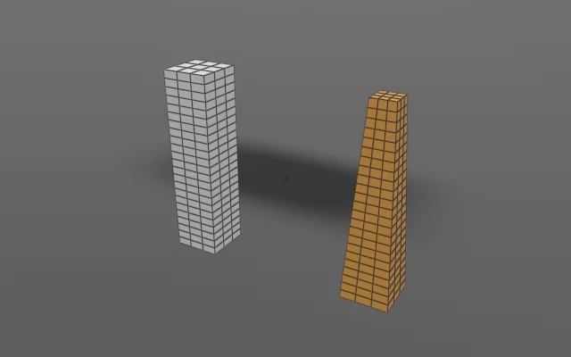

| Socket | Type | Kind | Default | Description |
| --- | --- | --- | --- | --- |
| `geometry` | geometry | input |  |  |
| `selection` | bool | input, field | `true` | Elements to affect. |
| `center` | vector | input | `[0, 0, 0]` | Origin of the deformer. |
| `rotation` | rotation | input | `[0, 0, 0]` | Turns the deformer's frame after the axis is chosen. |
| `low` | float | input | `-50` | Start of the deformed range along the axis, from the centre. |
| `high` | float | input | `50` | End of the deformed range along the axis, from the centre. |
| `startScale` | float | input | `1` |  |
| `endScale` | float | input | `0.5` |  |
| `curve` | float | input | `0` | Bulge added in the middle, in scale units. |
| `geometry` | geometry | output |  |  |

| Property | Options | Default | Description |
| --- | --- | --- | --- |
| `axis` | `x`, `y`, `z` | `y` | Axis the deformation runs along. |

### Twist

Twists geometry about the axis, the angle blending from low to high.

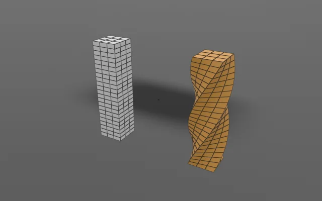

| Socket | Type | Kind | Default | Description |
| --- | --- | --- | --- | --- |
| `geometry` | geometry | input |  |  |
| `selection` | bool | input, field | `true` | Elements to affect. |
| `center` | vector | input | `[0, 0, 0]` | Origin of the deformer. |
| `rotation` | rotation | input | `[0, 0, 0]` | Turns the deformer's frame after the axis is chosen. |
| `low` | float | input | `-50` | Start of the deformed range along the axis, from the centre. |
| `high` | float | input | `50` | End of the deformed range along the axis, from the centre. |
| `startAngle` | float | input | `0` | Degrees at the low end. |
| `endAngle` | float | input | `90` | Degrees at the high end. |
| `geometry` | geometry | output |  |  |

| Property | Options | Default | Description |
| --- | --- | --- | --- |
| `axis` | `x`, `y`, `z` | `y` | Axis the deformation runs along. |

## Destruction

### Anchor Pieces

Ties the pieces resting on the ground to the world, so a wall stands until something breaks it free. Adds the anchors to the links coming in.

| Socket | Type | Kind | Default | Description |
| --- | --- | --- | --- | --- |
| `pieces` | geometry | input |  | Pieces, as instances. |
| `links` | geometry | input |  | Links to add the anchors to. |
| `height` | float | input | `0` | The ground, cm: pieces reaching down to it are anchored. |
| `tolerance` | float | input | `1` | How close to the ground counts, cm. At least 0. |
| `strength` | float | input | `20` | N per cm2 of the piece's footprint. At least 0. |
| `links` | geometry | output |  |  |

| Property | Options | Default | Description |
| --- | --- | --- | --- |
| `type` | `glue`, `spring`, `hard` | `glue` | glue breaks free under force; hard never lets go. |

### Collapse

Type `CollapsePieces`.

Gives way from one side to the other, like ground or a floor failing under structural damage. Pieces hold still until the failure reaches them, rumble harder as it nears, then come loose and fall: their links are cut and they start simulating. Connect Scene Time's frame to Frame.

| Socket | Type | Kind | Default | Description |
| --- | --- | --- | --- | --- |
| `pieces` | geometry | input |  | Pieces, as instances. |
| `links` | geometry | input |  | Their links. |
| `frame` | float | input | `1` | The current frame: connect Scene Time. |
| `start` | float | input | `60` | Frame the first pieces fall. |
| `duration` | float | input | `60` | Frames for the failure to cross to the far side. At least 0. |
| `direction` | vector | input | `[1, 0, 0]` | Which way the failure travels. |
| `rumble` | float | input | `2` | How far pieces shake just before they fall, cm. At least 0. |
| `lead` | float | input | `30` | Frames of rumbling before a piece falls. At least 1e-06. |
| `raggedness` | float | input | `0.25` | 0 is a straight front; 1 drops pieces in any order. Range 0 to 1. |
| `seed` | int | input | `0` | Another seed gives another ragged front. |
| `pieces` | geometry | output |  |  |
| `links` | geometry | output |  |  |

### Connect Pieces

Links every pair of pieces that touch (within Distance), for the Rigid Body Solver to hold together until they break. A link's strength is Strength times the area the two pieces share. Fracture makes these links itself; this is for pieces from anywhere else.

| Socket | Type | Kind | Default | Description |
| --- | --- | --- | --- | --- |
| `pieces` | geometry | input |  | Pieces, as instances. |
| `distance` | float | input | `0.5` | Gap still counted as touching, cm. At least 0. |
| `strength` | float | input | `20` | N per cm2 of shared area. At least 0. |
| `maxLinks` | int | input | `12` | Most links per piece; the largest contacts are kept. At least 1. |
| `links` | geometry | output |  |  |

| Property | Options | Default | Description |
| --- | --- | --- | --- |
| `type` | `glue`, `spring`, `hard` | `glue` | glue holds rigidly until it breaks; spring bends first; hard never breaks. |

### Explosion

One explosion for the Rigid Body Solver's blasts: on its frame, pieces within Radius are thrown outward, hardest at the centre. Join several with Join Geometry. Invisible: add your own flash or smoke.

| Socket | Type | Kind | Default | Description |
| --- | --- | --- | --- | --- |
| `position` | vector | input | `[0, 0, 0]` | Its centre, cm. |
| `frame` | int | input | `1` | Frame it goes off. |
| `speed` | float | input | `1500` | Speed given to pieces at the centre, cm/s. |
| `radius` | float | input | `300` | Pieces this far away or more aren't pushed, cm. At least 0. |
| `blast` | geometry | output |  |  |

### Fracture

Breaks a closed mesh into pieces the way a material cracks, and links the pieces that touch so the Rigid Body Solver holds them together until they break. Concrete gives chunky rough pieces, glass shards radiating from the impact, wood long splinters along the grain. The same inputs always give the same pieces.

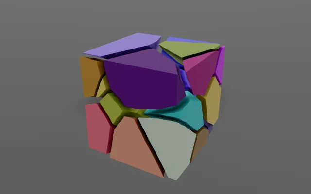

| Socket | Type | Kind | Default | Description |
| --- | --- | --- | --- | --- |
| `mesh` | geometry | input |  | A closed mesh. |
| `pieces` | int | input | `30` | Roughly how many pieces. Range 1 to 20000. |
| `seed` | int | input | `1` | Another seed gives another pattern. |
| `impact` | vector | input | `[0, 0, 0]` | Where it's hit, in the mesh's space, cm. Pieces are smaller near it. |
| `impactFocus` | float | input | `0` | 0 spreads pieces evenly; toward 1 packs small pieces around the impact. Range 0 to 1. |
| `impactRadius` | float | input | `50` | How far the small pieces reach from the impact, cm. At least 0.001. |
| `roughness` | float | input | `1` | How jagged the cracks are, cm. Glass ignores it. At least 0. |
| `roughnessSize` | float | input | `10` | Size of the bumps along a crack, cm. At least 0.1. |
| `crackDetail` | float | input | `0` | Edge length of the faces along a rough crack, cm: smaller is smoother and heavier. 0 picks half the bump size. At least 0. |
| `maxCrackFaces` | int | input | `400` | Most faces on one piece's cracks, keeping the result light for games. Range 16 to 100000. |
| `chunks` | float | input | `1` | Pieces glued into each chunk that never breaks apart; 1 keeps every piece separate. At least 1. |
| `interiorMaterial` | string | input |  | Material for the inside faces; empty names it after the mesh's material. |
| `interiorUvScale` | float | input | `100` | cm per UV tile on the inside faces. At least 0.001. |
| `linkStrength` | float | input | `20` | Strength of the links, N per cm2 of the area two pieces share. At least 0. |
| `pieces` | geometry | output |  | The pieces, as instances with their origins at their centres of mass. |
| `links` | geometry | output |  | A link between each pair of touching pieces, as two-point curves. |

| Property | Options | Default | Description |
| --- | --- | --- | --- |
| `material` | `concrete`, `glass`, `wood` | `concrete` | How it cracks. |
| `grain` | `auto`, `x`, `y`, `z` | `auto` | Wood: the axis the grain runs along; auto takes the longest. |
| `linkType` | `glue`, `spring`, `hard` | `glue` | Links between touching pieces: glue holds until it breaks, spring bends first, hard never breaks. |

### Join Pieces

Puts two sets of pieces and their links into one, so they simulate together and hit each other: walls and the ground they stand on, say. The second set's links are renumbered to follow it. Chain more for more sets.

| Socket | Type | Kind | Default | Description |
| --- | --- | --- | --- | --- |
| `pieces` | geometry | input |  | The first pieces. |
| `links` | geometry | input |  | The first pieces' links. |
| `pieces2` | geometry | input |  | The second pieces. |
| `links2` | geometry | input |  | The second pieces' links. |
| `pieces` | geometry | output |  |  |
| `links` | geometry | output |  |  |

### Mesh to Pieces

Type `MeshToPieces`.

Turns a mesh into pieces the Rigid Body Solver can move: one per separate part, or one per value of an integer attribute. Each piece's origin is the centre of its bounds, and every point gets a piece attribute.

| Socket | Type | Kind | Default | Description |
| --- | --- | --- | --- | --- |
| `mesh` | geometry | input |  |  |
| `attribute` | string | input | `piece` | Integer face or point attribute, for by = attribute. |
| `pieces` | geometry | output |  |  |

| Property | Options | Default | Description |
| --- | --- | --- | --- |
| `by` | `parts`, `attribute` | `parts` | parts: each connected part; attribute: faces sharing a value. |

## Game

### Collision

Simple collision for Unreal, per island or for the whole mesh: a convex hull, an approximate convex decomposition, or a fitted box, sphere or capsule. Gives the pieces as one mesh with face attributes "collision" (piece) and "collisionShape" (0 UCX_ hull, 1 UBX_ box, 2 USP_ sphere, 3 UCP_ capsule), the prefix each piece exports with.

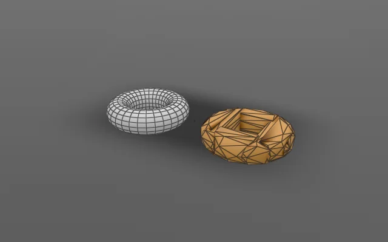

| Socket | Type | Kind | Default | Description |
| --- | --- | --- | --- | --- |
| `mesh` | geometry | input |  |  |
| `maxHulls` | int | input | `8` | Decompose: most pieces per island. Range 1 to 64. |
| `minFill` | float | input | `0.85` | Decompose: how full a piece must be before it stops splitting; higher follows concave shapes closer. Range 0.05 to 1. |
| `resolution` | int | input | `48` | Decompose: voxels along the longest side. Range 8 to 256. |
| `maxHullPoints` | int | input | `32` | Points per hull; Unreal keeps hulls light. Range 4 to 255. |
| `offset` | float | input | `0` | Pushed out on every side. |
| `collision` | geometry | output |  |  |
| `count` | int | output, field |  | Pieces made. |

| Property | Options | Default | Description |
| --- | --- | --- | --- |
| `shape` | `hull`, `decompose`, `box`, `sphere`, `capsule` | `hull` |  |
| `per` | `island`, `whole` | `island` |  |

### Imposter

Bakes what reaches it into an octahedral imposter for Unreal: Bake in the side panel views it from Frames x Frames directions and writes a base colour atlas (alpha is coverage), a normal atlas (alpha is depth), a card mesh FBX and a JSON of the material inputs into imposters/ next to the scene; Send to Unreal bakes and imports it through LilaLink with a material that blends the three nearest views. Base colour comes from the mesh's current colour set, else light grey. Geometry passes through; Card is the square the imposter draws on.

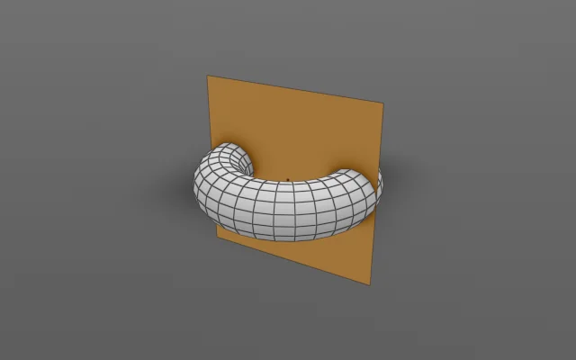

| Socket | Type | Kind | Default | Description |
| --- | --- | --- | --- | --- |
| `geometry` | geometry | input |  |  |
| `frames` | int | input | `12` | Views per side of the atlas. Range 2 to 32. |
| `resolution` | int | input | `256` | Pixels per view. Range 16 to 2048. |
| `geometry` | geometry | output |  |  |
| `card` | geometry | output |  | A square through the centre, as wide as the bounding sphere, facing +Z. |

| Property | Options | Default | Description |
| --- | --- | --- | --- |
| `layout` | `octahedral`, `hemi-octahedral` | `hemi-octahedral` | octahedral: views from every side; hemi-octahedral: only from above, twice the detail for things seen from the ground. |

### Lightmap UV

Unreal's lightmap channel: the source set's islands made non-overlapping and packed with padding for the lightmap resolution into the target set.

| Socket | Type | Kind | Default | Description |
| --- | --- | --- | --- | --- |
| `mesh` | geometry | input |  |  |
| `resolution` | int | input | `64` | The lightmap resolution in Unreal. Range 8 to 4096. |
| `padding` | float | input | `2` | Texels between charts. At least 0. |
| `source` | string | input | `uv0` |  |
| `target` | int | input | `1` | UV set written. Range 0 to 7. |
| `mesh` | geometry | output |  |  |

### LOD Chain

Type `LodChain`.

Levels of detail: LOD0 is the mesh, each further level keeps ratio^level of its triangles. Gives one instance per level (identity transforms, or spaced along X for a preview) with "lod" and "screenSize" instance attributes, and the mesh of one level.

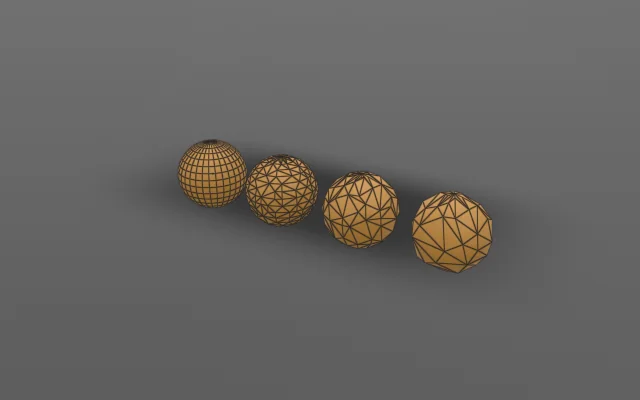

| Socket | Type | Kind | Default | Description |
| --- | --- | --- | --- | --- |
| `mesh` | geometry | input |  |  |
| `levels` | int | input | `3` | Reduced levels after LOD0 (Unreal takes 8 in all). Range 0 to 7. |
| `ratio` | float | input | `0.5` | Triangles kept per level, relative to the one before. Range 0.01 to 1. |
| `screenSizes` | string | input | `1 0.5 0.25 0.125` | Unreal screen size per level; missing levels halve the last. |
| `keepBorders` | bool | input | `true` | Open borders stay in place. |
| `spacing` | float | input | `0` | Offset between levels along X, for viewing them side by side. At least 0. |
| `level` | int | input | `0` | The level given on the mesh output. Range 0 to 7. |
| `lods` | geometry | output |  |  |
| `mesh` | geometry | output |  |  |
| `triangles` | int | output, field |  | Triangles in the level on the mesh output. |

### Material Index

Each face's material slot number.

| Socket | Type | Kind | Default | Description |
| --- | --- | --- | --- | --- |
| `materialIndex` | int | output, field |  |  |

### Material Selection

True on faces using the named material.

| Socket | Type | Kind | Default | Description |
| --- | --- | --- | --- | --- |
| `material` | string | input |  |  |
| `selection` | bool | output, field |  |  |

### Occluder Mesh

A closed low-poly proxy that sits inside the mesh, for occlusion culling or a far fallback: voxel remeshed, pulled in by the inset, then reduced to the triangle budget.

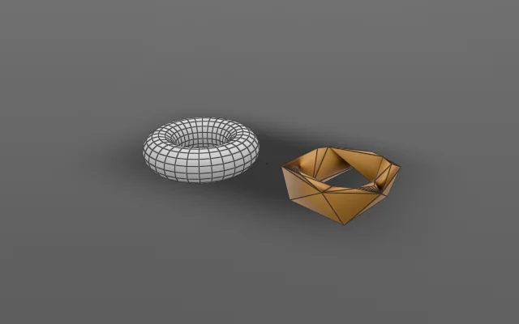

| Socket | Type | Kind | Default | Description |
| --- | --- | --- | --- | --- |
| `mesh` | geometry | input |  |  |
| `resolution` | int | input | `32` | Voxels along the longest side. Range 8 to 256. |
| `triangles` | int | input | `64` | Triangle budget. At least 4. |
| `inset` | float | input | `-1` | How far inside the surface; negative is one voxel. |
| `mesh` | geometry | output |  |  |

### Pack UV Islands

Packs the selected faces' uv islands into 0..1 with padding measured in texels of the resolution.

| Socket | Type | Kind | Default | Description |
| --- | --- | --- | --- | --- |
| `mesh` | geometry | input |  |  |
| `selection` | bool | input, field | `true` | Elements to affect. |
| `uvSet` | string | input | `uv0` |  |
| `padding` | float | input | `4` | At least 0. |
| `resolution` | int | input | `1024` | Range 16 to 16384. |
| `rotate` | bool | input | `true` | Try quarter turns. |
| `normalizeScale` | bool | input | `true` | Even texel density across islands. |
| `mesh` | geometry | output |  |  |

### Pivot Painter

Bakes each element's pivot and axis into the mesh for foliage and per-piece animation in Unreal materials. Element pivot xy goes into uv set N and z with the element's 0..1 index into uv set N+1; the vertex colour set holds the axis from the pivot to the element's farthest point (as 0..1) and, in alpha, its length relative to the longest.

| Socket | Type | Kind | Default | Description |
| --- | --- | --- | --- | --- |
| `mesh` | geometry | input |  |  |
| `attribute` | string | input | `piece` | Element: a face int attribute naming each element. |
| `uvSet` | int | input | `2` | First of the two uv sets written. Range 1 to 6. |
| `colorSet` | string | input | `pivotAxis` | Vertex colour set for the axis. |
| `mesh` | geometry | output |  |  |
| `elements` | int | output, field |  |  |

| Property | Options | Default | Description |
| --- | --- | --- | --- |
| `element` | `island`, `attribute` | `island` |  |
| `pivot` | `boundsBottom`, `boundsCenter`, `centroid` | `boundsBottom` |  |
| `space` | `unreal`, `lila` | `unreal` |  |

### Set Material

Assigns a material by name to the selected faces, adding its slot when the mesh doesn't have one.

| Socket | Type | Kind | Default | Description |
| --- | --- | --- | --- | --- |
| `geometry` | geometry | input |  |  |
| `selection` | bool | input, field | `true` | Faces to assign. |
| `material` | string | input |  |  |
| `geometry` | geometry | output |  |  |

### Set Material Index

Sets the selected faces' material slot by number.

| Socket | Type | Kind | Default | Description |
| --- | --- | --- | --- | --- |
| `geometry` | geometry | input |  |  |
| `selection` | bool | input, field | `true` |  |
| `materialIndex` | int | input, field | `0` | At least 0. |
| `geometry` | geometry | output |  |  |

### Snap to Grid

Type `SnapToGrid`.

Rounds selected points, curve points and instance positions to a grid, for modular kits. A rotation step also rounds instance rotations, in degrees. Zero on an axis leaves it free.

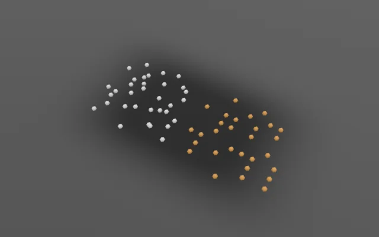

| Socket | Type | Kind | Default | Description |
| --- | --- | --- | --- | --- |
| `geometry` | geometry | input |  |  |
| `selection` | bool | input, field | `true` | Elements to affect. |
| `grid` | vector | input | `[50, 50, 50]` |  |
| `offset` | vector | input | `[0, 0, 0]` |  |
| `rotationStep` | float | input | `0` | Degrees; 0 keeps rotations. Range 0 to 360. |
| `geometry` | geometry | output |  |  |

### Socket Points

Attach points for Unreal sockets: a point per selected element with "socket" (its number) and "rotation" point attributes. Align to Normal turns each socket's Y axis to the surface normal, then applies the rotation.

| Socket | Type | Kind | Default | Description |
| --- | --- | --- | --- | --- |
| `geometry` | geometry | input |  |  |
| `selection` | bool | input, field | `true` | Elements to affect. |
| `position` | vector | input, field | Position |  |
| `rotation` | rotation | input, field | `[0, 0, 0]` |  |
| `alignToNormal` | bool | input | `true` |  |
| `sockets` | geometry | output |  |  |
| `count` | int | output, field |  |  |

| Property | Options | Default | Description |
| --- | --- | --- | --- |
| `domain` | `point`, `face` | `face` |  |

### Texel Density

Texture pixels per scene unit at a texture size (10.24 at 1024 is 1024 px per metre in centimetres). Apply scales the selected faces' islands about their centres to the density; the density output measures each face after.

| Socket | Type | Kind | Default | Description |
| --- | --- | --- | --- | --- |
| `mesh` | geometry | input |  |  |
| `selection` | bool | input, field | `true` | Elements to affect. |
| `uvSet` | string | input | `uv0` |  |
| `resolution` | int | input | `1024` | Range 1 to 16384. |
| `density` | float | input | `10.24` | Target pixels per scene unit. At least 0. |
| `apply` | bool | input | `true` |  |
| `mesh` | geometry | output |  |  |
| `density` | float | output, field |  | Per face. |

### UV Unwrap

Unwraps the selected faces' islands. Seams come from the seam input when it is linked, else the mesh's own seams, or automatic ones; islands are packed into 0..1 when Pack is on.

| Socket | Type | Kind | Default | Description |
| --- | --- | --- | --- | --- |
| `mesh` | geometry | input |  |  |
| `selection` | bool | input, field | `true` | Elements to affect. |
| `seam` | bool | input, field | `false` | Edges to cut along. |
| `uvSet` | string | input | `uv0` |  |
| `pack` | bool | input | `true` |  |
| `padding` | float | input | `4` | Texels between islands when packing. At least 0. |
| `resolution` | int | input | `1024` | Texture size padding is measured in. Range 16 to 16384. |
| `mesh` | geometry | output |  |  |

| Property | Options | Default | Description |
| --- | --- | --- | --- |
| `method` | `slim`, `conformal`, `bff` | `slim` |  |
| `seams` | `existing`, `auto` | `existing` |  |

### Vertex Animation Texture

Encodes the animation of what reaches it (a simulation, anything that changes over time) into Vertex Animation Textures for Unreal: Encode in the side panel samples this node's input over the playback range and writes a rest mesh FBX, position and normal textures and a JSON of the material inputs into vat/ next to the scene. The geometry passes through unchanged.

| Socket | Type | Kind | Default | Description |
| --- | --- | --- | --- | --- |
| `geometry` | geometry | input |  |  |
| `geometry` | geometry | output |  |  |

| Property | Options | Default | Description |
| --- | --- | --- | --- |
| `mode` | `auto`, `constant`, `soup`, `rigid` | `auto` | auto: soup when the topology changes, rigid when every point has a piece attribute and pieces only move, else constant. constant: a column per point. soup: a triangle soup padded to the largest frame. rigid: a transform per piece. |
| `format` | `exr`, `png16`, `png8` | `exr` | Position texture format: EXR keeps exact values; PNG is normalised by bounds. |
| `positions` | `offset`, `absolute` | `offset` | offset from the rest mesh (for World Position Offset), or absolute. |

### Walkable Surface

Faces a character can stand on: no steeper than the slope, with clearance above (a ray up from the face centre), plus step faces no taller than the step height beside them. Selects them, or keeps only them.

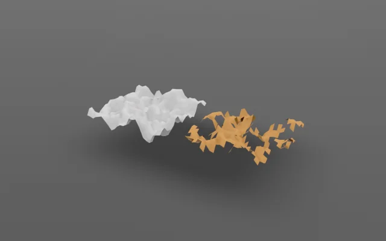

| Socket | Type | Kind | Default | Description |
| --- | --- | --- | --- | --- |
| `mesh` | geometry | input |  |  |
| `maxSlope` | float | input | `45` | Steepest walkable slope, degrees. Range 0 to 90. |
| `stepHeight` | float | input | `35` | Tallest step a character climbs. At least 0. |
| `clearance` | float | input | `180` | Free height needed above; 0 skips the test. At least 0. |
| `up` | vector | input | `[0, 1, 0]` |  |
| `mesh` | geometry | output |  |  |
| `walkable` | bool | output, field |  | Face selection. |

| Property | Options | Default | Description |
| --- | --- | --- | --- |
| `mode` | `select`, `separate` | `select` |  |

## Geometry

### Bake

Saves what reaches it to disk, then gives that back instead of evaluating the nodes before it: freeze an expensive result, or a simulation, so playing and editing downstream stay fast. Bake and Delete Bake are in the Node Editor's side panel. Still saves one result; Animation saves one per frame over the playback range. Items carry values besides the geometry.

| Socket | Type | Kind | Default | Description |
| --- | --- | --- | --- | --- |
| `geometry` | geometry | input |  |  |
| `geometry` | geometry | output |  |  |

| Property | Options | Default | Description |
| --- | --- | --- | --- |
| `mode` | `still`, `animation` | `still` | still: one result for every frame; animation: one per frame. |

### Bounding Box

A box mesh around everything, instances included.

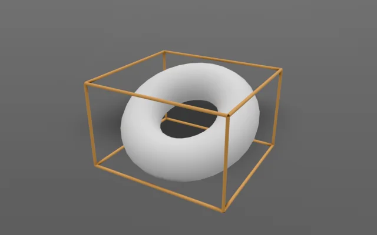

| Socket | Type | Kind | Default | Description |
| --- | --- | --- | --- | --- |
| `geometry` | geometry | input |  |  |
| `boundingBox` | geometry | output |  |  |
| `min` | vector | output |  |  |
| `max` | vector | output |  |  |

### Bounding Shape

A fitted shape containing every point: axis box, minimum oriented box, sphere, cylinder, capsule or convex hull.

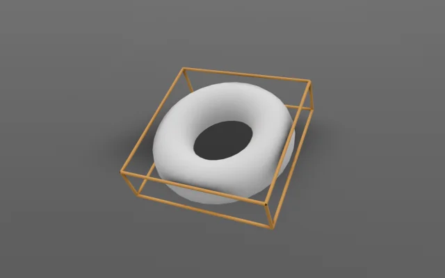

| Socket | Type | Kind | Default | Description |
| --- | --- | --- | --- | --- |
| `geometry` | geometry | input |  |  |
| `segments` | int | input | `16` | Sides of round shapes. Range 3 to 256. |
| `mesh` | geometry | output |  |  |
| `center` | vector | output |  |  |
| `size` | vector | output |  |  |

| Property | Options | Default | Description |
| --- | --- | --- | --- |
| `shape` | `box`, `orientedBox`, `sphere`, `cylinder`, `capsule`, `hull` | `orientedBox` |  |

### Convex Hull

The smallest convex mesh round every point of the geometry.

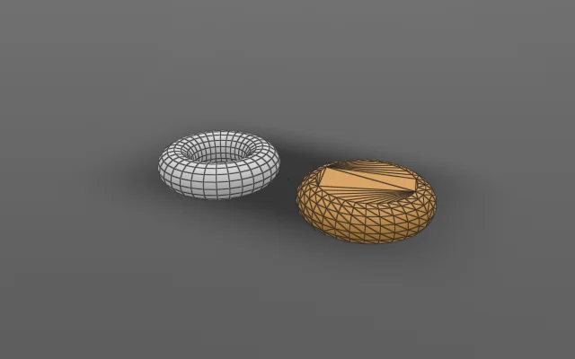

| Socket | Type | Kind | Default | Description |
| --- | --- | --- | --- | --- |
| `geometry` | geometry | input |  |  |
| `maxPoints` | int | input | `0` | Above this many points the hull is built from extreme points only; 0 uses all. Range 0 to 2147483647. |
| `convexHull` | geometry | output |  |  |

### Delete Geometry

Removes the selected elements. Deleting points or edges also removes the faces using them.

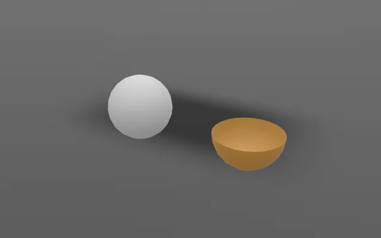

| Socket | Type | Kind | Default | Description |
| --- | --- | --- | --- | --- |
| `geometry` | geometry | input |  |  |
| `selection` | bool | input, field | `true` | Elements to affect. |
| `geometry` | geometry | output |  |  |

| Property | Options | Default | Description |
| --- | --- | --- | --- |
| `domain` | `point`, `edge`, `face`, `curve`, `instance` | `point` |  |

### Duplicate Elements

Copies each selected element amount times; faces become separate pieces. Duplicate Index counts the copies from 0.

| Socket | Type | Kind | Default | Description |
| --- | --- | --- | --- | --- |
| `geometry` | geometry | input |  |  |
| `selection` | bool | input, field | `true` | Elements to affect. |
| `amount` | int | input, field | `1` | Range 0 to 100000. |
| `geometry` | geometry | output |  |  |
| `duplicateIndex` | int | output, field |  |  |

| Property | Options | Default | Description |
| --- | --- | --- | --- |
| `domain` | `point`, `face`, `curve`, `instance` | `point` |  |

### Geometry Proximity

Closest point on the target's faces, edges or points.

| Socket | Type | Kind | Default | Description |
| --- | --- | --- | --- | --- |
| `targetGeometry` | geometry | input |  |  |
| `sourcePosition` | vector | input, field | Position |  |
| `position` | vector | output, field |  |  |
| `distance` | float | output, field |  |  |

| Property | Options | Default | Description |
| --- | --- | --- | --- |
| `targetElement` | `faces`, `edges`, `points` | `faces` |  |

### Join Geometry

Merges every connected geometry into one, component by component.

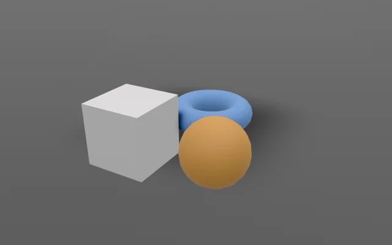

| Socket | Type | Kind | Default | Description |
| --- | --- | --- | --- | --- |
| `geometry` | geometry | input, multi |  |  |
| `geometry` | geometry | output |  |  |

### Merge by Distance

Type `MergeByDistance`.

Welds selected points closer than the distance.

| Socket | Type | Kind | Default | Description |
| --- | --- | --- | --- | --- |
| `geometry` | geometry | input |  |  |
| `selection` | bool | input, field | `true` | Elements to affect. |
| `distance` | float | input | `0.1` | At least 0. |
| `geometry` | geometry | output |  |  |

### Raycast

Casts a ray from each element against the target mesh. The attribute is read on the target's points and interpolated at the hit.

| Socket | Type | Kind | Default | Description |
| --- | --- | --- | --- | --- |
| `targetGeometry` | geometry | input |  |  |
| `attribute` | float | input, field | `0` |  |
| `sourcePosition` | vector | input, field | Position |  |
| `rayDirection` | vector | input, field | `[0, -1, 0]` |  |
| `rayLength` | float | input, field | `100000` | At least 0. |
| `isHit` | bool | output, field |  |  |
| `hitPosition` | vector | output, field |  |  |
| `hitNormal` | vector | output, field |  |  |
| `hitDistance` | float | output, field |  |  |
| `attribute` | float | output, field |  |  |

| Property | Options | Default | Description |
| --- | --- | --- | --- |
| `dataType` | `float`, `vector`, `int`, `bool` | `float` |  |
| `mapping` | `interpolated`, `nearest` | `interpolated` |  |

### Sample Index

Reads a field from another geometry at an index.

| Socket | Type | Kind | Default | Description |
| --- | --- | --- | --- | --- |
| `geometry` | geometry | input |  |  |
| `value` | float | input, field | `0` |  |
| `index` | int | input, field | Index |  |
| `value` | float | output, field |  |  |

| Property | Options | Default | Description |
| --- | --- | --- | --- |
| `dataType` | `float`, `int`, `vector`, `bool`, `rotation`, `color` | `float` |  |
| `domain` | `point`, `edge`, `face`, `corner`, `curve`, `instance` | `point` |  |
| `clamp` | `false`, `true` | `false` |  |

### Sample Nearest

Index of the element of another geometry closest to each position. Pair with Sample Index.

| Socket | Type | Kind | Default | Description |
| --- | --- | --- | --- | --- |
| `geometry` | geometry | input |  |  |
| `samplePosition` | vector | input, field | Position |  |
| `index` | int | output, field |  |  |

| Property | Options | Default | Description |
| --- | --- | --- | --- |
| `domain` | `point`, `edge`, `face`, `corner` | `point` |  |

### Separate Geometry

Splits geometry into the selected part and the rest.

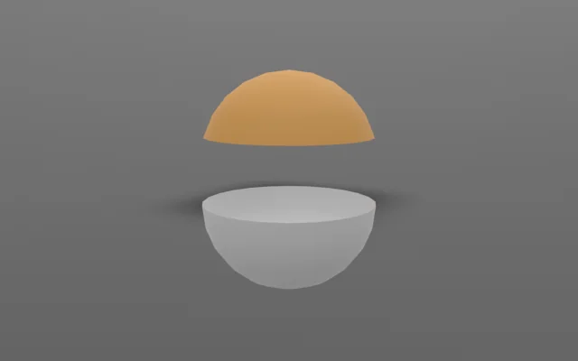

| Socket | Type | Kind | Default | Description |
| --- | --- | --- | --- | --- |
| `geometry` | geometry | input |  |  |
| `selection` | bool | input, field | `true` | Elements to affect. |
| `selection` | geometry | output |  |  |
| `inverted` | geometry | output |  |  |

| Property | Options | Default | Description |
| --- | --- | --- | --- |
| `domain` | `point`, `edge`, `face`, `curve`, `instance` | `point` |  |

### Set Position

Moves points (and instances) to a position plus an offset.

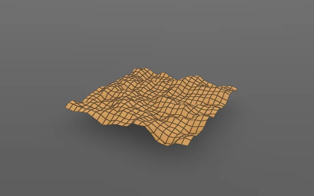

| Socket | Type | Kind | Default | Description |
| --- | --- | --- | --- | --- |
| `geometry` | geometry | input |  |  |
| `selection` | bool | input, field | `true` | Elements to affect. |
| `position` | vector | input, field | Position |  |
| `offset` | vector | input, field | `[0, 0, 0]` |  |
| `geometry` | geometry | output |  |  |

### Set Radius

Sets the "radius" attribute of points and curve points (curve radius scales the profile in Curve to Mesh).

| Socket | Type | Kind | Default | Description |
| --- | --- | --- | --- | --- |
| `geometry` | geometry | input |  |  |
| `selection` | bool | input, field | `true` | Elements to affect. |
| `radius` | float | input, field | `1` | At least 0. |
| `geometry` | geometry | output |  |  |

### Transform Geometry

Moves, rotates and scales all of the geometry.

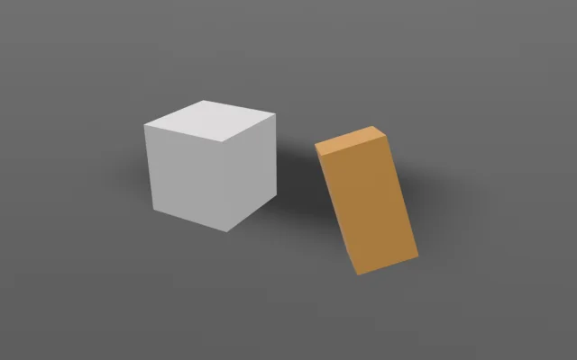

| Socket | Type | Kind | Default | Description |
| --- | --- | --- | --- | --- |
| `geometry` | geometry | input |  |  |
| `translation` | vector | input | `[0, 0, 0]` |  |
| `rotation` | rotation | input | `[0, 0, 0]` |  |
| `scale` | vector | input | `[1, 1, 1]` |  |
| `geometry` | geometry | output |  |  |

| Property | Options | Default | Description |
| --- | --- | --- | --- |
| `mode` | `components`, `matrix` | `components` | components: separate translation, rotation and scale; matrix: one transform matrix. |

## Group

### For Each Element

Runs a node group once per element of the geometry, each run seeing only that element, and joins what they return. Int inputs named index and count read the element's number and how many there are. Runs are evaluated in parallel; data outputs come from the last element.

| Property | Options | Default | Description |
| --- | --- | --- | --- |
| `group` |  |  | Name of the node group to run per element. |
| `element` | `part`, `face`, `curve`, `instance` | `part` | part: each connected mesh part; face: each mesh face; curve: each curve; instance: each instance, realized. |

### Group

Runs another node group inside this one. Its exposed inputs are this node's inputs and its outputs are this node's outputs. Editing that group updates every group using it.

| Property | Options | Default | Description |
| --- | --- | --- | --- |
| `group` |  |  | Name of the node group to run. |

### Group Input

The modifier's input mesh and the group's exposed parameters.

| Socket | Type | Kind | Default | Description |
| --- | --- | --- | --- | --- |
| `geometry` | geometry | output |  | The mesh coming up the modifier stack. |

### Group Output

What the modifier passes up the stack. Instances are realized and only the mesh is kept. The group's outputs are what a Group node using it gives back.

| Socket | Type | Kind | Default | Description |
| --- | --- | --- | --- | --- |
| `geometry` | geometry | input |  |  |

### Repeat

Type `RepeatGroup`.

Runs a node group again and again, each pass taking the last one's results: its output geometry becomes the next pass's geometry, and each output named like an input feeds that input. An Int input named iteration reads the pass number, from 0.

| Property | Options | Default | Description |
| --- | --- | --- | --- |
| `group` |  |  | Name of the node group to repeat. |

## Input

### Active Camera

The camera of the viewport last clicked or focused, in world space. A group using this re-evaluates as that camera moves. Angles are in radians.

| Socket | Type | Kind | Default | Description |
| --- | --- | --- | --- | --- |
| `location` | vector | output |  |  |
| `rotation` | rotation | output |  |  |
| `forward` | vector | output |  |  |
| `horizontalFov` | float | output |  |  |
| `verticalFov` | float | output |  |  |
| `orthographic` | bool | output |  |  |
| `orthoSize` | vector | output |  |  |

### Boolean

A constant bool.

| Socket | Type | Kind | Default | Description |
| --- | --- | --- | --- | --- |
| `value` | bool | input | `false` |  |
| `value` | bool | output |  |  |

### ID

The "id" attribute, or the index when there is none.

| Socket | Type | Kind | Default | Description |
| --- | --- | --- | --- | --- |
| `value` | int | output, field |  |  |

### Import Mesh

Reads an OBJ, STL or PLY file (a PLY without faces as points). Objects in the file are joined. Reread when the file changes.

| Socket | Type | Kind | Default | Description |
| --- | --- | --- | --- | --- |
| `path` | string | input |  |  |
| `scale` | float | input | `1` | Uniform scale, like 100 for a file in metres. At least 0. |
| `geometry` | geometry | output |  |  |

### Index

Element index on the evaluated domain.

| Socket | Type | Kind | Default | Description |
| --- | --- | --- | --- | --- |
| `value` | int | output, field |  |  |

### Integer

A constant int.

| Socket | Type | Kind | Default | Description |
| --- | --- | --- | --- | --- |
| `value` | int | input | `0` |  |
| `value` | int | output |  |  |

### Is Viewport

True while the viewport shows the result; false while it is exported, sent to Unreal or rendered. Switch on it to keep the viewport light and the output detailed.

| Socket | Type | Kind | Default | Description |
| --- | --- | --- | --- | --- |
| `isViewport` | bool | output |  |  |

### Normal

Surface normal on the evaluated domain.

| Socket | Type | Kind | Default | Description |
| --- | --- | --- | --- | --- |
| `value` | vector | output, field |  |  |

### Object Info

Another mesh or curve object's evaluated shape and transform. Its mesh (or splines) and world matrix are connected into the modifier, so editing it re-evaluates this group. A curve comes out as curves; instance places it like world.

| Socket | Type | Kind | Default | Description |
| --- | --- | --- | --- | --- |
| `location` | vector | output |  |  |
| `rotation` | rotation | output |  |  |
| `scale` | vector | output |  |  |
| `geometry` | geometry | output |  |  |

| Property | Options | Default | Description |
| --- | --- | --- | --- |
| `object` |  |  | Name of the mesh or curve object. |
| `transformSpace` | `original`, `world`, `instance` | `original` | original keeps the mesh in its own space; world applies its world matrix; instance passes one instance of the mesh placed by its world matrix, which simulation nodes follow as a moving object. |
| `relativeTo` | `world`, `owner` | `world` | world reads the object's transform as it is in the scene; owner reads it relative to the mesh this group runs on (where it stood when the object was connected), so moving both together changes nothing. |

### Position

Point positions, or the averaged positions on other domains.

| Socket | Type | Kind | Default | Description |
| --- | --- | --- | --- | --- |
| `value` | vector | output, field |  |  |

### Radius

The "radius" attribute of points and curves (1 when missing).

| Socket | Type | Kind | Default | Description |
| --- | --- | --- | --- | --- |
| `value` | float | output, field |  |  |

### Read Data Table

A point per row of a CSV file (header row first) or JSON array of objects. Columns x, y, z (or position_x...) place the points; other columns become point attributes: numbers, true/false, vectors from name_x/_y/_z or three-number arrays, and text as ints numbering its distinct values. Reread when the file changes.

| Socket | Type | Kind | Default | Description |
| --- | --- | --- | --- | --- |
| `path` | string | input |  |  |
| `points` | geometry | output |  |  |
| `rows` | int | output, field |  |  |

| Property | Options | Default | Description |
| --- | --- | --- | --- |
| `format` | `auto`, `csv`, `json` | `auto` |  |

### Scene Time

The current time. A group using this makes its modifier re-evaluate whenever the time changes.

| Socket | Type | Kind | Default | Description |
| --- | --- | --- | --- | --- |
| `fps` | float | input | `30` | Frames per second for the frame output. At least 0. |
| `seconds` | float | output |  |  |
| `frame` | float | output |  |  |

### Self Object

The world transform of the object the modifier is on, as location, rotation and scale. Inside a nested group it is the identity.

| Socket | Type | Kind | Default | Description |
| --- | --- | --- | --- | --- |
| `location` | vector | output, field |  |  |
| `rotation` | rotation | output, field |  |  |
| `scale` | vector | output, field |  |  |

### String

A constant string.

| Socket | Type | Kind | Default | Description |
| --- | --- | --- | --- | --- |
| `value` | string | input |  |  |
| `value` | string | output |  |  |

### Value

A constant float.

| Socket | Type | Kind | Default | Description |
| --- | --- | --- | --- | --- |
| `value` | float | input | `0.5` |  |
| `value` | float | output |  |  |

### Vector

A constant vector.

| Socket | Type | Kind | Default | Description |
| --- | --- | --- | --- | --- |
| `value` | vector | input | `[0, 0, 0]` |  |
| `value` | vector | output |  |  |

## Instances

### Geometry to Instance

Type `GeometryToInstance`.

Turns each linked geometry into one instance at the origin, in link order, so Pick Instance can choose between them.

| Socket | Type | Kind | Default | Description |
| --- | --- | --- | --- | --- |
| `geometry` | geometry | input, multi |  |  |
| `instances` | geometry | output |  |  |

### Instance on Curve

Type `InstanceOnCurve`.

Places copies of the instance geometry along the first curve, by count or by spacing (0 spacing is the instance's own length along the forward axis), each turned onto the curve's frame.

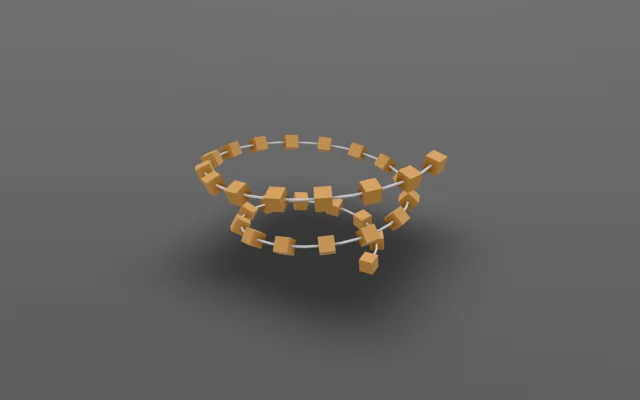

| Socket | Type | Kind | Default | Description |
| --- | --- | --- | --- | --- |
| `curve` | geometry | input |  |  |
| `instance` | geometry | input |  |  |
| `count` | int | input | `5` | Range 1 to 100000. |
| `spacing` | float | input | `0` | Step between copies, cm. At least 0. |
| `fitToLength` | bool | input | `true` | Spacing: even the step so copies run end to end. |
| `startOffset` | float | input | `0` | cm. At least 0. |
| `endOffset` | float | input | `0` | cm. At least 0. |
| `align` | bool | input | `true` |  |
| `instances` | geometry | output |  |  |

| Property | Options | Default | Description |
| --- | --- | --- | --- |
| `fill` | `count`, `spacing` | `count` |  |
| `forwardAxis` | `+x`, `-x`, `+y`, `-y`, `+z`, `-z` | `+x` |  |
| `upMode` | `curveFrames`, `autoNormals` | `curveFrames` |  |

### Instance on Points

Type `InstanceOnPoints`.

Places a copy of the instance geometry on every selected point. Point attributes carry over to the instances.

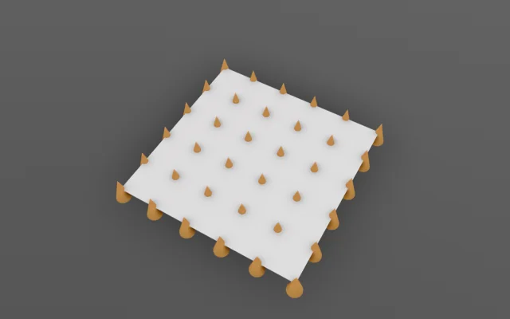

| Socket | Type | Kind | Default | Description |
| --- | --- | --- | --- | --- |
| `points` | geometry | input |  |  |
| `selection` | bool | input, field | `true` | Elements to affect. |
| `instance` | geometry | input |  |  |
| `pickInstance` | bool | input | `false` | Pick one of the instance geometry's own instances per point. |
| `instanceIndex` | int | input, field | Id |  |
| `rotation` | rotation | input, field | `[0, 0, 0]` |  |
| `scale` | vector | input, field | `[1, 1, 1]` |  |
| `instances` | geometry | output |  |  |

### Instance Rotation

Each instance's rotation.

| Socket | Type | Kind | Default | Description |
| --- | --- | --- | --- | --- |
| `rotation` | rotation | output, field |  |  |

### Instance Scale

Each instance's scale.

| Socket | Type | Kind | Default | Description |
| --- | --- | --- | --- | --- |
| `scale` | vector | output, field |  |  |

### Instance Transform

Each instance's whole transform as a matrix.

| Socket | Type | Kind | Default | Description |
| --- | --- | --- | --- | --- |
| `transform` | matrix | output, field |  |  |

### Instances to Points

Type `InstancesToPoints`.

A point for each selected instance, at its position by default, carrying the instance attributes.

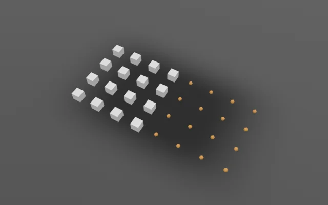

| Socket | Type | Kind | Default | Description |
| --- | --- | --- | --- | --- |
| `instances` | geometry | input |  |  |
| `selection` | bool | input, field | `true` | Elements to affect. |
| `position` | vector | input, field | Position |  |
| `radius` | float | input, field | `5` | At least 0. |
| `points` | geometry | output |  |  |

### Realize Instances

Turns instances into real geometry.

| Socket | Type | Kind | Default | Description |
| --- | --- | --- | --- | --- |
| `geometry` | geometry | input |  |  |
| `geometry` | geometry | output |  |  |

### Rotate Instances

Turns instances about a pivot. Local turns about each instance's own axes with the pivot in its own space; otherwise about the world axes with the pivot in world space.

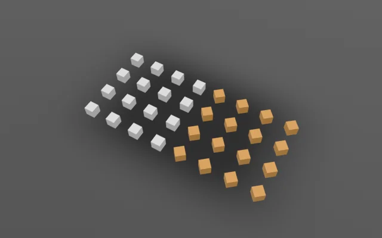

| Socket | Type | Kind | Default | Description |
| --- | --- | --- | --- | --- |
| `instances` | geometry | input |  |  |
| `selection` | bool | input, field | `true` | Elements to affect. |
| `rotation` | rotation | input, field | `[0, 0, 0]` |  |
| `pivotPoint` | vector | input, field | `[0, 0, 0]` |  |
| `local` | bool | input | `true` |  |
| `instances` | geometry | output |  |  |

### Scale Instances

Scales instances about a centre. Local scales along each instance's own axes with the centre in its own space.

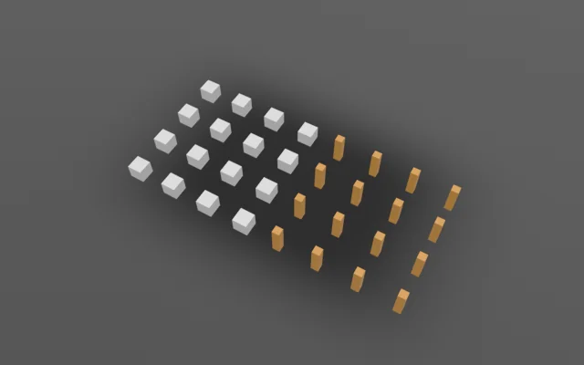

| Socket | Type | Kind | Default | Description |
| --- | --- | --- | --- | --- |
| `instances` | geometry | input |  |  |
| `selection` | bool | input, field | `true` | Elements to affect. |
| `scale` | vector | input, field | `[1, 1, 1]` |  |
| `center` | vector | input, field | `[0, 0, 0]` |  |
| `local` | bool | input | `true` |  |
| `instances` | geometry | output |  |  |

### Set Instance Transform

Sets instances' translation, rotation and scale. Rotation and scale change only when linked.

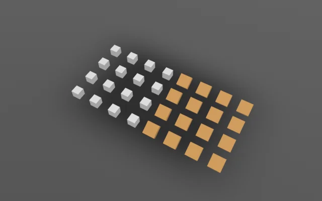

| Socket | Type | Kind | Default | Description |
| --- | --- | --- | --- | --- |
| `instances` | geometry | input |  |  |
| `selection` | bool | input, field | `true` | Elements to affect. |
| `translation` | vector | input, field | Position |  |
| `rotation` | rotation | input, field | `[0, 0, 0]` |  |
| `scale` | vector | input, field | `[1, 1, 1]` |  |
| `instances` | geometry | output |  |  |

| Property | Options | Default | Description |
| --- | --- | --- | --- |
| `mode` | `components`, `matrix` | `components` | components: separate translation, rotation and scale; matrix: one transform matrix. |

### Translate Instances

Moves instances. Local moves along each instance's own axes (its rotation and scale apply).

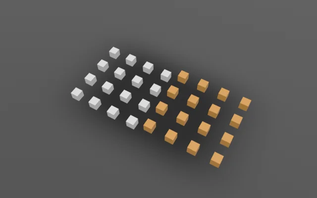

| Socket | Type | Kind | Default | Description |
| --- | --- | --- | --- | --- |
| `instances` | geometry | input |  |  |
| `selection` | bool | input, field | `true` | Elements to affect. |
| `translation` | vector | input, field | `[0, 0, 0]` |  |
| `local` | bool | input | `true` |  |
| `instances` | geometry | output |  |  |

## Layout

### Receive

Type `PortalReceive`.

Reads the value of the Send node with its name, without a wire. Takes that value's type.

| Socket | Type | Kind | Default | Description |
| --- | --- | --- | --- | --- |
| `value` | float | output |  |  |

| Property | Options | Default | Description |
| --- | --- | --- | --- |
| `name` |  |  | The Send node to read. |

### Reroute

A point a wire passes through, to steer it. Takes the type of whatever feeds it and can feed several inputs.

| Socket | Type | Kind | Default | Description |
| --- | --- | --- | --- | --- |
| `input` | float | input |  |  |
| `output` | float | output |  |  |

### Send

Type `PortalSend`.

Names the value wired into it, so Receive nodes anywhere in the group can read it without a wire.

| Socket | Type | Kind | Default | Description |
| --- | --- | --- | --- | --- |
| `value` | float | input |  |  |

| Property | Options | Default | Description |
| --- | --- | --- | --- |
| `name` |  |  | What Receive nodes call this value. |

## Mesh

### Bevel

Bevels the selected manifold edges.

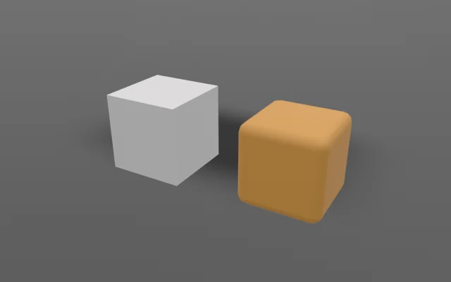

| Socket | Type | Kind | Default | Description |
| --- | --- | --- | --- | --- |
| `mesh` | geometry | input |  |  |
| `selection` | bool | input, field | `true` | Elements to affect. |
| `offset` | float | input | `5` | Width from each edge to the new edges. At least 0. |
| `segments` | int | input | `1` | Range 1 to 100. |
| `profile` | float | input | `0.5` | 0.5 round, 0.25 straight, towards 1 square. Range 0 to 1. |
| `clamp` | bool | input | `true` | Keep offsets from overlapping. |
| `smoothingAngle` | float | input | `30` | New edges sharper than this many degrees are hard; negative leaves them soft. |
| `mesh` | geometry | output |  |  |
| `bevel` | bool | output, field |  | The new bevel faces. |

### Bridge Edge Loops

Joins pairs of open border loops among the selected edges with faces; loops of different lengths make up the difference with quads.

| Socket | Type | Kind | Default | Description |
| --- | --- | --- | --- | --- |
| `mesh` | geometry | input |  |  |
| `selection` | bool | input, field | `true` | Elements to affect. |
| `divisions` | int | input | `0` | Extra rows of faces between the loops; -1 picks them from the gap and the open ends. Range -1 to 1000. |
| `smoothness` | float | input | `1` | 0 straightens the curve, 1 is the full curve. Range 0 to 1. |
| `tensionSource` | float | input | `1` |  |
| `tensionTarget` | float | input | `1` |  |
| `offset` | int | input | `0` | Steps the pairing round closed loops. |
| `twist` | float | input | `0` | Degrees from source to target. |
| `taper` | float | input | `1` | Scale of the middle rows. |
| `bias` | float | input | `0.5` | Where the taper peaks. Range 0 to 1. |
| `profileFactor` | float | input | `0` | Bulge (positive) or pinch of the middle rows. |
| `weldEnds` | bool | input | `true` | Open bridges land their end rows on the border between the sides' ends. |
| `relax` | int | input | `0` | Smoothing passes over the new points. Range 0 to 100. |
| `merge` | bool | input | `false` | Merge the loops instead of bridging. |
| `mergeFactor` | float | input | `0.5` | Range 0 to 1. |
| `mesh` | geometry | output |  |  |
| `bridge` | bool | output, field |  | The new faces. |

| Property | Options | Default | Description |
| --- | --- | --- | --- |
| `curve` | `linear`, `blend`, `auto` | `linear` | Linear rows, a blend square to each border, or a fit to the faces around them. |
| `profileShape` | `smooth`, `sphere`, `root`, `sharp`, `linear`, `inverseSquare`, `constant` | `smooth` |  |
| `transition` | `quads`, `triangles` | `quads` | How borders of different lengths make up the difference. |
| `connect` | `pairs`, `chain`, `chainClosed` | `pairs` | Pairs, or one run through every loop in order. |

### Clay

Melts spheres at points and tubes along curves into one surface with smooth joins: blobby creatures, vines, roots, horns. Either input can cut instead, carving into the other.

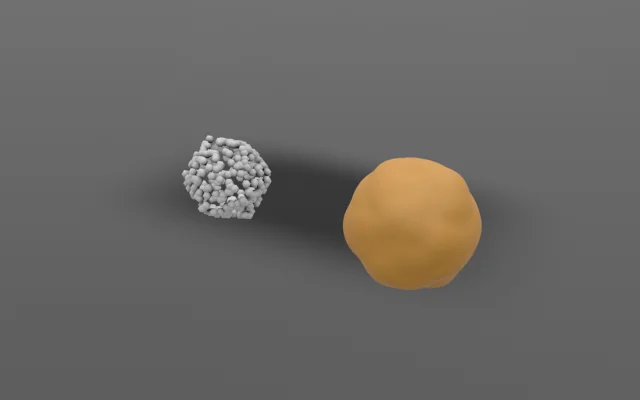

| Socket | Type | Kind | Default | Description |
| --- | --- | --- | --- | --- |
| `points` | geometry | input |  |  |
| `pointRadius` | float | input, field | `5` | At least 0. |
| `cutWithPoints` | bool | input | `false` | The spheres carve into the tubes instead of adding. |
| `curves` | geometry | input |  |  |
| `curveRadius` | float | input, field | `2` | At least 0. |
| `cutWithCurves` | bool | input | `false` | The tubes carve into the spheres instead of adding. |
| `blend` | float | input | `2` | Radius of the smooth joins, cm; 0 is a hard edge. At least 0. |
| `voxelSize` | float | input | `0.5` | Lattice spacing, cm. Smaller is finer and slower. At least 0.01. |
| `sharpEdges` | bool | input | `false` | Keep hard joins sharp (dual contouring). |
| `mesh` | geometry | output |  |  |

### Decimate

Quadric edge-collapse reduction that keeps uvs, borders and hard edges.

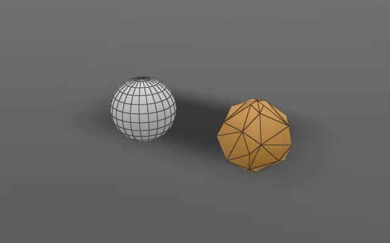

| Socket | Type | Kind | Default | Description |
| --- | --- | --- | --- | --- |
| `mesh` | geometry | input |  |  |
| `ratio` | float | input | `0.5` | Fraction of triangles to keep. Range 0 to 1. |
| `targetTriangles` | int | input | `0` | Positive overrides the ratio. Range 0 to 2147483647. |
| `keepBorders` | bool | input | `true` |  |
| `keepHardEdges` | bool | input | `true` |  |
| `quads` | bool | input | `false` | Join triangle pairs back into quads. |
| `mesh` | geometry | output |  |  |

| Property | Options | Default | Description |
| --- | --- | --- | --- |
| `symmetry` | `none`, `x`, `y`, `z` | `none` |  |

### Dual Mesh

Swaps faces and points: a point at each face centre, a face round each interior point. Open borders are dropped.

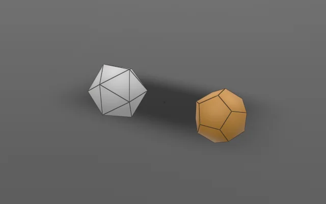

| Socket | Type | Kind | Default | Description |
| --- | --- | --- | --- | --- |
| `mesh` | geometry | input |  |  |
| `mesh` | geometry | output |  |  |

### Extrude Mesh

Extrudes faces by an offset (a field, the face normal by default) times the scale.

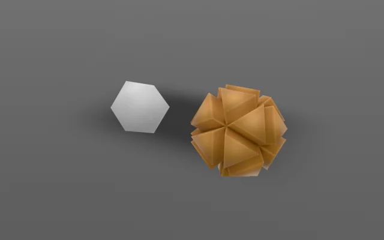

| Socket | Type | Kind | Default | Description |
| --- | --- | --- | --- | --- |
| `mesh` | geometry | input |  |  |
| `selection` | bool | input, field | `true` | Elements to affect. |
| `offset` | vector | input, field | Normal |  |
| `offsetScale` | float | input, field | `10` |  |
| `mesh` | geometry | output |  |  |
| `top` | bool | output, field |  |  |
| `side` | bool | output, field |  |  |

| Property | Options | Default | Description |
| --- | --- | --- | --- |
| `individual` | `true`, `false` | `true` | Each face separately, or connected regions together. |

### Flip Faces

Reverses the winding of the selected faces.

| Socket | Type | Kind | Default | Description |
| --- | --- | --- | --- | --- |
| `mesh` | geometry | input |  |  |
| `selection` | bool | input, field | `true` | Elements to affect. |
| `mesh` | geometry | output |  |  |

### Grid Fill

Fills holes, or replaces disc patches of faces such as a pole's fan, with a quad grid inside a ring of quads.

| Socket | Type | Kind | Default | Description |
| --- | --- | --- | --- | --- |
| `mesh` | geometry | input |  |  |
| `selection` | bool | input, field | `true` | Elements to affect. |
| `gridSize` | float | input | `0.4` | The grid's size against the hole. Range 0 to 1. |
| `rotate` | int | input | `0` | Steps the grid's corners round the border. |
| `mesh` | geometry | output |  |  |
| `fill` | bool | output, field |  | The new faces. |

| Property | Options | Default | Description |
| --- | --- | --- | --- |
| `mode` | `holes`, `faces` | `holes` | Holes bordered by the selected edges, or patches of selected faces. |

### Inset Faces

Insets the selected faces, leaving a ring of faces round each region.

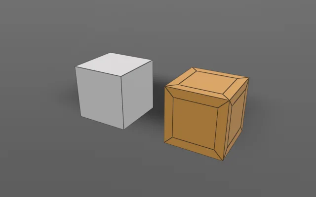

| Socket | Type | Kind | Default | Description |
| --- | --- | --- | --- | --- |
| `mesh` | geometry | input |  |  |
| `selection` | bool | input, field | `true` | Elements to affect. |
| `thickness` | float | input | `5` | Inward distance in the face plane. At least 0. |
| `depth` | float | input | `0` | Distance along the normals after the inset. |
| `individual` | bool | input | `false` | Each face separately instead of connected regions. |
| `clamp` | bool | input | `true` |  |
| `mesh` | geometry | output |  |  |
| `inner` | bool | output, field |  | The inset faces. |
| `rim` | bool | output, field |  | The new faces round them. |

### Mesh Boolean

Union, difference or intersection of closed meshes (Manifold), with the seam cleaned up. Difference subtracts every mesh B from mesh A.

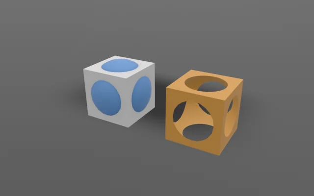

| Socket | Type | Kind | Default | Description |
| --- | --- | --- | --- | --- |
| `meshA` | geometry | input |  |  |
| `meshB` | geometry | input, multi |  |  |
| `cleanup` | bool | input | `true` | Weld slivers and stray points along the seam. |
| `splitNgons` | bool | input | `true` | Cut the n-gons along the seam into quads that carry on the edge loops. |
| `filletWidth` | float | input | `0` | Width of a rounded strip along the seam, cm; 0 keeps it sharp. At least 0. |
| `filletSegments` | int | input | `2` | Rows of faces across the fillet. Range 1 to 64. |
| `mesh` | geometry | output |  |  |

| Property | Options | Default | Description |
| --- | --- | --- | --- |
| `operation` | `difference`, `union`, `intersect` | `difference` |  |

### Mirror Mesh

Adds a mirrored copy across an axis plane, welded on the plane.

| Socket | Type | Kind | Default | Description |
| --- | --- | --- | --- | --- |
| `mesh` | geometry | input |  |  |
| `selection` | bool | input, field | `true` | Elements to affect. |
| `offset` | float | input | `0` | Where the plane lies along its axis. |
| `weld` | bool | input | `true` | Merge points on the plane with their mirror images. |
| `tolerance` | float | input | `0.001` | At least 0. |
| `mesh` | geometry | output |  |  |

| Property | Options | Default | Description |
| --- | --- | --- | --- |
| `axis` | `x`, `y`, `z` | `x` |  |
| `direction` | `both`, `positive`, `negative` | `both` | Positive keeps the side the axis points to and rebuilds the other. |

### Quad Remesh

Field-aligned quad remesh following curvature and sharp edges.

| Socket | Type | Kind | Default | Description |
| --- | --- | --- | --- | --- |
| `mesh` | geometry | input |  |  |
| `targetFaces` | int | input | `500` | Range 1 to 10000000. |
| `targetEdgeLength` | float | input | `0` | Positive overrides the face count. At least 0. |
| `adaptivity` | float | input | `0.25` | 0 uniform, 1 denser where curved. Range 0 to 1. |
| `sharpAngle` | float | input | `40` | Edges sharper than this many degrees steer the flow; negative off. |
| `pureQuads` | bool | input | `true` |  |
| `mesh` | geometry | output |  |  |

| Property | Options | Default | Description |
| --- | --- | --- | --- |
| `symmetry` | `none`, `x`, `y`, `z` | `none` |  |

### Scale Elements

Scales each connected group of selected faces or edges about its centre.

| Socket | Type | Kind | Default | Description |
| --- | --- | --- | --- | --- |
| `mesh` | geometry | input |  |  |
| `selection` | bool | input, field | `true` | Elements to affect. |
| `scale` | float | input, field | `1` |  |
| `center` | vector | input, field | `[0, 0, 0]` | Per-element centre, averaged per group. Unlinked: the elements' own centres. |
| `axis` | vector | input | `[1, 0, 0]` | Direction for single-axis scaling. |
| `mesh` | geometry | output |  |  |

| Property | Options | Default | Description |
| --- | --- | --- | --- |
| `domain` | `face`, `edge` | `face` |  |
| `scaleMode` | `uniform`, `singleAxis` | `uniform` |  |

### Set Mesh Normal

Custom normals (free: any direction per point, face or corner), or smoothing from sharp edges and faces, or smoothing by angle. Custom normals are the corner normal layer that FBX exports and the viewport shades with.

| Socket | Type | Kind | Default | Description |
| --- | --- | --- | --- | --- |
| `mesh` | geometry | input |  |  |
| `customNormal` | vector | input, field | Normal | The normal; normalized. Defaults to the current normal. |
| `mesh` | geometry | output |  |  |

| Property | Options | Default | Description |
| --- | --- | --- | --- |
| `mode` | `free`, `sharpness`, `smoothByAngle` | `free` |  |
| `domain` | `point`, `face`, `corner` | `point` |  |

### Set Shade Smooth

Smooth or flat shading through hard edges: flat faces harden their edges.

| Socket | Type | Kind | Default | Description |
| --- | --- | --- | --- | --- |
| `mesh` | geometry | input |  |  |
| `selection` | bool | input, field | `true` | Elements to affect. |
| `shadeSmooth` | bool | input, field | `true` |  |
| `mesh` | geometry | output |  |  |

| Property | Options | Default | Description |
| --- | --- | --- | --- |
| `domain` | `face`, `edge` | `face` |  |

### Shrinkwrap

Moves the selected points onto the target's surface.

| Socket | Type | Kind | Default | Description |
| --- | --- | --- | --- | --- |
| `mesh` | geometry | input |  |  |
| `selection` | bool | input, field | `true` | Elements to affect. |
| `target` | geometry | input |  | Mesh to wrap onto. |
| `offset` | float | input | `0` | Distance to stay off the target, outward. |
| `direction` | vector | input | `[0, -1, 0]` | Projection direction for direction mode. |
| `maxDistance` | float | input | `-1` | Points farther than this stay put; negative is unlimited. |
| `mesh` | geometry | output |  |  |

| Property | Options | Default | Description |
| --- | --- | --- | --- |
| `mode` | `nearestSurface`, `normal`, `direction`, `nearestVertex` | `nearestSurface` |  |

### Smooth Mesh

Smooths the selected points.

| Socket | Type | Kind | Default | Description |
| --- | --- | --- | --- | --- |
| `mesh` | geometry | input |  |  |
| `selection` | bool | input, field | `true` | Elements to affect. |
| `iterations` | int | input | `5` | Range 0 to 1000. |
| `strength` | float | input | `0.5` | Range 0 to 1. |
| `pinBorders` | bool | input | `true` |  |
| `mesh` | geometry | output |  |  |

| Property | Options | Default | Description |
| --- | --- | --- | --- |
| `mode` | `relax`, `laplacian` | `relax` | Relax evens the points out on the surface; laplacian smooths the shape, which shrinks it. |

### Solidify

Gives the surface thickness: an inner shell along the point normals, joined at open borders.

| Socket | Type | Kind | Default | Description |
| --- | --- | --- | --- | --- |
| `mesh` | geometry | input |  |  |
| `thickness` | float | input | `5` |  |
| `offset` | float | input | `-1` | -1 grows inward from the surface, 1 outward, 0 both ways. Range -1 to 1. |
| `fillRim` | bool | input | `true` | Close open borders between the two shells. |
| `mesh` | geometry | output |  |  |

### Split Edges

Disconnects the faces on either side of the selected edges.

| Socket | Type | Kind | Default | Description |
| --- | --- | --- | --- | --- |
| `mesh` | geometry | input |  |  |
| `selection` | bool | input, field | `true` | Elements to affect. |
| `mesh` | geometry | output |  |  |

### Subdivide Mesh

Splits every face into quads without smoothing. Uvs and colours are interpolated.

| Socket | Type | Kind | Default | Description |
| --- | --- | --- | --- | --- |
| `mesh` | geometry | input |  |  |
| `level` | int | input | `1` | Range 0 to 6. |
| `mesh` | geometry | output |  |  |

### Subdivision Surface

Catmull-Clark subdivision. Edge "crease" attributes keep edges sharp.

| Socket | Type | Kind | Default | Description |
| --- | --- | --- | --- | --- |
| `mesh` | geometry | input |  |  |
| `level` | int | input | `1` | Range 0 to 6. |
| `mesh` | geometry | output |  |  |

| Property | Options | Default | Description |
| --- | --- | --- | --- |
| `uvs` | `fitSurface`, `blend` | `fitSurface` | Island interior uvs: spread evenly over the smoothed surface, or smoothed like the points. |
| `uvCorners` | `keep`, `smooth` | `keep` | Island corner uvs: kept where the input has them, or smoothed with the border. |

### Triangulate

Splits the selected faces into triangles.

| Socket | Type | Kind | Default | Description |
| --- | --- | --- | --- | --- |
| `mesh` | geometry | input |  |  |
| `selection` | bool | input, field | `true` | Elements to affect. |
| `mesh` | geometry | output |  |  |

| Property | Options | Default | Description |
| --- | --- | --- | --- |
| `quadMethod` | `shortestDiagonal`, `fixed` | `shortestDiagonal` |  |

### Voxel Remesh

Rebuilds the mesh as one closed quad surface, closing holes and merging overlaps.

| Socket | Type | Kind | Default | Description |
| --- | --- | --- | --- | --- |
| `mesh` | geometry | input |  |  |
| `resolution` | int | input | `128` | Voxels along the longest side. Range 4 to 2048. |
| `project` | bool | input | `true` | Pull the result onto the input surface. |
| `mesh` | geometry | output |  |  |

## Mesh Analysis

### Ambient Occlusion

How open each element is to its surroundings: 1 when nothing of the mesh lies within the distance above it, 0 when it is fully enclosed. Rays are spread over the hemisphere around the normal.

| Socket | Type | Kind | Default | Description |
| --- | --- | --- | --- | --- |
| `samples` | int | input | `16` | Range 1 to 1024. |
| `distance` | float | input | `100` | At least 0. |
| `ao` | float | output, field |  |  |
| `occlusion` | float | output, field |  |  |

### Cavity

How far each point sits below (cavity) or above (convexity) the average of the surface around it, 0 to 1. Larger radii pick up broader shapes. Good for dirt and edge-wear masks.

| Socket | Type | Kind | Default | Description |
| --- | --- | --- | --- | --- |
| `radius` | float | input | `10` | Distance around each point that counts as its surroundings. At least 0. |
| `strength` | float | input | `1` | Contrast of the result. At least 0. |
| `cavity` | float | output, field |  |  |
| `convexity` | float | output, field |  |  |

### Curvature

Surface curvature per point, in 1 / scene units: mean (positive on convex bumps, negative in hollows), Gaussian (positive on domes, negative on saddles) and the principal curvatures.

| Socket | Type | Kind | Default | Description |
| --- | --- | --- | --- | --- |
| `mean` | float | output, field |  |  |
| `gaussian` | float | output, field |  |  |
| `minimum` | float | output, field |  |  |
| `maximum` | float | output, field |  |  |

### Feature Edges

Classifies edges: sharp where two faces meet at more than the angle, boundary with one face, non-manifold with none or more than two. Feature is any of them.

| Socket | Type | Kind | Default | Description |
| --- | --- | --- | --- | --- |
| `angle` | float | input | `30` | Degrees of bend between faces that counts as sharp. Range 0 to 180. |
| `feature` | bool | output, field |  |  |
| `sharp` | bool | output, field |  |  |
| `boundary` | bool | output, field |  |  |
| `nonManifold` | bool | output, field |  |  |

### Flood Fill

Grows a point selection along edges, a ring per step, without crossing to a point whose normal turns more than the angle limit. Steps of 0 grow until nothing more can be reached.

| Socket | Type | Kind | Default | Description |
| --- | --- | --- | --- | --- |
| `seed` | bool | input, field | `false` | Points to grow from. |
| `steps` | int | input | `1` | At least 0. |
| `angleLimit` | float | input | `180` | Degrees between neighbouring normals that still grows. Range 0 to 180. |
| `selection` | bool | output, field |  |  |
| `step` | int | output, field |  | Step each point was reached in, 0 for seeds, -1 if never. |

### Geodesic Distance

Distance over the surface from each point to the nearest source point, and which source that is. Points no source reaches read 0 and -1.

| Socket | Type | Kind | Default | Description |
| --- | --- | --- | --- | --- |
| `source` | bool | input, field | `false` | Points the distance is measured from. |
| `distance` | float | output, field |  |  |
| `sourceIndex` | int | output, field |  |  |

### Thickness

Distance through the mesh from each element straight back against its normal to the far side. Open areas with nothing behind them read the max distance.

| Socket | Type | Kind | Default | Description |
| --- | --- | --- | --- | --- |
| `maxDistance` | float | input | `1000` | At least 0. |
| `thickness` | float | output, field |  |  |

## Mesh Primitives

### Cone

Type `MeshCone`.

Upright cone centred on the origin.

| Socket | Type | Kind | Default | Description |
| --- | --- | --- | --- | --- |
| `vertices` | int | input | `32` | Range 3 to 1000. |
| `sideSegments` | int | input | `1` | Range 1 to 1000. |
| `fillSegments` | int | input | `0` | Range 0 to 1000. |
| `radius` | float | input | `50` | At least 0. |
| `depth` | float | input | `100` | At least 0. |
| `fraction` | float | input | `1` | Portion of a full turn swept around the up axis: 1 is whole, 0.5 half. Range 0.01 to 1. |
| `cutCaps` | bool | input | `true` | Close the flat ends a partial sweep leaves. |
| `mesh` | geometry | output |  |  |

### Cube

Type `MeshCube`.

A box centred on the origin, with uvs.

| Socket | Type | Kind | Default | Description |
| --- | --- | --- | --- | --- |
| `size` | vector | input | `[100, 100, 100]` |  |
| `verticesX` | int | input | `2` | Range 2 to 1001. |
| `verticesY` | int | input | `2` | Range 2 to 1001. |
| `verticesZ` | int | input | `2` | Range 2 to 1001. |
| `mesh` | geometry | output |  |  |

### Cylinder

Type `MeshCylinder`.

Upright cylinder centred on the origin.

| Socket | Type | Kind | Default | Description |
| --- | --- | --- | --- | --- |
| `vertices` | int | input | `32` | Range 3 to 1000. |
| `sideSegments` | int | input | `1` | Range 1 to 1000. |
| `fillSegments` | int | input | `0` | Range 0 to 1000. |
| `radius` | float | input | `50` | At least 0. |
| `depth` | float | input | `100` | At least 0. |
| `fraction` | float | input | `1` | Portion of a full turn swept around the up axis: 1 is whole, 0.5 half. Range 0.01 to 1. |
| `cutCaps` | bool | input | `true` | Close the flat ends a partial sweep leaves. |
| `mesh` | geometry | output |  |  |

| Property | Options | Default | Description |
| --- | --- | --- | --- |
| `fillType` | `ngon`, `none` | `ngon` |  |

### Grid

Type `MeshGrid`.

A flat grid in the ground plane, facing up. sizeY runs along depth.

| Socket | Type | Kind | Default | Description |
| --- | --- | --- | --- | --- |
| `sizeX` | float | input | `100` | At least 0. |
| `sizeY` | float | input | `100` | At least 0. |
| `verticesX` | int | input | `3` | Range 2 to 10001. |
| `verticesY` | int | input | `3` | Range 2 to 10001. |
| `mesh` | geometry | output |  |  |

### Ico Sphere

Type `MeshIcoSphere`.

Evenly triangulated sphere.

| Socket | Type | Kind | Default | Description |
| --- | --- | --- | --- | --- |
| `radius` | float | input | `50` | At least 0. |
| `subdivisions` | int | input | `2` | Range 1 to 7. |
| `fraction` | float | input | `1` | Portion of the height kept, from the top: 1 is whole, 0.5 a dome open at the bottom. Range 0.01 to 1. |
| `mesh` | geometry | output |  |  |

### Mesh Circle

A ring of points in the ground plane, as edges or filled.

| Socket | Type | Kind | Default | Description |
| --- | --- | --- | --- | --- |
| `vertices` | int | input | `32` | Range 3 to 100000. |
| `radius` | float | input | `50` | At least 0. |
| `mesh` | geometry | output |  |  |

| Property | Options | Default | Description |
| --- | --- | --- | --- |
| `fillType` | `none`, `ngon`, `triangleFan` | `none` |  |

### Mesh Line

Points joined by edges in a straight line.

| Socket | Type | Kind | Default | Description |
| --- | --- | --- | --- | --- |
| `count` | int | input | `10` | Range 1 to 1000000. |
| `start` | vector | input | `[0, 0, 0]` |  |
| `offset` | vector | input | `[0, 10, 0]` | Step between points (offset mode) or end point. |
| `mesh` | geometry | output |  |  |

| Property | Options | Default | Description |
| --- | --- | --- | --- |
| `mode` | `offset`, `endPoints` | `offset` |  |

### Quad Sphere

Type `MeshQuadSphere`.

All-quad sphere, no poles.

| Socket | Type | Kind | Default | Description |
| --- | --- | --- | --- | --- |
| `radius` | float | input | `50` | At least 0. |
| `subdivisions` | int | input | `3` | Range 1 to 200. |
| `fraction` | float | input | `1` | Portion of the height kept, from the top: 1 is whole, 0.5 a dome open at the bottom. Range 0.01 to 1. |
| `mesh` | geometry | output |  |  |

### Torus

Type `MeshTorus`.

Ring in the ground plane.

| Socket | Type | Kind | Default | Description |
| --- | --- | --- | --- | --- |
| `radius` | float | input | `50` | At least 0. |
| `sectionRadius` | float | input | `20` | At least 0. |
| `segments` | int | input | `32` | Range 3 to 1000. |
| `sectionSegments` | int | input | `16` | Range 3 to 1000. |
| `fraction` | float | input | `1` | Portion of a full turn swept around the up axis: 1 is whole, 0.5 half. Range 0.01 to 1. |
| `cutCaps` | bool | input | `true` | Close the flat ends a partial sweep leaves. |
| `mesh` | geometry | output |  |  |

### UV Sphere

Type `MeshUVSphere`.

Latitude-longitude sphere.

| Socket | Type | Kind | Default | Description |
| --- | --- | --- | --- | --- |
| `segments` | int | input | `32` | Range 3 to 1000. |
| `rings` | int | input | `16` | Range 2 to 1000. |
| `radius` | float | input | `50` | At least 0. |
| `fraction` | float | input | `1` | Portion of the height kept, from the top: 1 is whole, 0.5 a dome open at the bottom. Range 0.01 to 1. |
| `mesh` | geometry | output |  |  |

## Mesh Topology

### Corners of Face

Type `CornersOfFace`.

A corner of a face, chosen by sorting the face's corners by weight. With equal weights they come in winding order.

| Socket | Type | Kind | Default | Description |
| --- | --- | --- | --- | --- |
| `faceIndex` | int | input, field | Index | The face to look in; defaults to the index. |
| `weights` | float | input, field | `0` | Values the choices are sorted by, lowest first. |
| `sortIndex` | int | input, field | `0` | Which of the sorted choices to output; wraps around. |
| `cornerIndex` | int | output, field |  |  |
| `total` | int | output, field |  | How many choices there are. |

### Corners of Vertex

Type `CornersOfVertex`.

One of the corners around a point, chosen by sorting them by weight. With equal weights they come in index order.

| Socket | Type | Kind | Default | Description |
| --- | --- | --- | --- | --- |
| `vertexIndex` | int | input, field | Index | The point to look around; defaults to the index. |
| `weights` | float | input, field | `0` | Values the choices are sorted by, lowest first. |
| `sortIndex` | int | input, field | `0` | Which of the sorted choices to output; wraps around. |
| `cornerIndex` | int | output, field |  |  |
| `total` | int | output, field |  | How many choices there are. |

### Edge Angle

Angle between the faces on each edge, radians. Signed is positive on convex edges and negative on concave ones. Edges without exactly two faces read 0.

| Socket | Type | Kind | Default | Description |
| --- | --- | --- | --- | --- |
| `unsignedAngle` | float | output, field |  |  |
| `signedAngle` | float | output, field |  |  |

### Edge Neighbors

Per edge: how many faces use it.

| Socket | Type | Kind | Default | Description |
| --- | --- | --- | --- | --- |
| `faceCount` | int | output, field |  |  |

### Edge Paths to Curves

Type `EdgePathsToCurves`.

A poly curve from each start vertex following the next vertex indices until a path stops, leaves the mesh or loops back. Paths of a single point make no curve.

| Socket | Type | Kind | Default | Description |
| --- | --- | --- | --- | --- |
| `mesh` | geometry | input |  |  |
| `startVertices` | bool | input, field | `true` | Points to start a path from. |
| `nextVertexIndex` | int | input, field | `-1` | Each point's next point along its path, per point. |
| `curves` | geometry | output |  |  |

### Edge Paths to Selection

Type `EdgePathsToSelection`.

Selects the edges walked from each start vertex following the next vertex indices.

| Socket | Type | Kind | Default | Description |
| --- | --- | --- | --- | --- |
| `startVertices` | bool | input, field | `true` | Points to start a path from. |
| `nextVertexIndex` | int | input, field | `-1` | Each point's next point along its path, per point. |
| `selection` | bool | output, field |  |  |

### Edge Vertices

The two points of each edge and their positions.

| Socket | Type | Kind | Default | Description |
| --- | --- | --- | --- | --- |
| `vertexIndex1` | int | output, field |  |  |
| `vertexIndex2` | int | output, field |  |  |
| `position1` | vector | output, field |  |  |
| `position2` | vector | output, field |  |  |

### Edges of Corner

Type `EdgesOfCorner`.

The edges on either side of a corner in its face: the next one runs from the corner's point onward along the winding.

| Socket | Type | Kind | Default | Description |
| --- | --- | --- | --- | --- |
| `cornerIndex` | int | input, field | Index | The corner; defaults to the index. |
| `nextEdgeIndex` | int | output, field |  |  |
| `previousEdgeIndex` | int | output, field |  |  |

### Edges of Vertex

Type `EdgesOfVertex`.

One of the edges around a point, chosen by sorting them by weight. With equal weights they come in index order.

| Socket | Type | Kind | Default | Description |
| --- | --- | --- | --- | --- |
| `vertexIndex` | int | input, field | Index | The point to look around; defaults to the index. |
| `weights` | float | input, field | `0` | Values the choices are sorted by, lowest first. |
| `sortIndex` | int | input, field | `0` | Which of the sorted choices to output; wraps around. |
| `edgeIndex` | int | output, field |  |  |
| `total` | int | output, field |  | How many choices there are. |

### Edges to Face Groups

Type `EdgesToFaceGroups`.

Groups faces connected without crossing a boundary edge. Group IDs run from 0.

| Socket | Type | Kind | Default | Description |
| --- | --- | --- | --- | --- |
| `boundaryEdges` | bool | input, field | `true` | Edges that separate groups. |
| `faceGroupId` | int | output, field |  |  |

### Face Area

Surface area of each face.

| Socket | Type | Kind | Default | Description |
| --- | --- | --- | --- | --- |
| `area` | float | output, field |  |  |

### Face Group Boundaries

Selects edges between faces of different groups. Edges with a single face are not boundaries.

| Socket | Type | Kind | Default | Description |
| --- | --- | --- | --- | --- |
| `faceGroupId` | int | input, field | `0` | Group of each face. |
| `boundaryEdges` | bool | output, field |  |  |

### Face Neighbors

Per face: its number of corners, and how many other faces share one of its edges (counted per edge).

| Socket | Type | Kind | Default | Description |
| --- | --- | --- | --- | --- |
| `vertexCount` | int | output, field |  |  |
| `faceCount` | int | output, field |  |  |

### Face of Corner

Type `FaceOfCorner`.

The face a corner belongs to, and the corner's position in that face's winding.

| Socket | Type | Kind | Default | Description |
| --- | --- | --- | --- | --- |
| `cornerIndex` | int | input, field | Index | The corner; defaults to the index. |
| `faceIndex` | int | output, field |  |  |
| `indexInFace` | int | output, field |  |  |

### Is Face Planar

True for faces whose points all lie within the threshold of the face's plane.

| Socket | Type | Kind | Default | Description |
| --- | --- | --- | --- | --- |
| `threshold` | float | input, field | `0.01` | Distance from the plane allowed, read per face. At least 0. |
| `planar` | bool | output, field |  |  |

### Mesh Island

Which connected piece each element belongs to, numbered from 0 in point order, and how many pieces there are.

| Socket | Type | Kind | Default | Description |
| --- | --- | --- | --- | --- |
| `islandIndex` | int | output, field |  |  |
| `islandCount` | int | output, field |  |  |

### Offset Corner in Face

Type `OffsetCornerInFace`.

The corner a number of steps along the face's winding from another, wrapping around the face.

| Socket | Type | Kind | Default | Description |
| --- | --- | --- | --- | --- |
| `cornerIndex` | int | input, field | Index | The corner; defaults to the index. |
| `offset` | int | input, field | `0` |  |
| `cornerIndex` | int | output, field |  |  |

### Shortest Edge Paths

For every point, the neighbouring point on the cheapest path along edges to the nearest end vertex, and that path's cost. End vertices and points with no path point to themselves with a cost of 0.

| Socket | Type | Kind | Default | Description |
| --- | --- | --- | --- | --- |
| `endVertex` | bool | input, field | `false` | Where paths end, read per point. |
| `edgeCost` | float | input, field | `1` | Cost of crossing each edge; negative counts as 0. |
| `nextVertexIndex` | int | output, field |  |  |
| `totalCost` | float | output, field |  |  |

### Sort Elements

Reorders elements by group ID, then by weight within a group. Selected elements are sorted among the places they held; the rest stay where they are. Mesh points, edges and faces, point clouds and instances.

| Socket | Type | Kind | Default | Description |
| --- | --- | --- | --- | --- |
| `geometry` | geometry | input |  |  |
| `selection` | bool | input, field | `true` | Elements to affect. |
| `groupId` | int | input, field | `0` |  |
| `sortWeight` | float | input, field | `0` |  |
| `geometry` | geometry | output |  |  |

| Property | Options | Default | Description |
| --- | --- | --- | --- |
| `domain` | `point`, `edge`, `face`, `instance` | `point` |  |

### Vertex Neighbors

Per point: how many points it shares an edge with, and how many faces use it.

| Socket | Type | Kind | Default | Description |
| --- | --- | --- | --- | --- |
| `vertexCount` | int | output, field |  |  |
| `faceCount` | int | output, field |  |  |

### Vertex of Corner

Type `VertexOfCorner`.

The point a corner is attached to.

| Socket | Type | Kind | Default | Description |
| --- | --- | --- | --- | --- |
| `cornerIndex` | int | input, field | Index | The corner; defaults to the index. |
| `vertexIndex` | int | output, field |  |  |

## Output

### Viewer

Previews geometry at this point of the graph in the viewport, coloured by the value field, while the viewer is active (gnSetActiveViewer, or click its eye in the Node Editor). The modifier's result is unchanged.

| Socket | Type | Kind | Default | Description |
| --- | --- | --- | --- | --- |
| `geometry` | geometry | input |  |  |
| `value` | float | input, field | `0` | Field to colour the preview by. |

| Property | Options | Default | Description |
| --- | --- | --- | --- |
| `dataType` | `float`, `int`, `vector`, `color`, `bool` | `float` |  |
| `domain` | `auto`, `point`, `edge`, `face`, `corner`, `instance` | `auto` |  |

## Point

### Distribute Points on Faces

Type `DistributePointsOnFaces`.

Scatters points over the surface. Density is points per square metre (10000 cm2). Each point gets a stable "id", so Random Value stays put as the surface changes.

| Socket | Type | Kind | Default | Description |
| --- | --- | --- | --- | --- |
| `mesh` | geometry | input |  |  |
| `selection` | bool | input, field | `true` | Elements to affect. |
| `density` | float | input, field | `10` | At least 0. |
| `seed` | int | input | `0` |  |
| `points` | geometry | output |  |  |
| `normal` | vector | output, field |  |  |
| `rotation` | rotation | output, field |  |  |

| Property | Options | Default | Description |
| --- | --- | --- | --- |
| `distributeMethod` | `random`, `poissonDisk` | `random` |  |

### Mesh to Points

Type `MeshToPoints`.

A point cloud from mesh vertices, edge or face centres, or corners. Vertices keep their point attributes.

| Socket | Type | Kind | Default | Description |
| --- | --- | --- | --- | --- |
| `mesh` | geometry | input |  |  |
| `selection` | bool | input, field | `true` | Elements to affect. |
| `position` | vector | input, field | Position |  |
| `radius` | float | input, field | `5` | At least 0. |
| `points` | geometry | output |  |  |

| Property | Options | Default | Description |
| --- | --- | --- | --- |
| `mode` | `vertices`, `edges`, `faces`, `corners` | `vertices` |  |

### Points

A point cloud of count points, placed by the position field (Index tells them apart).

| Socket | Type | Kind | Default | Description |
| --- | --- | --- | --- | --- |
| `count` | int | input | `1` | Range 0 to 100000000. |
| `position` | vector | input, field | `[0, 0, 0]` |  |
| `radius` | float | input, field | `10` | At least 0. |
| `points` | geometry | output |  |  |

### Points to Vertices

Type `PointsToVertices`.

Turns a point cloud into a mesh of loose vertices.

| Socket | Type | Kind | Default | Description |
| --- | --- | --- | --- | --- |
| `points` | geometry | input |  |  |
| `selection` | bool | input, field | `true` | Elements to affect. |
| `mesh` | geometry | output |  |  |

## Procedural

### L-System

Type `LSystem`.

Rewrites the axiom by the rules, then draws it with a turtle starting up +Y: F and G draw a step, f moves, + - turn, & ^ pitch, \ / roll, | turns around, [ ] branch, ! thins. Each branch is a curve with a "radius" that shrinks by taper.

| Socket | Type | Kind | Default | Description |
| --- | --- | --- | --- | --- |
| `axiom` | string | input | `F` |  |
| `rules` | string | input | `F=F[+F]F[-F]F` | One per line or ';'. Several rules for a symbol pick one at random per use. |
| `iterations` | int | input | `4` | Range 0 to 12. |
| `angle` | float | input | `25` | Degrees. |
| `step` | float | input | `10` | cm. At least 0. |
| `radius` | float | input | `2` | cm. At least 0. |
| `taper` | float | input | `0.7` | Radius factor per branch and per !. Range 0 to 1. |
| `lengthScale` | float | input | `1` | Step factor per branch. At least 0. |
| `randomAngle` | float | input | `0` | Random turn added to each turn, degrees. At least 0. |
| `seed` | int | input | `0` |  |
| `curve` | geometry | output |  |  |

### Poisson Disk Points

Points spaced by their radius (two points keep the mean of their radii apart), on the mesh's faces or in a box (flat when its Y size is 0). With classes, larger radii place first and each point gets a "class". Points stay clear of avoid by its radius attribute or avoidRadius, or their own radius when larger. On a surface, the radius and density fields are read at the mesh's points and blended across faces.

| Socket | Type | Kind | Default | Description |
| --- | --- | --- | --- | --- |
| `mesh` | geometry | input |  |  |
| `radius` | float | input, field | `50` | Spacing per point, cm. At least 0. |
| `density` | float | input, field | `1` | Chance a point is kept: a mask from 0 to 1. Range 0 to 1. |
| `classes` | string | input |  | Class radii, comma separated ("200, 80, 30"). Overrides radius. |
| `avoid` | geometry | input |  | Points new points keep clear of. |
| `avoidRadius` | float | input | `0` | Clearance around avoid points without a radius attribute, cm. At least 0. |
| `seed` | int | input | `0` |  |
| `points` | geometry | output |  |  |
| `normal` | vector | output, field |  |  |
| `rotation` | rotation | output, field |  |  |

| Property | Options | Default | Description |
| --- | --- | --- | --- |
| `mode` | `surface`, `box` | `surface` |  |

### Space Colonization

Grows branches from the roots toward the attractor points, a step at a time, using up attractors as branches reach them. For trees, roots, vines and veins. Branch radius follows the pipe model from tipRadius at the tips.

| Socket | Type | Kind | Default | Description |
| --- | --- | --- | --- | --- |
| `attractors` | geometry | input |  | Points the branches grow toward. |
| `roots` | geometry | input |  | Where branches start. |
| `step` | float | input | `10` | cm. At least 0.001. |
| `influence` | float | input | `200` | Attractors farther than this from every branch are ignored until one grows near; 0 for no limit. At least 0. |
| `killDistance` | float | input | `20` | Attractors this close to a branch are used up. At least 0. |
| `iterations` | int | input | `200` | Range 1 to 100000. |
| `tipRadius` | float | input | `0.5` | cm. At least 0. |
| `exponent` | float | input | `2` | Pipe model: a parent's radius^e is the sum of its children's. Range 1 to 4. |
| `curve` | geometry | output |  |  |

### Spline Network

Lays a strip of the given width along each curve, level across and following the curve's height, for roads, paths and rails. Where curves cross, or an end meets another curve, the strips stop at a junction patch; ends meeting end to end join into one strip. Faces carry a "junction" flag; junctions gives a point per meeting of three or more with its "degree".

| Socket | Type | Kind | Default | Description |
| --- | --- | --- | --- | --- |
| `curves` | geometry | input |  |  |
| `width` | float | input | `400` | cm. At least 0.001. |
| `capEnds` | bool | input | `false` | Round off loose ends. |
| `capSegments` | int | input | `6` | Range 1 to 64. |
| `snap` | float | input | `0` | Ends this close to another curve join it, cm. 0 uses half the width. At least 0. |
| `mesh` | geometry | output |  |  |
| `junctions` | geometry | output |  |  |

### Split Grammar

Type `SplitBox`.

Runs split rules on the mesh's faces (each as its bounding rectangle) or on the box around it. One rule per line or ';': extrude(h) R, split(x|y|z) { 120 : R | ~1 : R }, repeat(x|y|z, size) R, comp(f) { side : R | top : R | bottom : R | front/back/left/right/all : R }, or another rule's name. On faces y runs up the wall; NIL drops a piece. Names with no rule are terminals: the mesh has their pieces with a face "rule" index, and points at their centres carry "rule", "size" and "rotation" for instancing.

| Socket | Type | Kind | Default | Description |
| --- | --- | --- | --- | --- |
| `mesh` | geometry | input |  |  |
| `rules` | string | input | `Lot -> extrude(900) Mass
Mass -> comp(f) { side : Facade \| top : Roof }
Facade -> repeat(y, 300) Floor
Floor -> repeat(x, 250) Bay
Bay -> split(x) { ~1 : Wall \| 120 : Window \| ~1 : Wall }` |  |
| `start` | string | input | `Lot` | Rule the starting scopes run. |
| `maxDepth` | int | input | `32` | Range 1 to 256. |
| `mesh` | geometry | output |  |  |
| `points` | geometry | output |  |  |
| `names` | string | output |  | Terminal names in "rule" index order, comma separated. |

| Property | Options | Default | Description |
| --- | --- | --- | --- |
| `scope` | `faces`, `box` | `faces` |  |

### Wave Function Collapse

Fills a grid of cells with tiles whose touching sides match, as instances with a "tile" index. Labels: each side's label comes from the rules text and sides match when the labels are equal. Profiles: sides match where the tiles' points on the shared cell face coincide (tiles centred on their cell). Restarts with a new seed on a contradiction; solved is false when every attempt failed.

| Socket | Type | Kind | Default | Description |
| --- | --- | --- | --- | --- |
| `tiles` | geometry | input, multi |  | One geometry per tile, or one instances input whose instances are the tiles. |
| `sizeX` | int | input | `8` | Range 1 to 512. |
| `sizeY` | int | input | `1` | Range 1 to 512. |
| `sizeZ` | int | input | `8` | Range 1 to 512. |
| `cellSize` | float | input | `100` | cm. At least 0.001. |
| `rules` | string | input |  | Labels per tile side, a tile per line or ';': "0: +x=road -x=road +z=grass". Missing sides are "". |
| `weights` | string | input |  | Relative frequency per tile, comma separated. |
| `boundary` | string | input |  | Label every outward side on the grid's edge must have; with profiles, any text keeps those sides open. Axes one cell thick are left free. |
| `rotations` | bool | input | `false` | Also try each tile turned 90, 180 and 270 degrees about Y. |
| `seed` | int | input | `0` |  |
| `attempts` | int | input | `10` | Range 1 to 1000. |
| `instances` | geometry | output |  |  |
| `solved` | bool | output |  |  |

| Property | Options | Default | Description |
| --- | --- | --- | --- |
| `adjacency` | `labels`, `profiles` | `labels` |  |

## Rotation

### Axis Angle to Rotation

Type `AxisAngleToRotation`.

A rotation of angle radians about an axis.

| Socket | Type | Kind | Default | Description |
| --- | --- | --- | --- | --- |
| `axis` | vector | input, field | `[0, 0, 1]` |  |
| `angle` | float | input, field | `0` |  |
| `rotation` | rotation | output, field |  |  |

### Invert Rotation

The rotation that undoes this one.

| Socket | Type | Kind | Default | Description |
| --- | --- | --- | --- | --- |
| `rotation` | rotation | input, field | `[0, 0, 0]` |  |
| `rotation` | rotation | output, field |  |  |

### Quaternion to Rotation

Type `QuaternionToEuler`.

A rotation from quaternion components, normalized first. All zero gives no rotation.

| Socket | Type | Kind | Default | Description |
| --- | --- | --- | --- | --- |
| `w` | float | input, field | `1` |  |
| `x` | float | input, field | `0` |  |
| `y` | float | input, field | `0` |  |
| `z` | float | input, field | `0` |  |
| `rotation` | rotation | output, field |  |  |

### Rotate Rotation

Applies a second rotation: in global space it turns about the world axes, in local space about the rotation's own axes.

| Socket | Type | Kind | Default | Description |
| --- | --- | --- | --- | --- |
| `rotation` | rotation | input, field | `[0, 0, 0]` |  |
| `rotateBy` | rotation | input, field | `[0, 0, 0]` |  |
| `rotation` | rotation | output, field |  |  |

| Property | Options | Default | Description |
| --- | --- | --- | --- |
| `space` | `global`, `local` | `global` |  |

### Rotation to Axis Angle

Type `RotationToAxisAngle`.

The axis and angle (0 to pi radians) of a rotation. No rotation gives the Z axis.

| Socket | Type | Kind | Default | Description |
| --- | --- | --- | --- | --- |
| `rotation` | rotation | input, field | `[0, 0, 0]` |  |
| `axis` | vector | output, field |  |  |
| `angle` | float | output, field |  |  |

### Rotation to Quaternion

Type `EulerToQuaternion`.

A rotation as a unit quaternion with w not negative.

| Socket | Type | Kind | Default | Description |
| --- | --- | --- | --- | --- |
| `rotation` | rotation | input, field | `[0, 0, 0]` |  |
| `w` | float | output, field |  |  |
| `x` | float | output, field |  |  |
| `y` | float | output, field |  |  |
| `z` | float | output, field |  |  |

## Text

### Join Strings

Joins every linked string in link order, with the delimiter between them.

| Socket | Type | Kind | Default | Description |
| --- | --- | --- | --- | --- |
| `delimiter` | string | input |  |  |
| `strings` | string | input, multi |  |  |
| `string` | string | output |  |  |

### Replace String

Replaces every occurrence of find with replace.

| Socket | Type | Kind | Default | Description |
| --- | --- | --- | --- | --- |
| `string` | string | input |  |  |
| `find` | string | input |  |  |
| `replace` | string | input |  |  |
| `string` | string | output |  |  |

### Slice String

length characters starting at position (0 is the first), counting characters rather than bytes.

| Socket | Type | Kind | Default | Description |
| --- | --- | --- | --- | --- |
| `string` | string | input |  |  |
| `position` | int | input | `0` | At least 0. |
| `length` | int | input | `10` | At least 0. |
| `string` | string | output |  |  |

### String Length

Number of characters in the string.

| Socket | Type | Kind | Default | Description |
| --- | --- | --- | --- | --- |
| `string` | string | input |  |  |
| `length` | int | output, field |  |  |

### Value to String

Type `ValueToString`.

A number as text with a fixed number of decimals.

| Socket | Type | Kind | Default | Description |
| --- | --- | --- | --- | --- |
| `value` | float | input | `0` |  |
| `decimals` | int | input | `0` | Range 0 to 20. |
| `string` | string | output |  |  |

| Property | Options | Default | Description |
| --- | --- | --- | --- |
| `dataType` | `float`, `int` | `float` |  |

## Texture

### Brick Texture

Blender's Brick Texture: rows of bricks tinted between color1 and color2, separated by mortar; fac is the mortar mask. Brick sizes are in scaled units, so the default scale of 0.05 gives 10 cm by 5 cm bricks.

| Socket | Type | Kind | Default | Description |
| --- | --- | --- | --- | --- |
| `vector` | vector | input, field | Position | Where to sample; defaults to the position. |
| `color1` | color | input, field | `[0.8, 0.8, 0.8, 1]` |  |
| `color2` | color | input, field | `[0.2, 0.2, 0.2, 1]` |  |
| `mortar` | color | input, field | `[0, 0, 0, 1]` |  |
| `scale` | float | input, field | `0.05` |  |
| `mortarSize` | float | input, field | `0.02` | Range 0 to 0.125. |
| `mortarSmooth` | float | input, field | `0.1` | Range 0 to 1. |
| `bias` | float | input, field | `0` | Range -1 to 1. |
| `brickWidth` | float | input, field | `0.5` | At least 0.01. |
| `rowHeight` | float | input, field | `0.25` | At least 0.01. |
| `color` | color | output, field |  |  |
| `fac` | float | output, field |  |  |

| Property | Options | Default | Description |
| --- | --- | --- | --- |
| `offset` |  | `0.5` | Shift of every offsetFrequency-th row, as a fraction of the brick width. |
| `offsetFrequency` |  | `2` |  |
| `squash` |  | `1.0` | Brick width factor on every squashFrequency-th row. |
| `squashFrequency` |  | `2` |  |

### Checker Texture

Blender's Checker Texture: alternating 3D cells of two colours; fac is 1 on color1. Positions are in cm, so the default scale of 0.05 gives 20 cm squares.

| Socket | Type | Kind | Default | Description |
| --- | --- | --- | --- | --- |
| `vector` | vector | input, field | Position | Where to sample; defaults to the position. |
| `color1` | color | input, field | `[0.8, 0.8, 0.8, 1]` |  |
| `color2` | color | input, field | `[0.2, 0.2, 0.2, 1]` |  |
| `scale` | float | input, field | `0.05` |  |
| `color` | color | output, field |  |  |
| `fac` | float | output, field |  |  |

### Gabor Texture

Gabor noise in the manner of Blender's Gabor Texture: directional, band-limited waves scattered over cells. Anisotropy 1 aligns every wave with the orientation; 0 points them anywhere. Positions are in cm; the default scale is 0.05.

| Socket | Type | Kind | Default | Description |
| --- | --- | --- | --- | --- |
| `vector` | vector | input, field | Position | Where to sample; defaults to the position. |
| `scale` | float | input, field | `0.05` |  |
| `frequency` | float | input, field | `2` | At least 0. |
| `anisotropy` | float | input, field | `1` | Range 0 to 1. |
| `orientation` | float | input, field | `0.7853981633974483` | Angle of the waves in the XY plane, radians. |
| `value` | float | output, field |  |  |
| `phase` | float | output, field |  |  |
| `intensity` | float | output, field |  |  |

| Property | Options | Default | Description |
| --- | --- | --- | --- |
| `gaborType` | `2D`, `3D` | `2D` |  |

### Gradient Texture

Blender's Gradient Texture: a ramp from the vector's X (linear, quadratic, easing), X and Y (diagonal, radial) or its length (spherical, quadratic sphere), clamped to 0..1. Positions are in cm, so scale the vector to spread the ramp.

| Socket | Type | Kind | Default | Description |
| --- | --- | --- | --- | --- |
| `vector` | vector | input, field | Position | Where to sample; defaults to the position. |
| `color` | color | output, field |  |  |
| `fac` | float | output, field |  |  |

| Property | Options | Default | Description |
| --- | --- | --- | --- |
| `gradientType` | `linear`, `quadratic`, `easing`, `diagonal`, `spherical`, `quadraticSphere`, `radial` | `linear` |  |

### Image Texture

Reads an image file (png, exr, tif, psd, tga) at the vector's X and Y, 0 to 1 across the image with Y up, as a uv would. Relative paths are under the workspace. The file is read again when it changes on disk, so an image being painted elsewhere updates on save. Value is the red channel, for greyscale images such as heightmaps.

| Socket | Type | Kind | Default | Description |
| --- | --- | --- | --- | --- |
| `vector` | vector | input, field | `[0, 0, 0]` | Where to read: X and Y, 0 to 1. |
| `file` | string | input |  | Image path. |
| `color` | color | output, field |  |  |
| `alpha` | float | output, field |  |  |
| `value` | float | output, field |  |  |

| Property | Options | Default | Description |
| --- | --- | --- | --- |
| `interpolation` | `linear`, `closest` | `linear` |  |
| `extension` | `repeat`, `extend`, `clip` | `repeat` | Outside 0 to 1: tile, carry the edge on, or transparent black. |

### Magic Texture

Blender's Magic Texture: psychedelic interference of nested sines, deeper with depth. fac is the colour's average. Positions are in cm; the default scale is 0.05.

| Socket | Type | Kind | Default | Description |
| --- | --- | --- | --- | --- |
| `vector` | vector | input, field | Position | Where to sample; defaults to the position. |
| `scale` | float | input, field | `0.05` |  |
| `distortion` | float | input, field | `1` |  |
| `color` | color | output, field |  |  |
| `fac` | float | output, field |  |  |

| Property | Options | Default | Description |
| --- | --- | --- | --- |
| `depth` | `0`, `1`, `2`, `3`, `4`, `5`, `6`, `7`, `8`, `9`, `10` | `2` |  |

### Noise Texture

Gradient noise with fBm octaves in 1D to 4D (W is the extra coordinate). Positions are in cm, so the default scale of 0.05 gives about five bumps a metre.

| Socket | Type | Kind | Default | Description |
| --- | --- | --- | --- | --- |
| `vector` | vector | input, field | Position |  |
| `scale` | float | input, field | `0.05` |  |
| `detail` | float | input, field | `2` | Range 0 to 15. |
| `roughness` | float | input, field | `0.5` | Range 0 to 1. |
| `lacunarity` | float | input, field | `2` | At least 0. |
| `distortion` | float | input, field | `0` |  |
| `fac` | float | output, field |  |  |
| `color` | color | output, field |  |  |

| Property | Options | Default | Description |
| --- | --- | --- | --- |
| `dimensions` | `1D`, `2D`, `3D`, `4D` | `3D` |  |

### Voronoi Texture

Worley cell noise, matching Blender's Voronoi Texture: distance to the nearest (F1), second nearest (F2) or blended (smooth F1) cell point, distance to the cell edge, or n-sphere radius, in 1D to 4D.

| Socket | Type | Kind | Default | Description |
| --- | --- | --- | --- | --- |
| `vector` | vector | input, field | Position | Where to sample; defaults to the position. |
| `scale` | float | input, field | `5` | Cells per unit of the vector. Positions are in cm. |
| `detail` | float | input, field | `0` | Octaves of finer cells layered on top (0 to 15). Range 0 to 15. |
| `roughness` | float | input, field | `0.5` | How much each finer octave contributes (0 to 1). Range 0 to 1. |
| `lacunarity` | float | input, field | `2` | Scale step between octaves. At least 0. |
| `randomness` | float | input, field | `1` | How far cell points stray from the grid (0 to 1). Range 0 to 1. |
| `distance` | float | output, field |  |  |
| `color` | color | output, field |  | A random colour per cell. |
| `position` | vector | output, field |  | The nearest cell point. |

| Property | Options | Default | Description |
| --- | --- | --- | --- |
| `dimensions` | `1D`, `2D`, `3D`, `4D` | `3D` |  |
| `feature` | `f1`, `f2`, `smoothF1`, `distanceToEdge`, `nSphereRadius` | `f1` |  |
| `distance` | `euclidean`, `manhattan`, `chebyshev`, `minkowski` | `euclidean` |  |
| `normalize` | `false`, `true` | `false` | Divide distance and colour by their largest possible value, for 0..1 output. |

### Wave Texture

Blender's Wave Texture: bands or rings with a sine, saw or triangle profile, optionally distorted by noise. Positions are in cm, so the default scale of 0.05 gives one wave about every 6 cm.

| Socket | Type | Kind | Default | Description |
| --- | --- | --- | --- | --- |
| `vector` | vector | input, field | Position | Where to sample; defaults to the position. |
| `scale` | float | input, field | `0.05` |  |
| `distortion` | float | input, field | `0` |  |
| `detail` | float | input, field | `2` | Range 0 to 15. |
| `detailScale` | float | input, field | `1` |  |
| `detailRoughness` | float | input, field | `0.5` | Range 0 to 1. |
| `phaseOffset` | float | input, field | `0` |  |
| `color` | color | output, field |  |  |
| `fac` | float | output, field |  |  |

| Property | Options | Default | Description |
| --- | --- | --- | --- |
| `waveType` | `bands`, `rings` | `bands` |  |
| `bandsDirection` | `x`, `y`, `z`, `diagonal` | `x` |  |
| `ringsDirection` | `x`, `y`, `z`, `spherical` | `x` |  |
| `profile` | `sine`, `saw`, `triangle` | `sine` |  |

### White Noise Texture

Blender's White Noise Texture: a random value and colour hashed from the coordinates, the same for equal inputs. Feed it snapped or per-element values (an index, a cell position) for stable per-element randomness.

| Socket | Type | Kind | Default | Description |
| --- | --- | --- | --- | --- |
| `vector` | vector | input, field | Position | Where to sample; defaults to the position. |
| `value` | float | output, field |  |  |
| `color` | color | output, field |  |  |

| Property | Options | Default | Description |
| --- | --- | --- | --- |
| `dimensions` | `1D`, `2D`, `3D`, `4D` | `3D` |  |

## Utilities

### Accumulate Field

Running totals of a field over a domain in index order: leading includes each element, trailing stops just before it, total is the sum of its group. Elements with the same group id accumulate together.

| Socket | Type | Kind | Default | Description |
| --- | --- | --- | --- | --- |
| `value` | float | input, field | `1` |  |
| `groupId` | int | input, field | `0` | Elements with equal ids are summed separately. |
| `leading` | float | output, field |  |  |
| `trailing` | float | output, field |  |  |
| `total` | float | output, field |  |  |

| Property | Options | Default | Description |
| --- | --- | --- | --- |
| `dataType` | `float`, `int`, `vector` | `float` |  |
| `domain` | `point`, `edge`, `face`, `corner`, `curve`, `instance` | `point` |  |

### Align Euler to Vector

Type `AlignEulerToVector`.

Turns a rotation so one of its axes points along a vector.

| Socket | Type | Kind | Default | Description |
| --- | --- | --- | --- | --- |
| `rotation` | rotation | input, field | `[0, 0, 0]` |  |
| `factor` | float | input, field | `1` |  |
| `vector` | vector | input, field | `[0, 1, 0]` |  |
| `rotation` | rotation | output, field |  |  |

| Property | Options | Default | Description |
| --- | --- | --- | --- |
| `axis` | `x`, `y`, `z` | `y` |  |
| `pivotAxis` | `auto`, `x`, `y`, `z` | `auto` |  |

### Bit Math

Bitwise operations on 32-bit integers. Shift moves left for positive b and right for negative; rotate wraps bits around.

| Socket | Type | Kind | Default | Description |
| --- | --- | --- | --- | --- |
| `a` | int | input, field | `0` |  |
| `b` | int | input, field | `0` |  |
| `value` | int | output, field |  |  |

| Property | Options | Default | Description |
| --- | --- | --- | --- |
| `operation` | `and`, `not`, `or`, `rotate`, `shift`, `xor` | `and` |  |

### Boolean Math

Logic on booleans.

| Socket | Type | Kind | Default | Description |
| --- | --- | --- | --- | --- |
| `a` | bool | input, field | `false` |  |
| `b` | bool | input, field | `false` |  |
| `result` | bool | output, field |  |  |

| Property | Options | Default | Description |
| --- | --- | --- | --- |
| `operation` | `and`, `or`, `not`, `nand`, `nor`, `xnor`, `xor`, `imply`, `nimply` | `and` |  |

### Clamp

Limits a value to a range. range mode also works when min is above max.

| Socket | Type | Kind | Default | Description |
| --- | --- | --- | --- | --- |
| `value` | float | input, field | `1` |  |
| `min` | float | input, field | `0` |  |
| `max` | float | input, field | `1` |  |
| `result` | float | output, field |  |  |

| Property | Options | Default | Description |
| --- | --- | --- | --- |
| `clampType` | `minMax`, `range` | `minMax` |  |

### Combine Bundle

Packs values of any type into one bundle, each under its item's name, so several values travel along one link.

| Socket | Type | Kind | Default | Description |
| --- | --- | --- | --- | --- |
| `bundle` | bundle | output |  |  |

### Combine Matrix

A 4x4 matrix from its sixteen values, column by column; the last column is the translation.

| Socket | Type | Kind | Default | Description |
| --- | --- | --- | --- | --- |
| `c0r0` | float | input, field | `1` | Column 1, row 1. |
| `c0r1` | float | input, field | `0` | Column 1, row 2. |
| `c0r2` | float | input, field | `0` | Column 1, row 3. |
| `c0r3` | float | input, field | `0` | Column 1, row 4. |
| `c1r0` | float | input, field | `0` | Column 2, row 1. |
| `c1r1` | float | input, field | `1` | Column 2, row 2. |
| `c1r2` | float | input, field | `0` | Column 2, row 3. |
| `c1r3` | float | input, field | `0` | Column 2, row 4. |
| `c2r0` | float | input, field | `0` | Column 3, row 1. |
| `c2r1` | float | input, field | `0` | Column 3, row 2. |
| `c2r2` | float | input, field | `1` | Column 3, row 3. |
| `c2r3` | float | input, field | `0` | Column 3, row 4. |
| `c3r0` | float | input, field | `0` | Column 4, row 1. |
| `c3r1` | float | input, field | `0` | Column 4, row 2. |
| `c3r2` | float | input, field | `0` | Column 4, row 3. |
| `c3r3` | float | input, field | `1` | Column 4, row 4. |
| `matrix` | matrix | output, field |  |  |

### Combine Transform

A transform matrix from translation, rotation and scale: scaled first, then rotated, then moved.

| Socket | Type | Kind | Default | Description |
| --- | --- | --- | --- | --- |
| `translation` | vector | input, field | `[0, 0, 0]` |  |
| `rotation` | rotation | input, field | `[0, 0, 0]` |  |
| `scale` | vector | input, field | `[1, 1, 1]` |  |
| `transform` | matrix | output, field |  |  |

### Combine XYZ

Builds a vector from three floats.

| Socket | Type | Kind | Default | Description |
| --- | --- | --- | --- | --- |
| `x` | float | input, field | `0` |  |
| `y` | float | input, field | `0` |  |
| `z` | float | input, field | `0` |  |
| `vector` | vector | output, field |  |  |

### Compare

Compares two values. Vectors compare by length for the ordering tests and element-wise for equality.

| Socket | Type | Kind | Default | Description |
| --- | --- | --- | --- | --- |
| `a` | float | input, field | `0` |  |
| `b` | float | input, field | `0` |  |
| `epsilon` | float | input, field | `0.001` | Tolerance for equal and notEqual. At least 0. |
| `result` | bool | output, field |  |  |

| Property | Options | Default | Description |
| --- | --- | --- | --- |
| `dataType` | `float`, `int`, `vector` | `float` |  |
| `operation` | `lessThan`, `lessEqual`, `greaterThan`, `greaterEqual`, `equal`, `notEqual` | `greaterThan` |  |

### Evaluate at Index

Type `EvaluateAtIndex`.

Reads a field at another element of the same geometry: the value at the index, evaluated on the domain. Out of range indices read zero.

| Socket | Type | Kind | Default | Description |
| --- | --- | --- | --- | --- |
| `value` | float | input, field | `0` |  |
| `index` | int | input, field | Index |  |
| `value` | float | output, field |  |  |

| Property | Options | Default | Description |
| --- | --- | --- | --- |
| `dataType` | `float`, `int`, `vector`, `bool`, `rotation`, `color` | `float` |  |
| `domain` | `point`, `edge`, `face`, `corner`, `curve`, `instance` | `point` |  |

### Evaluate Closure

Runs a closure with these inputs and gives back its outputs, matched by name. Linking a closure in fills the inputs and outputs from it when the node has none.

| Socket | Type | Kind | Default | Description |
| --- | --- | --- | --- | --- |
| `closure` | closure | input |  |  |

### Evaluate on Domain

Type `EvaluateOnDomain`.

Evaluates a field on another domain and brings the result back to the one it is read on, averaging where several elements meet.

| Socket | Type | Kind | Default | Description |
| --- | --- | --- | --- | --- |
| `value` | float | input, field | `0` |  |
| `value` | float | output, field |  |  |

| Property | Options | Default | Description |
| --- | --- | --- | --- |
| `dataType` | `float`, `int`, `vector`, `bool`, `rotation`, `color` | `float` |  |
| `domain` | `point`, `edge`, `face`, `corner`, `curve`, `instance` | `point` |  |

### Expression

A field computed by code: the value of its last expression, such as 'a * sin(@P.x) + b'. It can read attributes but not write them. Statements end in ';'. Types: float, int, vector, vector4 (declare with 'float x = 1;' or assign). Operators + - * / % ^ (power), comparisons, && || !, ?:, x.y components, += -= *= /= ++ --; if/else, for, while, break, continue. @name reads or writes an attribute: @P position, @N normal (read-only), @Cd colour, @id, @ptnum (element index), @numelem; f@ i@ v@ p@ give a type, float otherwise. a, b, c (floats) and d (vector) or ch("a") read the inputs. Functions: sin cos tan asin acos atan atan2 sqrt pow exp log abs floor ceil frac sign radians degrees min max clamp lerp fit smooth length normalize dot cross distance rand noise set int float; PI. Division by zero gives 0.

| Socket | Type | Kind | Default | Description |
| --- | --- | --- | --- | --- |
| `a` | float | input, field | `0` |  |
| `b` | float | input, field | `0` |  |
| `c` | float | input, field | `0` |  |
| `d` | vector | input, field | `[0, 0, 0]` |  |
| `value` | float | output, field |  |  |

| Property | Options | Default | Description |
| --- | --- | --- | --- |
| `dataType` | `float`, `int`, `vector`, `color`, `bool` | `float` |  |
| `code` |  | `a` | The code; its last expression is the value. |

### Float to Integer

Type `FloatToInteger`.

Rounds a float to an integer.

| Socket | Type | Kind | Default | Description |
| --- | --- | --- | --- | --- |
| `float` | float | input, field | `0` |  |
| `integer` | int | output, field |  |  |

| Property | Options | Default | Description |
| --- | --- | --- | --- |
| `roundingMode` | `round`, `floor`, `ceil`, `truncate` | `round` |  |

### Hash Value

A stable pseudo-random integer from a value and a seed: equal inputs always give the same hash.

| Socket | Type | Kind | Default | Description |
| --- | --- | --- | --- | --- |
| `value` | int | input, field | `0` |  |
| `seed` | int | input, field | `0` |  |
| `hash` | int | output, field |  |  |

| Property | Options | Default | Description |
| --- | --- | --- | --- |
| `dataType` | `float`, `int`, `vector`, `rotation`, `color`, `string` | `int` |  |

### Index Switch

Picks one of several inputs by index. For data types the index can be a field, choosing per element; out of range gives zero.

| Socket | Type | Kind | Default | Description |
| --- | --- | --- | --- | --- |
| `index` | int | input | `0` |  |
| `item0` | geometry | input |  |  |
| `item1` | geometry | input |  |  |
| `output` | geometry | output |  |  |

| Property | Options | Default | Description |
| --- | --- | --- | --- |
| `dataType` | `float`, `int`, `vector`, `bool`, `rotation`, `color`, `string`, `geometry` | `geometry` |  |
| `count` |  | `2` | Number of items, 1 to 64. |

### Integer Math

Integer math on values or fields. Division by zero gives zero.

| Socket | Type | Kind | Default | Description |
| --- | --- | --- | --- | --- |
| `a` | int | input, field | `0` |  |
| `b` | int | input, field | `0` |  |
| `value` | int | output, field |  |  |

| Property | Options | Default | Description |
| --- | --- | --- | --- |
| `operation` | `absolute`, `add`, `divide`, `divideCeil`, `divideFloor`, `divideRound`, `flooredModulo`, `gcd`, `lcm`, `maximum`, `minimum`, `modulo`, `multiply`, `multiplyAdd`, `negate`, `power`, `sign`, `subtract` | `add` |  |

### Invert Matrix

The transform that undoes this one. A matrix that can't be inverted (a zero scale) passes through, with Invertible false.

| Socket | Type | Kind | Default | Description |
| --- | --- | --- | --- | --- |
| `matrix` | matrix | input, field |  |  |
| `matrix` | matrix | output, field |  |  |
| `invertible` | bool | output, field |  |  |

### Join Bundle

Merges bundles into one. Where two hold the same name, the later link wins.

| Socket | Type | Kind | Default | Description |
| --- | --- | --- | --- | --- |
| `bundle` | bundle | input, multi |  |  |
| `bundle` | bundle | output |  |  |

### Map Range

Remaps a value from one range to another.

| Socket | Type | Kind | Default | Description |
| --- | --- | --- | --- | --- |
| `value` | float | input, field | `1` |  |
| `fromMin` | float | input, field | `0` |  |
| `fromMax` | float | input, field | `1` |  |
| `toMin` | float | input, field | `0` |  |
| `toMax` | float | input, field | `1` |  |
| `steps` | float | input, field | `4` | For stepped. At least 0. |
| `result` | float | output, field |  |  |

| Property | Options | Default | Description |
| --- | --- | --- | --- |
| `interpolation` | `linear`, `stepped`, `smoothstep`, `smootherstep` | `linear` |  |
| `clamp` | `true`, `false` | `true` |  |

### Math

Float math on values or fields.

| Socket | Type | Kind | Default | Description |
| --- | --- | --- | --- | --- |
| `a` | float | input, field | `0.5` |  |
| `b` | float | input, field | `0.5` |  |
| `value` | float | output, field |  |  |

| Property | Options | Default | Description |
| --- | --- | --- | --- |
| `operation` | `absolute`, `add`, `arccosine`, `arcsine`, `arctan2`, `arctangent`, `ceil`, `compare`, `cosh`, `cosine`, `degrees`, `divide`, `exponent`, `floor`, `flooredModulo`, `fraction`, `greaterThan`, `inverseSqrt`, `lessThan`, `logarithm`, `maximum`, `minimum`, `modulo`, `multiply`, `multiplyAdd`, `pingpong`, `power`, `radians`, `round`, `sign`, `sine`, `sinh`, `smoothMax`, `smoothMin`, `snap`, `sqrt`, `subtract`, `tangent`, `tanh`, `truncate`, `wrap` | `add` |  |
| `clamp` | `false`, `true` | `false` | Clamp the result to 0..1. |

### Matrix Determinant

How much the transform scales volume; negative when it mirrors.

| Socket | Type | Kind | Default | Description |
| --- | --- | --- | --- | --- |
| `matrix` | matrix | input, field |  |  |
| `determinant` | float | output, field |  |  |

### Menu Switch

Picks the input named by menu from a list of named entries (options: a comma list). Expose menu as a string group input to offer the choice on the modifier.

| Socket | Type | Kind | Default | Description |
| --- | --- | --- | --- | --- |
| `menu` | string | input | `A` | Name of the entry to pass on. |
| `A` | geometry | input |  | A |
| `B` | geometry | input |  | B |
| `output` | geometry | output |  |  |

| Property | Options | Default | Description |
| --- | --- | --- | --- |
| `dataType` | `float`, `int`, `vector`, `bool`, `rotation`, `color`, `string`, `geometry` | `geometry` |  |
| `options` |  | `A, B` | Entry names, comma separated. |

### Mix

Blends a and b by factor.

| Socket | Type | Kind | Default | Description |
| --- | --- | --- | --- | --- |
| `factor` | float | input, field | `0.5` |  |
| `a` | float | input, field | `0` |  |
| `b` | float | input, field | `0` |  |
| `result` | float | output, field |  |  |

| Property | Options | Default | Description |
| --- | --- | --- | --- |
| `dataType` | `float`, `vector`, `rotation`, `color` | `float` |  |
| `clampFactor` | `true`, `false` | `true` |  |

### Multiply Matrices

A times B: the transform that applies B first, then A.

| Socket | Type | Kind | Default | Description |
| --- | --- | --- | --- | --- |
| `a` | matrix | input, field |  |  |
| `b` | matrix | input, field |  |  |
| `matrix` | matrix | output, field |  |  |

### Project Point

Transforms a point by a projection matrix and divides by w, as a camera projects into its view.

| Socket | Type | Kind | Default | Description |
| --- | --- | --- | --- | --- |
| `vector` | vector | input, field | `[0, 0, 0]` |  |
| `transform` | matrix | input, field |  |  |
| `vector` | vector | output, field |  |  |

### Random Value

Random numbers that stay the same for an element as long as its ID and the seed do.

| Socket | Type | Kind | Default | Description |
| --- | --- | --- | --- | --- |
| `min` | float | input, field | `0` |  |
| `max` | float | input, field | `1` |  |
| `id` | int | input, field | Id | Stable per-element key; defaults to the ID. |
| `seed` | int | input, field | `0` |  |
| `value` | float | output, field |  |  |

| Property | Options | Default | Description |
| --- | --- | --- | --- |
| `dataType` | `float`, `int`, `vector`, `bool`, `rotation` | `float` |  |

### Separate Bundle

Unpacks a bundle's values by name. An item the bundle lacks reads as its type's default; one of another type is converted where it can be.

| Socket | Type | Kind | Default | Description |
| --- | --- | --- | --- | --- |
| `bundle` | bundle | input |  |  |

### Separate Matrix

The sixteen values of a 4x4 matrix, column by column.

| Socket | Type | Kind | Default | Description |
| --- | --- | --- | --- | --- |
| `matrix` | matrix | input, field |  |  |
| `c0r0` | float | output, field |  | Column 1, row 1. |
| `c0r1` | float | output, field |  | Column 1, row 2. |
| `c0r2` | float | output, field |  | Column 1, row 3. |
| `c0r3` | float | output, field |  | Column 1, row 4. |
| `c1r0` | float | output, field |  | Column 2, row 1. |
| `c1r1` | float | output, field |  | Column 2, row 2. |
| `c1r2` | float | output, field |  | Column 2, row 3. |
| `c1r3` | float | output, field |  | Column 2, row 4. |
| `c2r0` | float | output, field |  | Column 3, row 1. |
| `c2r1` | float | output, field |  | Column 3, row 2. |
| `c2r2` | float | output, field |  | Column 3, row 3. |
| `c2r3` | float | output, field |  | Column 3, row 4. |
| `c3r0` | float | output, field |  | Column 4, row 1. |
| `c3r1` | float | output, field |  | Column 4, row 2. |
| `c3r2` | float | output, field |  | Column 4, row 3. |
| `c3r3` | float | output, field |  | Column 4, row 4. |

### Separate Transform

A transform matrix's translation, rotation and scale. Shear is lost; a mirrored matrix gives a negative X scale.

| Socket | Type | Kind | Default | Description |
| --- | --- | --- | --- | --- |
| `transform` | matrix | input, field |  |  |
| `translation` | vector | output, field |  |  |
| `rotation` | rotation | output, field |  |  |
| `scale` | vector | output, field |  |  |

### Separate XYZ

Splits a vector into three floats.

| Socket | Type | Kind | Default | Description |
| --- | --- | --- | --- | --- |
| `vector` | vector | input, field | `[0, 0, 0]` |  |
| `x` | float | output, field |  |  |
| `y` | float | output, field |  |  |
| `z` | float | output, field |  |  |

### Switch

Picks false or true by the switch. For data types the switch can be a field.

| Socket | Type | Kind | Default | Description |
| --- | --- | --- | --- | --- |
| `switch` | bool | input | `false` |  |
| `false` | geometry | input |  |  |
| `true` | geometry | input |  |  |
| `output` | geometry | output |  |  |

| Property | Options | Default | Description |
| --- | --- | --- | --- |
| `type` | `geometry`, `float`, `int`, `bool`, `vector`, `rotation`, `string`, `color` | `geometry` |  |

### Transform Direction

Turns and scales a direction by a rotation and scale; translation doesn't apply to directions.

| Socket | Type | Kind | Default | Description |
| --- | --- | --- | --- | --- |
| `direction` | vector | input, field | `[0, 0, 1]` |  |
| `rotation` | rotation | input, field | `[0, 0, 0]` |  |
| `scale` | vector | input, field | `[1, 1, 1]` |  |
| `direction` | vector | output, field |  |  |

| Property | Options | Default | Description |
| --- | --- | --- | --- |
| `mode` | `components`, `matrix` | `components` | components: separate translation, rotation and scale; matrix: one transform matrix. |

### Transform Point

Moves a point by a transform given as translation, rotation and scale (scale first, then rotation, then translation).

| Socket | Type | Kind | Default | Description |
| --- | --- | --- | --- | --- |
| `vector` | vector | input, field | `[0, 0, 0]` |  |
| `translation` | vector | input, field | `[0, 0, 0]` |  |
| `rotation` | rotation | input, field | `[0, 0, 0]` |  |
| `scale` | vector | input, field | `[1, 1, 1]` |  |
| `vector` | vector | output, field |  |  |

| Property | Options | Default | Description |
| --- | --- | --- | --- |
| `mode` | `components`, `matrix` | `components` | components: separate translation, rotation and scale; matrix: one transform matrix. |

### Transpose Matrix

Rows become columns. For a pure rotation this is its inverse.

| Socket | Type | Kind | Default | Description |
| --- | --- | --- | --- | --- |
| `matrix` | matrix | input, field |  |  |
| `matrix` | matrix | output, field |  |  |

### Vector Math

Vector math on values or fields. dot, distance and length give the value output.

| Socket | Type | Kind | Default | Description |
| --- | --- | --- | --- | --- |
| `a` | vector | input, field | `[0, 0, 0]` |  |
| `b` | vector | input, field | `[0, 0, 0]` |  |
| `vector` | vector | output, field |  |  |

| Property | Options | Default | Description |
| --- | --- | --- | --- |
| `operation` | `absolute`, `add`, `ceil`, `cosine`, `cross`, `distance`, `divide`, `dot`, `faceforward`, `floor`, `fraction`, `length`, `maximum`, `minimum`, `modulo`, `multiply`, `multiplyAdd`, `normalize`, `project`, `reflect`, `refract`, `scale`, `sine`, `snap`, `subtract`, `tangent`, `wrap` | `add` |  |

### Vector Rotate

Rotates a vector around a center, by axis and angle, a fixed axis, or an Euler rotation.

| Socket | Type | Kind | Default | Description |
| --- | --- | --- | --- | --- |
| `vector` | vector | input, field | `[0, 0, 0]` |  |
| `center` | vector | input, field | `[0, 0, 0]` |  |
| `axis` | vector | input, field | `[0, 1, 0]` |  |
| `angle` | float | input, field | `0` | Radians. |
| `rotation` | rotation | input, field | `[0, 0, 0]` |  |
| `vector` | vector | output, field |  |  |

| Property | Options | Default | Description |
| --- | --- | --- | --- |
| `rotationType` | `axisAngle`, `x`, `y`, `z`, `euler` | `axisAngle` |  |
| `invert` | `false`, `true` | `false` |  |

### Warning

Reports the message when show is true and the node is evaluated (its output used downstream). An error stops the group with the message; a warning or info is logged.

| Socket | Type | Kind | Default | Description |
| --- | --- | --- | --- | --- |
| `show` | bool | input | `true` |  |
| `message` | string | input |  |  |
| `show` | bool | output, field |  |  |

| Property | Options | Default | Description |
| --- | --- | --- | --- |
| `warningType` | `error`, `warning`, `info` | `error` |  |

### Wrangle

Runs code on every selected element of a domain, reading and writing attributes. Writing @P moves points (and instances). Statements end in ';'. Types: float, int, vector, vector4 (declare with 'float x = 1;' or assign). Operators + - * / % ^ (power), comparisons, && || !, ?:, x.y components, += -= *= /= ++ --; if/else, for, while, break, continue. @name reads or writes an attribute: @P position, @N normal (read-only), @Cd colour, @id, @ptnum (element index), @numelem; f@ i@ v@ p@ give a type, float otherwise. a, b, c (floats) and d (vector) or ch("a") read the inputs. Functions: sin cos tan asin acos atan atan2 sqrt pow exp log abs floor ceil frac sign radians degrees min max clamp lerp fit smooth length normalize dot cross distance rand noise set int float; PI. Division by zero gives 0.

| Socket | Type | Kind | Default | Description |
| --- | --- | --- | --- | --- |
| `geometry` | geometry | input |  |  |
| `selection` | bool | input, field | `true` | Elements to affect. |
| `a` | float | input, field | `0` |  |
| `b` | float | input, field | `0` |  |
| `c` | float | input, field | `0` |  |
| `d` | vector | input, field | `[0, 0, 0]` |  |
| `geometry` | geometry | output |  |  |

| Property | Options | Default | Description |
| --- | --- | --- | --- |
| `domain` | `point`, `edge`, `face`, `corner`, `curve`, `instance` | `point` |  |
| `code` |  | `@P.y += a;` | The code run per element. |

## Volume

### Distribute Points in Volume

Type `DistributePointsInVolume`.

Points inside a volume. Random scatters density points per 100-unit cube, scaled by a density volume's value; a signed distance counts as 1 inside. Grid places a point every spacing where the density is above threshold, or the distance below 0.

| Socket | Type | Kind | Default | Description |
| --- | --- | --- | --- | --- |
| `volume` | geometry | input |  |  |
| `density` | float | input | `100` | At least 0. |
| `seed` | int | input | `0` |  |
| `spacing` | vector | input | `[10, 10, 10]` |  |
| `threshold` | float | input | `0.1` |  |
| `points` | geometry | output |  |  |

| Property | Options | Default | Description |
| --- | --- | --- | --- |
| `mode` | `random`, `grid` | `random` |  |

### Mesh to SDF

Type `MeshToSDF`.

Signed distance to a closed mesh: negative inside, positive outside, kept accurate within the band. Open meshes give streaks where rows pass through their holes.

| Socket | Type | Kind | Default | Description |
| --- | --- | --- | --- | --- |
| `mesh` | geometry | input |  |  |
| `voxelSize` | float | input | `5` | Edge length of a voxel. At least 0.01. |
| `bandWidth` | int | input | `3` | Voxels kept either side of the surface; further ones hold the band distance. Range 1 to 100. |
| `volume` | geometry | output |  |  |

### Offset SDF

Moves a signed distance surface outward by distance (inward when negative). Accurate while the distance stays within the band.

| Socket | Type | Kind | Default | Description |
| --- | --- | --- | --- | --- |
| `volume` | geometry | input |  |  |
| `distance` | float | input | `1` |  |
| `volume` | geometry | output |  |  |

### Points to SDF

Type `PointsToSDF`.

Signed distance to a sphere around each point (the points component, or the mesh's vertices when there are none).

| Socket | Type | Kind | Default | Description |
| --- | --- | --- | --- | --- |
| `points` | geometry | input |  |  |
| `radius` | float | input, field | `10` | At least 0. |
| `voxelSize` | float | input | `5` | Edge length of a voxel. At least 0.01. |
| `bandWidth` | int | input | `3` | Voxels kept either side of the surface; further ones hold the band distance. Range 1 to 100. |
| `volume` | geometry | output |  |  |

### Sample Volume

The volume's value at each position; outside the grid it reads the background.

| Socket | Type | Kind | Default | Description |
| --- | --- | --- | --- | --- |
| `volume` | geometry | input |  |  |
| `position` | vector | input, field | Position |  |
| `value` | float | output, field |  |  |

| Property | Options | Default | Description |
| --- | --- | --- | --- |
| `interpolation` | `trilinear`, `nearest` | `trilinear` |  |

### SDF Boolean

Combines signed distance volumes. Union grows the grid to cover every input at a's voxel size; intersect and difference keep a's grid. Smooth rounds the seam over that distance.

| Socket | Type | Kind | Default | Description |
| --- | --- | --- | --- | --- |
| `a` | geometry | input |  |  |
| `b` | geometry | input, multi |  | Volumes combined with a; difference subtracts each. |
| `smooth` | float | input | `0` | At least 0. |
| `volume` | geometry | output |  |  |

| Property | Options | Default | Description |
| --- | --- | --- | --- |
| `operation` | `union`, `intersect`, `difference` | `union` |  |

### Smooth Volume

Type `SDFSmooth`.

Blurs a volume's values, rounding a signed distance surface or softening a density. Width is the filter's reach in voxels.

| Socket | Type | Kind | Default | Description |
| --- | --- | --- | --- | --- |
| `volume` | geometry | input |  |  |
| `iterations` | int | input | `1` | Range 0 to 100. |
| `width` | int | input | `1` | Range 1 to 32. |
| `volume` | geometry | output |  |  |

| Property | Options | Default | Description |
| --- | --- | --- | --- |
| `filter` | `mean`, `gaussian` | `gaussian` |  |

### Volume Cube

A density grid filling a box, with voxel centres at both corners. The density field reads Position as the voxel's centre and Index as its voxel.

| Socket | Type | Kind | Default | Description |
| --- | --- | --- | --- | --- |
| `density` | float | input, field | `1` |  |
| `background` | float | input | `0` | Density outside the grid. |
| `min` | vector | input | `[-50, -50, -50]` |  |
| `max` | vector | input | `[50, 50, 50]` |  |
| `resolutionX` | int | input | `32` | Range 2 to 1024. |
| `resolutionY` | int | input | `32` | Range 2 to 1024. |
| `resolutionZ` | int | input | `32` | Range 2 to 1024. |
| `volume` | geometry | output |  |  |

### Volume Info

A volume's grid: world bounds of its voxel centres, voxel size, voxel counts per axis and kind. Zero without a volume.

| Socket | Type | Kind | Default | Description |
| --- | --- | --- | --- | --- |
| `volume` | geometry | input |  |  |
| `min` | vector | output |  |  |
| `max` | vector | output |  |  |
| `voxelSize` | float | output |  |  |
| `dimensions` | vector | output |  |  |
| `voxelCount` | int | output |  |  |
| `isSDF` | bool | output |  |  |

### Volume to Mesh

Type `VolumeToMesh`.

The volume's surface as quads, joined with any mesh the geometry already has. Density above threshold is solid; for a signed distance, distance below it, so 0 is the surface itself.

| Socket | Type | Kind | Default | Description |
| --- | --- | --- | --- | --- |
| `volume` | geometry | input |  |  |
| `threshold` | float | input | `0.1` |  |
| `mesh` | geometry | output |  |  |

## Zones

### Closure Input

Start of a closure zone: its outputs are the closure's inputs, given by whichever Evaluate Closure runs it. Its inputs and outputs are set in the Node Editor's side panel.

### Closure Output

End of a closure zone: the nodes between Closure Input and here become a closure, a value that Evaluate Closure runs later with its own inputs. Values the zone reads from outside are captured where the closure is made.

| Socket | Type | Kind | Default | Description |
| --- | --- | --- | --- | --- |
| `closure` | closure | output |  | The zone as a closure, with the values it reads from outside captured. |

### For Each Element Input

Type `ForEachInput`.

Start of a for-each zone: the nodes between it and For Each Output run once per element (each mesh part, face, curve or instance), in parallel, each seeing only its element as the geometry. Values carried through besides the geometry are items, added in the Node Editor's side panel.

| Socket | Type | Kind | Default | Description |
| --- | --- | --- | --- | --- |
| `geometry` | geometry | input |  | Geometry going into the zone. |
| `index` | int | output, field |  | The element's number. |
| `count` | int | output, field |  | How many elements there are. |
| `geometry` | geometry | output |  |  |

| Property | Options | Default | Description |
| --- | --- | --- | --- |
| `element` | `part`, `face`, `curve`, `instance` | `part` | part: each connected mesh part; face: each mesh face; curve: each curve; instance: each instance, realized. |

### For Each Element Output

Type `ForEachOutput`.

End of a for-each zone: the elements' geometry joined; items come from the last element.

| Socket | Type | Kind | Default | Description |
| --- | --- | --- | --- | --- |
| `geometry` | geometry | input |  |  |
| `geometry` | geometry | output |  |  |

### Repeat Input

Start of a repeat zone: the nodes between it and Repeat Output run Iterations times, each pass taking the last one's geometry and items. Values carried through besides the geometry are items, added in the Node Editor's side panel.

| Socket | Type | Kind | Default | Description |
| --- | --- | --- | --- | --- |
| `iterations` | int | input | `1` | Number of passes; 0 passes the inputs through. Range 0 to 100000. |
| `geometry` | geometry | input |  | Geometry going into the zone. |
| `iteration` | int | output, field |  | The pass number, from 0. |
| `geometry` | geometry | output |  |  |

### Repeat Output

End of a repeat zone: what reaches it feeds the next pass, and after the last pass comes out here.

| Socket | Type | Kind | Default | Description |
| --- | --- | --- | --- | --- |
| `geometry` | geometry | input |  |  |
| `geometry` | geometry | output |  |  |

### Simulation Input

Start of a simulation zone: the nodes between it and Simulation Output step the geometry and items forward one frame at a time from Start Frame, each step starting from the last. Items keep single values; store per-element state as attributes. Values carried through besides the geometry are items, added in the Node Editor's side panel.

| Socket | Type | Kind | Default | Description |
| --- | --- | --- | --- | --- |
| `startFrame` | int | input | `1` | Frame the simulation starts on; before it, the inputs pass through. |
| `substeps` | int | input | `1` | Steps per frame. Range 1 to 64. |
| `geometry` | geometry | input |  | Geometry going into the zone. |
| `deltaTime` | float | output, field |  | Seconds the step covers. |
| `geometry` | geometry | output |  |  |

### Simulation Output

End of a simulation zone: the state at the current frame, cached frame by frame.

| Socket | Type | Kind | Default | Description |
| --- | --- | --- | --- | --- |
| `geometry` | geometry | input |  |  |
| `geometry` | geometry | output |  |  |

## Destruction extension

Available when the Destruction extension is loaded.

### Destruction

#### Damage Pieces

Damages fractured pieces without simulating a break: cracked leaves every piece standing with a visible crack between neighbours and some slipped out of place; missing takes out the pieces around the impact; chipped takes small pieces off edges and corners; collapsed frees the pieces around the impact and lets everything settle under gravity, so what lost its support falls. The same inputs always give the same result.

| Socket | Type | Kind | Default | Description |
| --- | --- | --- | --- | --- |
| `pieces` | geometry | input |  | Pieces, as instances (from Fracture). |
| `links` | geometry | input |  | Links between them (from Fracture or Anchor Pieces). |
| `colliders` | geometry | input |  | Collapsed: things the pieces land on besides the ground. |
| `amount` | float | input | `0.3` | How much is damaged, 0 to 1. Range 0 to 1. |
| `impact` | vector | input | `[0, 0, 0]` | Where the damage centres, cm (missing, collapsed). |
| `seed` | int | input | `1` | Another seed gives another result. |
| `gap` | float | input | `0.3` | Cracked: width of the cracks, cm. At least 0. |
| `shift` | float | input | `1` | Cracked: how far loose pieces slip, cm. At least 0. |
| `tilt` | float | input | `2` | Cracked: how far loose pieces tip, degrees. At least 0. |
| `gravity` | vector | input | `[0, -981, 0]` | Collapsed: cm/s2. |
| `ground` | bool | input | `true` | Collapsed: a floor at Ground Height. |
| `groundHeight` | float | input | `0` | Collapsed: cm. |
| `strength` | float | input | `1` | Collapsed: multiplies the links' strength; lower brings more down. At least 0. |
| `density` | float | input | `2400` | Collapsed: kg/m3. At least 1. |
| `seconds` | float | input | `6` | Collapsed: longest it settles for, s. Range 0.5 to 60. |
| `pieces` | geometry | output |  | The damaged pieces. |
| `links` | geometry | output |  | The links still holding. |
| `rubble` | geometry | output |  | Missing and chipped: the pieces taken out, where they were. |

| Property | Options | Default | Description |
| --- | --- | --- | --- |
| `mode` | `cracked`, `missing`, `chipped`, `collapsed` | `cracked` | What kind of damage. |

#### Debris From Events

Small chunks and dust where things broke: each event point (a Rigid Body Solver's breaks) throws off chunks, more for harder breaks, that settle on the ground and on the pieces, ready to keep as level dressing; dust comes out as points (size, velocity, frame) for Niagara. Chunks share a few rock shapes, so they stay light. Without Settle they come out flying, with velocity, for another Rigid Body Solver.

| Socket | Type | Kind | Default | Description |
| --- | --- | --- | --- | --- |
| `events` | geometry | input |  | Where things broke: points, with impulse and frame attributes when they have them. |
| `colliders` | geometry | input |  | What chunks land on and take their inside material from: the pieces, or a mesh. |
| `amount` | float | input | `4` | Chunks per break, on average. Range 0 to 1000. |
| `size` | float | input | `8` | Typical chunk size, cm. At least 0.1. |
| `sizeVariation` | float | input | `0.5` | 0 makes every chunk the same size; 1 from nothing to twice it. Range 0 to 1. |
| `spread` | float | input | `300` | How fast chunks fly off, cm/s. At least 0. |
| `dust` | int | input | `20` | Dust points per break. Range 0 to 10000. |
| `seed` | int | input | `1` | Another seed gives another scatter. |
| `settle` | bool | input | `true` | Let the chunks fall and come to rest. |
| `gravity` | vector | input | `[0, -981, 0]` | cm/s2. |
| `ground` | bool | input | `true` | A floor at Ground Height. |
| `groundHeight` | float | input | `0` | cm. |
| `density` | float | input | `2400` | kg/m3. At least 1. |
| `seconds` | float | input | `6` | Longest the chunks settle for, s. Range 0.5 to 60. |
| `material` | string | input |  | Material of the chunks; empty takes the pieces' inside material. |
| `debris` | geometry | output |  | The chunks, as instances of a few shared shapes. |
| `dust` | geometry | output |  | Dust points for Niagara. |

#### Rigid Body Solver

Simulates pieces falling, colliding and breaking apart, the same on every machine. Pieces are instances (from Fracture or Mesh to Pieces); links are two-point curves (from Connect Pieces) that hold pieces together until the force through them passes their strength; a link's strength can change over time, and 0 cuts it. Pieces with active = 0 follow their own transform until it turns 1. The simulation is cached frame by frame; changing anything upstream re-simulates from the first frame it affects.

| Socket | Type | Kind | Default | Description |
| --- | --- | --- | --- | --- |
| `pieces` | geometry | input |  | The pieces, as instances. |
| `links` | geometry | input |  | Links holding pieces together, as two-point curves. |
| `colliders` | geometry | input |  | Things pieces hit: instances move with their transforms, a mesh stays put. |
| `blasts` | geometry | input |  | Explosions, as points with frame, speed (cm/s) and radius (cm) attributes: join Explosion nodes here. |
| `startFrame` | int | input | `1` | Frame the simulation starts on. |
| `substeps` | int | input | `4` | Physics steps per frame. More is more accurate and slower. Range 1 to 32. |
| `gravity` | vector | input | `[0, -981, 0]` | cm/s2. |
| `ground` | bool | input | `true` | A floor at Ground Height. |
| `groundHeight` | float | input | `0` | cm. |
| `density` | float | input | `2400` | kg/m3 (2400 concrete, 700 wood, 2500 glass). A piece's density attribute overrides it. At least 1. |
| `friction` | float | input | `0.6` | How much pieces grip as they slide. At least 0. |
| `bounce` | float | input | `0.1` | 0 to 1. Range 0 to 1. |
| `damping` | float | input | `0.05` | Air drag on moving pieces. At least 0. |
| `sleep` | bool | input | `true` | Pieces that come to rest stop being simulated. |
| `strength` | float | input | `1` | Multiplies every link's strength: lower breaks more. At least 0. |
| `blastCenter` | vector | input | `[0, 0, 0]` | Where a blast pushes pieces out from, cm. |
| `blastSpeed` | float | input | `0` | Speed given to pieces at the blast centre, cm/s; 0 for none. |
| `blastRadius` | float | input | `100` | Pieces this far away or more aren't pushed, cm. At least 0.001. |
| `blastFrame` | int | input | `1` | Frame the blast happens on. |
| `guideStiffness` | float | input | `2` | How fast pieces with a guide attribute (0 to 1) are pulled toward their own animated transform, Hz. At least 0. |
| `pieces` | geometry | output |  | The pieces where the simulation put them; velocity and active attributes. |
| `links` | geometry | output |  | The links, moved with their pieces; broken = 1 once broken. |
| `breaks` | geometry | output |  | A point where each link broke so far: frame, impulse, pieceA, pieceB. |

## Masonry extension

Available when the Masonry extension is loaded.

### Masonry

#### Masonry Age

Weathers any instances as masonry: writes age, wet (near the ground and on exposed tops) and moss (where wet and exposed) per instance, the values Unreal's masonry material reads. Damage already on the instances is kept.

| Socket | Type | Kind | Default | Description |
| --- | --- | --- | --- | --- |
| `geometry` | geometry | input |  | Instances to age: stones from a masonry node, or any instances. |
| `age` | float | input | `0` | How old it looks, 0 to 1: moss, wear and staining in the material. Range 0 to 1. |
| `moss` | float | input | `0.5` | How much moss grows where it is wet and exposed, 0 to 1. Range 0 to 1. |
| `wetHeight` | float | input | `0` | Damp band above the ground, cm; 0 is a fifth of the height. Range 0 to 1000000. |
| `plaster` | float | input | `0` | How much render coat is left on the outer faces, 0 to 1; it peels high up and where damaged. Range 0 to 1. |
| `plasterThickness` | float | input | `0` | Render coat thickness, cm; 0 is a third of a stone height. Range 0 to 10000. |
| `ivy` | float | input | `0` | How much ivy climbs from the ground, 0 to 1. Range 0 to 1. |
| `ivyHeight` | float | input | `0.7` | How far up the ivy reaches, 0 to 1. Range 0 to 1. |
| `leaf` | float | input | `0` | Ivy leaf size, cm; 0 is two thirds of a typical stone. Range 0 to 10000. |
| `geometry` | geometry | output |  | The same instances with age, wet and moss. |

#### Masonry Building

A whole masonry building from a JSON spec: walls with openings, buttresses, bands and cornices, columns, stairs, vaults, domes, arches and floors, each a named region. The Ruin and Age inputs break and weather it; floors break into pieces that fall where nothing holds them. Stones are instances sharing a few meshes, with attributes stone, wall, course, role (0 stretcher, 1 header, 2 bat, 3 closer, 4 filler, 5 voussoir, 6 keystone, 7 lintel, 8 sill, 9 jamb, 10 column, 11 step, 12 band, 13 slab, 14 rubble), face (0 outer, 1 inner, 2 through), region, random, variant, size, height, age, damage, wet, moss and loose. Lengths are cm.

| Socket | Type | Kind | Default | Description |
| --- | --- | --- | --- | --- |
| `spec` | string | input | `{}` | The building as a JSON spec (masonrySpec reads it back; lila://masonry/spec-schema describes it). |
| `bevel` | float | input | `0.5` | Stone edge chamfer, cm. Range 0 to 10000. |
| `wear` | float | input | `0.5` | How knocked about stone corners are, 0 to 1. Range 0 to 1. |
| `jitter` | float | input | `1` | How far stones wander and tilt inside their joints, 0 to 1. Range 0 to 1. |
| `protrude` | float | input | `0.3` | Stones pushed out of the face by up to this, cm. Range 0 to 10000. |
| `variants` | int | input | `6` | How many differently worn versions of each stone size. Range 1 to 64. |
| `detail` | int | input | `0` | 0 worn, 1 clean chamfer, 2 plain boxes (fast preview). Range 0 to 2. |
| `tile` | float | input | `100` | Cm of stone per UV unit of the tiling texture. Range 1 to 10000000. |
| `chips` | float | input | `0.3` | Chips knocked out of stone edges and corners, 0 to 1; more on old, wet and damaged stones. Range 0 to 1. |
| `seed` | int | input | `1` | Another seed gives other wander, wear and cut positions. Range 0 to 2147483647. |
| `left` | float | input | `1` | Share of the stone left standing, 0 to 1: 1 intact, 0.75, 0.5, 0.25 a stump. Range 0 to 1. |
| `collapse` | float | input | `0` | Direction it fell toward, degrees about Y from +X; it stands lowest there and rubble lies that way. Range -360 to 360. |
| `slope` | float | input | `0.5` | How much lower it stands toward the collapse side, 0 to 1. Range 0 to 1. |
| `roughness` | float | input | `0.35` | How ragged the broken top is, 0 to 1. Range 0 to 1. |
| `gaps` | int | input | `0` | Breaches cut down toward the ground. Range 0 to 64. |
| `survivors` | float | input | `0.1` | Share of the stones just above the break that hang on. Range 0 to 1. |
| `loose` | float | input | `0.4` | Share of the top stones tipped or slid. Range 0 to 1. |
| `tip` | float | input | `40` | Most a loose stone tips, degrees. Range 0 to 89. |
| `rubble` | float | input | `0.6` | Share of the fallen stones lying at the foot; the rest are gone. Range 0 to 1. |
| `settle` | bool | input | `false` | Drop the rubble with the rigid-body solver (slower) instead of only heaping it. |
| `ruinRegions` | string | input |  | Only these regions ruin, comma separated (north_wall, tower_1/door_1); empty is all. |
| `ruinSeed` | int | input | `1` | Another seed breaks it differently. Range 0 to 2147483647. |
| `structural` | bool | input | `false` | Also drop what can't stand under the rigid-body solver: arches without keystones, overhangs (slower). |
| `ruinStrokes` | string | input |  | Painted damage as JSON [{points, radius, strength}]; ruinPaint and the Ruin Brush add to it. |
| `age` | float | input | `0` | How old it looks, 0 to 1: moss, wear and staining in the material. Range 0 to 1. |
| `moss` | float | input | `0.5` | How much moss grows where it is wet and exposed, 0 to 1. Range 0 to 1. |
| `wetHeight` | float | input | `0` | Damp band above the ground, cm; 0 is a fifth of the height. Range 0 to 1000000. |
| `plaster` | float | input | `0` | How much render coat is left on the outer faces, 0 to 1; it peels high up and where damaged. Range 0 to 1. |
| `plasterThickness` | float | input | `0` | Render coat thickness, cm; 0 is a third of a stone height. Range 0 to 10000. |
| `ivy` | float | input | `0` | How much ivy climbs from the ground, 0 to 1. Range 0 to 1. |
| `ivyHeight` | float | input | `0.7` | How far up the ivy reaches, 0 to 1. Range 0 to 1. |
| `leaf` | float | input | `0` | Ivy leaf size, cm; 0 is two thirds of a typical stone. Range 0 to 10000. |
| `geometry` | geometry | output |  | Stones, core, plaster and ivy together. |
| `stones` | geometry | output |  | The stones, as instances. |
| `core` | geometry | output |  | The mortar core, a mesh. |
| `dressing` | geometry | output |  | Plaster and ivy, a mesh. |

#### Masonry Links

Links for the Rigid Body Solver between masonry stones that touch, as two-point curves (pieceA, pieceB, type, strength, area): mortar strength times contact area, weakened by each stone's age. Grounded stones are tied to the world.

| Socket | Type | Kind | Default | Description |
| --- | --- | --- | --- | --- |
| `stones` | geometry | input |  | Stones as instances (a masonry node's stones output, or any). |
| `strength` | float | input | `30` | Mortar strength, N per cm2 of contact. Range 0 to 1000000. |
| `ageWeakens` | float | input | `0.6` | How much of its strength the oldest mortar has lost, 0 to 1. Range 0 to 1. |
| `anchor` | bool | input | `true` | Tie stones on the ground to the world. |
| `links` | geometry | output |  | Links as two-point curves. |

#### Masonry Ruin

Ruins any instances as masonry: those above a ragged break fall (heaped at the foot as rubble, or gone), a few survive, nothing is left floating, and top ones tip. Writes damage and loose. Other components pass through.

| Socket | Type | Kind | Default | Description |
| --- | --- | --- | --- | --- |
| `geometry` | geometry | input |  | Instances to ruin: stones from a masonry node, or any instances. |
| `left` | float | input | `1` | Share of the stone left standing, 0 to 1: 1 intact, 0.75, 0.5, 0.25 a stump. Range 0 to 1. |
| `collapse` | float | input | `0` | Direction it fell toward, degrees about Y from +X; it stands lowest there and rubble lies that way. Range -360 to 360. |
| `slope` | float | input | `0.5` | How much lower it stands toward the collapse side, 0 to 1. Range 0 to 1. |
| `roughness` | float | input | `0.35` | How ragged the broken top is, 0 to 1. Range 0 to 1. |
| `gaps` | int | input | `0` | Breaches cut down toward the ground. Range 0 to 64. |
| `survivors` | float | input | `0.1` | Share of the stones just above the break that hang on. Range 0 to 1. |
| `loose` | float | input | `0.4` | Share of the top stones tipped or slid. Range 0 to 1. |
| `tip` | float | input | `40` | Most a loose stone tips, degrees. Range 0 to 89. |
| `rubble` | float | input | `0.6` | Share of the fallen stones lying at the foot; the rest are gone. Range 0 to 1. |
| `settle` | bool | input | `false` | Drop the rubble with the rigid-body solver (slower) instead of only heaping it. |
| `ruinRegions` | string | input |  | Only these regions ruin, comma separated (north_wall, tower_1/door_1); empty is all. |
| `ruinSeed` | int | input | `1` | Another seed breaks it differently. Range 0 to 2147483647. |
| `structural` | bool | input | `false` | Also drop what can't stand under the rigid-body solver: arches without keystones, overhangs (slower). |
| `ruinStrokes` | string | input |  | Painted damage as JSON [{points, radius, strength}]; ruinPaint and the Ruin Brush add to it. |
| `geometry` | geometry | output |  | What is left, rubble included. |

#### Masonry Wall

Lays stones in courses along footprint lines and builds the mortar core they sit in. Corners turn by alternating which wall runs through; courses step over sloping ground; openings get arches or lintels, sills and jambs. The Ruin and Age inputs break and weather it. Stones are instances sharing a few meshes, with attributes stone, wall, course, role (0 stretcher, 1 header, 2 bat, 3 closer, 4 filler, 5 voussoir, 6 keystone, 7 lintel, 8 sill, 9 jamb, 10 column, 11 step, 12 band, 13 slab, 14 rubble), face (0 outer, 1 inner, 2 through), region, random, variant, size, height, age, damage, wet, moss and loose. Lengths are cm.

| Socket | Type | Kind | Default | Description |
| --- | --- | --- | --- | --- |
| `footprint` | geometry | input |  | Lines the wall stands on: curves, or a mesh's loose edges (point float wallHeight sets the height per point). Y is up; each point's Y is the ground. |
| `bond` | string | input | `running` | running, stack, english, flemish, header, gardenWall, herringbone, ashlar, rubble or dryStone. |
| `height` | float | input | `200` | Wall height above the ground, cm, where the footprint has no per-point wallHeight. Range 0 to 10000000. |
| `thickness` | float | input | `21.5` | Wall thickness at the base, cm. Under 1.5 stone depths the wall is one stone thick. Range 1 to 1000000. |
| `cornerAngle` | float | input | `30` | Turns sharper than this, degrees, are corners; gentler ones curve the wall. Range 1 to 179. |
| `batter` | float | input | `0` | Degrees each face leans in, so the wall thins upward. Range 0 to 45. |
| `bands` | string | input |  | String course heights above the lowest ground, cm: a JSON list such as [300, 600]. |
| `cornice` | int | input | `0` | Top courses corbelled out, each further than the one below. Range 0 to 16. |
| `openings` | string | input |  | Doors, windows and niches as a JSON list: [{"at": cm along the footprint, "width", "height", "sill", "arch": lintel\|round\|pointed\|segmental\|flat, "kind": door\|window\|niche, "name"}]. |
| `stoneLength` | float | input | `21.5` | Stone length along the face, cm. Range 1 to 100000. |
| `stoneHeight` | float | input | `6.5` | Stone height, cm. Courses are fitted to the wall height. Range 0.5 to 100000. |
| `stoneDepth` | float | input | `10.25` | Stone depth into the wall, cm; also a header's width on the face. Range 0.5 to 100000. |
| `joint` | float | input | `1` | Mortar joint, cm. Range 0 to 10000. |
| `recess` | float | input | `0.6` | How far the mortar sits behind the stone faces, cm. Range 0 to 10000. |
| `bevel` | float | input | `0.5` | Stone edge chamfer, cm. Range 0 to 10000. |
| `wear` | float | input | `0.5` | How knocked about stone corners are, 0 to 1. Range 0 to 1. |
| `jitter` | float | input | `1` | How far stones wander and tilt inside their joints, 0 to 1. Range 0 to 1. |
| `protrude` | float | input | `0.3` | Stones pushed out of the face by up to this, cm. Range 0 to 10000. |
| `variants` | int | input | `6` | How many differently worn versions of each stone size. Range 1 to 64. |
| `detail` | int | input | `0` | 0 worn, 1 clean chamfer, 2 plain boxes (fast preview). Range 0 to 2. |
| `tile` | float | input | `100` | Cm of stone per UV unit of the tiling texture. Range 1 to 10000000. |
| `chips` | float | input | `0.3` | Chips knocked out of stone edges and corners, 0 to 1; more on old, wet and damaged stones. Range 0 to 1. |
| `seed` | int | input | `1` | Another seed gives other wander, wear and cut positions. Range 0 to 2147483647. |
| `left` | float | input | `1` | Share of the stone left standing, 0 to 1: 1 intact, 0.75, 0.5, 0.25 a stump. Range 0 to 1. |
| `collapse` | float | input | `0` | Direction it fell toward, degrees about Y from +X; it stands lowest there and rubble lies that way. Range -360 to 360. |
| `slope` | float | input | `0.5` | How much lower it stands toward the collapse side, 0 to 1. Range 0 to 1. |
| `roughness` | float | input | `0.35` | How ragged the broken top is, 0 to 1. Range 0 to 1. |
| `gaps` | int | input | `0` | Breaches cut down toward the ground. Range 0 to 64. |
| `survivors` | float | input | `0.1` | Share of the stones just above the break that hang on. Range 0 to 1. |
| `loose` | float | input | `0.4` | Share of the top stones tipped or slid. Range 0 to 1. |
| `tip` | float | input | `40` | Most a loose stone tips, degrees. Range 0 to 89. |
| `rubble` | float | input | `0.6` | Share of the fallen stones lying at the foot; the rest are gone. Range 0 to 1. |
| `settle` | bool | input | `false` | Drop the rubble with the rigid-body solver (slower) instead of only heaping it. |
| `ruinRegions` | string | input |  | Only these regions ruin, comma separated (north_wall, tower_1/door_1); empty is all. |
| `ruinSeed` | int | input | `1` | Another seed breaks it differently. Range 0 to 2147483647. |
| `structural` | bool | input | `false` | Also drop what can't stand under the rigid-body solver: arches without keystones, overhangs (slower). |
| `ruinStrokes` | string | input |  | Painted damage as JSON [{points, radius, strength}]; ruinPaint and the Ruin Brush add to it. |
| `age` | float | input | `0` | How old it looks, 0 to 1: moss, wear and staining in the material. Range 0 to 1. |
| `moss` | float | input | `0.5` | How much moss grows where it is wet and exposed, 0 to 1. Range 0 to 1. |
| `wetHeight` | float | input | `0` | Damp band above the ground, cm; 0 is a fifth of the height. Range 0 to 1000000. |
| `plaster` | float | input | `0` | How much render coat is left on the outer faces, 0 to 1; it peels high up and where damaged. Range 0 to 1. |
| `plasterThickness` | float | input | `0` | Render coat thickness, cm; 0 is a third of a stone height. Range 0 to 10000. |
| `ivy` | float | input | `0` | How much ivy climbs from the ground, 0 to 1. Range 0 to 1. |
| `ivyHeight` | float | input | `0.7` | How far up the ivy reaches, 0 to 1. Range 0 to 1. |
| `leaf` | float | input | `0` | Ivy leaf size, cm; 0 is two thirds of a typical stone. Range 0 to 10000. |
| `geometry` | geometry | output |  | Stones, core, plaster and ivy together. |
| `stones` | geometry | output |  | The stones, as instances. |
| `core` | geometry | output |  | The mortar core, a mesh. |
| `dressing` | geometry | output |  | Plaster and ivy, a mesh. |

## NanoVDB extension

Available when the NanoVDB extension is loaded.

### Volume

#### Read NanoVDB

A float grid from a NanoVDB file (.nvdb) as a volume: level sets as signed distances, fog volumes as densities. Read whole over the grid's active voxels.

| Socket | Type | Kind | Default | Description |
| --- | --- | --- | --- | --- |
| `path` | string | input |  | The .nvdb file; relative paths are against the scene. |
| `grid` | string | input |  | Grid name; empty reads the first. |
| `volume` | geometry | output |  |  |

#### Read VDB

A float grid from an OpenVDB file (.vdb, from Houdini, Blender or EmberGen) as a volume: level sets as signed distances, fog volumes as densities. Read whole over the grid's active voxels.

| Socket | Type | Kind | Default | Description |
| --- | --- | --- | --- | --- |
| `path` | string | input |  | The .vdb file; relative paths are against the scene. |
| `grid` | string | input |  | Grid name, such as density; empty reads the first float grid. |
| `volume` | geometry | output |  |  |

## Seamwork extension

Available when the Seamwork extension is loaded.

### Instances

#### Distribute Along Seam

Instances along contact points: wedged into the crease along the bisector of both surfaces and sunk by part of their height, in clumps that thin out away from the join.

| Socket | Type | Kind | Default | Description |
| --- | --- | --- | --- | --- |
| `points` | geometry | input |  |  |
| `instance` | geometry | input |  |  |
| `clump` | int | input | `1` | Instances per point. Range 1 to 64. |
| `clumpRadius` | float | input | `10` | Clump size, cm. At least 0. |
| `spread` | float | input | `0` | How far instances spread from the join, cm, thinning out. At least 0. |
| `wedge` | bool | input | `true` | Lean into the crease. |
| `sink` | float | input | `0.1` | Share of each instance's height pushed below the surface. Range 0 to 1. |
| `scaleMin` | float | input | `0.8` | Smallest scale. At least 0. |
| `scaleMax` | float | input | `1.2` | Largest scale. At least 0. |
| `tilt` | float | input | `10` | Random tilt, degrees. Range 0 to 90. |
| `seed` | int | input | `0` | Variation seed. |
| `instances` | geometry | output |  |  |

| Property | Options | Default | Description |
| --- | --- | --- | --- |
| `side` | `ground`, `wall`, `both` | `ground` | Spread onto the ground, up the wall, or both. |

### Point

#### Seam Points

Keeps the contact points (from Object Info on a seam node's points object) that suit what will grow or gather there: by kind, wedge angle, exposure to the sky and depth, thinned to a density. Their facts stay on as point attributes.

| Socket | Type | Kind | Default | Description |
| --- | --- | --- | --- | --- |
| `points` | geometry | input |  |  |
| `kinds` | string | input | `ground mesh crease` | Kinds kept: ground, mesh, crease. |
| `angleMin` | float | input | `0` | Narrowest wedge kept, degrees. Range 0 to 180. |
| `angleMax` | float | input | `180` | Widest wedge kept, degrees. Range 0 to 180. |
| `exposureMin` | float | input | `0` | Least sky visibility kept. Range 0 to 1. |
| `exposureMax` | float | input | `1` | Most sky visibility kept. Range 0 to 1. |
| `depthMax` | float | input | `0` | Deepest join kept, cm; 0 keeps all. At least 0. |
| `density` | float | input | `1` | Share of the points kept. Range 0 to 1. |
| `seed` | int | input | `0` | Which points the density keeps. |
| `points` | geometry | output |  |  |

### Terrain

#### Contact Mask

Type `SeamContactMask`.

A mask on the heightfield that is 1 where objects meet the ground and fades over width: dirt rings around buildings and rocks for terrain layer rules. Its seam node fills in curves and keeps them up to date.

| Socket | Type | Kind | Default | Description |
| --- | --- | --- | --- | --- |
| `heightfield` | geometry | input |  |  |
| `curves` | string | input | `[]` | Contact polylines in the heightfield's space, [[[x, y, z], ...], ...]. |
| `width` | float | input | `100` | How far the mask reaches from a contact, cm. At least 0. |
| `noise` | float | input | `0` | Width varies by up to this fraction with world noise. At least 0. |
| `noiseScale` | float | input | `500` | Size of the width noise, cm. At least 1. |
| `seed` | int | input | `0` | Noise seed. |
| `mask` | string | input | `contact` | Name of the mask written. |
| `source` | string | input |  | The seam node that fills in curves. |
| `heightfield` | geometry | output |  |  |

| Property | Options | Default | Description |
| --- | --- | --- | --- |
| `falloff` | `linear`, `smooth`, `sharp`, `root`, `custom` | `smooth` | How the mask fades. |

## Settlement extension

Available when the Settlement extension is loaded.

### Settlement

#### Settlement

Lays out a settlement inside an outline: arterial roads routed over the ground from the centre to gates and attractors, streets grown, gridded or ringed by the profile's pattern, blocks between them, lots along the streets and a building envelope on each lot (the space a building may fill: footprint, floors, height, roof). Exclusions (closed loops with int edge attribute exclude, or in edits) stay clear of all of it; edits add streets and routes, routed over the ground or across the walkable mesh. Streets are ribbons with face attributes street, class (0 arterial, 1 collector, 2 local, 3 alley, 4 path) and path (the edit id, -1 when generated); lots are outlines with an edge attribute lot; envelopes are closed volumes with face attributes lot, use (0 residential, 1 commercial, 2 civic), floors and part (0 wall, 1 roof, 2 floor). Curves carry the centrelines, lot outlines and footprints. Lengths are cm, Y up.

| Socket | Type | Kind | Default | Description |
| --- | --- | --- | --- | --- |
| `site` | geometry | input |  | Outline (the largest closed curve or loose-edge loop), fixed streets (open lines) and points (the first is the centre, the rest attractors main roads run to). Loose edges with int attribute road are main roads arriving from outside; with int attribute water they are rivers, float attribute width their width; loops with int attribute exclude are exclusions. |
| `ground` | geometry | input |  | Mesh the settlement stands on. Empty for flat ground at the site's height. |
| `profile` | string | input | `medievalTown` | Style: hamlet, streetVillage, medievalTown, usTown, manhattan, europeanCity, modernCity, scifiMegacity. |
| `pattern` | string | input |  | Override the profile's pattern: organic, grid, radial, linear, organicGrid, none, tensor, contour, osm, example. |
| `overrides` | string | input |  | JSON object of profile fields to change, such as {"maxFloors": 6}. |
| `size` | float | input | `40000` | Side of the square used when the site has no outline. At least 100. |
| `growth` | float | input | `1` | 0 to 1: how far the settlement has grown. Range 0 to 1. |
| `heightScale` | float | input | `1` | Multiplies every building's floors. At least 0. |
| `widthScale` | float | input | `1` | Multiplies every street width. At least 0.05. |
| `lotScale` | float | input | `1` | Multiplies lot frontage, depth and building depth. At least 0.05. |
| `seed` | int | input | `1` | Another seed gives another settlement on the same site. |
| `blocks` | bool | input | `true` | Blocks and lots between the streets. Off for streets and paths only. |
| `buildings` | bool | input | `true` | A building envelope on each lot. Off for empty lots. |
| `edits` | string | input |  | Streets, routes, exclusions and road profiles as JSON (settlementAddStreet, settlementRoute and settlementAddExclusion write it). |
| `walkable` | geometry | input |  | Mesh routes may walk on: a structure's ramps, terraces and floors. |
| `walkSlope` | float | input | `35` | Steepest walkable face, degrees. Range 0 to 89. |
| `walkStep` | float | input | `60` | Height a walk may step between separate pieces, cm. At least 0. |
| `showStreets` | bool | input | `true` | Include streets in geometry. |
| `showLots` | bool | input | `true` | Include lot outlines in geometry. |
| `showBuildings` | bool | input | `true` | Include building envelopes in geometry. |
| `generators` | string | input |  | Tensor fields, eras, districts, walls, imported streets and levels as JSON (settlementCreate's generator flags write it). |
| `geometry` | geometry | output |  | What the show inputs select, joined. |
| `streets` | geometry | output |  | Street ribbons and centreline curves. |
| `lots` | geometry | output |  | Lot outlines as loose edges and closed curves. |
| `buildings` | geometry | output |  | Building envelopes as closed meshes, footprints as closed curves. |
| `water` | geometry | output |  | River ribbons. |

## Stagehand extension

Available when the Stagehand extension is loaded.

### Stagehand

#### Contact Wear

Writes a 0 to 1 point attribute where things touched the mesh: patches where they rested, scuffs where they slid, chips where they hit hard. Feed it to vertex colour or a material's wear mask.

| Socket | Type | Kind | Default | Description |
| --- | --- | --- | --- | --- |
| `geometry` | geometry | input |  | The worn mesh, in the same space as the contacts (world for Object Info in world). |
| `contacts` | geometry | input |  | Contacts from Settle Instances (points with impulse, slide, resting, contactNormal, load), or settled instances, which count as resting at their origins with their mass. |
| `radius` | float | input | `3` | How far around a contact the wear spreads, cm. At least 0.001. |
| `resting` | float | input | `0.5` | Weight of resting contacts. At least 0. |
| `sliding` | float | input | `0.8` | Weight of sliding. At least 0. |
| `hits` | float | input | `1` | Weight of hard hits. At least 0. |
| `hitImpulse` | float | input | `200` | Impulse counted as a full-strength hit, kg cm/s. At least 1e-06. |
| `attribute` | string | input | `wear` | Name of the point attribute written. |
| `geometry` | geometry | output |  | The mesh with the attribute. |

#### Dent At Contacts

Pushes a mesh's surface in where it was hit hard: a dinged corner, a dented tin. Hits under minImpulse leave no mark; at fullImpulse the dent is the full depth.

| Socket | Type | Kind | Default | Description |
| --- | --- | --- | --- | --- |
| `geometry` | geometry | input |  | The mesh to dent, in the contacts' space. |
| `contacts` | geometry | input |  | Contacts from Settle Instances (points with impulse, slide, resting, contactNormal, load), or settled instances, which count as resting at their origins with their mass. |
| `radius` | float | input | `2` | Dent size, cm. At least 0.001. |
| `depth` | float | input | `0.4` | Deepest dent, cm. At least 0. |
| `minImpulse` | float | input | `50` | Softest hit that marks, kg cm/s. At least 0. |
| `fullImpulse` | float | input | `400` | Hit that dents the full depth, kg cm/s. At least 0. |
| `geometry` | geometry | output |  | The dented mesh. |

#### Pile Items

Items tumbled in layers above a footprint, nothing touching, ready for Settle Instances to drop them into a heap. Instances carry item (which one), pose (0 upright, 1 leaning, 2 lying) and random (0 to 1).

| Socket | Type | Kind | Default | Description |
| --- | --- | --- | --- | --- |
| `center` | vector | input | `[0, 0, 0]` | Centre of the footprint, at its floor. |
| `items` | geometry | input, multi |  | The things to place: each geometry linked in is one item (Object Info of a library master, say). |
| `count` | int | input | `30` | How many. At least 0. |
| `radius` | float | input | `40` | Footprint radius, cm. At least 0. |
| `gap` | float | input | `1` | Space between items as they start, cm. At least 0. |
| `seed` | int | input | `1` | Another seed gives another heap. |
| `scaleMin` | float | input | `0.85` | Smallest uniform scale an item gets. At least 0. |
| `scaleMax` | float | input | `1.15` | Largest uniform scale an item gets. At least 0. |
| `instances` | geometry | output |  | The items in the air, as instances. |

#### Row Along Line

Packs items along lines side by side, as books on a shelf: their X along the line, their bottoms on it, some leaning, a few lying in small stacks. Instances carry item (which one), pose (0 upright, 1 leaning, 2 lying) and random (0 to 1).

| Socket | Type | Kind | Default | Description |
| --- | --- | --- | --- | --- |
| `line` | geometry | input |  | Where the row runs: curves, or a mesh's loose edges; items stand on it, Y up. |
| `items` | geometry | input, multi |  | The things to place: each geometry linked in is one item (Object Info of a library master, say). |
| `gap` | float | input | `0.3` | Space between items, cm. At least 0. |
| `gapJitter` | float | input | `0.5` | 0 to 1: how much the gaps vary. Range 0 to 1. |
| `leanChance` | float | input | `0.08` | 0 to 1: chance an item leans back on its neighbour. Range 0 to 1. |
| `leanAngle` | float | input | `14` | Most an item leans, degrees. Range 0 to 90. |
| `lyingChance` | float | input | `0.04` | 0 to 1: chance a small stack of items lies flat. Range 0 to 1. |
| `lyingMax` | int | input | `4` | Most items in a lying stack. At least 1. |
| `fill` | float | input | `1` | 0 to 1: how much of the line is used, from its start. Range 0 to 1. |
| `inset` | float | input | `0` | Kept clear at both ends, cm. At least 0. |
| `depthJitter` | float | input | `0.4` | Back and forth across the line, cm. At least 0. |
| `seed` | int | input | `1` | Another seed gives another row. |
| `scaleMin` | float | input | `0.9` | Smallest uniform scale an item gets. At least 0. |
| `scaleMax` | float | input | `1.1` | Largest uniform scale an item gets. At least 0. |
| `instances` | geometry | output |  | The row, as instances. |

#### Sag Under Load

Bends a board (a shelf, a plank) down under what rests on it, as a beam held at both ends: heavy things in the middle bend it most. The span runs along its longer horizontal side.

| Socket | Type | Kind | Default | Description |
| --- | --- | --- | --- | --- |
| `geometry` | geometry | input |  | The board, in the contacts' space. |
| `contacts` | geometry | input |  | Contacts from Settle Instances (points with impulse, slide, resting, contactNormal, load), or settled instances, which count as resting at their origins with their mass. |
| `amount` | float | input | `0.3` | Sag at the middle for 10 kg resting there, cm. At least 0. |
| `toLocalX` | vector | input | `[1, 0, 0]` | Columns of the matrix taking contacts into the board's space. |
| `toLocalY` | vector | input | `[0, 1, 0]` | Second column. |
| `toLocalZ` | vector | input | `[0, 0, 1]` | Third column. |
| `toLocalOrigin` | vector | input | `[0, 0, 0]` | Translation. |
| `ownWeight` | float | input | `0` | The board's own weight as an even load, kg. At least 0. |
| `geometry` | geometry | output |  | The bent board. |

#### Scatter Props

Scatters items over a surface, no two closer than their footprints, on slopes gentle enough, thinned by a mask. Instances carry item (which one), pose (0 upright, 1 leaning, 2 lying) and random (0 to 1).

| Socket | Type | Kind | Default | Description |
| --- | --- | --- | --- | --- |
| `surface` | geometry | input |  | The mesh to scatter over. |
| `items` | geometry | input, multi |  | The things to place: each geometry linked in is one item (Object Info of a library master, say). |
| `maxCount` | int | input | `200` | At most this many. At least 0. |
| `density` | float | input | `4` | Per square metre. At least 0. |
| `spacing` | float | input | `1` | Footprints kept clear, as a multiple of each item's own. At least 0. |
| `slopeMax` | float | input | `35` | Steepest surface used, degrees from up. Range 0 to 90. |
| `align` | float | input | `0` | 0 upright, 1 along the surface. Range 0 to 1. |
| `turn` | float | input | `180` | Random turn about up, degrees either way. Range 0 to 180. |
| `mask` | string | input |  | A point attribute (0 to 1) on the surface that thins it out; empty for none. |
| `avoid` | geometry | input, multi |  | Things nothing goes in or under (world space): each linked geometry's bounds. |
| `seed` | int | input | `1` | Another seed gives another scatter. |
| `scaleMin` | float | input | `0.8` | Smallest uniform scale an item gets. At least 0. |
| `scaleMax` | float | input | `1.2` | Largest uniform scale an item gets. At least 0. |
| `instances` | geometry | output |  | The scatter, as instances. |

#### Settle Instances

Lets instances fall and come to rest against the colliders with physics, deterministically: the same inputs settle the same way. Adds atRest, impact (hardest hit, kg cm/s) and mass to the instances. Contacts come out as points with a and b (instance indices; -1 ground, -2 a collider), impulse, slide (cm), resting, contactNormal and load (kg pressing there), for wear and sag.

| Socket | Type | Kind | Default | Description |
| --- | --- | --- | --- | --- |
| `instances` | geometry | input |  | What falls. |
| `colliders` | geometry | input, multi |  | What it lands on and never moves: meshes, in world space. |
| `seconds` | float | input | `10` | Longest it runs; it stops sooner once everything rests. At least 0. |
| `ground` | bool | input | `false` | A floor plane under everything too. |
| `groundHeight` | float | input | `0` | Height of that floor. |
| `density` | float | input | `600` | kg per cubic metre of every item. At least 1. |
| `friction` | float | input | `0.6` | 0 slides, 1 grips. At least 0. |
| `bounce` | float | input | `0.05` | 0 lands dead, 1 bounces back as high. Range 0 to 1. |
| `instances` | geometry | output |  | Where they came to rest. |
| `contacts` | geometry | output |  | Where they touched, as points. |

#### Stack Items

Stacks items one on another from a point: plates, crates, books lying flat. Instances carry item (which one), pose (0 upright, 1 leaning, 2 lying) and random (0 to 1).

| Socket | Type | Kind | Default | Description |
| --- | --- | --- | --- | --- |
| `base` | vector | input | `[0, 0, 0]` | Where the stack stands. |
| `items` | geometry | input, multi |  | The things to place: each geometry linked in is one item (Object Info of a library master, say). |
| `count` | int | input | `6` | How many. At least 0. |
| `offset` | float | input | `1` | Sideways wander per level, cm. At least 0. |
| `turn` | float | input | `6` | Turn per level, degrees either way. Range 0 to 180. |
| `seed` | int | input | `1` | Another seed gives another stack. |
| `scaleMin` | float | input | `0.95` | Smallest uniform scale an item gets. At least 0. |
| `scaleMax` | float | input | `1.05` | Largest uniform scale an item gets. At least 0. |
| `instances` | geometry | output |  | The stack, as instances. |

#### Variant Pool

Gives instances bowed and bulged versions of their meshes, driven by an attribute (random, pose, impact...). pool: a few variants per mesh, shared, so it stays cheap to draw and ships as instanced meshes. unique: one mesh per instance. Adds variant.

| Socket | Type | Kind | Default | Description |
| --- | --- | --- | --- | --- |
| `instances` | geometry | input |  | The instances to vary. |
| `variants` | int | input | `5` | Variants per mesh in pool mode. Range 1 to 64. |
| `bow` | float | input | `0.6` | Most an item's middle bows sideways, cm. At least 0. |
| `bulge` | float | input | `0.15` | Most its faces swell at mid height, cm. At least 0. |
| `driver` | string | input | `random` | Instance attribute (0 to 1) that picks how deformed each one is. |
| `instances` | geometry | output |  | The instances on their variants. |

| Property | Options | Default | Description |
| --- | --- | --- | --- |
| `mode` | `pool`, `unique` | `pool` | pool shares a few variants; unique makes one per instance. |

## Terrain extension

Available when the Terrain extension is loaded.

### Terrain

#### Amplify Terrain

Refines coarse data (30 m DEMs) to game scale: each doubling of resolution adds slope-scaled detail and erodes at the finer cell, keeping the original shape, so real places gain gullies and ridgelets. Factor 4 turns 30 m cells into 7.5 m. Seconds per million samples.

| Socket | Type | Kind | Default | Description |
| --- | --- | --- | --- | --- |
| `heightfield` | geometry | input |  |  |
| `factor` | int | input | `4` | Samples per original sample along a side: 2, 4 or 8. Range 1 to 16. |
| `detail` | float | input | `0.5` | Strength of the new detail. At least 0. |
| `iterations` | int | input | `15` | Erosion steps per doubling. Range 0 to 500. |
| `seed` | int | input | `0` | Seed for the detail. |
| `heightfield` | geometry | output |  |  |

#### Amplify Terrain

Type `TerrainAmplify`.

More samples over the same area, keeping the drainage: the heights upsampled smoothly, detail added where the ground slopes, then eroded at the new scale so the detail runs along the valleys.

| Socket | Type | Kind | Default | Description |
| --- | --- | --- | --- | --- |
| `heightfield` | geometry | input |  |  |
| `factor` | int | input | `2` | Samples per input cell along each side. Range 1 to 8. |
| `detail` | float | input | `0.35` | Detail height, as a fraction of the drop over one input cell. At least 0. |
| `age` | float | input | `0.06` | Age of the fine erosion. Range 0 to 4. |
| `seed` | int | input | `0` | Random seed. |
| `heightfield` | geometry | output |  |  |

#### Analytic Erosion

Type `TerrainAnalyticErosion`.

Stream-power erosion solved for an age instead of stepped: valleys cut back from the edge as age grows, toward the steady state where uplift and erosion balance. Every valley drains. One drainage pass, so it is fast at any age. Keeps the height range. Writes flow, lakes, wear and deposit.

| Socket | Type | Kind | Default | Description |
| --- | --- | --- | --- | --- |
| `heightfield` | geometry | input |  |  |
| `age` | float | input | `0.5` | 0 is the input, 1 the steady state almost everywhere. Range 0 to 4. |
| `strength` | float | input | `1` | Erodibility; the hardness mask slows it. At least 0. |
| `areaExponent` | float | input | `0.5` | How much bigger rivers cut faster (0.3 to 0.7). Range 0.1 to 1. |
| `hardnessMask` | string | input |  | Mask of hard rock (1) that erodes slower. |
| `upliftMask` | string | input |  | Mask scaling the uplift that builds ranges; empty is uniform. |
| `keepRange` | bool | input | `true` | Rescale to the input's height range. |
| `heightfield` | geometry | output |  |  |

#### Bare Earth

Surface models (Copernicus GLO-30, SRTM) measure the tops of trees and roofs. This takes down what stands up from the ground around it, up to radius wide and maxHeight tall, and smooths it into the ground; taller or wider shapes stay. Limit it to a mask such as landcover_forest. Writes mask bareEarth.

| Socket | Type | Kind | Default | Description |
| --- | --- | --- | --- | --- |
| `heightfield` | geometry | input |  |  |
| `radius` | float | input | `6000` | Widest object removed, cm. At least 0. |
| `maxHeight` | float | input | `4000` | Tallest object removed, cm. At least 0. |
| `mask` | string | input |  | Only where this mask is; empty is everywhere. |
| `heightfield` | geometry | output |  |  |

#### Blend Heightfields

Combines B into A on A's grid: B is read bilinearly at each of A's samples and combined by blend, its masks too. Where B doesn't reach, A is left alone.

| Socket | Type | Kind | Default | Description |
| --- | --- | --- | --- | --- |
| `a` | geometry | input |  |  |
| `b` | geometry | input |  |  |
| `factor` | float | input, field | `1` | 0 to 1 per sample: how much of B is applied. Range 0 to 1. |
| `heightfield` | geometry | output |  |  |

| Property | Options | Default | Description |
| --- | --- | --- | --- |
| `blend` | `replace`, `add`, `subtract`, `multiply`, `max`, `min` | `max` | How the new value combines with the one there. |

#### Buildable Regions

Outlines of contiguous buildable land (see terrainBuildable) as closed curves, with area (m2), meanSlope and meanBuildability per curve; holes are their own curves with hole = 1.

| Socket | Type | Kind | Default | Description |
| --- | --- | --- | --- | --- |
| `heightfield` | geometry | input |  |  |
| `minArea` | float | input | `2000` | Smallest region, m2. At least 0. |
| `maxSlope` | float | input | `15` | Steepest ground, degrees. Range 0 to 90. |
| `avoidFlood` | bool | input | `true` | Leave out ground that floods. |
| `floodTolerance` | float | input | `0.3` | Flood risk counted as flooding. Range 0 to 1. |
| `riverArea` | float | input | `250000` | Drainage area, m2, past which water is a river. At least 1. |
| `hasSea` | bool | input | `false` | There is a sea. |
| `seaLevel` | float | input | `0` | Sea level, cm. |
| `regions` | geometry | output |  |  |

#### Cliff

Type `TerrainCliff`.

Ground steeper than the threshold becomes sheer rock bands. Writes cliff.

| Socket | Type | Kind | Default | Description |
| --- | --- | --- | --- | --- |
| `heightfield` | geometry | input |  |  |
| `threshold` | float | input | `35` | Slope where cliffs start, degrees. Range 1 to 89. |
| `step` | float | input | `1500` | Rock band height, cm. At least 1. |
| `strength` | float | input | `0.8` | 0 to 1. Range 0 to 1. |
| `seed` | int | input | `0` | Random seed. |
| `heightfield` | geometry | output |  |  |

#### Debris Flow

Type `TerrainDebrisFlow`.

Steep gullies with small catchments scour and their material runs out, settling as cones where the ground eases. Writes wear, deposit and talus.

| Socket | Type | Kind | Default | Description |
| --- | --- | --- | --- | --- |
| `heightfield` | geometry | input |  |  |
| `strength` | float | input | `1` | How much is scoured. At least 0. |
| `scourAngle` | float | input | `32` | Steeper than this scours, degrees. Range 1 to 89. |
| `settleAngle` | float | input | `14` | Gentler than this, the flow settles, degrees. Range 0.5 to 89. |
| `maxArea` | float | input | `2000000` | Catchments larger than this are rivers, m2. At least 1. |
| `iterations` | int | input | `3` | Passes. Range 1 to 50. |
| `heightfield` | geometry | output |  |  |

#### Deposition

Type `TerrainDeposition`.

Material weathered off slopes rides the drainage and settles where the flow slows: fans at valley mouths, filled valley floors and lakes. Writes sediment (depth laid down), deposit and wear.

| Socket | Type | Kind | Default | Description |
| --- | --- | --- | --- | --- |
| `heightfield` | geometry | input |  |  |
| `supply` | float | input | `40` | Weathered off a slope of 1 per pass, cm. At least 0. |
| `transport` | float | input | `2` | How much the flow carries. At least 0. |
| `areaExponent` | float | input | `0.5` | How much more big rivers carry. Range 0.1 to 1. |
| `depositRate` | float | input | `0.35` | Share of the excess dropped per sample. Range 0 to 1. |
| `fillLakes` | bool | input | `true` | Fill lakes with what reaches them. |
| `hardnessMask` | string | input |  | Mask of hard rock (1) that weathers slower. |
| `iterations` | int | input | `2` | Passes. Range 1 to 50. |
| `heightfield` | geometry | output |  |  |

#### Erode Preset

Type `TerrainErodePreset`.

The whole erosion chain as one age: macro form (analytic stream power at low resolution), amplified back keeping its drainage, debris flow and scree, rills, then deposition (and snow on alpine). Age 0 leaves the ground alone. Writes flow, lakes, wear, deposit, sediment, wet and talus (and snow).

| Socket | Type | Kind | Default | Description |
| --- | --- | --- | --- | --- |
| `heightfield` | geometry | input |  |  |
| `preset` | string | input | `natural` | natural, alpine, desert or hills. |
| `age` | float | input | `0.5` | 0 is off, 1 is very old. Range 0 to 2. |
| `seed` | int | input | `0` | Random seed. |
| `hardnessMask` | string | input |  | Mask of hard rock (1). |
| `heightfield` | geometry | output |  |  |

| Property | Options | Default | Description |
| --- | --- | --- | --- |
| `device` | `cpu`, `gpu`, `auto` | `cpu` | Where it runs: cpu is exact and the same everywhere. |

#### Erode Terrain

Rivers cut valleys: stream-power erosion on the drainage network, with optional uplift building the land as it wears, and slopes over the talus angle shedding downhill. Every valley drains to the edge, which stays put. Writes masks flow (drainage), wear (removed), deposit (laid down) and lakes. Iterations is age: more is older and more carved. Lengths are cm. Device gpu runs it on the graphics card (in the app), within float tolerance of cpu, which is exact and the same everywhere; auto takes the GPU when there is one.

| Socket | Type | Kind | Default | Description |
| --- | --- | --- | --- | --- |
| `heightfield` | geometry | input |  |  |
| `iterations` | int | input | `60` | Steps; more is an older landscape. Range 0 to 10000. |
| `strength` | float | input | `0.0005` | How fast rivers cut. At least 0. |
| `areaExponent` | float | input | `0.5` | How much bigger rivers cut faster (0.3 to 0.7). Range 0.1 to 1. |
| `uplift` | float | input | `0` | Rise per step, cm. |
| `upliftMask` | string | input |  | Mask scaling uplift; empty is uniform. |
| `hardnessMask` | string | input |  | Mask of hard rock (1) that erodes slower. |
| `talusAngle` | float | input | `38` | Slopes steeper than this shed material, degrees. Range 1 to 89. |
| `thermalIterations` | int | input | `2` | Thermal steps per erosion step. Range 0 to 100. |
| `heightfield` | geometry | output |  |  |

| Property | Options | Default | Description |
| --- | --- | --- | --- |
| `device` | `cpu`, `gpu`, `auto` | `cpu` | Where it runs. |

#### Erosion Filter

Type `TerrainErosionFilter`.

Eroded-looking gullies per sample, without simulating: branching channels down every slope, deepest where it is steepest. Instant and the same across tiles, for previews, distant terrain and endless worlds. Writes wear.

| Socket | Type | Kind | Default | Description |
| --- | --- | --- | --- | --- |
| `heightfield` | geometry | input |  |  |
| `scale` | float | input | `4000` | Spacing of the largest gullies, cm. At least 1. |
| `octaves` | int | input | `4` | Levels of branching. Range 1 to 10. |
| `strength` | float | input | `0.12` | Gully depth as a fraction of their spacing. At least 0. |
| `lacunarity` | float | input | `2` | Spacing ratio between levels. Range 1.1 to 4. |
| `gain` | float | input | `0.5` | Depth ratio between levels. Range 0 to 1. |
| `slopeFull` | float | input | `0.6` | Slope (rise over run) where gullies reach full depth. At least 0.01. |
| `seed` | int | input | `0` | Random seed. |
| `heightfield` | geometry | output |  |  |

| Property | Options | Default | Description |
| --- | --- | --- | --- |
| `device` | `cpu`, `gpu`, `auto` | `cpu` | Where it runs: cpu is exact and the same everywhere. |

#### Evaluate Texture Graph

Type `TerrainTextureGraph`.

Runs a texture graph (a .lilamat from texExportGraph) over the heightfield, one texel per sample, and writes one of its channels into the height or a mask: 0 to 1 maps to low..high. The texture's uv covers the whole grid, its top row on the -Z edge, so every texture node is a terrain node. Runs on the GPU when there is one unless backend says cpu.

| Socket | Type | Kind | Default | Description |
| --- | --- | --- | --- | --- |
| `heightfield` | geometry | input |  |  |
| `file` | string | input |  | The .lilamat; relative paths are under the workspace. |
| `channel` | string | input | `height` | Channel to read: height, roughness, ao, baseColor (its red) ... |
| `target` | string | input |  | Mask to write; empty writes the height. |
| `low` | float | input | `0` | What 0 becomes. |
| `high` | float | input | `10000` | What 1 becomes. |
| `factor` | float | input, field | `1` | 0 to 1 per sample: how much of the change is applied. Range 0 to 1. |
| `heightfield` | geometry | output |  |  |

| Property | Options | Default | Description |
| --- | --- | --- | --- |
| `blend` | `replace`, `add`, `subtract`, `multiply`, `max`, `min` | `replace` | How the new value combines with the one there. |
| `backend` | `auto`, `cpu`, `gpu` | `auto` | Where the graph runs. |

#### Fold

Type `TerrainFold`.

Buckles the ground into parallel ridges with bent crests.

| Socket | Type | Kind | Default | Description |
| --- | --- | --- | --- | --- |
| `heightfield` | geometry | input |  |  |
| `wavelength` | float | input | `30000` | Ridge spacing, cm. At least 1. |
| `amplitude` | float | input | `3000` | Height, cm. |
| `direction` | float | input | `0` | Degrees from +X toward +Z the folds run across. |
| `bend` | float | input | `0.3` | Crest bend, as a fraction of the wavelength. At least 0. |
| `seed` | int | input | `0` | Random seed. |
| `heightfield` | geometry | output |  |  |

#### Heightfield Flow

Where water would go, without changing the ground: writes masks flow (0 to 1, how much drains through each sample, on a log scale: rivers are near 1) and lakes (how deep the pits are that water would fill). Fill Pits also raises the heights to those lake levels, so everything drains.

| Socket | Type | Kind | Default | Description |
| --- | --- | --- | --- | --- |
| `heightfield` | geometry | input |  |  |
| `fillPits` | bool | input | `false` | Raise pits to their spill level. |
| `heightfield` | geometry | output |  |  |

#### Heightfield Grid

A flat heightfield: size along X and Z, centred on center, with resolution samples along the longer side and square cells. Lengths are cm.

| Socket | Type | Kind | Default | Description |
| --- | --- | --- | --- | --- |
| `sizeX` | float | input | `100000` | Width along X. At least 0. |
| `sizeZ` | float | input | `100000` | Depth along Z. At least 0. |
| `resolution` | int | input | `513` | Samples along the longer side (2 to 16385). Range 2 to 16385. |
| `center` | vector | input | `[0, 0, 0]` | Centre; its Y is the starting height. |
| `heightfield` | geometry | output |  |  |

#### Heightfield Info

Size and height range of a heightfield: lowest and highest height, the area it covers (X and Z in the vector), its sample counts and cell size. All zero without one.

| Socket | Type | Kind | Default | Description |
| --- | --- | --- | --- | --- |
| `heightfield` | geometry | input |  |  |
| `minHeight` | float | output |  |  |
| `maxHeight` | float | output |  |  |
| `size` | vector | output |  |  |
| `resolutionX` | int | output |  |  |
| `resolutionZ` | int | output |  |  |
| `cellSize` | float | output |  |  |
| `center` | vector | output |  |  |

#### Heightfield to Mesh

Type `HeightfieldToMesh`.

Turns the heightfield into a grid of quads facing up, keeping every step-th sample (the edges always stay), with uvs over the whole grid and masks as point attributes. Other components pass through.

| Socket | Type | Kind | Default | Description |
| --- | --- | --- | --- | --- |
| `geometry` | geometry | input |  |  |
| `step` | int | input | `1` | Keep every step-th sample. Range 1 to 1024. |
| `uvs` | bool | input | `true` | Add uv set 0. |
| `geometry` | geometry | output |  |  |

#### Hydraulic Erosion

Type `TerrainHydraulic`.

Rills from many water drops: each runs downhill, picks up material where it speeds up and drops it where it slows. Writes wet (where water ran), wear and deposit.

| Socket | Type | Kind | Default | Description |
| --- | --- | --- | --- | --- |
| `heightfield` | geometry | input |  |  |
| `density` | float | input | `0.2` | Drops per sample. Range 0 to 10. |
| `maxSteps` | int | input | `64` | Longest run of a drop, in samples. Range 1 to 120. |
| `inertia` | float | input | `0.1` | How much a drop keeps its direction, 0 to 1. Range 0 to 0.99. |
| `capacity` | float | input | `6` | How much a drop can carry. At least 0. |
| `erodeRate` | float | input | `0.3` | How fast it picks up, 0 to 1. Range 0 to 1. |
| `depositRate` | float | input | `0.25` | How fast it drops, 0 to 1. Range 0 to 1. |
| `evaporation` | float | input | `0.02` | Water lost per step, 0 to 1. Range 0 to 1. |
| `radius` | int | input | `2` | Erosion footprint, samples. Range 1 to 4. |
| `strength` | float | input | `1` | Scales what drops cut and lay down. At least 0. |
| `seed` | int | input | `0` | Random seed. |
| `heightfield` | geometry | output |  |  |

#### Import Terrain Image

Turns a painted height image (png, psd, tif, exr, tga from Photoshop, Krita or GIMP) into terrain. Mode guide keeps the painting's big shapes and lets erosion add natural detail; height takes it literally; uplift reads brightness as how fast the land rises, so ranges grow where it is bright and rivers carve them; mask leaves flat ground and puts the image in a mask; sketch reads red strokes as ridges, green as valleys, blue as rivers and yellow as flat ground over a grey base, and erosion keeps them. The image is width wide along X, its top row on the -Z edge. Erosion is slow on big grids: seconds at 1K.

| Socket | Type | Kind | Default | Description |
| --- | --- | --- | --- | --- |
| `file` | string | input |  | Path; relative paths are under the workspace. |
| `width` | float | input | `100000` | Width along X, cm. At least 0. |
| `low` | float | input | `0` | Height of black, cm. |
| `high` | float | input | `50000` | Height of white, cm. |
| `center` | vector | input | `[0, 0, 0]` | Centre. |
| `smooth` | float | input | `1` | Blur radius, samples: removes 8-bit steps and brush noise. Range 0 to 64. |
| `shape` | float | input | `1` | Exponent on brightness: above 1 widens valleys and sharpens peaks. At least 0. |
| `erosion` | float | input | `0.5` | 0 to 1: how far erosion may move the painting. Range 0 to 1. |
| `detail` | float | input | `0.03` | Noise added before erosion, a fraction of the height range. At least 0. |
| `seed` | int | input | `0` | Seed for that noise. |
| `mask` | string | input | `painted` | Mask mode: the mask written. |
| `heightfield` | geometry | output |  |  |

| Property | Options | Default | Description |
| --- | --- | --- | --- |
| `mode` | `height`, `guide`, `uplift`, `mask`, `sketch` | `guide` | How brightness is read. |

#### Mesh to Heightfield

Type `MeshToHeightfield`.

Bakes the highest surface of a mesh, seen from above, into a heightfield covering its footprint plus padding. Any mesh works: a blockout, a scan, a sculpt. Samples nothing covers take fill, or the mesh's lowest point when fillLowest is on.

| Socket | Type | Kind | Default | Description |
| --- | --- | --- | --- | --- |
| `mesh` | geometry | input |  |  |
| `resolution` | int | input | `513` | Samples along the longer side. Range 2 to 16385. |
| `padding` | float | input | `0` | Extra border around the footprint, cm. At least 0. |
| `fill` | float | input | `0` | Height where the mesh doesn't reach. |
| `fillLowest` | bool | input | `true` | Fill with the mesh's lowest point instead. |
| `heightfield` | geometry | output |  |  |

#### OSM Land Cover

Type `OsmLandcover`.

OpenStreetMap land cover (.osm, Overpass .json or .osm.pbf) as masks landcover_forest, landcover_grassland, landcover_farmland, landcover_scrub, landcover_rock, landcover_sand, landcover_urban, landcover_wetland, landcover_water and landcover_glacier, placed by the georeference terrainImportOsm stored. Re-read when the file changes.

| Socket | Type | Kind | Default | Description |
| --- | --- | --- | --- | --- |
| `heightfield` | geometry | input |  |  |
| `file` | string | input |  | OSM file; relative paths are under the workspace. |
| `georef` | string | input |  | Where the heightfield is on the earth (JSON, from terrainGeoref). |
| `heightfield` | geometry | output |  |  |

#### Read Elevation Data

Loads real-world elevation: GeoTIFF (DEM tiles such as Copernicus GLO-30, national lidar), SRTM .hgt, ESRI ASCII grid (.asc), XYZ points, or Terrarium and Terrain-RGB PNG map tiles. Heights become cm, centred on center with north toward -Z; data in degrees is flattened around its middle. Voids are filled from the data around them and marked in the mask voids. Data without spacing (PNG tiles, bare XYZ) uses spacing. Projection utm or enu reprojects data in degrees to UTM metres or a tangent plane at its centre (with the earth's curvature).

| Socket | Type | Kind | Default | Description |
| --- | --- | --- | --- | --- |
| `file` | string | input |  | Path; relative paths are under the workspace. |
| `center` | vector | input | `[0, 0, 0]` | Centre of the area. |
| `cellSize` | float | input | `0` | Grid spacing, cm; 0 keeps the data's own. At least 0. |
| `spacing` | float | input | `30` | Sample spacing, metres, for files that don't carry one. At least 0. |
| `exaggeration` | float | input | `1` | Multiplies heights. At least 0. |
| `fromLowest` | bool | input | `false` | Lowest point at 0 instead of sea level. |
| `fillVoids` | bool | input | `true` | Fill voids; off leaves them at 0. |
| `zone` | int | input | `0` | UTM zone; 0 picks the data's. Range 0 to 60. |
| `heightfield` | geometry | output |  |  |

| Property | Options | Default | Description |
| --- | --- | --- | --- |
| `format` | `auto`, `geotiff`, `hgt`, `asc`, `xyz`, `terrarium`, `terrainrgb` | `auto` | File type; auto goes by extension, and .png is Terrarium. |
| `projection` | `local`, `utm`, `enu` | `local` | local flattens degrees around the middle; utm and enu reproject. |

#### Read Heightfield

Loads a heightfield file. A .lilahf (what terrainBake writes) comes back exactly, masks and placement included. An image (png, exr, tif, psd, tga) is read as height from its red channel: 0 to 1 maps to low..high, or float EXR and TIFF values are taken as heights when raw is on. Images are width wide along X with square cells, centred on center; the top row is the -Z edge as seen from above.

| Socket | Type | Kind | Default | Description |
| --- | --- | --- | --- | --- |
| `file` | string | input |  | Path; relative paths are under the workspace. |
| `width` | float | input | `100000` | Images: width along X, cm. At least 0. |
| `low` | float | input | `0` | Images: height of black, cm. |
| `high` | float | input | `50000` | Images: height of white, cm. |
| `raw` | bool | input | `false` | Float images: values are heights, cm. |
| `center` | vector | input | `[0, 0, 0]` | Images: centre. |
| `heightfield` | geometry | output |  |  |

#### Read Land Cover

ESA WorldCover class codes from a GeoTIFF (degrees or UTM) onto the heightfield by nearest sample: a mask of the codes (code / 255, what terrainBiomes' landcover reads) and the landcover_<class> masks OSM Land Cover writes. Only the part of the file over the terrain is read. terrainImportLandCover sets it up.

| Socket | Type | Kind | Default | Description |
| --- | --- | --- | --- | --- |
| `heightfield` | geometry | input |  |  |
| `file` | string | input |  | Land cover GeoTIFF; relative paths are under the workspace. |
| `georef` | string | input |  | Where the heightfield is on the earth (JSON, from terrainGeoref). |
| `mask` | string | input | `worldcover` | Mask for the class codes. |
| `classes` | bool | input | `true` | Also write the landcover_<class> masks. |
| `heightfield` | geometry | output |  |  |

#### Resample Heightfield

The same area at another resolution (samples along the longer side), masks included, read bilinearly.

| Socket | Type | Kind | Default | Description |
| --- | --- | --- | --- | --- |
| `heightfield` | geometry | input |  |  |
| `resolution` | int | input | `1025` | Samples along the longer side. Range 2 to 16385. |
| `heightfield` | geometry | output |  |  |

#### Ridge Sharpen

Type `TerrainRidgeSharpen`.

Pushes up ground that stands above its surroundings, so crests read sharp.

| Socket | Type | Kind | Default | Description |
| --- | --- | --- | --- | --- |
| `heightfield` | geometry | input |  |  |
| `amount` | float | input | `0.6` | How much. At least 0. |
| `radius` | float | input | `3000` | Surroundings radius, cm. At least 1. |
| `heightfield` | geometry | output |  |  |

#### Sample Heightfield

Reads a heightfield under each element: height, normal and slope at its X and Z, and a mask by name. Positions outside the heightfield read its nearest edge; inside says which are over it.

| Socket | Type | Kind | Default | Description |
| --- | --- | --- | --- | --- |
| `heightfield` | geometry | input |  |  |
| `position` | vector | input, field | Position | Where to read; only X and Z count. |
| `mask` | string | input |  | Mask to read into the mask output. |
| `height` | float | output, field |  |  |
| `normal` | vector | output, field |  |  |
| `slope` | float | output, field |  | Degrees from flat. |
| `mask` | float | output, field |  |  |
| `inside` | bool | output, field |  |  |

#### Set Height

Sets every sample's height from a field, combined by blend. Fields see each sample as a point at its position, with height and every mask as attributes, so Noise Texture, Math and Named Attribute all work per sample.

| Socket | Type | Kind | Default | Description |
| --- | --- | --- | --- | --- |
| `heightfield` | geometry | input |  |  |
| `height` | float | input, field | `0` | The value, cm. |
| `factor` | float | input, field | `1` | 0 to 1 per sample: how much of the change is applied. Range 0 to 1. |
| `heightfield` | geometry | output |  |  |

| Property | Options | Default | Description |
| --- | --- | --- | --- |
| `blend` | `replace`, `add`, `subtract`, `multiply`, `max`, `min` | `replace` | How the new value combines with the one there. |

#### Set Heightfield Mask

Writes a named mask (made when missing) from a field, combined by blend. Masks ride along with the heightfield, reach fields as attributes, and become point attributes when it turns into a mesh.

| Socket | Type | Kind | Default | Description |
| --- | --- | --- | --- | --- |
| `heightfield` | geometry | input |  |  |
| `name` | string | input | `mask` | Mask name. |
| `value` | float | input, field | `1` | The value, usually 0 to 1. |
| `factor` | float | input, field | `1` | 0 to 1 per sample: how much of the change is applied. Range 0 to 1. |
| `heightfield` | geometry | output |  |  |

| Property | Options | Default | Description |
| --- | --- | --- | --- |
| `blend` | `replace`, `add`, `subtract`, `multiply`, `max`, `min` | `replace` | How the new value combines with the one there. |

#### Snow

Type `TerrainSnow`.

Snow above the snowline on slopes that hold it, deeper in hollows, sliding off steep ground. Writes snow; Add Depth also raises the ground by it.

| Socket | Type | Kind | Default | Description |
| --- | --- | --- | --- | --- |
| `heightfield` | geometry | input |  |  |
| `autoSnowline` | bool | input | `true` | Snowline at the 60th percentile height. |
| `snowline` | float | input | `0` | Height where snow starts, cm. |
| `band` | float | input | `0` | Height from no cover to full, cm; 0 is a tenth of the relief. At least 0. |
| `maxSlope` | float | input | `48` | Steepest slope that holds snow, degrees. Range 1 to 89. |
| `hollows` | float | input | `0.5` | Extra snow in hollows, 0 to 1. Range 0 to 1. |
| `depth` | float | input | `200` | Depth at full cover, cm. At least 1. |
| `addDepth` | bool | input | `false` | Raise the ground by the snow. |
| `slide` | int | input | `8` | Slide steps. Range 0 to 200. |
| `heightfield` | geometry | output |  |  |

#### Strata

Type `TerrainStrata`.

Rock layers tilted across the terrain: hard bands stand out as benches, and the strata mask (1 hard) feeds erosion's hardness.

| Socket | Type | Kind | Default | Description |
| --- | --- | --- | --- | --- |
| `heightfield` | geometry | input |  |  |
| `thickness` | float | input | `1500` | Layer thickness, cm. At least 1. |
| `dip` | float | input | `5` | Tilt, degrees. Range -80 to 80. |
| `dipDirection` | float | input | `0` | Tilt direction, degrees from +X toward +Z. |
| `strength` | float | input | `0.3` | How far hard bands stand out, as a fraction of the thickness. At least 0. |
| `noise` | float | input | `0.3` | Waviness, as a fraction of the thickness. At least 0. |
| `seed` | int | input | `0` | Random seed. |
| `heightfield` | geometry | output |  |  |

#### Terrace

Type `TerrainTerrace`.

Steps the ground into flat treads and risers every step cm.

| Socket | Type | Kind | Default | Description |
| --- | --- | --- | --- | --- |
| `heightfield` | geometry | input |  |  |
| `step` | float | input | `2000` | Step height, cm. At least 1. |
| `sharpness` | float | input | `0.8` | 0 soft to 1 sheer risers. Range 0 to 1. |
| `offset` | float | input | `0` | Height of a tread, cm. |
| `mask` | string | input |  | Mask scaling it; empty is everywhere. |
| `strength` | float | input | `1` | 0 to 1. Range 0 to 1. |
| `heightfield` | geometry | output |  |  |

#### Terrain Biomes

Climate and biomes over the heightfield. Writes temperature (0 to 1 over -30 to 40 C: colder with height, warmer on slopes facing the sun), moisture (rain, less in the lee of ranges, more on windward slopes and where water gathers) and biome_<name> per biome, the biome weights summing to 1 everywhere. Biomes fit by temperature (C), moisture, height and slope, or follow a painted mask or an imported landcover mask. terrainBiomes writes the spec.

| Socket | Type | Kind | Default | Description |
| --- | --- | --- | --- | --- |
| `heightfield` | geometry | input |  |  |
| `heightfield` | geometry | output |  |  |

| Property | Options | Default | Description |
| --- | --- | --- | --- |
| `biomes` |  |  | The spec, JSON: {climate, biomes: [{name, when, paint}], sharpness, landcover}; empty uses the defaults. |

#### Terrain Cliff Kit

Kit pieces (rock and cliff meshes) fitted along a cliff region: facing out, scaled to its height, overlapped and turned to hide repeats, base sunk, floating and over-buried pieces dropped, gaps filled with smaller pieces. Instances carry piece and filler.

| Socket | Type | Kind | Default | Description |
| --- | --- | --- | --- | --- |
| `instances` | geometry | output |  |  |

| Property | Options | Default | Description |
| --- | --- | --- | --- |
| `terrain` |  |  | The Object Info node of the terrain. |
| `region` |  | `{}` | The region, JSON: {rings, low, high} in the terrain's own space. |
| `pieces` |  | `[]` | Piece names, JSON list; each is an Object Info node Item_<name>. |
| `settings` |  | `{}` | Fitting, JSON: {overlap, rotate, scaleJitter, sink, floatTolerance, maxPenetration, gap, seed}. |

#### Terrain Cliff Scatter

Scatter on cliff meshes by tiers, each on its own grid (big rocks coarse, debris fine) with a seed per cell, so an edit only reshuffles the cells it touches. Pieces go where a tier's mask (a cliff mesh attribute: scatter, ledge, talus, upFacing) is high. Instances carry tier, item, slope and downhill.

| Socket | Type | Kind | Default | Description |
| --- | --- | --- | --- | --- |
| `seed` | int | input |  |  |
| `instances` | geometry | output |  |  |

| Property | Options | Default | Description |
| --- | --- | --- | --- |
| `tiers` |  | `[]` | Tiers, JSON: [{name, grid, density, mask, align, scale, items}]. |
| `sources` |  | `[]` | Object Info nodes of the cliff meshes, JSON list. |

#### Terrain Cliff Wall

A cliff wall along a curve: from the ground at its base up to height (or the plateau a stamped terrain raised behind it), shaped by a profile, strata and noise, with the masks every cliff mesh carries. Follows the curve and the terrain live.

| Socket | Type | Kind | Default | Description |
| --- | --- | --- | --- | --- |
| `geometry` | geometry | output |  |  |

| Property | Options | Default | Description |
| --- | --- | --- | --- |
| `curve` |  |  | The Object Info node of the curve. |
| `terrain` |  |  | The Object Info node of the terrain; empty stands the wall on Y = 0. |
| `settings` |  | `{}` | The wall, JSON: {height, profile, custom, batter, steps, sink, detail, cell, flip, shape: {...}}. |

#### Terrain Cliffs

The ground under cliff meshes: a proud cliff sets the ground back under its mesh so the mesh stands in front, an inset cliff opens holes the mesh fills, and an extruded wall raises a plateau behind it and cuts the base in front. Writes masks cliff, cliffTalus (below cliffs, for scree) and cliffTop (along their tops). terrainCliffMesh and terrainCliffExtrude write it.

| Socket | Type | Kind | Default | Description |
| --- | --- | --- | --- | --- |
| `heightfield` | geometry | input |  |  |
| `heightfield` | geometry | output |  |  |

| Property | Options | Default | Description |
| --- | --- | --- | --- |
| `cliffs` |  | `[]` | Cliffs, JSON: [{name, kind, mesh, mode, rings, depth, recess, blend, margin, talusWidth}] in the heightfield's own space. |
| `walls` |  | `[]` | Walls, JSON: [{name, object (an Object Info node), height, plateau, cut, falloff, flip, stamp}]. |

#### Terrain Constraints

Drawn ridges, valleys, cliffs, rivers and flat ground shape the heightfield and are held while Erode Terrain runs, so erosion carves around them instead of through them. Each follows a path or a curve through an Object Info node in this group (moving the curve moves it). Rivers are drawn downstream: their bed only falls along the curve. terrainConstrain writes the list; put this before Erode Terrain.

| Socket | Type | Kind | Default | Description |
| --- | --- | --- | --- | --- |
| `heightfield` | geometry | input |  |  |
| `heightfield` | geometry | output |  |  |

| Property | Options | Default | Description |
| --- | --- | --- | --- |
| `constraints` |  | `[]` | The constraints, a JSON list in the heightfield's own space (see terrainConstrain). |

#### Terrain Field

Writes an analysis field into a mask of the heightfield: slope, aspect, curvature, roughness, flow, flowDir, basinId, streamOrder, wet, hand, floodRisk, distanceToWater, nearestWaterId, waterDepth, rockHardness, soilDepth, excavationCost, slopeClass, buildability, prominence, viewshedScore, solar or windExposure (see terrainField). Sample Heightfield reads it back per point.

| Socket | Type | Kind | Default | Description |
| --- | --- | --- | --- | --- |
| `heightfield` | geometry | input |  |  |
| `riverArea` | float | input | `250000` | Drainage area, m2, past which water is a river. At least 1. |
| `hasSea` | bool | input | `false` | There is a sea. |
| `seaLevel` | float | input | `0` | Sea level, cm. |
| `heightfield` | geometry | output |  |  |

| Property | Options | Default | Description |
| --- | --- | --- | --- |
| `field` | `height`, `slope`, `aspect`, `curvature`, `roughness`, `flow`, `flowDir`, `basinId`, `streamOrder`, `wet`, `hand`, `floodRisk`, `distanceToWater`, `nearestWaterId`, `waterDepth`, `rockHardness`, `soilDepth`, `excavationCost`, `slopeClass`, `buildability`, `prominence`, `viewshedScore`, `solar`, `windExposure` | `buildability` | Which field. |
| `mask` |  |  | Mask to write; empty is the field's name. |

#### Terrain Ground Cover

Scatters items over a terrain by rules: each rule's items go where its ranges, biomes and layers fit, as densely as it asks, kept clear of each other by their footprints (the item's size across, or the rule's footprint). The terrain comes from the Object Info node named in terrain, each item from the Object Info node Item_<name>. Outputs instances with rule, item, fit and random attributes, ready for Settle Instances and for unrealPlaceInstances (HISM). terrainGroundCover builds the group.

| Socket | Type | Kind | Default | Description |
| --- | --- | --- | --- | --- |
| `seed` | int | input | `0` | Another seed gives another scatter. |
| `density` | float | input | `1` | Multiplies every rule's density. At least 0. |
| `instances` | geometry | output |  | The pieces, as instances. |

| Property | Options | Default | Description |
| --- | --- | --- | --- |
| `rules` |  |  | The rules, JSON: {seed, maxCount, rules: [{name, items, density, footprint, when, scale, align, turn, sink, solid}]}. |
| `terrain` |  | `Terrain` | The Object Info node reading the terrain. |

#### Terrain Layers

Material layers over the heightfield from rules: each layer (grass, rock, dirt, sand, snow, gravel, road, riverbed or your own) lies where its ranges over masks and derived fields hold (height, slope, aspect, curvature, nearCliff, flow, wear, deposit, wet, temperature, moisture, any painted mask) and in the biomes it names, with noise to break up its edges. Writes layer_<name> per layer; the first layer is the base and the weights sum to 1 everywhere. Put it last, after erosion and stamps. terrainMaterialRules writes the rules.

| Socket | Type | Kind | Default | Description |
| --- | --- | --- | --- | --- |
| `heightfield` | geometry | input |  |  |
| `seed` | int | input | `0` | Moves the edge noise. |
| `material` | string | input |  | Material the terrain's mesh is drawn with; terrainMaterialPreview sets it. |
| `heightfield` | geometry | output |  |  |

| Property | Options | Default | Description |
| --- | --- | --- | --- |
| `rules` |  |  | The rules, JSON: {seed, layers: [{name, material, color, when, noise, ...}]}, bottom first; empty uses the defaults. |

#### Terrain Noise

Fractal noise over world X and Z, from 0 to amplitude, combined into the heightfield's heights. Ridged turns rolling hills into sharp crests with detail gathered on them; warp bends the shapes so they don't line up. Works in world space, so neighbouring heightfields with the same settings join without a seam. Lengths are cm.

| Socket | Type | Kind | Default | Description |
| --- | --- | --- | --- | --- |
| `heightfield` | geometry | input |  |  |
| `amplitude` | float | input | `15000` | Height of the tallest features. |
| `featureSize` | float | input | `40000` | Size of the largest features. At least 1. |
| `octaves` | int | input | `7` | Layers of detail, each smaller than the last. Range 1 to 16. |
| `roughness` | float | input | `0.5` | 0 to 1: how strong each smaller layer is. Range 0 to 1. |
| `lacunarity` | float | input | `2` | How much smaller each layer is. Range 1 to 4. |
| `ridged` | float | input | `0.5` | 0 rolling, 1 sharp ridges. Range 0 to 1. |
| `warp` | float | input | `0.25` | Domain warp, as a fraction of feature size. |
| `seed` | int | input | `0` | Another seed gives other shapes. |
| `factor` | float | input, field | `1` | 0 to 1 per sample: how much of the noise is applied. Range 0 to 1. |
| `heightfield` | geometry | output |  |  |

| Property | Options | Default | Description |
| --- | --- | --- | --- |
| `blend` | `replace`, `add`, `subtract`, `multiply`, `max`, `min` | `add` | How the new value combines with the one there. |

#### Terrain Regions

Named regions found by terrainQuery (valley floor, a pass, north slopes...), each written to a mask region_<name> (1 inside its outlines). Commands take 'region:<name>' wherever they take a point, path or polygon.

| Socket | Type | Kind | Default | Description |
| --- | --- | --- | --- | --- |
| `heightfield` | geometry | input |  |  |
| `heightfield` | geometry | output |  |  |

| Property | Options | Default | Description |
| --- | --- | --- | --- |
| `regions` |  | `{}` | The regions, JSON: {name: {rings: [[[x, z], ...]], point: [x, z], query}} in the heightfield's own space. |

#### Terrain Roads

Roads, paths, tracks, rail lines and runways laid into the heightfield in order: graded with vertical curves, banked into curves, cut and filled at their talus angles with retaining walls, bridge and tunnel spans left open, joined at junctions, and painted into the masks roadSurface, roadVerge, roadDirtEdge, roadWear and erosionProtect. A road follows a path or a curve through an Object Info node in this group. terrainAddRoad writes the list.

| Socket | Type | Kind | Default | Description |
| --- | --- | --- | --- | --- |
| `heightfield` | geometry | input |  |  |
| `heightfield` | geometry | output |  |  |

| Property | Options | Default | Description |
| --- | --- | --- | --- |
| `roads` |  | `[]` | The roads, a JSON list in the heightfield's own space (see terrainAddRoad). |

#### Terrain Sculpt

Sculpt strokes replayed on the heightfield in order: raise, lower, smooth, flatten and noise, at points or along paths, with a radius and strength. terrainSculpt adds strokes; before Erode Terrain they are shaped by erosion, after it they stay as drawn.

| Socket | Type | Kind | Default | Description |
| --- | --- | --- | --- | --- |
| `heightfield` | geometry | input |  |  |
| `heightfield` | geometry | output |  |  |

| Property | Options | Default | Description |
| --- | --- | --- | --- |
| `strokes` |  | `[]` | The strokes, a JSON list in the heightfield's own space (see terrainSculpt). |

#### Terrain Sites

Scored places for a kind of site (see terrainSites) as points with a score attribute, best first.

| Socket | Type | Kind | Default | Description |
| --- | --- | --- | --- | --- |
| `heightfield` | geometry | input |  |  |
| `count` | int | input | `5` | How many. Range 1 to 1000. |
| `spacing` | float | input | `20000` | Least distance between them, cm. At least 0. |
| `riverArea` | float | input | `250000` | Drainage area, m2, past which water is a river. At least 1. |
| `hasSea` | bool | input | `false` | There is a sea. |
| `seaLevel` | float | input | `0` | Sea level, cm. |
| `sites` | geometry | output |  |  |

| Property | Options | Default | Description |
| --- | --- | --- | --- |
| `kind` | `townCentre`, `harbour`, `bridge`, `ford`, `mill`, `castle`, `temple`, `farmland`, `quarry` | `townCentre` | Kind of site. |

#### Terrain Stamps

Footprint stamps: building pads and plazas, parks and yards flattened, carved, raised, blended, terraced or left on plinths and stilts, each with a skirt back to the ground, and their coverage written to masks such as cityFootprint. Each stamp's footprint is a polygon or follows a mesh or curve through an Object Info node in this group, so moving that object moves the stamp. terrainStampPad and terrainStampRegion write the list; put this after Erode Terrain so erosion never re-cuts a pad.

| Socket | Type | Kind | Default | Description |
| --- | --- | --- | --- | --- |
| `heightfield` | geometry | input |  |  |
| `heightfield` | geometry | output |  |  |

| Property | Options | Default | Description |
| --- | --- | --- | --- |
| `stamps` |  | `[]` | The stamps, a JSON list in the heightfield's own space (see terrainStampPad). |

#### Terrain Volume

Caves, tunnels, overhangs, arches and mesh stamps added to or carved from the ground as a sparse signed distance field, then split: what the heightfield can hold goes into its heights, every connected place it can't becomes a mesh piece (with LODs, triplanar uvs and material ids), with a holes mask under the pieces the ground opens for. Mesh edges drop below the ground by a skirt and sit exactly on it at the seam. terrainCave, terrainTunnel, terrainOverhang, terrainArch and terrainVolumeStamp write the list; terrainSplit sets the split. Keep it last.

| Socket | Type | Kind | Default | Description |
| --- | --- | --- | --- | --- |
| `heightfield` | geometry | input |  |  |
| `heightfield` | geometry | output |  |  |

| Property | Options | Default | Description |
| --- | --- | --- | --- |
| `ops` |  | `[]` | The edits, a JSON list in the heightfield's own space (see terrainCave). |
| `settings` |  | `{}` | Split settings, a JSON object (see terrainSplit). |

#### Terrain Water

The water on a heightfield as geometry: rivers as curves with width, depth, waterLevel, bedHeight, discharge and flowSpeed per point and streamOrder per curve; lake and sea shorelines as closed curves with waterLevel; and the sites (springs, fords, bridge sites, confluences, rapids, waterfalls) as points with a score. See terrainWaterInfo.

| Socket | Type | Kind | Default | Description |
| --- | --- | --- | --- | --- |
| `heightfield` | geometry | input |  |  |
| `riverArea` | float | input | `250000` | Drainage area, m2, past which water is a river. At least 1. |
| `hasSea` | bool | input | `false` | There is a sea. |
| `seaLevel` | float | input | `0` | Sea level, cm. |
| `rivers` | geometry | output |  |  |
| `shorelines` | geometry | output |  |  |
| `sites` | geometry | output |  |  |

#### Terrain Water Features

Rivers, lakes and sea level on a heightfield. Rivers are carved with a bed that falls all the way to their mouth, sized by their drainage, with banks re-eroded into the ground, gravel bars inside bends and waterfalls with plunge pools at cliffs; lakes stand at their spill level or a set level; basins no water holds are filled so everything drains. Writes the masks riverBed, riverBank, gravelBar, waterfall, lakeBed, sea, water, shore and beach. terrainAddRiver, terrainAddLake and terrainSeaLevel write its lists; put it after Erode Terrain.

| Socket | Type | Kind | Default | Description |
| --- | --- | --- | --- | --- |
| `heightfield` | geometry | input |  |  |
| `heightfield` | geometry | output |  |  |

| Property | Options | Default | Description |
| --- | --- | --- | --- |
| `rivers` |  | `[]` | The rivers, a JSON list in the heightfield's own space (see terrainAddRiver). |
| `lakes` |  | `[]` | The lakes, a JSON list in the heightfield's own space (see terrainAddLake). |
| `settings` |  | `{}` | Sea level, shore and beach settings, a JSON object (see terrainSeaLevel). |

#### Thermal Erosion

Slopes steeper than the talus angle shed material downhill until they settle: scree below cliffs, softened crests. Where Material Mask is set, its angle takes over (hard rock stands steeper, sand slumps lower). Writes talus (where scree landed).

| Socket | Type | Kind | Default | Description |
| --- | --- | --- | --- | --- |
| `heightfield` | geometry | input |  |  |
| `talusAngle` | float | input | `38` | Steepest stable slope, degrees. Range 1 to 89. |
| `iterations` | int | input | `20` | Steps. Range 0 to 10000. |
| `materialMask` | string | input |  | Mask of a material with its own talus angle (such as a hardness mask). |
| `materialAngle` | float | input | `60` | The material's talus angle, degrees. Range 1 to 89. |
| `heightfield` | geometry | output |  |  |

| Property | Options | Default | Description |
| --- | --- | --- | --- |
| `device` | `cpu`, `gpu`, `auto` | `cpu` | Where it runs: cpu is exact and the same everywhere. |

#### Warp Terrain

Type `TerrainWarp`.

Pulls heights and masks sideways by noise, so straight features meander.

| Socket | Type | Kind | Default | Description |
| --- | --- | --- | --- | --- |
| `heightfield` | geometry | input |  |  |
| `amount` | float | input | `2000` | How far, cm. At least 0. |
| `featureSize` | float | input | `15000` | Size of the swirls, cm. At least 1. |
| `seed` | int | input | `0` | Random seed. |
| `heightfield` | geometry | output |  |  |

## TrimSheets extension

Available when the TrimSheets extension is loaded.

### Trim Sheets

#### Hotspot UV

Type `TrimHotspotUv`.

Maps the mesh's uvs onto a trim sheet: islands split by angle, rectified, measured in world size and matched to the trim that fits (strips for long islands, rectangles for panels, round trims for discs), with seeded variation. Faces get the sheet's material slot and a face int 'trim' (index + 1). Re-runs whenever the input changes, so a blockout stays trimmed while it is edited.

| Socket | Type | Kind | Default | Description |
| --- | --- | --- | --- | --- |
| `geometry` | geometry | input |  | The mesh to map. |
| `sheet` | string | input |  | The .lilatrim; the current sheet when empty. |
| `splitAngle` | float | input | `30` | Faces meeting sharper than this, degrees, become separate islands. Range 0 to 180. |
| `orient` | string | input | `worldUp` | worldUp, longestU or asIs. |
| `tag` | string | input |  | Only trims with this tag. |
| `seed` | int | input | `0` | Variation seed. |
| `randomOffset` | bool | input | `true` | Slide islands along tiling strips. |
| `randomFlip` | bool | input | `false` | Turn islands 180 degrees at random. |
| `uvSet` | string | input | `uv0` | UV set to write. |
| `palette` | string | input |  | Palette the faces use; the sheet's default when empty. |
| `geometry` | geometry | output |  | The mesh with its uvs on the sheet. |

#### Trim Sheet Generator

The high and low poly a trim sheet bakes from: each trim's profile swept across its rectangle (strips along U, rectangles as framed panels, round trims as domes) with its details, on the XZ plane facing +Y.

| Socket | Type | Kind | Default | Description |
| --- | --- | --- | --- | --- |
| `sheet` | string | input |  | The .lilatrim; the current sheet when empty. |
| `tile` | bool | input | `false` | Repeat tiling strips one sheet width to each side, as the bake does. |
| `high` | geometry | output |  | Bevelled trims with corner colour per trim. |
| `low` | geometry | output |  | The flat plane, uv0 over the sheet. |
