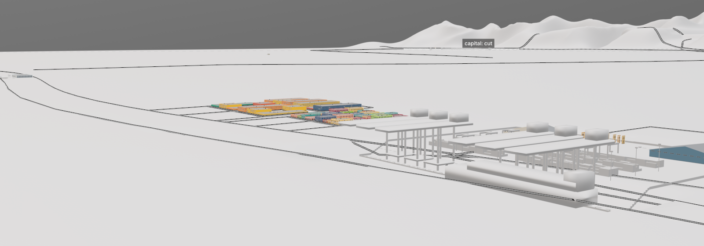

# Open World

Build a whole game map from real places: compose several real coasts, cities and valleys onto one map, bring in their terrain, streets and buildings under fictional names, add ports, airstrips and compounds, then paint gameplay zones and send it all to Unreal.



## Get it working

1. **Compose the map.** **Level > Open World > Create Remix**, **Add Source** for each real place, then select a closed curve around a city and **Add Region** to cut it out and place it elsewhere. **Apply Remix** writes the remixed data and drapes its roads, rivers and coast on the remix terrain. See [World Remix](#world-remix).
2. **Coast and water.** Seabed, mangroves, boat channels, reservoirs and boat and air routes go on the remix like on any terrain: [Coast and water](terrain-coast.md).
3. **Towns.** Lay out each city from the remixed OpenStreetMap file with procedural buildings:

```python
r = remixApply('World')
settlementFromOsm(r['files']['osm'], ground='World', origin=r['origin'], buildingRoute='buildings', name='Port')
```

4. **Sites.** Ports, cemeteries, airstrips, farms, villages and compounds from **Level > Open World > Site Kit**. See [Site kits](#site-kits).
5. **Swap the placeholders.** Every door, sign, lamp, crop row and container is a [slot](slots.md): one rule swaps all of a type for your assets or Blueprints.
6. **Gameplay zones.** Districts, police, territory, spawns and traffic from **Level > Open World > Zones**. See [Zones](#zones).
7. **Send to Unreal.** `terrainSendToUnreal`, `settlementSendToUnreal`, `buildingSend` and `zoneSendToUnreal`, or the whole map from the [world spec](#send-to-unreal).
8. **Check the whole map.** **Level > Open World > Check World**. See [World spec](#world-spec).

Once the map works, **Save World Spec** writes it all to one file that **Build World** rebuilds in one go.

### Every name is fictional

Every name an import brings in is replaced with a generated fictional one: streets, districts, neighbourhoods, towns, businesses, brands, chains, landmarks, rivers, lakes, dams, islands, beaches, ports, airports, cemeteries, schools and government buildings. No setting keeps real names. Names are stable: the same street or business gets the same fictional name on every import, and every branch of one real chain shares one fictional chain name.

The naming culture follows where the data lies (Mexican Spanish in Mexico) or the **Names** setting. Real names are kept only in a hidden attribute, for the check:

```python
realNameCheck(report=True)['ok']      # False lists every output text matching a real name, in the Validation panel
```

## World spec

One JSON file describes the whole map: slot rules, the remix, the terrain and coast, settlements, their buildings, site kits, zones, pins, the check and the export. **Build World** builds it in that order, so you can change any part and rebuild the map.

1. **Level > Open World > Save World Spec** writes what the scene holds now, hand edits included. Or start from a spec of your own; the MCP resource `lila://schema/world-spec` holds the schema.
2. **Level > Open World > Build World** and pick the file. It replaces an earlier build of the same world.
3. **Check World** lists everything wrong in the [Validation](validation.md) panel, with a fix where there is one.
4. **World Map** writes the overview map: a PNG plus JSON with the bounds, districts, zones, settlements, sites, points of interest, roads and water in world cm, so your game draws its own labels.

```python
r = worldBuild(file='worlds/coast.json', replace=True)
[(s['step'], s['ok'], s['seconds']) for s in r['steps']]
worldCheck(report=True)['counts']
worldMap(resolution=4096)['image']
worldSpec(file='worlds/now.json')
```

A small spec. Only `name` and `terrain` are required; a settlement comes from OpenStreetMap (`"osm": "remix"` takes the remix's output, clipped to its `area` in world cm `[x0, z0, x1, z1]`) or from Settlement's own layout (`create`):

```json
{
  "name": "Coast",
  "culture": "mexican",
  "terrain": {"size": [260000, 260000], "resolution": 129, "source": {"type": "noise", "amplitude": 1500}},
  "settlements": [{"name": "Pueblo", "create": {"profile": "usTown", "outline": [[-36000, -36000], [36000, -36000], [36000, 36000], [-36000, 36000]]},
                   "buildings": {"style": "colonial"}}],
  "sites": [{"kind": "village", "id": "v1", "at": [80000, 80000]}],
  "slots": {"rules": [{"type": "sign.storefront", "payload": {"poolTag": "fictional_signs"}}]},
  "zones": {"fromDistricts": true},
  "export": {"target": "files", "map": {"resolution": 2048}}
}
```

A built world's terrain gets default material layers fitted to the finished ground: grass, forest on hillsides, sand at the shore, riverbed, rock on steep ground, roads, dirt and gravel where it was eroded, and snow only on land 3 km or more above the sea. Its sea gets a water material. `terrain.materials` in the spec sets your own layers.

**Real places.** Give each remix source a `bbox` and the files to keep its data in (`dem`, `osm`, `landcover`, `bathymetry`), relative to the spec file. In **Build World**'s option box, turn on **Fetch Missing Data**: the box lists each missing file with its download size, and the build downloads them to those paths before it starts. Files already there are kept. Over 25 MB, or on a metered connection, also turn on **Allow Large Download**. Run **World Map** first to check that settlement areas and site positions land where you want them.

```python
worldBuild(file='worlds/sinaloa_real.json', estimate=True)['estimate']['summary']   # what is missing, and the sizes
worldBuild(file='worlds/sinaloa_real.json', fetch=True, consent=True, replace=True)
```

Sea floor data (GEBCO) comes through OpenTopography, which needs a free API key: pass it once with `apiKey='...', saveKey=True`. `worldFetch(file=...)` downloads without building.

### Troubleshooting

**A step failed.** The build stops there, and the log and the result's `steps` name the step and its error. `stopOnError=False` carries on past it.

**`ok` is false but every step is ok.** **Check World** found issues: read `check.issues` in the result.

**"a world named ... exists".** A world of that name was built before. **Build World** always replaces it; from Python pass `replace=True`.

**"missing data: ...".** The spec names files that aren't there. Turn on **Fetch Missing Data**, or pass `fetch=True`.

**"... MB to download; over 25 MB needs consent=True", or "the connection is metered".** Turn on **Allow Large Download**, or pass `consent=True`.

**"OpenTopography needs your API key".** Sign in at portal.opentopography.org and request one under My Account. Pass it once: `worldFetch(file='worlds/sinaloa_real.json', apiKey='...', saveKey=True)`.

**"apiKey looks like a placeholder", or "the saved OpenTopography key is a placeholder".** The key passed (or saved earlier) is example text such as `<your OpenTopography key>`, not a key. Pass your real key with `saveKey=True` to replace it.

**A download failed, or you pressed Abort.** The error names the file and the reason. Files fetched before it are kept, so building again carries on from there. **Cache Only** builds from earlier downloads without the network.

**Memory nearly doubles after rebuilding a world.** The replaced world stays on the undo stack, so a rebuild needs room for both (about 54 GB for a full sample map, against 34 GB for a first build). `flushUndo()` frees it.

**Check World issues:**

| Issue | Fix |
| --- | --- |
| `realName` | A name matches a real one. Rename it. |
| `buildingOverWater` | The settlement's `area` reaches into the sea. Settlement keeps its own lots off water, but imported buildings stay where they are. |
| `buildingOverRoad` | A building stands on a terrain road. Move one of them. |
| `unreachableWater` | An island or inlet has no lane. Link it with [Water Routes](terrain-coast.md). |
| `buildingsStale` | The settlement changed after its buildings were made. **Level > Buildings > Refresh Buildings**. |
| `zone.gap` | A must-cover layer leaves ground uncovered. `fillGaps` (on by default) fills it with an outlying zone. |
| `propFloating`, `propBuried` | A ground prop stands off the terrain, often after the ground was regraded. Regenerate the part that placed it. |
| `interiorNoEntry` | An [enterable building](buildings.md#enterable-buildings) has no door into its rooms. **Make Enterable** with **Add Entry** on. |
| `placeholders` | Not a fault: how many slots of each type still show placeholders. |

### Tune it

| Key | What it does |
| --- | --- |
| `skip=` | Leaves sections out while you iterate: `slots`, `terrain`, `settlements`, `buildings`, `sites`, `zones`. |
| `check=False` | Skips **Check World** at the end. |
| `buildings.lod` | Level of detail new building cells start at: `near` or `hlod` (much less memory in a big world). |
| `buildings.enterable` | Buildings made [enterable](buildings.md#enterable-buildings) once everything is built. One pick or a list: `{"programs": ["police", "bar"], "landmarks": true, "limit": 6}`; `styles` and `ids` pick too, `program` and `furnish` set what they get. |
| `export.target` | `files` writes terrain, zones and the map; `unreal` also sends the whole world to the open Unreal level. |
| `export.map.resolution` | Width of the map image, in pixels. |

Each section takes its own part's spec: `lila://schema/remix-spec`, `lila://schema/terrain-spec` (coast under `terrain.coast`), a site's `siteInfo()['spec']`, `lila://schema/zones`.

### Send to Unreal

1. Open a World Partition level in Unreal with LilaLink in the project, and run `unrealConnect()`.
2. Set `"export": {"target": "unreal"}` in the spec and **Build World**.

The landscape with its layers and water, the settlements, buildings with their HLOD proxies and interiors, site kits and zones all go. Each `export.unreal.*` step in the result says what it sent, what the level already held unchanged and what it skipped.

Settlement roads paint the terrain's Road layer when the landscape draws in material layers (`roadLayer` in the step result). Each step's `seconds` says where a slow send spent its time.

Building again sends only what changed. Whatever the spec no longer makes leaves the level: placement groups, interiors with their level files and data layers, whole settlements and zone sets. A send into another level of the same project reuses the assets already imported (`reused` in the step results).

**`proxiesSkipped`.** The level isn't World Partition, so the HLOD proxies weren't sent.

**Furniture placements skipped for missing meshes.** The project lacks the settlement's furniture meshes. Add them, or [name your own](settlement.md#troubleshooting).

**The landscape renders as a grid.** Its material failed to compile with an older LilaLink. Rebuild LilaLink from Lila's `ue/LilaLink`.

**`levelsKept`, or "another level holds zone volumes".** Another level of the project still uses that interior or zone data, so it stays. Remove it from that level too.

**`recordIgnored` after remaking a level.** The level at that path is a new one, so nothing was removed and everything was sent again. `levelNote` means LilaLink is too old to tell: rebuild it from Lila's `ue/LilaLink`.

**A settlement taken out of the spec is still in the level.** Lila's record of what it sent there was cleared. `settlementRemoveFromUnreal(key='Puerto')` removes it by its name; `zoneRemoveFromUnreal(id=..., label=...)` removes a zone set by the id and label its send returned.

| `export.unreal` key | What it does |
| --- | --- |
| `folder` | Content folder root, default `/Game/Lila`. The cleanup deletes only meshes under it. |
| `interiors` | `levelInstance`, `dataLayer` or `none`, as `buildingSend(interiors=)`. |
| `roads`, `roadMesh`, `pcgGraph` | As `settlementSendToUnreal`: roads as `landscape`, `splines`, `meshes` or `none`. |
| `landscapeMaterial` | Your own landscape material instead of the generated one. |
| `hlodLayer`, `hlodProxyLayer` | As `buildingSend`. |

## World Remix

A remix composes real places onto one map before they become terrain, so heights, roads, rivers, coast, land cover, buildings and places all move together. The result is a terrain: erode it, settle it and export it like any other.

1. **Level > Open World > Create Remix** makes the remix terrain. Its option box sets the **Horizontal** and **Vertical** scales.
2. **Add Source** adds a place: its elevation file, OpenStreetMap file and WorldCover land cover, or a bounding box with **Fetch** to download them (the sizes are reported). **At** is where its centre lands on the map, in cm.
3. Draw a closed curve around a city, select it and pick **Add Region**. **Op** `cut` lifts it out and places it at **Translate** and **Angle**, filling the hole; `move` carries it rigidly while the land around stretches; `keep` holds it still; `duplicate` and `delete` do what they say.
4. **Edit Remix** lets you drag regions (Ctrl+drag turns them) and pins in the viewport. **Before Remix** shows the base map for comparison.
5. **Apply Remix** writes `remix.osm.json`, the heights and the spec under the workspace's `openworld/remix/<name>` folder, and drapes the roads, rivers and coast on the terrain. Cut roads are routed back together, rivers re-solved to drain to the sea, and the coastline re-joined.

```python
remixCreate(name='World', sources=[{'id': 'coast', 'dem': 'dem/coast.tif', 'osm': 'osm/coast.osm.pbf'}])
remixSource('World', id='capital', dem='dem/capital.tif', osm='osm/capital.json', at=[350000, -200000])
remixAddRegion('World', id='capital', op='cut', curve='CapitalOutline', translate=[-150000, 80000], angle=15)
remixPin('World', at=[50000, 20000], to=[30000, 20000])
remixApply('World')
```

Pins move a point of the map (or hold it with no **To**) and the land around follows without folding: use them to squeeze the empty land between two cities.

### Troubleshooting

**Check Remix lists issues.** Each has a kind and a map position, also marked on the overlay. The fixes:

| Issue | Fix |
| --- | --- |
| `riverNoDrain` | A river that drained before now ends in a hollow. Move the region so the valley reaches the sea, or widen the seam. |
| `danglingRoad` | A cut road found nothing to join. Raise `seams.roadReach` in the spec, or move the region nearer a road. |
| `coastGap` | Two coastline ends didn't meet. Move the region so its shore lines up with the coast. |
| `overlap` | Two regions land on each other. Move one. |
| `fold` | Pins ask for the impossible. Move pins or regions apart, or raise `warp.maxSteps`. |
| `source` | A source file couldn't be read. The map builds without it. |

**A pasted region sits higher or lower than its source.** A `cut` or `duplicate` region is raised or lowered to the land around it, so its seam falls no steeper than `seams.maxSlope`. Set `"matchHeight": false` on the region to keep its own heights.

**A steep edge remains round a pasted region.** The seam is capped at a quarter of the region's size. `stats.regionLevels` in the **Apply Remix** result gives each region's `stepLeft`. Move the region to ground nearer its height.

**The sea floor is flat or a plain shelf.** No source has a bathymetry grid. Give the source a `bathymetry` GEBCO GeoTIFF; with none, the remix lays a shelf profile and its notes say so.

**Terrain's OSM import onto the remix says the terrain has no location.** The remix terrain needs `origin=`. Use the `origin` **Apply Remix** returns.

### Tune it

Edit the spec with `remixSpec('World')` and `remixSpec('World', spec=...)`; the terrain follows live. The MCP resource `lila://schema/remix-spec` holds the schema.

| Key | Default | What it does |
| --- | --- | --- |
| `scale.horizontal`, `scale.vertical` | `1:3`, `1:1.5` | Distances shrink more than heights, so mountains stay mountains. |
| `seams.width`, `seams.erosion`, `seams.detail` | | Seam band width, and the erosion and detail that blend it. |
| `seams.maxSlope` | `0.08` | Steepest grade a pasted region's seam may fall after levelling; its seam widens to keep to it. |
| `warp.falloff` | | How far a pin or moved region pulls the land around it. |
| `map.size`, `map.cell`, `map.seaDepth`, `map.maxResolution` | fit to the sources | Output map extent and grid. |
| `bathymetry` | on | Shelf profile under the sea where no grid covers (`shoreSlope`, `shelfDepth`, `blendWidth`); `enabled: false` gives a flat floor at `map.seaDepth`. |

Land-use areas crossing a region edge are split there; buildings never are.

## Site kits

Lay out a whole cargo port, cruise terminal, lighthouse, cemetery, hidden airstrip, industrial farm, mountain village, walled compound or private island on the terrain, graded into it, with every part a slot and every name fictional.

1. **Level > Open World > Site Kit > Site Kits** opens the palette.
2. Select a locator where the site goes (nothing puts it at the origin), then click a kind. It stands on the selected terrain, else the only one.
3. Shift+click a kind, or click its row's corner, for that kind's settings first.
4. Select the site: the Attribute Editor's **Site** section changes its settings, and the layout and grading follow.
5. Move or turn the site with the transform gizmo. On release it lands and the ground is graded again; one undo takes back both.

```python
siteCreate(kind='port', terrain='Terrain', at=[0, -20000], quayLength=80000, tiers=5)
siteEdit('port1', tiers=6, fill=0.9)
siteCheck()['ok']
```

Buildings in a site draw as grey massing. **Level > Open World > Site Buildings** builds the selected sites' buildings (or every site's) with [Buildings](buildings.md) in the kit's style; they follow when the site's layout changes. `siteBuildings('port1', remove=True)` goes back to massing.

### Troubleshooting

**Check Sites reports issues.** It lists real names, overlapping sites or buildings, parts standing in water, berths too shallow, ground too steep, stale grading and parts that didn't fit, each with its fix. **Regrade Site** fixes stale grading.

**The site stands at height 0.** No terrain was found. Select one, or `siteCreate(..., terrain='Terrain')`.

**A tilt or scale on a site is undone.** A site keeps only its position and its turn about the up axis; the rest is dropped with a warning.

**`airClearance` on an airstrip.** Hills are too close under an approach corridor. Turn the strip (**Heading**) or move it.

### Tune it

`siteKinds()` lists every kind's settings with defaults and ranges, and the slot types each kit makes. Swap parts with [slot rules](slots.md): `container.*` for every container (each fictional shipping line is a subtype such as `container.40ft.<line>`), `crane.sts`, `grave.*`, or `crop.row` with tag `crop:tomato`. Pin a whole site with `slotPin('owner:site:port1')`.

## Zones

Paint gameplay layers over the map: districts, police and military jurisdiction, cartel territory, ped, vehicle, boat and aircraft spawns, traffic and pedestrian density, wanted response, interiors and mission markers.

1. Select the terrain and pick **Level > Open World > Zones** to open the panel.
2. **Add Layer > Districts**.
3. **Paint Zones**: drag to paint a zone, or pick **Draw** in the palette and click an outline (Enter closes it). **Pick** reads every layer at a click.
4. **Zones from Districts** makes one zone per Settlement district, named as the settlement names it. **Zones from Water Routes** turns boat or air lanes into spawn zones; **Zones from Terrain Masks** turns masks such as `mangrove` into zones.
5. **Export Zones** writes `<name>_zones.json` and a PNG mask per painted zone for any engine. **Send Zones to Unreal** makes a zone volume per zone, a `ZD_<set>` data asset for runtime point queries and a data layer per layer.

```python
zoneFromDistricts(settlement='Port')
zoneCreate(type='police', polygon=[[0, 0], [50000, 0], [50000, 50000], [0, 50000]], attrs={'agency': 'state'})
zonePaint(layer='traffic', type='traffic', zone='downtown', points=[[0, 0], [20000, 5000]], radius=4000, value=0.8)
zoneQuery(point=[12000, 0, -3500])['layers']['police']['attrs']['agency']
```

New zones get fictional names in the set's naming culture.

### Troubleshooting

**Check Zones reports gaps.** A layer that must cover the play area (Districts and Police by default) leaves part of it uncovered. Gaps at the map's edge mean the play area is bigger than the playable land: draw it and use **Play Area from Curve**.

**Check Zones reports overlaps.** Two zones of an exclusive layer (Districts, Police, Wanted) share ground. Erase one, or raise one zone's **Priority** if the overlap is meant to be there.

**Erase does nothing.** Erase works on the zone picked in the palette's **Target**. Pick one first.

**"is a number, not text".** An attribute keeps the type of the layer's default. Type a value of that kind, or change the layer's defaults.

**Zones stay in Unreal after the set is deleted.** **Remove Zones from Unreal** (Zones panel menu) before deleting the set. For a set already gone, `zoneRemoveFromUnreal(id=..., label=...)` with the id and label its send returned.

**Unreal says the plugin predates zones.** Rebuild LilaLink from Lila's `ue/LilaLink`. Data layers are skipped in levels without World Partition.

### Tune it

| Option | What it does |
| --- | --- |
| Layer **Priority** | Draw order, and the Unreal volume priority. Zone **Priority** picks the winner inside a layer. |
| `exclusive`, **Must Cover** | Whether a layer's zones may overlap, and whether they must cover the play area. |
| Layer defaults | Attributes every zone starts with (`agency`, `responseTime`, `faction`, `density`). |
| `zoneTypes(define=...)` | Your own layer types with their defaults. |
| `zoneSpec(maskCell=...)` | Paint resolution, in cm. Set it before painting. |
| `zoneSendToUnreal(height=, depth=)` | How far volumes reach above the highest ground and below the lowest, in cm. |
