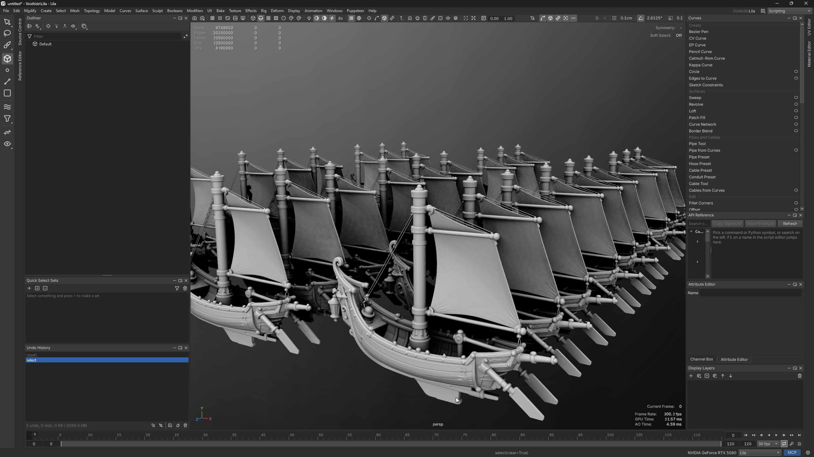
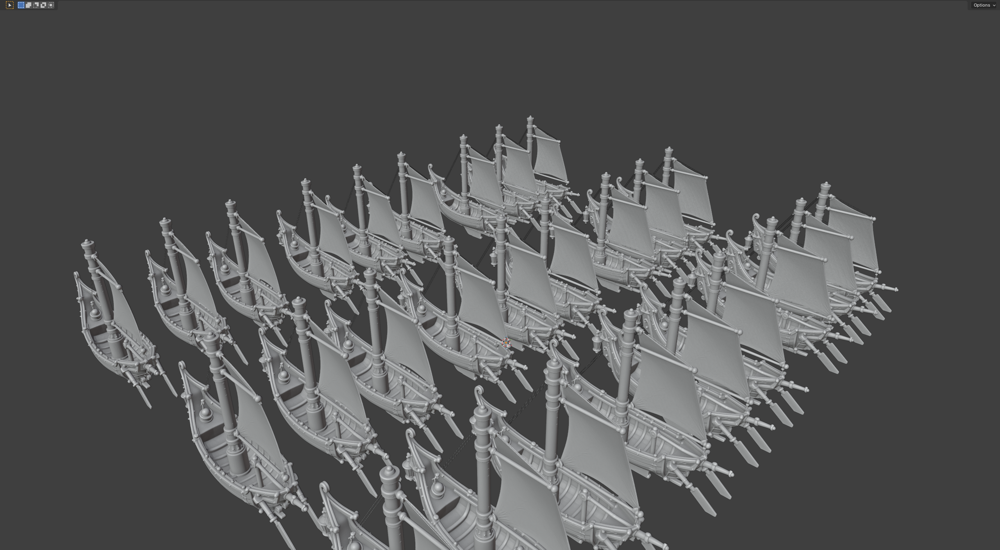

# Lila and Blender

The same 13.5 million triangles in each app, with ambient occlusion: Lila at 8x antialiasing, Blender with its samples added once the view stopped.

<span style="background:linear-gradient(90deg,#4da3ff,#e8f3ff);-webkit-background-clip:text;background-clip:text;color:transparent;font-weight:700">Lila</span>



<span style="background:linear-gradient(90deg,#f5792a,#ffb15e);-webkit-background-clip:text;background-clip:text;color:transparent;font-weight:700">Blender 5.2</span>



> Same machine, same files and the same tests as [Performance](performance.md), timed in the running app from the command until the result draws on the screen.

## Measured on

| | |
| --- | --- |
| Date | 4 and 5 November 2026 |
| Lila | 0.1.0, build of 4 November 2026 |
| Blender | 5.2.3 LTS, OpenGL |
| CPU | AMD Ryzen 9 5950X, 16 cores |
| RAM | 128 GB |
| GPU | NVIDIA GeForce RTX 5080, 16 GB, driver 610.88 |
| OS | Windows 11 Pro |

Each number is only a claim about the versions above. The test files are described on [Performance](performance.md).

## Results

> Lower is faster: each number is how long a task took, or how long one frame took to draw.

Results are coloured by how far they are from the best on their row: <span style="color:#22a447">green</span> is the fastest (brighter for a bigger lead), <span style="color:#c9a400">yellow</span> is close to it and <span style="color:#e0453a">red</span> is 10x slower or worse; results within 5% count as even.

### Files

| Task | <span style="background:linear-gradient(90deg,#f5792a,#ffb15e);-webkit-background-clip:text;background-clip:text;color:transparent;font-weight:700">Blender 5.2</span> | <span style="background:linear-gradient(90deg,#4da3ff,#e8f3ff);-webkit-background-clip:text;background-clip:text;color:transparent;font-weight:700">Lila</span> | Difference |
|---|---|---|---|
| Import the ships OBJ, until on screen | <span style="color:#d28016">16.0 s</span> | <span style="color:#89a41b;font-weight:700">6.60 s</span> | **<span style="background:linear-gradient(90deg,#4da3ff,#e8f3ff);-webkit-background-clip:text;background-clip:text;color:transparent;font-weight:700">Lila</span> 2.4x faster** |
| Save native binary (.blend / .lila) | <span style="color:#baa406;font-weight:700">0.659 s</span> | <span style="color:#cb9b05">0.811 s</span> | **<span style="background:linear-gradient(90deg,#f5792a,#ffb15e);-webkit-background-clip:text;background-clip:text;color:transparent;font-weight:700">Blender</span> 1.2x faster** |
| Open native binary, until on screen | <span style="color:#bba406;font-weight:700">2.47 s</span> | <span style="color:#cb9c05">2.98 s</span> | **<span style="background:linear-gradient(90deg,#f5792a,#ffb15e);-webkit-background-clip:text;background-clip:text;color:transparent;font-weight:700">Blender</span> 1.2x faster** |
| Export FBX<br><small>Lila writes tangents by default, Blender doesn't; without them Lila took 4.7 s, and Blender took 46.9 s with them</small> | <span style="color:#cf8a10">23.9 s</span> | <span style="color:#9ba414;font-weight:700">12.6 s</span> | **<span style="background:linear-gradient(90deg,#4da3ff,#e8f3ff);-webkit-background-clip:text;background-clip:text;color:transparent;font-weight:700">Lila</span> 1.9x faster** |
| Import that FBX, until on screen | <span style="color:#d76a24">22.2 s</span> | <span style="color:#62a42c;font-weight:700">5.40 s</span> | **<span style="background:linear-gradient(90deg,#4da3ff,#e8f3ff);-webkit-background-clip:text;background-clip:text;color:transparent;font-weight:700">Lila</span> 4.1x faster** |

### File sizes, the ships

| Task | <span style="background:linear-gradient(90deg,#f5792a,#ffb15e);-webkit-background-clip:text;background-clip:text;color:transparent;font-weight:700">Blender 5.2</span> | <span style="background:linear-gradient(90deg,#4da3ff,#e8f3ff);-webkit-background-clip:text;background-clip:text;color:transparent;font-weight:700">Lila</span> | Difference |
|---|---|---|---|
| Native binary (.blend / .lila) | <span style="color:#c9a400">499 MB</span> | <span style="color:#c9a400">517 MB</span> | ≈ even |
| FBX, each app's defaults<br><small>Lila's default writes tangents, Blender's doesn't</small> | <span style="color:#64a42b;font-weight:700">466 MB</span> | <span style="color:#d76a23">1880 MB</span> | **<span style="background:linear-gradient(90deg,#f5792a,#ffb15e);-webkit-background-clip:text;background-clip:text;color:transparent;font-weight:700">Blender</span> 4.0x smaller** |
| FBX without tangents | <span style="color:#b5a408;font-weight:700">466 MB</span> | <span style="color:#cc9907">611 MB</span> | **<span style="background:linear-gradient(90deg,#f5792a,#ffb15e);-webkit-background-clip:text;background-clip:text;color:transparent;font-weight:700">Blender</span> 1.3x smaller** |

### Modelling

| Task | <span style="background:linear-gradient(90deg,#f5792a,#ffb15e);-webkit-background-clip:text;background-clip:text;color:transparent;font-weight:700">Blender 5.2</span> | <span style="background:linear-gradient(90deg,#4da3ff,#e8f3ff);-webkit-background-clip:text;background-clip:text;color:transparent;font-weight:700">Lila</span> | Difference |
|---|---|---|---|
| Weld the exploded ship (1.5 million vertices, 0.0001 cm), until on screen | <span style="color:#cc9907">1.86 s</span> | <span style="color:#b6a408;font-weight:700">1.42 s</span> | **<span style="background:linear-gradient(90deg,#4da3ff,#e8f3ff);-webkit-background-clip:text;background-clip:text;color:transparent;font-weight:700">Lila</span> 1.3x faster** |
| Subdivide the ships once (13.5 million to 40.5 million faces), until on screen<br><small>Subdivision Surface, level 1, applied</small> | <span style="color:#e0453a">crashed</span> | <span style="color:#22a447;font-weight:700">19.9 s</span> | **<span style="background:linear-gradient(90deg,#f5792a,#ffb15e);-webkit-background-clip:text;background-clip:text;color:transparent;font-weight:700">Blender</span> crashed** |
| Object to vertices (6.75 million), until on screen<br><small>Blender: entering Edit Mode with every vertex selected</small> | <span style="color:#e0453a">10.6 s</span> | <span style="color:#22a447;font-weight:700">0.121 s</span> | **<span style="background:linear-gradient(90deg,#4da3ff,#e8f3ff);-webkit-background-clip:text;background-clip:text;color:transparent;font-weight:700">Lila</span> 88x faster** |

### Viewport, no antialiasing

| Task | <span style="background:linear-gradient(90deg,#f5792a,#ffb15e);-webkit-background-clip:text;background-clip:text;color:transparent;font-weight:700">Blender 5.2</span> | <span style="background:linear-gradient(90deg,#4da3ff,#e8f3ff);-webkit-background-clip:text;background-clip:text;color:transparent;font-weight:700">Lila</span> | Difference |
|---|---|---|---|
| Shaded<br><small>Lila's Temporal mode, one sample a frame refined once the view stops: 1.85 ms</small> | <span style="color:#c9a400">1.80 ms</span> | <span style="color:#c9a400">1.74 ms</span> | ≈ even |
| Shaded with ambient occlusion<br><small>Lila fast mode; Blender: world-space cavity</small> | <span style="color:#c1a403;font-weight:700">1.83 ms</span> | <span style="color:#caa003">2.04 ms</span> | **<span style="background:linear-gradient(90deg,#f5792a,#ffb15e);-webkit-background-clip:text;background-clip:text;color:transparent;font-weight:700">Blender</span> 1.1x faster** |
| Wireframe on shaded (20 million edges) | <span style="color:#cb9d04">4.37 ms</span> | <span style="color:#bda405;font-weight:700">3.72 ms</span> | **<span style="background:linear-gradient(90deg,#4da3ff,#e8f3ff);-webkit-background-clip:text;background-clip:text;color:transparent;font-weight:700">Lila</span> 1.2x faster** |
| Object selected | <span style="color:#b5a409;font-weight:700">2.83 ms</span> | <span style="color:#cc9907">3.73 ms</span> | **<span style="background:linear-gradient(90deg,#f5792a,#ffb15e);-webkit-background-clip:text;background-clip:text;color:transparent;font-weight:700">Blender</span> 1.3x faster** |
| Vertex mode, all 6.75 million vertices selected<br><small>Lila's Temporal mode: 3.84 ms</small> | <span style="color:#d08513">11.6 ms</span> | <span style="color:#93a417;font-weight:700">5.53 ms</span> | **<span style="background:linear-gradient(90deg,#4da3ff,#e8f3ff);-webkit-background-clip:text;background-clip:text;color:transparent;font-weight:700">Lila</span> 2.1x faster** |

### Python, 6.75 million vertices

| Task | <span style="background:linear-gradient(90deg,#f5792a,#ffb15e);-webkit-background-clip:text;background-clip:text;color:transparent;font-weight:700">Blender 5.2</span> | <span style="background:linear-gradient(90deg,#4da3ff,#e8f3ff);-webkit-background-clip:text;background-clip:text;color:transparent;font-weight:700">Lila</span> | Difference |
|---|---|---|---|
| Get every vertex position into numpy, usual API<br><small>Blender: MeshVertices.foreach_get into float64; Lila: Node.points_array</small> | <span style="color:#e0453a">0.628 s</span> | <span style="color:#22a447;font-weight:700">22.2 µs</span> | **<span style="background:linear-gradient(90deg,#4da3ff,#e8f3ff);-webkit-background-clip:text;background-clip:text;color:transparent;font-weight:700">Lila</span> 28290x faster** |
| Get every vertex position into numpy, fastest route<br><small>Blender: the position attribute's foreach_get into float32</small> | <span style="color:#e0453a">0.0195 s</span> | <span style="color:#22a447;font-weight:700">22.2 µs</span> | **<span style="background:linear-gradient(90deg,#4da3ff,#e8f3ff);-webkit-background-clip:text;background-clip:text;color:transparent;font-weight:700">Lila</span> 877x faster** |
| Compute with numpy | <span style="color:#b3a409;font-weight:700">0.965 s</span> | <span style="color:#cc9808">1.31 s</span> | **<span style="background:linear-gradient(90deg,#f5792a,#ffb15e);-webkit-background-clip:text;background-clip:text;color:transparent;font-weight:700">Blender</span> 1.4x faster** |
| Compute with numpy on 32 threads | <span style="color:#bba406;font-weight:700">0.621 s</span> | <span style="color:#cb9c05">0.750 s</span> | **<span style="background:linear-gradient(90deg,#f5792a,#ffb15e);-webkit-background-clip:text;background-clip:text;color:transparent;font-weight:700">Blender</span> 1.2x faster** |
| Compute in pure Python<br><small>100,000 vertices timed, extrapolated</small> | <span style="color:#c9a400">18.8 s</span> | <span style="color:#c9a400">18.0 s</span> | ≈ even |
| Get every normal into numpy (40.5 million face-vertices)<br><small>Blender: Mesh.corner_normals; Lila: Node.normals_array</small> | <span style="color:#8ba41a;font-weight:700">0.0586 s</span> | <span style="color:#d28116">0.138 s</span> | **<span style="background:linear-gradient(90deg,#f5792a,#ffb15e);-webkit-background-clip:text;background-clip:text;color:transparent;font-weight:700">Blender</span> 2.4x faster** |
| Get every tangent into numpy (MikkTSpace)<br><small>Blender: Mesh.calc_tangents, then the loops' tangents and signs; Lila: Node.tangents_array</small> | <span style="color:#d08811">6.42 s</span> | <span style="color:#98a415;font-weight:700">3.28 s</span> | **<span style="background:linear-gradient(90deg,#4da3ff,#e8f3ff);-webkit-background-clip:text;background-clip:text;color:transparent;font-weight:700">Lila</span> 2.0x faster** |

Blender's viewport has no multisampling: it draws one sample a frame while the view moves and adds samples once it stops. Lila's **Preferences > Viewport > Antialiasing > Mode > Temporal** works the same way, with temporal antialiasing on the moving frames.

### Stability

| | <span style="background:linear-gradient(90deg,#f5792a,#ffb15e);-webkit-background-clip:text;background-clip:text;color:transparent;font-weight:700">Blender 5.2</span> | <span style="background:linear-gradient(90deg,#4da3ff,#e8f3ff);-webkit-background-clip:text;background-clip:text;color:transparent;font-weight:700">Lila</span> |
| --- | --- | --- |
| Crashes | <span style="color:#e0453a">1</span>: subdividing the ships (Subdivision Surface, level 1, applied) | <span style="color:#22a447">0</span> |

## How it was measured

Each app was started fresh, with nothing else running, and timed alone. Both viewports were 1600 x 1260. Lila's method is under How it was measured on [Performance](performance.md).

### Blender

Each step ran in the open Blender (`--factory-startup --gpu-vsync off`, the 3D view maximised) from a script driven by `bpy.app.timers`. The timer wraps the operator, then waits until a draw handler on the 3D view fires.

| Task | Command |
| --- | --- |
| Import | `bpy.ops.wm.obj_import(filepath=path)` |
| Save and open | `bpy.ops.wm.save_as_mainfile(filepath=path)`, then `bpy.ops.wm.open_mainfile(filepath=path, load_ui=False)` |
| FBX | `bpy.ops.export_scene.fbx(filepath=path)` with the default settings (`use_tspace=True` for tangents), then `bpy.ops.import_scene.fbx(filepath=path)` into an empty scene |
| Weld | Edit Mode, all selected, `bpy.ops.mesh.remove_doubles(threshold=0.0001)` |
| Subdivide | a Subdivision Surface modifier at level 1, then `bpy.ops.object.modifier_apply` |
| Object to vertices | object selected, `bpy.ops.object.mode_set(mode="EDIT")` with every vertex selected |

Viewport: Solid shading on OpenGL, world-space cavity on or off per row. Blender has no multisampling in the viewport: it draws one sample a frame while the view moves and adds more once it stops, so each frame turns the view by 0.05 degrees to keep it drawing a fresh frame. The time is the wall time of `bpy.ops.wm.redraw_timer(type="DRAW_SWAP")` over 20 frames, the median of 5 runs, at 4 angles 45 degrees apart; the row is the median of the angles.

The script is `tools/benchmarks/blender_bench.py` in the Lila repository. Its Python rows run the same `tools/benchmarks/mesh_compute.py` as Lila and give the same checksum. Blender gathers the positions with:

```python
points = np.empty(len(mesh.vertices) * 3)
mesh.vertices.foreach_get("co", points)
```
