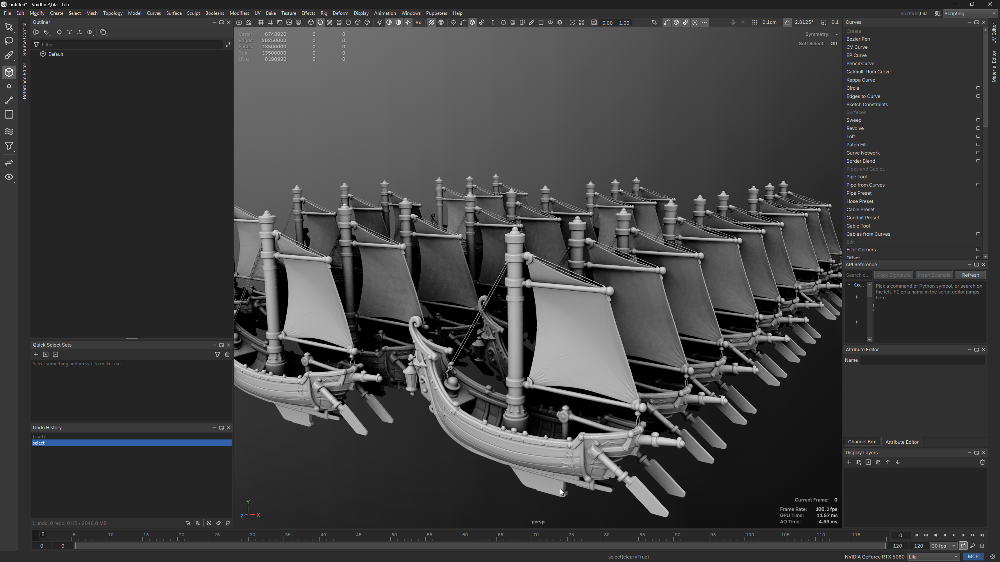
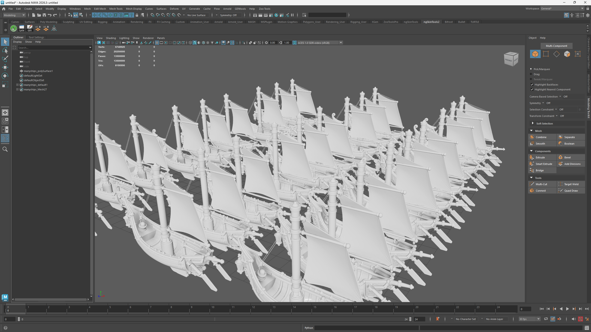

# Performance

The same 13.5 million triangles in each app, as drawn during these tests, both with ambient occlusion and 8x antialiasing.

<span style="background:linear-gradient(90deg,#4da3ff,#e8f3ff);-webkit-background-clip:text;background-clip:text;color:transparent;font-weight:700">Lila</span>



<span style="background:linear-gradient(90deg,#3fcf6b,#1fb5b0);-webkit-background-clip:text;background-clip:text;color:transparent;font-weight:700">Maya 2026.3</span>



> Same machine, same files, timed the way a user experiences them in the running app - from the command, until the result draws on the screen.

## Measured on

| | |
| --- | --- |
| Date | 27 October 2026 |
| Lila | 0.1.0, build of 27 October 2026 |
| Maya | 2026.3 (cut 202510291147-60ec9eda33) |
| CPU | AMD Ryzen 9 5950X, 16 cores |
| RAM | 128 GB |
| GPU | NVIDIA GeForce RTX 5080, 16 GB, driver 610.88 |
| OS | Windows 11 Pro |

Numbers change between versions. Each one is only a claim about the versions above.

## Test files

- **Ships**: a 2.6 GB OBJ of 27 copies of one ship, 13.5 million triangles and 6.75 million vertices, exported from Maya.
- **Exploded ship**: one 500,000-triangle ship written with every face on its own vertices (1.5 million vertices), as an exploded import arrives. Welding it gives back the ship.

## Results

Results are coloured by how far they are from the best on their row: <span style="color:#22a447">green</span> is the fastest (brighter for a bigger lead), <span style="color:#c9a400">yellow</span> is close to it and <span style="color:#e0453a">red</span> is 10x slower or worse; results within 5% count as even.

> Lower means faster - numbers are times: how long each task took, or how long one frame took to draw.

### Files

| Task | <span style="background:linear-gradient(90deg,#3fcf6b,#1fb5b0);-webkit-background-clip:text;background-clip:text;color:transparent;font-weight:700">Maya 2026.3</span> | <span style="background:linear-gradient(90deg,#4da3ff,#e8f3ff);-webkit-background-clip:text;background-clip:text;color:transparent;font-weight:700">Lila</span> | Difference |
|---|---|---|---|
| Import the ships OBJ, until on screen | <span style="color:#df4838">55.3 s</span> | <span style="color:#28a445;font-weight:700">6.80 s</span> | **<span style="background:linear-gradient(90deg,#4da3ff,#e8f3ff);-webkit-background-clip:text;background-clip:text;color:transparent;font-weight:700">Lila</span> 8.1x faster** |
| Save native binary (.mb / .lila) | <span style="color:#bda405;font-weight:700">0.610 s</span> | <span style="color:#cb9d04">0.723 s</span> | **<span style="background:linear-gradient(90deg,#3fcf6b,#1fb5b0);-webkit-background-clip:text;background-clip:text;color:transparent;font-weight:700">Maya</span> 1.2x faster** |
| Open native binary, until on screen | <span style="color:#cc9608">4.05 s</span> | <span style="color:#b1a40a;font-weight:700">2.90 s</span> | **<span style="background:linear-gradient(90deg,#4da3ff,#e8f3ff);-webkit-background-clip:text;background-clip:text;color:transparent;font-weight:700">Lila</span> 1.4x faster** |
| Save native ASCII (.ma / .lilaa) | <span style="color:#d76c22">19.5 s</span> | <span style="color:#66a42a;font-weight:700">4.97 s</span> | **<span style="background:linear-gradient(90deg,#4da3ff,#e8f3ff);-webkit-background-clip:text;background-clip:text;color:transparent;font-weight:700">Lila</span> 3.9x faster** |
| Open native ASCII, until on screen | <span style="color:#d5711f">30.0 s</span> | <span style="color:#6fa426;font-weight:700">8.65 s</span> | **<span style="background:linear-gradient(90deg,#4da3ff,#e8f3ff);-webkit-background-clip:text;background-clip:text;color:transparent;font-weight:700">Lila</span> 3.5x faster** |
| Export FBX<br><small>Lila writes tangents by default, Maya doesn't; without them Lila took 10.7 s</small> | <span style="color:#d08811">37.5 s</span> | <span style="color:#98a415;font-weight:700">19.0 s</span> | **<span style="background:linear-gradient(90deg,#4da3ff,#e8f3ff);-webkit-background-clip:text;background-clip:text;color:transparent;font-weight:700">Lila</span> 2.0x faster** |
| Import that FBX, until on screen | <span style="color:#de4e35">48.7 s</span> | <span style="color:#31a440;font-weight:700">6.02 s</span> | **<span style="background:linear-gradient(90deg,#4da3ff,#e8f3ff);-webkit-background-clip:text;background-clip:text;color:transparent;font-weight:700">Lila</span> 8.1x faster** |

### File sizes, the ships

| Task | <span style="background:linear-gradient(90deg,#3fcf6b,#1fb5b0);-webkit-background-clip:text;background-clip:text;color:transparent;font-weight:700">Maya 2026.3</span> | <span style="background:linear-gradient(90deg,#4da3ff,#e8f3ff);-webkit-background-clip:text;background-clip:text;color:transparent;font-weight:700">Lila</span> | Difference |
|---|---|---|---|
| Native binary (.mb / .lila) | <span style="color:#d18414">1129 MB</span> | <span style="color:#90a418;font-weight:700">517 MB</span> | **<span style="background:linear-gradient(90deg,#4da3ff,#e8f3ff);-webkit-background-clip:text;background-clip:text;color:transparent;font-weight:700">Lila</span> 2.2x smaller** |
| Native ASCII (.ma / .lilaa) | <span style="color:#c9a400">2923 MB</span> | <span style="color:#c9a400">2889 MB</span> | ≈ even |
| FBX, each app's defaults<br><small>Lila's default writes tangents, Maya's doesn't</small> | <span style="color:#6aa429;font-weight:700">504 MB</span> | <span style="color:#d66e21">1880 MB</span> | **<span style="background:linear-gradient(90deg,#3fcf6b,#1fb5b0);-webkit-background-clip:text;background-clip:text;color:transparent;font-weight:700">Maya</span> 3.7x smaller** |
| FBX without tangents | <span style="color:#bba406;font-weight:700">504 MB</span> | <span style="color:#cb9c05">611 MB</span> | **<span style="background:linear-gradient(90deg,#3fcf6b,#1fb5b0);-webkit-background-clip:text;background-clip:text;color:transparent;font-weight:700">Maya</span> 1.2x smaller** |

### Modelling

| Task | <span style="background:linear-gradient(90deg,#3fcf6b,#1fb5b0);-webkit-background-clip:text;background-clip:text;color:transparent;font-weight:700">Maya 2026.3</span> | <span style="background:linear-gradient(90deg,#4da3ff,#e8f3ff);-webkit-background-clip:text;background-clip:text;color:transparent;font-weight:700">Lila</span> | Difference |
|---|---|---|---|
| Weld the exploded ship (1.5 million vertices, 0.0001 cm), until on screen | <span style="color:#cc9609">1.74 s</span> | <span style="color:#b0a40a;font-weight:700">1.24 s</span> | **<span style="background:linear-gradient(90deg,#4da3ff,#e8f3ff);-webkit-background-clip:text;background-clip:text;color:transparent;font-weight:700">Lila</span> 1.4x faster** |
| Subdivide the ships once (13.5 million to 40.5 million faces), until on screen<br><small>Maya crashed after it in one of two sessions</small> | <span style="color:#cb9b05">42.4 s</span> | <span style="color:#b9a407;font-weight:700">34.2 s</span> | **<span style="background:linear-gradient(90deg,#4da3ff,#e8f3ff);-webkit-background-clip:text;background-clip:text;color:transparent;font-weight:700">Lila</span> 1.2x faster** |
| Object to vertices (6.75 million), until on screen | <span style="color:#cc9807">0.154 s</span> | <span style="color:#b4a409;font-weight:700">0.116 s</span> | **<span style="background:linear-gradient(90deg,#4da3ff,#e8f3ff);-webkit-background-clip:text;background-clip:text;color:transparent;font-weight:700">Lila</span> 1.3x faster** |

### Stability

| | <span style="background:linear-gradient(90deg,#3fcf6b,#1fb5b0);-webkit-background-clip:text;background-clip:text;color:transparent;font-weight:700">Maya 2026.3</span> | <span style="background:linear-gradient(90deg,#4da3ff,#e8f3ff);-webkit-background-clip:text;background-clip:text;color:transparent;font-weight:700">Lila</span> |
| --- | --- | --- |
| Crashes | <span style="color:#e0453a">1</span>: subdividing the ships (exception 0xc0000409, in one of two sessions) | <span style="color:#22a447">0</span> |
| Hangs | <span style="color:#e0453a">3 of 3</span>: welding the single ship at 0.01 cm, ended with End Task after several minutes | <span style="color:#22a447">0</span>: the same weld finished in 0.6 s |

The 0.01 cm weld is extreme: the ship is about 1 cm long, so almost every edge is shorter than that and the whole mesh collapses. Lila does what was asked; Maya never returns.

If Lila crashes, hangs or is slow on your files, report it. Unlike with Autodesk, you reach the person who wrote it, and crashes, bugs and slow spots get fixed.

### Viewport

| Task | <span style="background:linear-gradient(90deg,#3fcf6b,#1fb5b0);-webkit-background-clip:text;background-clip:text;color:transparent;font-weight:700">Maya 2026.3</span> | <span style="background:linear-gradient(90deg,#4da3ff,#e8f3ff);-webkit-background-clip:text;background-clip:text;color:transparent;font-weight:700">Lila</span> | Difference |
|---|---|---|---|
| Shaded | <span style="color:#bca406;font-weight:700">4.73 ms</span> | <span style="color:#cb9c05">5.68 ms</span> | **<span style="background:linear-gradient(90deg,#3fcf6b,#1fb5b0);-webkit-background-clip:text;background-clip:text;color:transparent;font-weight:700">Maya</span> 1.2x faster** |
| Shaded with ambient occlusion<br><small>Lila fast mode; accurate mode 9.44 ms</small> | <span style="color:#c9a400">5.58 ms</span> | <span style="color:#c9a400">5.79 ms</span> | ≈ even |
| Wireframe on shaded (20 million edges) | <span style="color:#baa406;font-weight:700">4.99 ms</span> | <span style="color:#cb9b05">6.14 ms</span> | **<span style="background:linear-gradient(90deg,#3fcf6b,#1fb5b0);-webkit-background-clip:text;background-clip:text;color:transparent;font-weight:700">Maya</span> 1.2x faster** |
| Object selected | <span style="color:#d5741d">19.4 ms</span> | <span style="color:#74a424;font-weight:700">6.02 ms</span> | **<span style="background:linear-gradient(90deg,#4da3ff,#e8f3ff);-webkit-background-clip:text;background-clip:text;color:transparent;font-weight:700">Lila</span> 3.2x faster** |
| Vertex mode, all 6.75 million vertices selected | <span style="color:#c5a402;font-weight:700">6.42 ms</span> | <span style="color:#caa202">6.82 ms</span> | **<span style="background:linear-gradient(90deg,#3fcf6b,#1fb5b0);-webkit-background-clip:text;background-clip:text;color:transparent;font-weight:700">Maya</span> 1.1x faster** |

Lila's accurate ambient occlusion only darkens ambient light, at the cost of drawing the scene twice. Its fast mode, like Maya's, darkens the finished image. Pick in **Preferences > Viewport > AO method**.

### Python, 6.75 million vertices

> Lila hands numpy its vertex buffer directly with no copy, so the gather time doesn't grow with mesh size. Maya copies every position.

| Task | <span style="background:linear-gradient(90deg,#3fcf6b,#1fb5b0);-webkit-background-clip:text;background-clip:text;color:transparent;font-weight:700">Maya 2026.3</span> | <span style="background:linear-gradient(90deg,#4da3ff,#e8f3ff);-webkit-background-clip:text;background-clip:text;color:transparent;font-weight:700">Lila</span> | Difference |
|---|---|---|---|
| Get every vertex position into numpy, usual API<br><small>Maya: MFnMesh.getPoints; Lila: Node.points_array</small> | <span style="color:#e0453a">13.7 s</span> | <span style="color:#22a447;font-weight:700">184 µs</span> | **<span style="background:linear-gradient(90deg,#4da3ff,#e8f3ff);-webkit-background-clip:text;background-clip:text;color:transparent;font-weight:700">Lila</span> 74402x faster** |
| Get every vertex position into numpy, fastest route<br><small>Maya: API 1 MFnMesh.getRawPoints through ctypes</small> | <span style="color:#e0453a">0.0220 s</span> | <span style="color:#22a447;font-weight:700">184 µs</span> | **<span style="background:linear-gradient(90deg,#4da3ff,#e8f3ff);-webkit-background-clip:text;background-clip:text;color:transparent;font-weight:700">Lila</span> 120x faster** |
| Compute with numpy | <span style="color:#c9a400">1.33 s</span> | <span style="color:#c9a400">1.30 s</span> | ≈ even |
| Compute with numpy on 32 threads | <span style="color:#c9a400">0.711 s</span> | <span style="color:#c9a400">0.698 s</span> | ≈ even |
| Compute in pure Python<br><small>100,000 vertices timed, extrapolated</small> | <span style="color:#cd9509">27.3 s</span> | <span style="color:#aea40c;font-weight:700">18.8 s</span> | **<span style="background:linear-gradient(90deg,#4da3ff,#e8f3ff);-webkit-background-clip:text;background-clip:text;color:transparent;font-weight:700">Lila</span> 1.5x faster** |

Lila's FBX export writes tangents and binormals by default, so Unreal uses the same tangent space Lila shows; Maya's doesn't write them. Tangents are most of the gap in FBX size: turn them off in the FBX export options (`exportFbx(path, tangents=False)`) when Unreal should compute its own.

### Other formats

Lila only. Each file was written by Lila's own exporter from the ships.

| File | Import, until on screen | Export | Size |
| --- | --- | --- | --- |
| PLY, binary: the ships, 40.5 million vertices | 3.86 s | 3.08 s | 1,403 MB |
| PLY, ASCII: the same | 6.52 s | 5.94 s | 3,648 MB |
| PLY, binary point cloud: 50 million points with normals, colours and intensity | 2.24 s | - | 1,478 MB |
| STL, binary: the ships | 2.70 s | 1.56 s | 644 MB |
| STL, ASCII: the ships | 4.60 s | 3.48 s | 2,699 MB |
| DXF: the ships as polyface meshes | 7.20 s | 4.83 s | 2,872 MB |

## How it was measured

Maya and Lila were each started fresh, with nothing else running, and timed one at a time. Both viewports were about 2 million pixels: Maya's 1864 x 1157, Lila's 1557 x 1283. Times "until on screen" run from the command to the first frame drawn afterwards, as a user sees it.

### Maya

Each script ran in the open Maya through a command port. The timer wraps the command, then `cmds.refresh(force=True)` for the redraw.

| Task | Command |
| --- | --- |
| Import | `cmds.file(path, i=True, type="OBJ", options="mo=0;lo=0")` |
| Save and open | `cmds.file(save=True, type="mayaBinary")` or `"mayaAscii"`, then `cmds.file(new=True, force=True)` and `cmds.file(path, open=True, force=True)` |
| FBX | `cmds.file(path, exportAll=True, type="FBX export")` with the default FBX settings, then `cmds.file(path, i=True, type="FBX")` into a new scene |
| Weld | all vertices selected, `cmds.polyMergeVertex(d=0.0001)` |
| Subdivide | `cmds.polySmooth(mesh, dv=1)` |
| Object to vertices | object selected, `mel.eval("ConvertSelectionToVertices")` |

Viewport: Viewport 2.0 (DirectX 11), Smooth Shaded, `hardwareRenderingGlobals` at 8 samples with SSAO on or off per row. The camera is framed on the ships with `viewFit`, then turned 3 degrees and redrawn with `cmds.refresh(force=True, currentView=True)` 40 times; the time is the average per redraw. `nvidia-smi` showed the GPU at 100% through a longer 1,500-frame run, so the GPU set the pace and wall time is GPU time.

### Lila

Each script ran in the open Lila through its MCP server. The timer wraps the command, then lets the app run until its viewport has drawn a frame (`viewportStats()["frames"]` counting up, checked every 20 ms).

| Task | Command |
| --- | --- |
| Import | `ops.importFile(path)`, median of three |
| Other formats | `ops.importPly`, `ops.importStl` and `ops.importDxf` into a new scene, median of two; `ops.exportPly`, `ops.exportStl` and `ops.exportDxf` with the ships selected |
| Save and open | `ops.saveScene("ships.lila")` or `"ships.lilaa"`, then `ops.newScene()` and `ops.openScene(path, force=True)` |
| FBX | `ops.exportFbx(path, selectionOnly=False)` with the default settings (Unreal axes, tangents, triangulated), then `ops.importFile(path)` into a new scene |
| Weld | object selected, `ops.polyMerge(distance=0.0001)` |
| Subdivide | `ops.polySubdivide(mesh, levels=1)` |
| Object to vertices | object selected and the viewport idle for 3 s, `ops.convertSelection("vertex")`, median of three |

Viewport: shaded, 8x antialiasing, framed with Frame All. The camera orbits while `viewportStats()` reads the GPU time of each finished frame from Vulkan timestamp queries; the time is the median of 12 samples.

### Python

The same maths runs in both apps from one file, `tools/benchmarks/mesh_compute.py` in the Lila repository. Each vertex gets a 4x4 matrix from its position, the matrix transforms it, and the result goes through normalisation, trigonometry and a mean and covariance. Both apps give the same checksum: mean -0.343375486 -0.065308194 0.008460365, covariance trace 0.027830457.

Gathering the positions:

```python
# Lila: a read-only numpy view of the mesh, no copy
points = lila.Node("Default").points_array()

# Maya, the usual route
points = np.array(om.MFnMesh(path).getPoints(om.MSpace.kObject))[:, :3]
```

Maya also has a faster route through API 1 and ctypes, `MFnMesh.getRawPoints`, which took 0.022 s. Lila's gather time is the median of five runs. The full scripts are `python/examples/mesh_compute_benchmark.py` (Lila) and `tools/benchmarks/maya_mesh_compute.py` (Maya). Threading in Lila is covered in [Threads and big meshes](python-threads.md).

<details>
<summary>mesh_compute.py</summary>

```python
"""The mesh compute benchmark's maths, shared by every app's benchmark script so they all time the same work.

Plain numpy and the math module only: nothing app-specific. Each vertex gets a 4x4 matrix built from its position
(rotate about Y by atan2(z, x), about X by asin of the normalised y, scale by its length, translate by the position),
that matrix transforms the vertex, the result is normalised, its angle to a fixed axis goes through some sin, cos and
tan, and the weighted directions are reduced to a mean and a 3x3 covariance.

    mean, cov = compute(points)                      # points: (N, 3) float64
    mean, cov = compute_threaded(points, pool, workers)
    n, s, ss = python_partial(points[:100_000])      # the same maths per vertex in pure Python
"""

import math

import numpy as np

AXIS = np.array([1.0, 2.0, 3.0]) / math.sqrt(14.0)
CHUNK = 1 << 16


def _matrices(p):
    """(n, 4, 4) per-vertex matrices T(p) * Ry(yaw) * Rx(pitch) * S(|p|)."""
    x, y, z = p[:, 0], p[:, 1], p[:, 2]
    length = np.sqrt(x * x + y * y + z * z)
    safe = np.where(length > 0.0, length, 1.0)
    yaw = np.arctan2(z, x)
    pitch = np.arcsin(np.clip(y / safe, -1.0, 1.0))
    cy, sy = np.cos(yaw), np.sin(yaw)
    cp, sp = np.cos(pitch), np.sin(pitch)
    m = np.zeros((len(p), 4, 4))
    m[:, 0, 0] = cy * length
    m[:, 0, 1] = sy * sp * length
    m[:, 0, 2] = sy * cp * length
    m[:, 1, 1] = cp * length
    m[:, 1, 2] = -sp * length
    m[:, 2, 0] = -sy * length
    m[:, 2, 1] = cy * sp * length
    m[:, 2, 2] = cy * cp * length
    m[:, :3, 3] = p
    m[:, 3, 3] = 1.0
    return m


def partial(p):
    """(count, sum, sum of outer products) of the weighted directions of one chunk of points."""
    h = np.empty((len(p), 4))
    h[:, :3] = p
    h[:, 3] = 1.0
    q = np.einsum("nij,nj->ni", _matrices(p), h)[:, :3]
    norm = np.linalg.norm(q, axis=1)
    qn = q / np.where(norm > 0.0, norm, 1.0)[:, None]
    angle = np.arccos(np.clip(qn @ AXIS, -1.0, 1.0))
    mix = np.sin(angle) * np.cos(2.0 * angle) + np.tan(0.25 * angle)
    r = qn * mix[:, None]
    return len(r), r.sum(axis=0), r.T @ r


def combine(parts):
    """Mean and sample covariance from partial() results."""
    n = sum(c for c, _, _ in parts)
    s = np.sum([s for _, s, _ in parts], axis=0)
    ss = np.sum([ss for _, _, ss in parts], axis=0)
    mean = s / n
    cov = (ss - n * np.outer(mean, mean)) / (n - 1)
    return mean, cov


def _chunks(n, size):
    return [(lo, min(lo + size, n)) for lo in range(0, n, size)]


def compute(points):
    """Mean and 3x3 covariance of the weighted directions, on this thread, a chunk at a time."""
    p = np.asarray(points, dtype=np.float64)
    return combine([partial(p[lo:hi]) for lo, hi in _chunks(len(p), CHUNK)])


def compute_threaded(points, pool, workers):
    """compute() split across a concurrent.futures pool; numpy releases the GIL, so the chunks run in parallel."""
    p = np.asarray(points, dtype=np.float64)
    size = max(1024, min(CHUNK, -(-len(p) // (workers * 4))))
    return combine(list(pool.map(lambda r: partial(p[r[0]:r[1]]), _chunks(len(p), size))))


def python_partial(points):
    """partial() vertex by vertex with the math module, for the pure Python timing."""
    ax, ay, az = (float(v) for v in AXIS)
    n = 0
    s = [0.0, 0.0, 0.0]
    ss = [[0.0] * 3 for _ in range(3)]
    for x, y, z in points:
        length = math.sqrt(x * x + y * y + z * z)
        yaw = math.atan2(z, x)
        pitch = math.asin(max(-1.0, min(1.0, y / length))) if length > 0.0 else 0.0
        cy, sy, cp, sp = math.cos(yaw), math.sin(yaw), math.cos(pitch), math.sin(pitch)
        m = ((cy * length, sy * sp * length, sy * cp * length, x),
             (0.0, cp * length, -sp * length, y),
             (-sy * length, cy * sp * length, cy * cp * length, z))
        q = [row[0] * x + row[1] * y + row[2] * z + row[3] for row in m]
        norm = math.sqrt(q[0] * q[0] + q[1] * q[1] + q[2] * q[2]) or 1.0
        qn = [c / norm for c in q]
        angle = math.acos(max(-1.0, min(1.0, qn[0] * ax + qn[1] * ay + qn[2] * az)))
        mix = math.sin(angle) * math.cos(2.0 * angle) + math.tan(0.25 * angle)
        r = [c * mix for c in qn]
        n += 1
        for i in range(3):
            s[i] += r[i]
            for j in range(3):
                ss[i][j] += r[i] * r[j]
    return n, np.array(s), np.array(ss)


def checksum(mean, cov):
    """One line to compare across apps: the mean and the covariance's trace."""
    return f"mean {mean[0]:.9f} {mean[1]:.9f} {mean[2]:.9f}  cov trace {np.trace(cov):.9f}"
```

</details>
