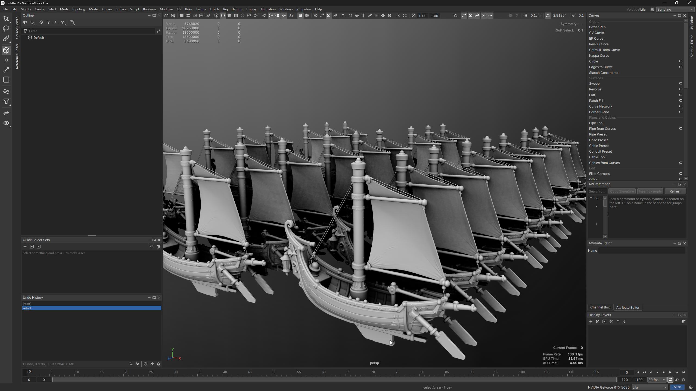
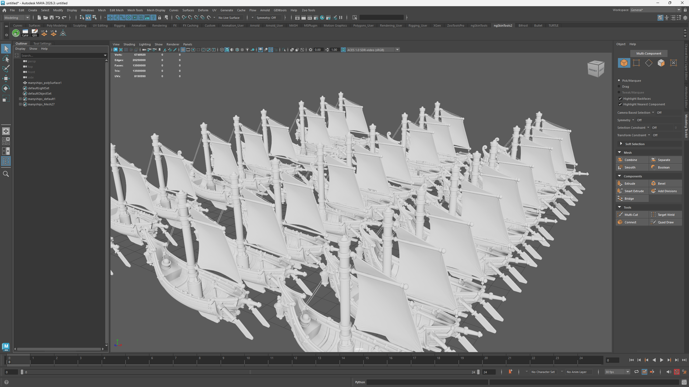
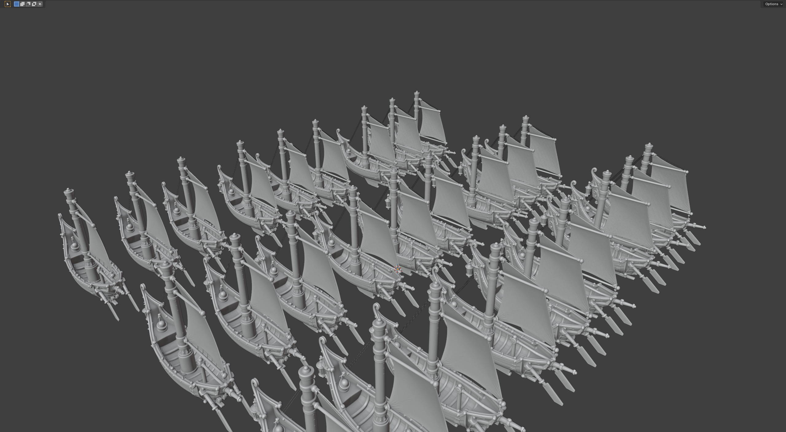

# Performance

The same 13.5 million triangles in each app, with ambient occlusion: Lila and Maya at 8x antialiasing, Blender with its samples added once the view stopped.

<span style="background:linear-gradient(90deg,#4da3ff,#e8f3ff);-webkit-background-clip:text;background-clip:text;color:transparent;font-weight:700">Lila</span>



<span style="background:linear-gradient(90deg,#3fcf6b,#1fb5b0);-webkit-background-clip:text;background-clip:text;color:transparent;font-weight:700">Maya 2026.3</span>



<span style="background:linear-gradient(90deg,#f5792a,#ffb15e);-webkit-background-clip:text;background-clip:text;color:transparent;font-weight:700">Blender 5.2</span>



> Same machine, same files, timed in the running app from the command until the result draws on the screen.

## Measured on

| | |
| --- | --- |
| Date | 4 and 5 November 2026 (Maya's files and modelling: 27 October 2026) |
| Lila | 0.1.0, build of 4 November 2026 |
| Maya | 2026.3 (cut 202510291147-60ec9eda33) |
| Blender | 5.2.3 LTS, OpenGL |
| CPU | AMD Ryzen 9 5950X, 16 cores |
| RAM | 128 GB |
| GPU | NVIDIA GeForce RTX 5080, 16 GB, driver 610.88 |
| OS | Windows 11 Pro |

Each number is only a claim about the versions above.

## Test files

- **Ships**: a 2.6 GB OBJ of 27 copies of one ship, 13.5 million triangles and 6.75 million vertices, exported from Maya.
- **Exploded ship**: one 500,000-triangle ship written with every face on its own vertices (1.5 million vertices), as an exploded import arrives. Welding it gives back the ship.

## Results

Results are coloured by how far they are from the best on their row: <span style="color:#22a447">green</span> is the fastest (brighter for a bigger lead), <span style="color:#c9a400">yellow</span> is close to it and <span style="color:#e0453a">red</span> is 10x slower or worse; results within 5% count as even.

> Lower is faster: each number is how long a task took, or how long one frame took to draw.

### Files

| Task | <span style="background:linear-gradient(90deg,#3fcf6b,#1fb5b0);-webkit-background-clip:text;background-clip:text;color:transparent;font-weight:700">Maya 2026.3</span> | <span style="background:linear-gradient(90deg,#f5792a,#ffb15e);-webkit-background-clip:text;background-clip:text;color:transparent;font-weight:700">Blender 5.2</span> | <span style="background:linear-gradient(90deg,#4da3ff,#e8f3ff);-webkit-background-clip:text;background-clip:text;color:transparent;font-weight:700">Lila</span> | Difference |
|---|---|---|---|---|
| Import the ships OBJ, until on screen | <span style="color:#de4c36">55.3 s</span> | <span style="color:#d28016">16.0 s</span> | <span style="color:#89a41b;font-weight:700">6.60 s</span> | **<span style="background:linear-gradient(90deg,#4da3ff,#e8f3ff);-webkit-background-clip:text;background-clip:text;color:transparent;font-weight:700">Lila</span> 2.4x faster** |
| Save native binary (.mb / .lila) | <span style="color:#c3a402;font-weight:700">0.610 s</span> | <span style="color:#caa102">0.659 s</span> | <span style="color:#cc9807">0.811 s</span> | **<span style="background:linear-gradient(90deg,#3fcf6b,#1fb5b0);-webkit-background-clip:text;background-clip:text;color:transparent;font-weight:700">Maya</span> 1.1x faster** |
| Open native binary, until on screen | <span style="color:#ce900d">4.05 s</span> | <span style="color:#bba406;font-weight:700">2.47 s</span> | <span style="color:#cb9c05">2.98 s</span> | **<span style="background:linear-gradient(90deg,#f5792a,#ffb15e);-webkit-background-clip:text;background-clip:text;color:transparent;font-weight:700">Blender</span> 1.2x faster** |
| Save native ASCII (.ma / .lilaa) | <span style="color:#d67020">19.5 s</span> | - | <span style="color:#6da427;font-weight:700">5.50 s</span> | **<span style="background:linear-gradient(90deg,#4da3ff,#e8f3ff);-webkit-background-clip:text;background-clip:text;color:transparent;font-weight:700">Lila</span> 3.5x faster** |
| Open native ASCII, until on screen | <span style="color:#d76a23">30.0 s</span> | - | <span style="color:#63a42b;font-weight:700">7.33 s</span> | **<span style="background:linear-gradient(90deg,#4da3ff,#e8f3ff);-webkit-background-clip:text;background-clip:text;color:transparent;font-weight:700">Lila</span> 4.1x faster** |
| Export FBX<br><small>Lila writes tangents by default, Maya and Blender don't; without them Lila took 4.7 s, and Blender took 46.9 s with them</small> | <span style="color:#d4771b">37.5 s</span> | <span style="color:#cf8a10">23.9 s</span> | <span style="color:#9ba414;font-weight:700">12.6 s</span> | **<span style="background:linear-gradient(90deg,#4da3ff,#e8f3ff);-webkit-background-clip:text;background-clip:text;color:transparent;font-weight:700">Lila</span> 1.9x faster** |
| Import that FBX, until on screen | <span style="color:#df4937">48.7 s</span> | <span style="color:#d76a24">22.2 s</span> | <span style="color:#62a42c;font-weight:700">5.40 s</span> | **<span style="background:linear-gradient(90deg,#4da3ff,#e8f3ff);-webkit-background-clip:text;background-clip:text;color:transparent;font-weight:700">Lila</span> 4.1x faster** |

### File sizes, the ships

| Task | <span style="background:linear-gradient(90deg,#3fcf6b,#1fb5b0);-webkit-background-clip:text;background-clip:text;color:transparent;font-weight:700">Maya 2026.3</span> | <span style="background:linear-gradient(90deg,#f5792a,#ffb15e);-webkit-background-clip:text;background-clip:text;color:transparent;font-weight:700">Blender 5.2</span> | <span style="background:linear-gradient(90deg,#4da3ff,#e8f3ff);-webkit-background-clip:text;background-clip:text;color:transparent;font-weight:700">Lila</span> | Difference |
|---|---|---|---|---|
| Native binary (.mb / .lila) | <span style="color:#d18215">1129 MB</span> | <span style="color:#c9a400">499 MB</span> | <span style="color:#c9a400">517 MB</span> | ≈ even |
| Native ASCII (.ma / .lilaa) | <span style="color:#c9a400">2923 MB</span> | - | <span style="color:#c9a400">2889 MB</span> | ≈ even |
| FBX, each app's defaults<br><small>Lila's default writes tangents, Maya's and Blender's don't</small> | <span style="color:#caa102">504 MB</span> | <span style="color:#c3a402;font-weight:700">466 MB</span> | <span style="color:#d76a23">1880 MB</span> | **<span style="background:linear-gradient(90deg,#f5792a,#ffb15e);-webkit-background-clip:text;background-clip:text;color:transparent;font-weight:700">Blender</span> 1.1x smaller** |
| FBX without tangents | <span style="color:#caa102">504 MB</span> | <span style="color:#c3a402;font-weight:700">466 MB</span> | <span style="color:#cc9907">611 MB</span> | **<span style="background:linear-gradient(90deg,#f5792a,#ffb15e);-webkit-background-clip:text;background-clip:text;color:transparent;font-weight:700">Blender</span> 1.1x smaller** |

### Modelling

| Task | <span style="background:linear-gradient(90deg,#3fcf6b,#1fb5b0);-webkit-background-clip:text;background-clip:text;color:transparent;font-weight:700">Maya 2026.3</span> | <span style="background:linear-gradient(90deg,#f5792a,#ffb15e);-webkit-background-clip:text;background-clip:text;color:transparent;font-weight:700">Blender 5.2</span> | <span style="background:linear-gradient(90deg,#4da3ff,#e8f3ff);-webkit-background-clip:text;background-clip:text;color:transparent;font-weight:700">Lila</span> | Difference |
|---|---|---|---|---|
| Weld the exploded ship (1.5 million vertices, 0.0001 cm), until on screen | <span style="color:#cb9c05">1.74 s</span> | <span style="color:#cc9907">1.86 s</span> | <span style="color:#baa406;font-weight:700">1.42 s</span> | **<span style="background:linear-gradient(90deg,#4da3ff,#e8f3ff);-webkit-background-clip:text;background-clip:text;color:transparent;font-weight:700">Lila</span> 1.2x faster** |
| Subdivide the ships once (13.5 million to 40.5 million faces), until on screen<br><small>Maya crashed after it in one of two sessions; Blender (Subdivision Surface, level 1, applied) crashed</small> | <span style="color:#d18513">42.4 s</span> | <span style="color:#e0453a">crashed</span> | <span style="color:#92a417;font-weight:700">19.9 s</span> | **<span style="background:linear-gradient(90deg,#4da3ff,#e8f3ff);-webkit-background-clip:text;background-clip:text;color:transparent;font-weight:700">Lila</span> 2.1x faster** |
| Object to vertices (6.75 million), until on screen<br><small>Blender: entering Edit Mode with every vertex selected</small> | <span style="color:#cb9a06">0.154 s</span> | <span style="color:#e0453a">10.6 s</span> | <span style="color:#b8a407;font-weight:700">0.121 s</span> | **<span style="background:linear-gradient(90deg,#4da3ff,#e8f3ff);-webkit-background-clip:text;background-clip:text;color:transparent;font-weight:700">Lila</span> 1.3x faster** |

### Stability

| | <span style="background:linear-gradient(90deg,#3fcf6b,#1fb5b0);-webkit-background-clip:text;background-clip:text;color:transparent;font-weight:700">Maya 2026.3</span> | <span style="background:linear-gradient(90deg,#f5792a,#ffb15e);-webkit-background-clip:text;background-clip:text;color:transparent;font-weight:700">Blender 5.2</span> | <span style="background:linear-gradient(90deg,#4da3ff,#e8f3ff);-webkit-background-clip:text;background-clip:text;color:transparent;font-weight:700">Lila</span> |
| --- | --- | --- | --- |
| Crashes | <span style="color:#e0453a">1</span>: subdividing the ships (exception 0xc0000409, in one of two sessions) | <span style="color:#e0453a">1</span>: subdividing the ships (Subdivision Surface, level 1, applied) | <span style="color:#22a447">0</span> |
| Hangs | <span style="color:#e0453a">3 of 3</span>: welding the single ship at 0.01 cm, ended with End Task after several minutes | not tested | <span style="color:#22a447">0</span>: the same weld finished in 0.6 s |

The 0.01 cm weld is extreme: the ship is about 1 cm long, so almost every edge is shorter than that and the whole mesh collapses.

If Lila crashes, hangs or is slow on your files, report it.

### Viewport

| Task | <span style="background:linear-gradient(90deg,#3fcf6b,#1fb5b0);-webkit-background-clip:text;background-clip:text;color:transparent;font-weight:700">Maya 2026.3</span> | <span style="background:linear-gradient(90deg,#f5792a,#ffb15e);-webkit-background-clip:text;background-clip:text;color:transparent;font-weight:700">Blender 5.2</span> | <span style="background:linear-gradient(90deg,#4da3ff,#e8f3ff);-webkit-background-clip:text;background-clip:text;color:transparent;font-weight:700">Lila</span> | Difference |
|---|---|---|---|---|
| Shaded<br><small>8x antialiasing; Blender's viewport has no multisampling</small> | <span style="color:#d5741d">11.9 ms</span> | - | <span style="color:#75a424;font-weight:700">3.72 ms</span> | **<span style="background:linear-gradient(90deg,#4da3ff,#e8f3ff);-webkit-background-clip:text;background-clip:text;color:transparent;font-weight:700">Lila</span> 3.2x faster** |
| Shaded with ambient occlusion<br><small>Lila fast mode; accurate mode 6.8 ms</small> | <span style="color:#d76824">13.2 ms</span> | - | <span style="color:#60a42d;font-weight:700">3.10 ms</span> | **<span style="background:linear-gradient(90deg,#4da3ff,#e8f3ff);-webkit-background-clip:text;background-clip:text;color:transparent;font-weight:700">Lila</span> 4.3x faster** |
| Wireframe on shaded (20 million edges) | <span style="color:#d27d18">12.2 ms</span> | - | <span style="color:#85a41d;font-weight:700">4.73 ms</span> | **<span style="background:linear-gradient(90deg,#4da3ff,#e8f3ff);-webkit-background-clip:text;background-clip:text;color:transparent;font-weight:700">Lila</span> 2.6x faster** |
| Object selected | <span style="color:#ce8f0d">7.79 ms</span> | - | <span style="color:#a3a410;font-weight:700">4.63 ms</span> | **<span style="background:linear-gradient(90deg,#4da3ff,#e8f3ff);-webkit-background-clip:text;background-clip:text;color:transparent;font-weight:700">Lila</span> 1.7x faster** |
| Vertex mode, all 6.75 million vertices selected | <span style="color:#d5711f">17.3 ms</span> | - | <span style="color:#70a426;font-weight:700">5.04 ms</span> | **<span style="background:linear-gradient(90deg,#4da3ff,#e8f3ff);-webkit-background-clip:text;background-clip:text;color:transparent;font-weight:700">Lila</span> 3.4x faster** |

Lila's accurate ambient occlusion only darkens ambient light, at the cost of drawing the scene twice. Its fast mode, like Maya's, darkens the finished image. Pick in **Preferences > Viewport > AO method**.

### Viewport, no antialiasing

| Task | <span style="background:linear-gradient(90deg,#3fcf6b,#1fb5b0);-webkit-background-clip:text;background-clip:text;color:transparent;font-weight:700">Maya 2026.3</span> | <span style="background:linear-gradient(90deg,#f5792a,#ffb15e);-webkit-background-clip:text;background-clip:text;color:transparent;font-weight:700">Blender 5.2</span> | <span style="background:linear-gradient(90deg,#4da3ff,#e8f3ff);-webkit-background-clip:text;background-clip:text;color:transparent;font-weight:700">Lila</span> | Difference |
|---|---|---|---|---|
| Shaded<br><small>Lila's Temporal mode, one sample a frame refined once the view stops: 1.85 ms</small> | <span style="color:#d5741e">5.63 ms</span> | <span style="color:#c9a400">1.80 ms</span> | <span style="color:#c9a400">1.74 ms</span> | ≈ even |
| Shaded with ambient occlusion<br><small>Lila fast mode; Blender: world-space cavity</small> | <span style="color:#d76c22">7.08 ms</span> | <span style="color:#c1a403;font-weight:700">1.83 ms</span> | <span style="color:#caa003">2.04 ms</span> | **<span style="background:linear-gradient(90deg,#f5792a,#ffb15e);-webkit-background-clip:text;background-clip:text;color:transparent;font-weight:700">Blender</span> 1.1x faster** |
| Wireframe on shaded (20 million edges) | <span style="color:#cd920b">5.80 ms</span> | <span style="color:#cb9d04">4.37 ms</span> | <span style="color:#bda405;font-weight:700">3.72 ms</span> | **<span style="background:linear-gradient(90deg,#4da3ff,#e8f3ff);-webkit-background-clip:text;background-clip:text;color:transparent;font-weight:700">Lila</span> 1.2x faster** |
| Object selected | <span style="color:#cb9a06">3.60 ms</span> | <span style="color:#b8a407;font-weight:700">2.83 ms</span> | <span style="color:#cc9907">3.73 ms</span> | **<span style="background:linear-gradient(90deg,#f5792a,#ffb15e);-webkit-background-clip:text;background-clip:text;color:transparent;font-weight:700">Blender</span> 1.3x faster** |
| Vertex mode, all 6.75 million vertices selected<br><small>Lila's Temporal mode: 3.84 ms</small> | <span style="color:#cd920b">8.47 ms</span> | <span style="color:#d08513">11.6 ms</span> | <span style="color:#aaa40d;font-weight:700">5.53 ms</span> | **<span style="background:linear-gradient(90deg,#4da3ff,#e8f3ff);-webkit-background-clip:text;background-clip:text;color:transparent;font-weight:700">Lila</span> 1.5x faster** |

Blender's viewport draws one sample a frame while the view moves, then adds samples once it stops. Lila's **Preferences > Viewport > Antialiasing > Mode > Temporal** works the same way, with temporal antialiasing on the moving frames.

### Python, 6.75 million vertices

> Lila hands numpy its vertex buffer directly with no copy, so the gather time doesn't grow with mesh size. Maya copies every position.

| Task | <span style="background:linear-gradient(90deg,#3fcf6b,#1fb5b0);-webkit-background-clip:text;background-clip:text;color:transparent;font-weight:700">Maya 2026.3</span> | <span style="background:linear-gradient(90deg,#f5792a,#ffb15e);-webkit-background-clip:text;background-clip:text;color:transparent;font-weight:700">Blender 5.2</span> | <span style="background:linear-gradient(90deg,#4da3ff,#e8f3ff);-webkit-background-clip:text;background-clip:text;color:transparent;font-weight:700">Lila</span> | Difference |
|---|---|---|---|---|
| Get every vertex position into numpy, usual API<br><small>Maya: MFnMesh.getPoints; Blender: MeshVertices.foreach_get into float64; Lila: Node.points_array</small> | <span style="color:#e0453a">13.7 s</span> | <span style="color:#e0453a">0.628 s</span> | <span style="color:#22a447;font-weight:700">22.2 µs</span> | **<span style="background:linear-gradient(90deg,#4da3ff,#e8f3ff);-webkit-background-clip:text;background-clip:text;color:transparent;font-weight:700">Lila</span> 28290x faster** |
| Get every vertex position into numpy, fastest route<br><small>Maya: API 1 MFnMesh.getRawPoints through ctypes; Blender: the position attribute's foreach_get into float32</small> | <span style="color:#e0453a">0.0220 s</span> | <span style="color:#e0453a">0.0195 s</span> | <span style="color:#22a447;font-weight:700">22.2 µs</span> | **<span style="background:linear-gradient(90deg,#4da3ff,#e8f3ff);-webkit-background-clip:text;background-clip:text;color:transparent;font-weight:700">Lila</span> 877x faster** |
| Compute with numpy | <span style="color:#cc9708">1.33 s</span> | <span style="color:#b3a409;font-weight:700">0.965 s</span> | <span style="color:#cc9808">1.31 s</span> | **<span style="background:linear-gradient(90deg,#f5792a,#ffb15e);-webkit-background-clip:text;background-clip:text;color:transparent;font-weight:700">Blender</span> 1.4x faster** |
| Compute with numpy on 32 threads | <span style="color:#ca9e03">0.711 s</span> | <span style="color:#bfa404;font-weight:700">0.621 s</span> | <span style="color:#cb9c05">0.750 s</span> | **<span style="background:linear-gradient(90deg,#f5792a,#ffb15e);-webkit-background-clip:text;background-clip:text;color:transparent;font-weight:700">Blender</span> 1.1x faster** |
| Compute in pure Python<br><small>100,000 vertices timed, extrapolated</small> | <span style="color:#cd930a">27.3 s</span> | <span style="color:#c9a400">18.8 s</span> | <span style="color:#c9a400">18.0 s</span> | ≈ even |
| Get every normal into numpy (40.5 million face-vertices)<br><small>Maya: MFnMesh.getNormals and getNormalIds; Blender: Mesh.corner_normals; Lila: Node.normals_array</small> | <span style="color:#e0453a">75.7 s</span> | <span style="color:#8ba41a;font-weight:700">0.0586 s</span> | <span style="color:#d28116">0.138 s</span> | **<span style="background:linear-gradient(90deg,#f5792a,#ffb15e);-webkit-background-clip:text;background-clip:text;color:transparent;font-weight:700">Blender</span> 2.4x faster** |
| Get every tangent into numpy (MikkTSpace)<br><small>Maya: MFnMesh.getTangents; Blender: Mesh.calc_tangents, then the loops' tangents and signs; Lila: Node.tangents_array</small> | <span style="color:#e0453a">76.0 s</span> | <span style="color:#d08811">6.42 s</span> | <span style="color:#98a415;font-weight:700">3.28 s</span> | **<span style="background:linear-gradient(90deg,#4da3ff,#e8f3ff);-webkit-background-clip:text;background-clip:text;color:transparent;font-weight:700">Lila</span> 2.0x faster** |

Lila's FBX export writes tangents and binormals by default, so Unreal uses the same tangent space Lila shows. Tangents are most of the gap in FBX size: turn them off in the FBX export options (`exportFbx(path, tangents=False)`) when Unreal should compute its own.

### Other formats

Lila only. Each file was written by Lila's own exporter from the ships.

| File | Import, until on screen | Export | Size |
| --- | --- | --- | --- |
| PLY, binary: the ships, 40.5 million vertices | 4.06 s | 3.04 s | 1,403 MB |
| PLY, ASCII: the same | 6.66 s | 6.09 s | 3,648 MB |
| PLY, binary point cloud: 50 million points with normals, colours and intensity | 2.40 s | - | 1,478 MB |
| STL, binary: the ships | 2.67 s | 1.47 s | 644 MB |
| STL, ASCII: the ships | 4.14 s | 3.55 s | 2,699 MB |
| DXF: the ships as polyface meshes | 7.36 s | 5.27 s | 2,872 MB |

<!-- history:start -->
## History

Snapshots of this page from major performance pushes, each kept as it was measured.

| Date | Push | Compared with | |
|---|---|---|---|
| 4 November 2026 | Viewport faster than Maya, Blender 5.2 added | Maya 2026.3, Blender 5.2 | [Snapshot](performance/2026-11-04.md) |
| 27 October 2026 | First comparison with Maya | Maya 2026.3 | [Snapshot](performance/2026-10-27.md) |

### Lila over time

| Task | 27 October 2026 | 4 November 2026 |
|---|---|---|
| Import the ships OBJ, until on screen | 6.80 s | 6.60 s |
| Save native binary (.mb / .lila) | 0.723 s | 0.811 s |
| Open native binary, until on screen | 2.90 s | 2.98 s |
| Save native ASCII (.ma / .lilaa) | 4.96 s | 5.50 s |
| Open native ASCII, until on screen | 8.65 s | 7.33 s |
| Export FBX | 19.0 s | 12.6 s |
| Import that FBX, until on screen | 6.02 s | 5.40 s |
| Native binary (.mb / .lila) | 517 MB | 517 MB |
| Native ASCII (.ma / .lilaa) | 2889 MB | 2889 MB |
| FBX, each app's defaults | 1880 MB | 1880 MB |
| FBX without tangents | 611 MB | 611 MB |
| Weld the exploded ship (1.5 million vertices, 0.0001 cm), until on screen | 1.24 s | 1.42 s |
| Subdivide the ships once (13.5 million to 40.5 million faces), until on screen | 34.2 s | 19.9 s |
| Object to vertices (6.75 million), until on screen | 0.116 s | 0.121 s |
| Shaded | 5.68 ms | 3.72 ms |
| Shaded with ambient occlusion | 5.79 ms | 3.10 ms |
| Wireframe on shaded (20 million edges) | 6.14 ms | 4.73 ms |
| Object selected | 6.02 ms | 4.63 ms |
| Vertex mode, all 6.75 million vertices selected | 6.82 ms | 5.04 ms |
| Get every vertex position into numpy, usual API | 184 µs | 22 µs |
| Get every vertex position into numpy, fastest route | 184 µs | 22 µs |
| Compute with numpy | 1.30 s | 1.30 s |
| Compute with numpy on 32 threads | 0.698 s | 0.750 s |
| Compute in pure Python | 18.8 s | 18.0 s |

<!-- history:end -->

## How it was measured

Each app was started fresh, with nothing else running, and timed alone. Each viewport was about 2 million pixels: Maya's 1662 x 1114, Blender's and Lila's 1600 x 1260. Times "until on screen" run from the command to the first frame drawn afterwards.

### Maya

Each script ran in the open Maya through a command port. The timer wraps the command, then `cmds.refresh(force=True)` for the redraw.

| Task | Command |
| --- | --- |
| Import | `cmds.file(path, i=True, type="OBJ", options="mo=0;lo=0")` |
| Save and open | `cmds.file(save=True, type="mayaBinary")` or `"mayaAscii"`, then `cmds.file(new=True, force=True)` and `cmds.file(path, open=True, force=True)` |
| FBX | `cmds.file(path, exportAll=True, type="FBX export")` with the default FBX settings, then `cmds.file(path, i=True, type="FBX")` into a new scene |
| Weld | all vertices selected, `cmds.polyMergeVertex(d=0.0001)` |
| Subdivide | `cmds.polySmooth(mesh, dv=1)` |
| Object to vertices | object selected, `mel.eval("ConvertSelectionToVertices")` |

Viewport: Viewport 2.0 (DirectX 11), Smooth Shaded, `hardwareRenderingGlobals` at 8 samples or with multisampling off, SSAO on or off per row. The camera is framed on the ships with `viewFit`, then orbited to 8 angles 45 degrees apart (`tools/benchmarks/maya_viewport.py`); at each, `cmds.refresh(force=True, currentView=True)` runs 30 times and the time is the average per redraw. The row is the median of the 8 angles. `nvidia-smi` showed the GPU at 100% through a longer run, so the GPU set the pace and wall time is GPU time.

Snapshots before 4 November turned Maya's camera in place instead of orbiting it, so the ships left the view for about half the frames: their Maya viewport times are too low.

### Lila

Each script ran in the open Lila through its MCP server. The timer wraps the command, then lets the app run until its viewport has drawn a frame (`viewportStats()["frames"]` counting up, checked every 20 ms).

| Task | Command |
| --- | --- |
| Import | `importFile(path)`, median of three |
| Other formats | `ops.importPly`, `ops.importStl` and `ops.importDxf` into a new scene, median of two; `ops.exportPly`, `ops.exportStl` and `ops.exportDxf` with the ships selected |
| Save and open | `saveScene("ships.lila")` or `"ships.lilaa"`, then `newScene()` and `openScene(path, force=True)` |
| FBX | `exportFbx(path, selectionOnly=False)` with the default settings (Unreal axes, tangents, triangulated), then `importFile(path)` into a new scene |
| Weld | object selected, `polyMerge(distance=0.0001)` |
| Subdivide | `polySubdivide(mesh, levels=1)` |
| Object to vertices | object selected and the viewport idle for 3 s, `convertSelection("vertex")`, median of three |

Viewport: shaded, framed with Frame All, at 8x antialiasing or with antialiasing off. The camera visits 8 angles 45 degrees apart; at each, timeline playback keeps the viewport drawing while `viewportStats()` reads the GPU time of each finished frame from Vulkan timestamp queries, and the angle's time is the median of those. The row is the median of the 8 angles.

### Blender

Each step ran in the open Blender (`--factory-startup --gpu-vsync off`, the 3D view maximised) from a script driven by `bpy.app.timers`. The timer wraps the operator, then waits until a draw handler on the 3D view fires.

| Task | Command |
| --- | --- |
| Import | `bpy.ops.wm.obj_import(filepath=path)` |
| Save and open | `bpy.ops.wm.save_as_mainfile(filepath=path)`, then `bpy.ops.wm.open_mainfile(filepath=path, load_ui=False)` |
| FBX | `bpy.ops.export_scene.fbx(filepath=path)` with the default settings (`use_tspace=True` for tangents), then `bpy.ops.import_scene.fbx(filepath=path)` into an empty scene |
| Weld | Edit Mode, all selected, `bpy.ops.mesh.remove_doubles(threshold=0.0001)` |
| Subdivide | a Subdivision Surface modifier at level 1, then `bpy.ops.object.modifier_apply` |
| Object to vertices | object selected, `bpy.ops.object.mode_set(mode="EDIT")` with every vertex selected |

Viewport: Solid shading on OpenGL, world-space cavity on or off per row. Blender has no multisampling in the viewport: it draws one sample a frame while the view moves and adds more once it stops, so each frame turns the view by 0.05 degrees to keep it drawing a fresh frame. The time is the wall time of `bpy.ops.wm.redraw_timer(type="DRAW_SWAP")` over 20 frames, the median of 5 runs, at 4 angles 45 degrees apart; the row is the median of the angles.

### Python

The same maths runs in every app from one file, `tools/benchmarks/mesh_compute.py` in the Lila repository. All three give the same checksum: mean -0.343375486 -0.065308194 0.008460365, covariance trace 0.027830457.

Gathering the positions:

```python
# Lila: a read-only numpy view of the mesh, no copy
points = lila.Node("Default").points_array()

# Maya, the usual route
points = np.array(om.MFnMesh(path).getPoints(om.MSpace.kObject))[:, :3]

# Blender
points = np.empty(len(mesh.vertices) * 3)
mesh.vertices.foreach_get("co", points)
```

Lila's gather time is the median of five runs. The full scripts are `python/examples/mesh_compute_benchmark.py` (Lila), `tools/benchmarks/maya_mesh_compute.py` (Maya) and `tools/benchmarks/blender_bench.py` (Blender, every Blender row). Threading in Lila is covered in [Threads and big meshes](python-threads.md).

<details>
<summary>mesh_compute.py</summary>

```python
"""The mesh compute benchmark's maths, shared by every app's benchmark script so they all time the same work.

Plain numpy and the math module only: nothing app-specific. Each vertex gets a 4x4 matrix built from its position
(rotate about Y by atan2(z, x), about X by asin of the normalised y, scale by its length, translate by the position),
that matrix transforms the vertex, the result is normalised, its angle to a fixed axis goes through some sin, cos and
tan, and the weighted directions are reduced to a mean and a 3x3 covariance.

    mean, cov = compute(points)                      # points: (N, 3) float64
    mean, cov = compute_threaded(points, pool, workers)
    n, s, ss = python_partial(points[:100_000])      # the same maths per vertex in pure Python
"""

import math

import numpy as np

AXIS = np.array([1.0, 2.0, 3.0]) / math.sqrt(14.0)
CHUNK = 1 << 16


def _matrices(p):
    """(n, 4, 4) per-vertex matrices T(p) * Ry(yaw) * Rx(pitch) * S(|p|)."""
    x, y, z = p[:, 0], p[:, 1], p[:, 2]
    length = np.sqrt(x * x + y * y + z * z)
    safe = np.where(length > 0.0, length, 1.0)
    yaw = np.arctan2(z, x)
    pitch = np.arcsin(np.clip(y / safe, -1.0, 1.0))
    cy, sy = np.cos(yaw), np.sin(yaw)
    cp, sp = np.cos(pitch), np.sin(pitch)
    m = np.zeros((len(p), 4, 4))
    m[:, 0, 0] = cy * length
    m[:, 0, 1] = sy * sp * length
    m[:, 0, 2] = sy * cp * length
    m[:, 1, 1] = cp * length
    m[:, 1, 2] = -sp * length
    m[:, 2, 0] = -sy * length
    m[:, 2, 1] = cy * sp * length
    m[:, 2, 2] = cy * cp * length
    m[:, :3, 3] = p
    m[:, 3, 3] = 1.0
    return m


def partial(p):
    """(count, sum, sum of outer products) of the weighted directions of one chunk of points."""
    h = np.empty((len(p), 4))
    h[:, :3] = p
    h[:, 3] = 1.0
    q = np.einsum("nij,nj->ni", _matrices(p), h)[:, :3]
    norm = np.linalg.norm(q, axis=1)
    qn = q / np.where(norm > 0.0, norm, 1.0)[:, None]
    angle = np.arccos(np.clip(qn @ AXIS, -1.0, 1.0))
    mix = np.sin(angle) * np.cos(2.0 * angle) + np.tan(0.25 * angle)
    r = qn * mix[:, None]
    return len(r), r.sum(axis=0), r.T @ r


def combine(parts):
    """Mean and sample covariance from partial() results."""
    n = sum(c for c, _, _ in parts)
    s = np.sum([s for _, s, _ in parts], axis=0)
    ss = np.sum([ss for _, _, ss in parts], axis=0)
    mean = s / n
    cov = (ss - n * np.outer(mean, mean)) / (n - 1)
    return mean, cov


def _chunks(n, size):
    return [(lo, min(lo + size, n)) for lo in range(0, n, size)]


def compute(points):
    """Mean and 3x3 covariance of the weighted directions, on this thread, a chunk at a time."""
    p = np.asarray(points, dtype=np.float64)
    return combine([partial(p[lo:hi]) for lo, hi in _chunks(len(p), CHUNK)])


def compute_threaded(points, pool, workers):
    """compute() split across a concurrent.futures pool; numpy releases the GIL, so the chunks run in parallel."""
    p = np.asarray(points, dtype=np.float64)
    size = max(1024, min(CHUNK, -(-len(p) // (workers * 4))))
    return combine(list(pool.map(lambda r: partial(p[r[0]:r[1]]), _chunks(len(p), size))))


def python_partial(points):
    """partial() vertex by vertex with the math module, for the pure Python timing."""
    ax, ay, az = (float(v) for v in AXIS)
    n = 0
    s = [0.0, 0.0, 0.0]
    ss = [[0.0] * 3 for _ in range(3)]
    for x, y, z in points:
        length = math.sqrt(x * x + y * y + z * z)
        yaw = math.atan2(z, x)
        pitch = math.asin(max(-1.0, min(1.0, y / length))) if length > 0.0 else 0.0
        cy, sy, cp, sp = math.cos(yaw), math.sin(yaw), math.cos(pitch), math.sin(pitch)
        m = ((cy * length, sy * sp * length, sy * cp * length, x),
             (0.0, cp * length, -sp * length, y),
             (-sy * length, cy * sp * length, cy * cp * length, z))
        q = [row[0] * x + row[1] * y + row[2] * z + row[3] for row in m]
        norm = math.sqrt(q[0] * q[0] + q[1] * q[1] + q[2] * q[2]) or 1.0
        qn = [c / norm for c in q]
        angle = math.acos(max(-1.0, min(1.0, qn[0] * ax + qn[1] * ay + qn[2] * az)))
        mix = math.sin(angle) * math.cos(2.0 * angle) + math.tan(0.25 * angle)
        r = [c * mix for c in qn]
        n += 1
        for i in range(3):
            s[i] += r[i]
            for j in range(3):
                ss[i][j] += r[i] * r[j]
    return n, np.array(s), np.array(ss)


def checksum(mean, cov):
    """One line to compare across apps: the mean and the covariance's trace."""
    return f"mean {mean[0]:.9f} {mean[1]:.9f} {mean[2]:.9f}  cov trace {np.trace(cov):.9f}"
```

</details>
