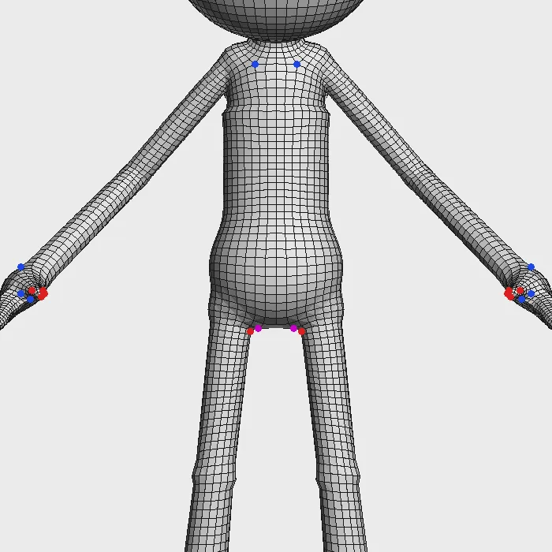
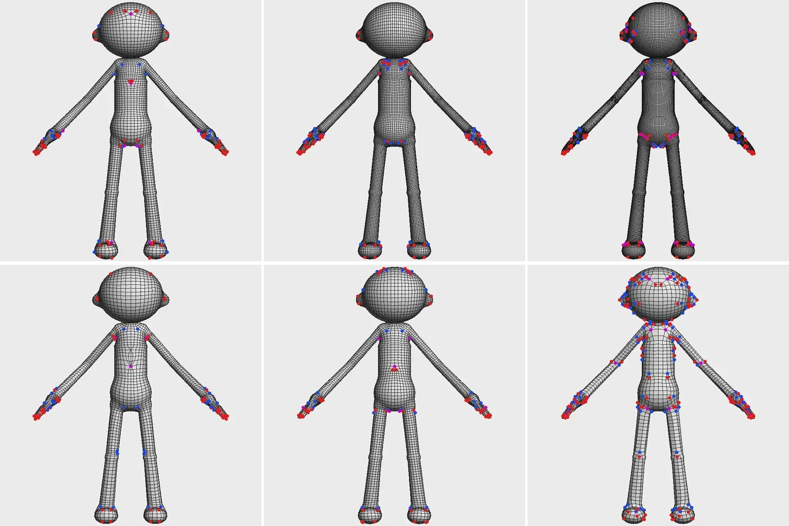
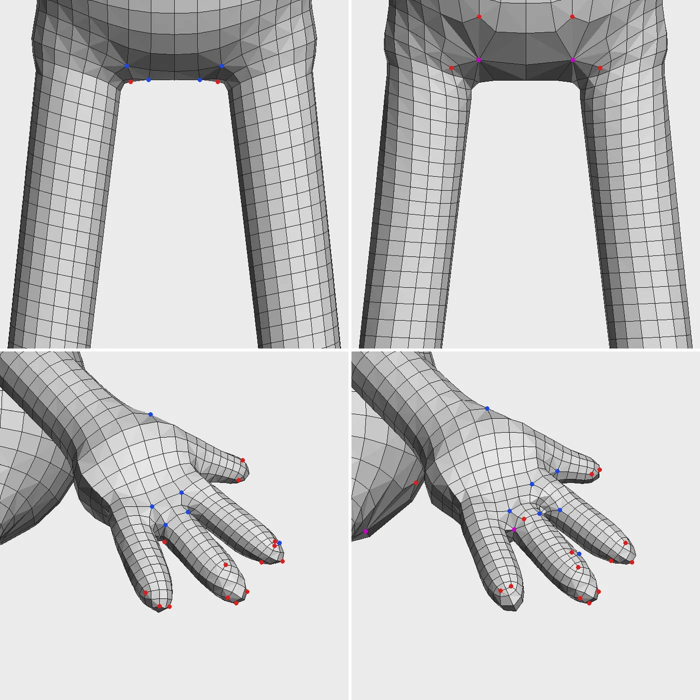
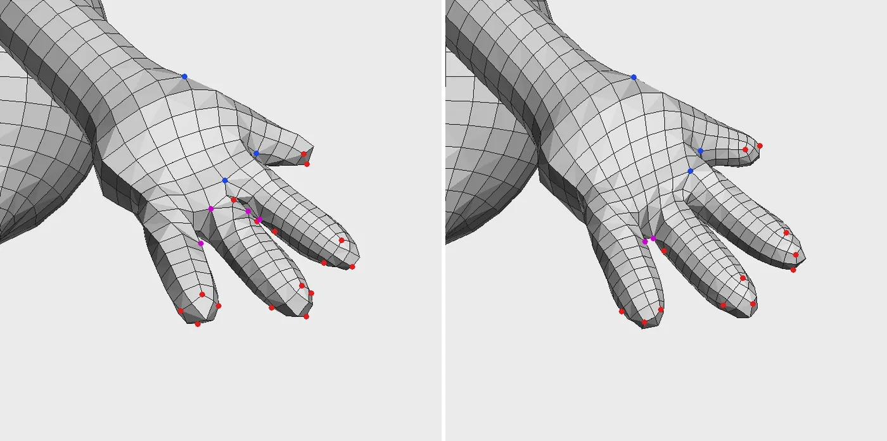
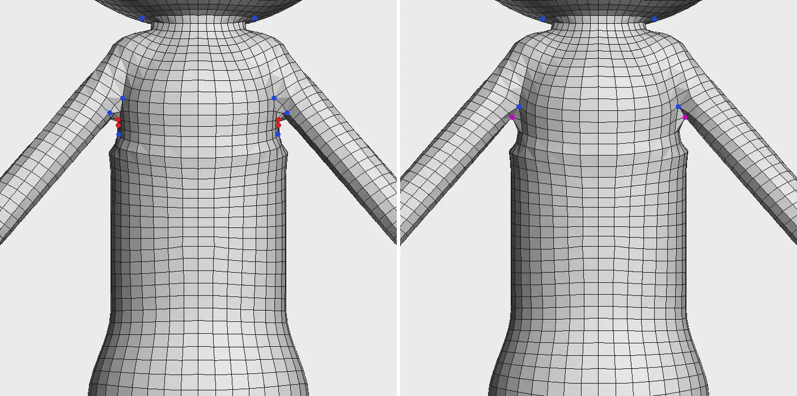

# Quad Remesh

Rebuild any mesh (a sculpt, a scan, a boolean result) as flowing, evenly sized quads you can rig, UV and animate.



## Get it working

1. Select the mesh.
2. **Topology > Quad Remesh** with the option box (Shift-click the menu item, or click its square).
3. Pick a **Preset** for what the mesh is for, or set **Target Faces**. **Symmetry**, right under it, is X by default.
4. Click **Apply**. The source stays, hidden; the new mesh is `<source>_remesh`.

```python
quadRemesh("Body", preset="gameCharacter")
```

To stop it, press **Esc** and confirm with **Abort** on the progress card; the scene stays as it was.

## Troubleshooting

**Far more faces than Target Faces.** Thin parts (fingers, hair locks) get **Edges Around Thin Parts** edges round them whatever the count. Lower **Edges Around Thin Parts**, or remesh thin parts separately.

**The status line says each point is placed from the flow near it instead.** The patches came out with flaws on this shape, so it used a looser layout with more poles. Change **Target Faces** a little and apply again.

**A pole sits in a joint (crotch, armpit, between fingers).** Raise **Joint Pole Avoidance**. Lower it if poles crowd onto flat areas nearby.

**Too few faces at the groin, armpits or hands to deform.** Raise **Joint Density**.

**The two sides don't match.** Set **Symmetry** to the mirror axis; the mesh has to be symmetric about the origin.

**The status line says the mesh isn't symmetric.** The result mirrors one half over the other. Set **Symmetry** to Off for meshes that aren't symmetric about their origin, like props and posed characters.

**Method Grid gave patches instead.** Grid needs an open sheet that never turns back on itself seen from one side, and no symmetry, guides or poles.

## Options

### Presets

| Preset | Target Faces | For |
| --- | --- | --- |
| Game Character | 8000 | Real-time characters: extra faces and no poles at joints, 12 edges round fingers. |
| Mid-Poly | 20000 | Cinematic or close-up characters; 16 edges round fingers. |
| Hero | 40000 | Hero characters: twice the extra faces at joints, 24 edges round fingers. |
| Stylized | 5000 | Broad, simple shapes with even spacing. |
| Hard Surface | 6000 | Machines and props with hard edges: loops on hard edges and creases over 30 degrees, no joint handling. |
| Prop | 3000 | Static props: denser at curves, no joint handling. |

A preset fills in the options below; change any of them afterwards. **Edit > Save Preset...** adds your own to the menu ([sharing presets](essentials.md#save-option-box-presets)). From Python, `preset=` also takes a saved preset's name, and flags you pass win over the preset.



### Density

| Option | Default | What it does |
| --- | --- | --- |
| Target Faces | 3000 | About how many faces to make. |
| Count Tolerance | 0.1 | Retries at a corrected size until the count is within this fraction of Target Faces; 0 takes the first try. |
| Target Edge Length | 0 | Edge length in cm; replaces Target Faces when set. |
| Adaptivity | 0.25 | 0 sizes faces evenly; 1 makes them much smaller where the surface curves. Painted point `density` multiplies it. |
| Joint Density | 0.5 | Extra faces round joints, armpits and finger webs, at the cost of faces elsewhere. 1 makes joints about three times as dense. |
| Joint Density Reach | 6 | How far, in faces, Joint Density's extra faces spread from a fold. Lower keeps them tight to the joint and can clear stray poles nearby (around the ears, for example). |
| Edges Around Thin Parts | 12 | Fingers and other thin round parts get at least this many edges round them; 0 off. |





### Edge flow

| Option | Default | What it does |
| --- | --- | --- |
| Symmetry | X | Remeshes one half and mirrors it, exactly symmetric. Off for meshes that aren't symmetric about their origin. |
| Method | Patches | Patches: loops run unbroken between a few poles and the symmetry line is one loop; use it for characters, props and anything you deform, bake or edit by hand. Grid: straight rows over an open sheet seen from one side (terrain tiles, panels). |
| Use Hard Edges | on | Lays an edge loop along edges marked hard. |
| Sharp Angle | 40 | Also follows creases sharper than this; negative turns it off. |
| Joint Pole Avoidance | 30 | Keeps poles out of joints, armpits and finger webs, onto flatter parts nearby; 0 off. |
| Pure Quads | on | All quads; off allows a few triangles and five-sided faces. |
| Relax Iterations | 6 | Smoothing passes that even out the faces on the surface. |



### Guides

Draw guides on the mesh with **Curves > Pencil Curve** (press S in the tool to draw on the surface), then pick them in the option box. A mesh whose edges trace the line works too.

| Option | What it does |
| --- | --- |
| Flow Curves | The edge flow turns to follow these curves. |
| Edge Loop Curves | An edge loop lands exactly on each curve, like a hard edge. |

### Steering from Python

```python
quadRemesh("Rock", targetFaces=2000,
    densityHandles=[{"position": [0, 120, 10], "radius": 15, "scale": 0.5}],
    featureGuidePoints=[[[0, 100, 0], [10, 110, 5], [20, 100, 0]]],
    guides=["flowCurve"])
```

- `densityHandles`: faces `scale` times as long within `radius` cm, easing out to the edge. Under 1 is denser.
- `guides` (curve or mesh nodes) or `guidePoints` (world points): Flow Curves.
- `featureGuides` or `featureGuidePoints`: Edge Loop Curves.
- `poles`, from **Topology > Retopo Poles** or `retopoPoles`: the flow turns only at these. The result's `poles` says where each one landed.

### Output

| Option | Default | What it does |
| --- | --- | --- |
| Transfer UVs | off | Copies the source's UV sets onto the new mesh. |
| Transfer Normals | off | Copies the source's normals as custom normals. |
| Keep Source | on | Keeps the source mesh; off deletes it. |
| Timeout | 0 | Seconds before giving up; 0 runs until done or aborted. |
