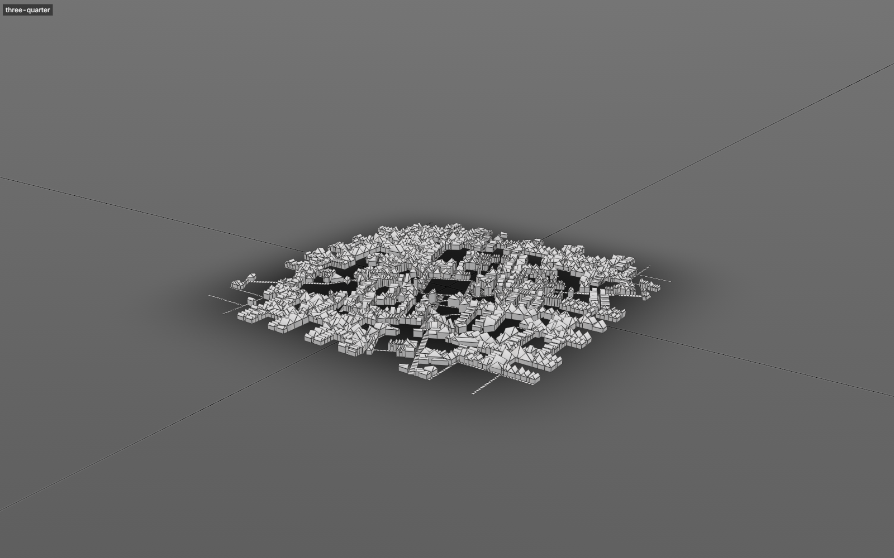

# Settlement

Villages, towns and cities laid out inside an outline, on flat ground, a Terrain or any mesh: main roads routed over the ground, streets grown, gridded, ringed or field-driven by style and era, walls and gates, blocks, lots with uses and landmarks, and a building on each lot as an envelope, greybox massing or placed assets.



## Get it working

1. **Level > Settlement > Settlement** with nothing selected lays out a 400 m medieval town. With a mesh selected, its loose-edge loop is the outline, open loose-edge lines are streets kept as drawn, and loose points are the centre (the first point) and attractors main roads run to (a bridge, a harbour, a gate).
2. Change **profile** on the modifier: `hamlet`, `streetVillage`, `medievalTown`, `usTown`, `manhattan`, `europeanCity`, `modernCity`, `scifiMegacity`.
3. Drag **growth** to watch it grow, change **seed** for another town on the same site.
4. `settlementBuildings(mesh, route="massing")` turns the envelopes into greybox buildings with roofs.

```python
town = settlementCreate(outline=[[-30000, -25000], [35000, -20000], [30000, 30000], [-28000, 25000]],
                        attractors=[[0, 0], [33000, 0]], ground="Terrain", profile="medievalTown", eras="walledTown")
mesh = town["mesh"]
settlementBuildings(mesh, route="massing")
settlementCheck(mesh)["ok"]   # True, or the issues by id
```

Points are `[x, z]` or `[x, y, z]` in cm. **ground** is any mesh, read in world space; keep the settlement mesh at the origin. On a Terrain, main roads are routed with the terrain's own router and its rivers come in as water (`terrainWater=False` leaves them out).

Rivers and roads from outside go in as lines: `water=[[...], ...]` with `waterWidth`, `roads=[[...], ...]`. Only main roads bridge a river; other streets stop at the bank, and no lot lies in the water. In a site mesh they are loose edges with the int edge attribute `water` (float `width`) or `road`.

### Eras, walls and street patterns

- **eras**: `walledTown`, `medievalToModern` or `gridToSprawl`, or your own list of eras, each with a profile, pattern and ring or polygon. Every street, lot and building carries its era; buildings take their era's style. `settlementEras(mesh)` lists what each era laid.
- **walls**: `{"moat": 1200}`, `{"starFort": True}` or a polygon. Gates go where main roads cross, towers by spacing. `settlementWalls(mesh, curves=True)` makes a curve per wall; `masonry=True` builds them in stone with Masonry.
- **pattern**: besides the profile's own, `tensor` (streets following blended fields: a grid angle, a centre, a coast or river line, the slope), `contour` (streets along the terrain's contours), `osm` (a real place's streets from `osmFile`) and `example` (a real place's street statistics on a new site).
- **districts**: polygons with their own profile and pattern. **levels**: decks, elevated roads, skybridges and ramps above the ground (`settlementLevels`).

`settlementGenerators(mesh, ...)` reads or changes all of these on an existing settlement.

### A whole map

```python
settlementSuggest(ground="Terrain", count=3, kind="port")                 # best sites, with the reasons for each
settlementRegion(ground="Terrain", cities=1, towns=3, villages=8, kind="market")
```

`settlementRegion` puts cities on the best sites, towns between them and villages filling in, routes roads between neighbours, then lays out each place with its main roads continuing the regional ones. **kind** (`town`, `market`, `port`, `mining`, `fort`, `farming`, `mill`) weights what makes a good site: flat ground, water out of its flood, trade routes, defence, resources, climate. `rules=` sets the weights yourself. On a Terrain the terrain's fords, confluences, harbours and buildable land feed the scores. The roads and rivers land on a `Region` mesh; each place gets its own settlement mesh.

### Lots, uses and landmarks

Blocks get a type (perimeter, courtyard, row, open, superblock, park, plaza, market, churchyard, field) and lots a use (residential in three wealth tiers, commercial, market, civic, religious, industrial, port, farm, park, cemetery) from the style, street access, water, slope and wind. The market square, church, town hall and a castle on high ground are placed as landmarks.

```python
settlementLots(mesh, landmarks=True)                       # with the reasons each is where it is
settlementSubdivide(mesh, at=[1200, -800], type="courtyard")
settlementLandUse(mesh, at=[3000, 500], use="commercial")
settlementPlaceLandmark(mesh, at=[0, 9000], name="castle", use="civic")
```

Changes are kept by stable id, undo and save with the scene.

### Buildings

`settlementBuildings(mesh, route=...)`, for the whole settlement or `polygon=` a district:

- `outline`: footprints and envelope volumes only.
- `massing`: greybox blocks with tiers and gable, hip, mansard or dome roofs.
- `library`: Stagehand library assets fitted to each lot by footprint, era and use tags, facing the street.
- `masonry`: stone landmark buildings with Masonry.
- `unreal`: envelopes go as PCG data for Unreal to build (`send=True` sends now).

`contacts=True` adds Seamwork contact skirts, strips or scatter where placed buildings meet the ground. On a Terrain, `settlementFoundations(mesh)` measures each foundation from the terrain.

### Streets, furniture and traffic

```python
settlementNames(mesh, culture="french")     # street and district names; settlementEditStreet(mesh, id=..., name=...) renames one
settlementRoadMesh(mesh)                    # road, sidewalk and marking meshes with junctions, curb returns and crosswalks
settlementFurniture(mesh, realize=True)     # lamps, trees, signs, benches, signals; market stalls and wells in old towns
settlementTransit(mesh, busRoutes=2, tramRoutes=1)
```

Furniture placements go out with exports and **Send to Unreal**; `engineAssets=` names the Unreal asset per kind. `settlementLanes(mesh)` returns the lane graph with its checks.

### Around and on a structure

Keep a monument, ruin or megastructure clear and lay only roads and paths around and onto it:

```python
town = settlementCreate(size=400000, pattern="none", blocks=False,
                        exclude=["Temple"], exclusionMargin=2000, walkable="Temple")
mesh = town["mesh"]
settlementRoute(mesh, start=[-150000, 0], end=[0, 10000, 20000], streetClass="path", profile="footpath")
settlementRoute(mesh, start=[-150000, -150000], via=[[150000, -150000]], end=[150000, 150000], profile="serviceRoad")
settlementAddStreet(mesh, points=[[-50000, 60000], [50000, 60000]], profile="avenue")
```

- **Exclusions** (`exclude=` objects or `exclusions=` polygons, later `settlementAddExclusion`) stay clear of every street, block, lot, building and route, in every pattern. A mesh counts by its footprint seen from above; a closed curve by its inside; an open curve as a corridor along it. Objects are measured when added: run it again after moving them.
- **Routes** take the cheapest way over the ground, around exclusions. A stop given with a height on the **walkable** mesh is reached across its upward faces (floors, ramps, terraces, stacked levels); the route leaves the mesh where it meets the ground nearest the way on.
- `pattern="none"` lays only what you give; `blocks=False` keeps streets and paths only; `buildings=False` keeps lots without envelopes.
- `settlementEditStreet(mesh, id=..., ...)` and `settlementDelete(mesh, ids=[...])` change and remove them by the id each edit returns.
- Cross-sections come from road profiles (`settlementRoadProfiles()`); add your own in the **edits** input under `roadProfiles`, as `{"causeway": {"base": "street", "sidewalk": 400}}`.

<!-- TODO image: service roads and a footpath winding around a giant ruin and up its ramp (images/settlement/structure.png) -->

### Shape the terrain

`settlementGrade(mesh)` builds the settlement into its Terrain (or `terrain=`): streets as terrain roads with their cross-section, grade limit, banking, cut and fill, bridges and tunnels; roundabouts where at least three main roads meet; lots as building pads (`padMode`), squares as flat paved regions; canals, moats, quays and rivers the settlement builds. Grading again sends only what changed.

Grading pins the plan: the settlement stays as graded while you edit the terrain. `settlementReplan(mesh)` re-plans only the blocks in regions the terrain changed, keeping every other block, lot and building as it was; `full=True` plans everything afresh.

### Change generated streets

Every street has a stable id: the same street keeps it through re-runs and edits elsewhere. Find it, then change or remove it like your own:

```python
main = settlementStreets(mesh, near=[1200, -800], streetClass="arterial")[0]["id"]
settlementEditStreet(mesh, id=main, profile="highway")
settlementDelete(mesh, ids=[main])
```

A change whose street the layout no longer makes (after a bigger edit) shows in `settlementInfo(mesh)["checks"]["staleOverrides"]`.

### Check and explain

`settlementCheck(mesh)` runs every check (lot frontage and overlaps, street grades, streets in water, envelopes inside their setbacks, foundations, lane connectivity, signal phases, transit routes) and returns the issues by id; `report=True` also lists them in the Validation panel. `settlementExplain(mesh, id="centre")` says why a part is where it is: `centre`, `site`, a street id, `lot:<id>`, `landmark:<id>`, `block:<id>`.

### Export

`settlementExport(mesh, path=...)` writes by the extension, or `format=`: `json`, `geojson` (every layer with its properties, in metres), `usd` (`.usda`), `dxf` (a plan), `unity` and `godot` (a folder with the data, street and massing meshes, and an importer: **Tools > Lila > Import Settlement** in Unity, an EditorScript in Godot 4.3 or later).

### Send to Unreal

Copy `ue/LilaLinkSettlement` into the project's Plugins folder next to LilaLink and enable **Lila Link Settlement**. It brings the PCG and ZoneGraph plugins; LilaLink alone does not need them.

```python
settlementSendToUnreal(mesh, roads="landscape", pcg=True, zoneGraph=True, massing=True)
```

- Everything is cut into World Partition cells (`cell`, 128 m by default). Sending again sends only what changed since the last send and deletes what is gone; `resend=True` sends all of it, `dryRun=True` reports what would go.
- **roads**: `landscape` (landscape splines joined at junctions, shaping the landscape), `splines` (a spline actor; `roadMesh=` lays a mesh along it), `meshes` (ribbon meshes per cell) or `none`. Paths on the walkable mesh always go as a spline actor.
- **massing** sends the greybox buildings as static meshes; library buildings and street furniture go as HISM instances (`placeMode`: `hism`, `ism` or `actors`).
- **pcg** writes a PCG data asset per cell under **folder**, with an actor that runs `pcgGraph` on it. Read it with **Load PCG Data Asset**: pins Lots, Envelopes (footprint polygons with `MaxHeight`, `Floors`, `Use`, `Roof`, `Style`, `Seed` on the data), EnvelopePoints (a point per building), Roads, Intersections (`control`: signal, stop or yield; phases) and ParkingSpots (along roads whose profile has parking, such as `parkedStreet`).
- **zoneGraph** adds lane profiles named `Lila_<profile>` and tags (Vehicle, Pedestrian, Parking, Intersection, Crossing, TrafficLight, StopSign) to the project's ZoneGraph settings, then a spline zone shape per road and crosswalk and a polygon per junction, and rebuilds the ZoneGraph for Mass traffic and crowds. When the project has MassTraffic, the tags its settings name for vehicle, pedestrian, intersection, crosswalk and parking lanes go on the matching shapes too; the reply's `massTraffic` lists which settings it read.

To make streets match a road kit, read its cross-section: `settlementRoadProfileFromUnreal(mesh, asset="/Game/Roads/SG_Avenue")` adds it as a road profile streets can name. `settlementRoadProfileToUnreal(profile="avenue")` writes a Lila profile as ModulesInfo and Grammar pins for PCG's Subdivide Segment.

## Troubleshooting

**"the settlement outline has no area".** The outline loop crosses itself or has fewer than three points.

**Terrain edits don't move the town.** A graded settlement keeps its plan. Run `settlementReplan(mesh)` or `settlementGrade(mesh)` again.

**`settlementCheck` reports issues.** Each names its part by id; `settlementExplain(mesh, id=...)` says why that part is there. Edit or delete it by that id.

**Streets stop short on hills.** Streets refuse grades over the profile's **maxGrade**. Raise it in **overrides**: `{"maxGrade": 0.2}`.

**`checks.components` above 1, or `checks.warnings` names an unconnected street network.** Some streets don't join the rest: streets you drew that end early, or a network with no way over the ground to the town's. Extend them, or let **growth** fill in.

**Few or no buildings.** Lots smaller than the profile's **minLot**, or with no street frontage, stay open ground. Lower **lotScale** or **minLot**, or raise **growth**.

**`route="library"` lists lots nothing fits.** No Stagehand library asset with a fitting footprint and tags. Add assets or widen `fit`; those lots keep their envelopes.

**The log says some massing roofs are flat caps.** The roof could not be built on those footprints; they get a flat roof instead.

**A settlement sits right at the map edge, or a tier has fewer places than asked.** Sites need room for their radius inside the outline and spacing from bigger places. Enlarge the outline, lower the counts, or lower `cityRadius`, `townRadius`, `villageRadius`.

**A route reports `ok: False`.** `settlementInfo(mesh)["paths"]` gives the reason per id: a stop outside the outline, no way over the ground (exclusions closing a gap; lower the margin), or no walkable way (the walkable mesh's pieces don't touch: gaps over 1 m or steps over **walkStep** don't join; faces steeper than **walkSlope** are walls).

**Streets still touch the structure.** The footprint is measured when the exclusion is added. Run `settlementAddExclusion` again after moving or reshaping it, and raise `margin`.

**A command says Terrain, Masonry, Stagehand or Seamwork commands are not available.** Load that extension.

**`settlementSendToUnreal` warns that placements were not sent.** The project has no static mesh at the paths in `missingAssets`. Name your own with `settlementFurniture(mesh, engineAssets={"lantern": "/Game/Props/SM_Lamp"}, store=True)` and send again.

**`settlementSendToUnreal` asks for the LilaLinkSettlement plugin.** Copy `ue/LilaLinkSettlement` next to LilaLink in the project's Plugins folder and enable it.

**`settlementRoadProfileFromUnreal` lists `unknown` slots.** Their names don't say lane, median, parking, sidewalk or verge; they were counted as verge. Rename the slots, or edit the profile under `roadProfiles` in the **edits** input.

**Slow on a big ground mesh.** The ground is sampled once per evaluation at about 2 m (2.5 m on a 10 km terrain). Use a lower-resolution copy of the ground while laying out.

## Tune it

| Input | What it does |
| --- | --- |
| pattern | Override the profile's pattern: `organic`, `grid`, `radial`, `linear`, `organicGrid` (an organic core inside a ring road, a grid beyond), `tensor`, `contour`, `osm`, `example`, `none`. |
| blocks, buildings | Off: streets and paths only; lots without envelopes. |
| walkSlope, walkStep | Steepest walkable face (degrees) and the height a walk may step between separate pieces of the walkable mesh (cm). |
| overrides | JSON object of profile fields, such as `{"maxFloors": 6, "gridAngle": 30, "blockType": "courtyard", "lotMethod": "burgage", "windAngle": 90}`. `settlementProfiles()` lists every field of every profile. |
| heightScale, widthScale, lotScale | Multiply floors, street widths and lot sizes. |
| showStreets, showLots, showBuildings | What the modifier shows. All three stay available on the node's own outputs. |

Streets carry face attributes `street`, `class` (0 arterial, 1 collector, 2 local, 3 alley, 4 path) and `path` (the edit id, -1 when generated); lot outlines an edge attribute `lot`; envelopes face attributes `lot`, `use` (0 residential, 1 commercial, 2 civic, 3 plaza, 4 open, 5 market, 6 religious, 7 industrial, 8 port, 9 farm, 10 park, 11 cemetery), `floors` and `part` (0 wall, 1 roof, 2 floor). `settlementInfo` also returns street metrics comparable with real cities: orientation entropy and order, intersections, dead-end ratio and block sizes.
