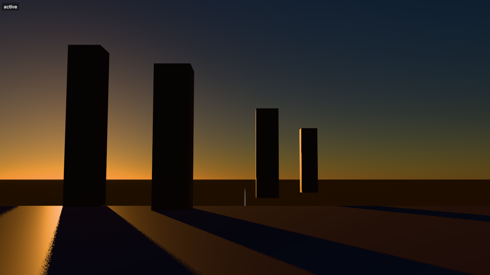

# Sky Atmosphere

A physically based sky lit by the sun, with haze over distant objects, from the ground up to orbit. It lights the scene in place of the environment, and sends to Unreal as a SkyAtmosphere with the same settings.



## Get it working

1. **Create > Sky Atmosphere**. If the scene has no directional light, it adds one named `sun` with **atmosphere sun** on.
2. Rotate `sun` to move the sun. Lower it toward the horizon for a sunset; below the horizon the sky goes dark.
3. Look around in a perspective view with Environment lighting. The sky, the sun's disk and the haze on far objects all follow the sun.

```python
skyAtmosphere()
setAttr("sun.rotate", [-8, 200, 0])
```

The sky's brightness follows the sun's **intensity**, so set exposure with the sun or the post process, not with the sky.

## Troubleshooting

**The sky is black.** No directional light is visible, or its intensity is 0. Add one, or turn **atmosphere sun** on for the one you want.

**The wrong light is the sun.** The sky uses the directional light with **atmosphere sun** on, else the first directional light it finds. Turn it on for the one you want.

**The sky doesn't show behind the scene.** Orthographic views show the plain backdrop. Use a perspective view, and check **Display > Environment Background** is on.

**The scene still lights like the HDRI.** A sky atmosphere replaces the environment only while it is **enabled** and visible. Only the first such sky atmosphere in the scene counts.

**Lighting lags a moment behind the sun when you drag it.** The background follows at once; the sky's light on surfaces rebuilds once the sun stops.

**Distant objects look washed out.** That's the haze. Lower **aerial perspective view distance scale** to push it further away, or raise **aerial perspective start depth** to clear the area round the camera.

## Unreal

**File > Send Sky to Unreal** sets the open level's SkyAtmosphere (unchanged settings), adds a SkyLight capturing the sky in real time, places the sun with **Atmosphere Sun Light** on, and sends the post process's height fog as an ExponentialHeightFog with volumetric fog. The level gets each actor only when it has none.

```python
unrealSendSky()
```

## Options

The attributes match Unreal's SkyAtmosphere one for one; tooltips in the Attribute Editor give each one's units. The ones you'll change most:

| Attribute | What it does |
| --- | --- |
| `transformMode` | Where the planet sits. The default puts sea level at the world origin; the other two put sea level or the planet's centre at the sky's position, which you move like any object. Use `planetCenterAtComponentTransform` for an Earth-centred scene. |
| `rayleighScattering`, `rayleighScatteringScale` | The sky's colour. Redder values give an alien sky. |
| `mieScatteringScale`, `mieAnisotropy` | Haze, and how strongly it glows round the sun. |
| `groundAlbedo` | The planet's colour, seen from high up and bounced into the air. |
| `bottomRadius`, `atmosphereHeight` | The planet's size and how deep its air is, in km. |
