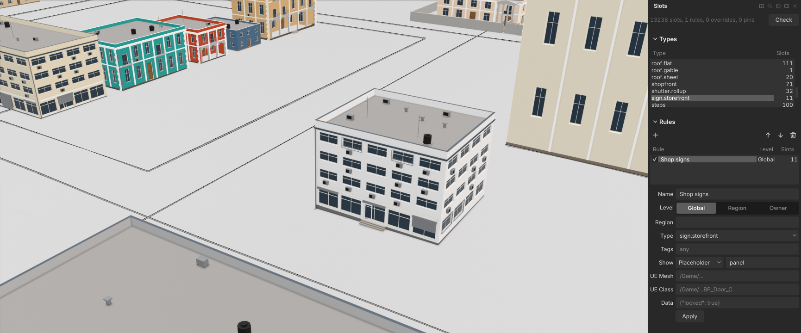

# Slots

Swap every generated door, sign, lamp, tree or container for your own asset or Unreal Blueprint with one rule, and keep per-part changes when the generator runs again.

Buildings, Settlement furniture, Terrain ground cover, Stagehand arrangements and site kits place their parts as typed slots (`door.shop`, `sign.storefront`, `lamp.street`, `container.40ft`). Each slot has a stable id, so a rule or an override follows it through regeneration.



## Get it working

1. Generate something with parts: [Buildings](buildings.md), Settlement furniture, Terrain ground cover or a [site kit](open-world.md#site-kits).
2. **Level > Slots > Slots** opens the panel. **Types** lists every slot type in the scene with its count.
3. Click a type, then the **Add Rule** button (**+**) under **Rules**.
4. Set **Show** to **Library item**, **Pool tag**, **Scene mesh**, **Placeholder** or **Hidden**, fill in the value and click **Apply**. Every slot of that type changes.

The same from Python:

```python
slotRule('add', type='sign.storefront', poolTag='fictional_signs', name='Fictional signs')
slotRule('add', type='door.shop', unrealClass='/Game/BP/BP_ShopDoor.BP_ShopDoor_C', data={'locked': False})
```

A rule on `door` covers every door type; `door.*` only the subtypes. **UE Mesh** places an Unreal static mesh as instances, **UE Class** spawns an actor of that class per slot (an interactable door), and **Data** is free key/value gameplay data that travels with the slot.

## Change one part

```python
slotFind(near=[1200, 0, -800], radius=500)                       # ids, types and what each shows
slotSet(id='building:1a2b/t0/f0/l0/b2/door', unrealClass='/Game/BP/BP_Door.BP_Door_C', data={'missionId': 'm04'})
```

Overrides are kept by slot id and win over every rule. `slotSet(id=..., remove=True)` hands the slot back to its rules.

Pin a building, block or site with `slotPin('owner:building:1a2b')` (or **Level > Slots > Pin Slots** on selected slot sets), and regenerating leaves it exactly as it is. `slotPin('owner:building:1a2b', swappable=True)` holds off regeneration only, so rules and overrides still swap its slots; [enterable buildings](buildings.md#enterable-buildings) are pinned this way.

## Colours

Give parts their own colour without a material each: container liveries, building palettes, team colours. Port containers and building modules come coloured.

```python
slotRule('add', type='container.40ft.*', data={'color': '#c0392b'})
```

`color` in a slot's data is `"#rrggbb"`, or `[r, g, b, a]` in linear colour with `a` as how much shows. In geometry nodes, **Store Named Attribute** with **Domain** Instance, **Data Type** Color and the name `color` colours instances. The viewport, the path-traced view and Unreal show it.

Two-tone pieces, such as a window frame against its trim, take a second colour from `color2` in the slot data or an instance attribute named `color2`. A material shows it with **Second Tone** on in the Material Editor.

In Unreal, meshes sent with no Lila material get `M_LilaInstanceColor`. In your own material, put `MF_LilaInstanceColor` between your base colour and the output, and set its `SecondTone` input to 1 on the part that takes the second colour.

## Troubleshooting

**A part keeps its own colour.** Its material has **Instance Color** off in the Material Editor, the viewport shows **Grey Base Color**, or a rule swapped its mesh without giving a colour.

**"this LilaLink has no instanceColor".** Colours went to Unreal without the material. Rebuild LilaLink from Lila's `ue/LilaLink`.

**`secondToneNote` in the send result.** LilaLink is too old to read second tones, so those parts show their first colour. Rebuild LilaLink from Lila's `ue/LilaLink`.

**The panel's banner counts orphaned overrides.** An override's slot no longer exists, because the generator stopped making that part. **Check** lists each in the [Validation](validation.md) panel with the nearest slot of its type; reassign it there, or `slotSet(id='old/id', reassign='new/id')`.

**Pin conflicts.** A pinned building or slot differs from what the generator makes now. The pin wins; unpin to take the new result.

**Duplicate ids.** Two generators share an owner. Give each its own owner (a Slots geometry node's **Owner** input).

**Parts draw as grey stand-ins after a rule names a library item.** The item isn't loaded or isn't in the library. `slotLoadItems()` loads every item the rules name and lists the missing ones under `missing`.

**A type shows as unregistered.** Generators can make subtypes nobody registered (`container.40ft.<shipping line>`). They act as their parent type; rules on the parent cover them.

## Tune it

| Option | What it does |
| --- | --- |
| **Level** | **Global** rules apply first, then **Region** (`district:3`, `settlement:Town`, `site:port1`), then **Owner** (a building, lot or site id), each in list order. Overrides apply last. |
| **Tags** | The rule covers only slots with every tag (`crop:tomato`, `groundcover`). |
| **Pool tag** | One library item per slot, picked from the items carrying the tag by the slot's id, so the pick is stable. `"a+b"` needs both tags. |
| `slotTypes(add=...)` | Registers your own type (footprint, attach, placeholder) for this session. |
| Colour | Replaces an untextured base colour and multiplies into a base colour map. **Instance Color** in the Material Editor turns it off per material. `MF_LilaInstanceColor`: **InstanceColorMultiply** (0 replaces, 1 multiplies) and **InstanceColorStrength**. |
| `slotReport()` | Counts per type, rule and owner, plus every problem above. |

In Unreal, each slot keeps its id in the actor tags (`LilaSlot:<id>`) or the instance data, and the slot table data asset (`/Game/Lila/Slots/DA_LilaSlotTable`) finds any slot by id, type or owner. Changing a rule while connected re-sends the slots.
