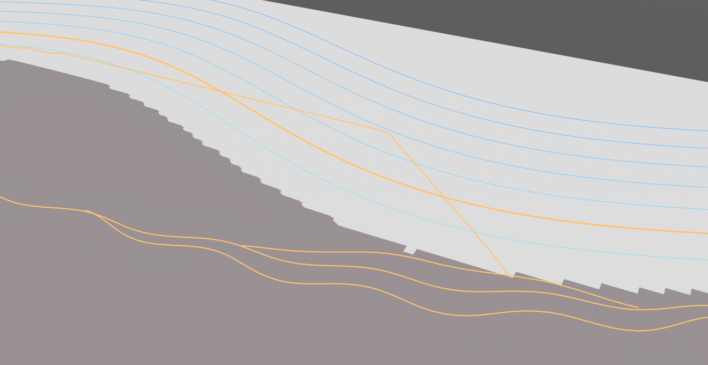

# Coast and water

Give a terrain a real seabed, beaches, reefs and mangroves, carve boat channels through lagoons, dam a valley into a reservoir, and get boat and air routes that engines can drive traffic on.



## Get it working

1. Import a real coast with **Level > Terrain > Real Place** and set **Level > Terrain > Sea Level** to 0.
2. **Level > Coast and Water > Bathymetry from File** and pick a GEBCO GeoTIFF tile covering the place (gebco.net, download as GeoTIFF). The sea gets real depths, blended into the shore.
3. **Coast Masks**, then **Mangroves**.
4. **Add Channel**, then click along a lagoon on the terrain and press Enter. The channel is cut wide and deep enough for its craft.
5. **Water Routes**, then **Water Check**. **Coast Overlay** shows the lanes coloured by craft, with depth contours.

```python
terrainBathymetry('Terrain', file='gebco/gebco_n30_w110.tif')
terrainCoastMasks('Terrain')
terrainMangroves('Terrain')['mangroveSource']
terrainAddChannel('Terrain', id='estuary', path=[[-30000, 5000], [0, 0], [20000, 6000]], craft='goFast', braids=3)
terrainRoutes('Terrain')
waterCheck('Terrain')['ok']
```

Everything lives in the terrain's nodes: edit the terrain and the coast follows. **Export Terrain** and **Send Terrain to Unreal** take the coast and routes along. GEBCO's credit is written to the terrain data folder's `ATTRIBUTION.txt`; ship it with your game.

## Bathymetry

With no file, **Bathymetry** lays a shelf profile off the shore. **Fetch for Area** in its option box downloads GEBCO for the terrain's area through OpenTopography with your API key; the box shows the download size, and a download over 25 MB needs **Allow Large Download**.

**The notes say "profile alone".** The grid wasn't used: the terrain isn't georeferenced (import it with **Real Place**), the grid doesn't cover it, or the file couldn't be read.

## Coast masks

**Coast Masks** writes `beach`, `surf`, `shallows` and `reef` masks for materials, ground cover and zones. Beach slope and height, surf width and reef cover are in its option box.

## Mangroves

**Mangroves** writes `tidal` and `mangrove` masks and adds a mangrove biome that ground cover plants.

**`mangroveSource` says `band`.** No land cover was imported, so mangroves follow the sheltered tidal band. For real mangroves, import land cover first: `terrainImportLandCover(terrain='Terrain')`. `worldcover` or `wetland` means it used the land cover.

## Channels

**Add Channel** draws on the terrain: click along the line, Enter finishes, Z or Backspace removes the last point, Esc clears and Esc again leaves. With a curve selected, the channel follows the curve. Shift+click the menu item to set the craft, braids and width first.

**A warning says the cells are coarse.** On 10 m to 20 m elevation cells, channels come out wider than asked. Raise the terrain's resolution for narrow channels.

**Stash Spots** finds dead ends, overhung banks and mangrove canopy along the channels and makes locators for them.

## Reservoirs

**Reservoir**: click one side of the valley, then the other. The dam fills a lake behind it to the spillway and runs a river down the valley.

**No lake appears.** The valley behind the dam is higher than the spillway sill, so there is nothing to fill. Raise **Crest Height** or move the dam downstream.

## Routes

**Water Routes** builds the route graph: coast lanes on a depth contour, channel strands, river reaches, and links joining loose lane ends over open water. **Harbour Lane** routes a berth (select a locator) out to the nearest lane. **Airstrip**: click both runway ends; it grades the runway and adds approach and departure corridors.

**Water Check** lists, each with its position:

| Issue | Fix |
| --- | --- |
| `channelShallow`, `channelNarrow` | The channel doesn't meet its craft. Widen or deepen it, or pick a smaller craft. |
| `laneDisconnected` | A boat lane doesn't join the main network. Add a **Harbour Lane**, or raise **Link Reach** in **Water Routes**. |
| `harbourUnreachable` | The berth is on land, or the water out is too shallow for the craft. |
| `airClearance` | A corridor passes too low over the ground. Move the strip or turn it away from hills. |
| `shortRunway` | The runway is shorter than its aircraft needs. |

**Route Curves** makes a curve per lane in the scene. **Export Routes** writes `<name>_coast.json` and `<name>_routes.json` (with a ZoneGraph-style block) for any engine. **Send Routes to Unreal** places each lane as a spline actor with a `LilaWaterRoute` component holding its craft, kind, width, depth or clearance, tagged `LilaWaterRoute`.

## Tune it

| Option | What it does |
| --- | --- |
| Craft | `skiff`, `airboat`, `goFast`, `semiSubmersible`, `cutter`: each has a draft, minimum depth and width. `terrainCraftClasses()` lists them. Aircraft `light` and `twin` have approach and climb angles, clearance and runway length. |
| Channel | **Braid Spread**, **Bank Angle**, margin over the craft's minimums (1.3) and width or depth of your own. |
| **Water Routes** | **Coast Depth** and **Coast Craft** of the coast lanes, **Link Reach**, **Min Lane Length**. |
| Bathymetry | **Shore Slope**, **Shelf Depth**, **Shelf Width**, **Blend Width** (how far out the grid takes over). |
| Mangroves | **Tide Low**, **Tide High**, **Max Slope**, **Shelter Radius**. |

[Zones](open-world.md#zones) turn the lanes into boat and aircraft spawn zones with **Zones from Water Routes**.
