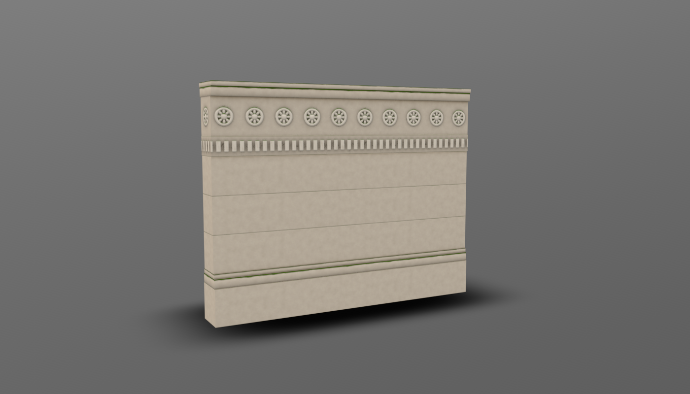
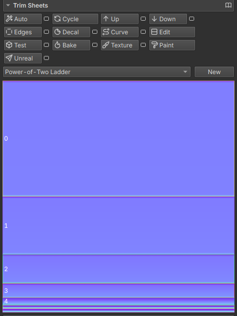
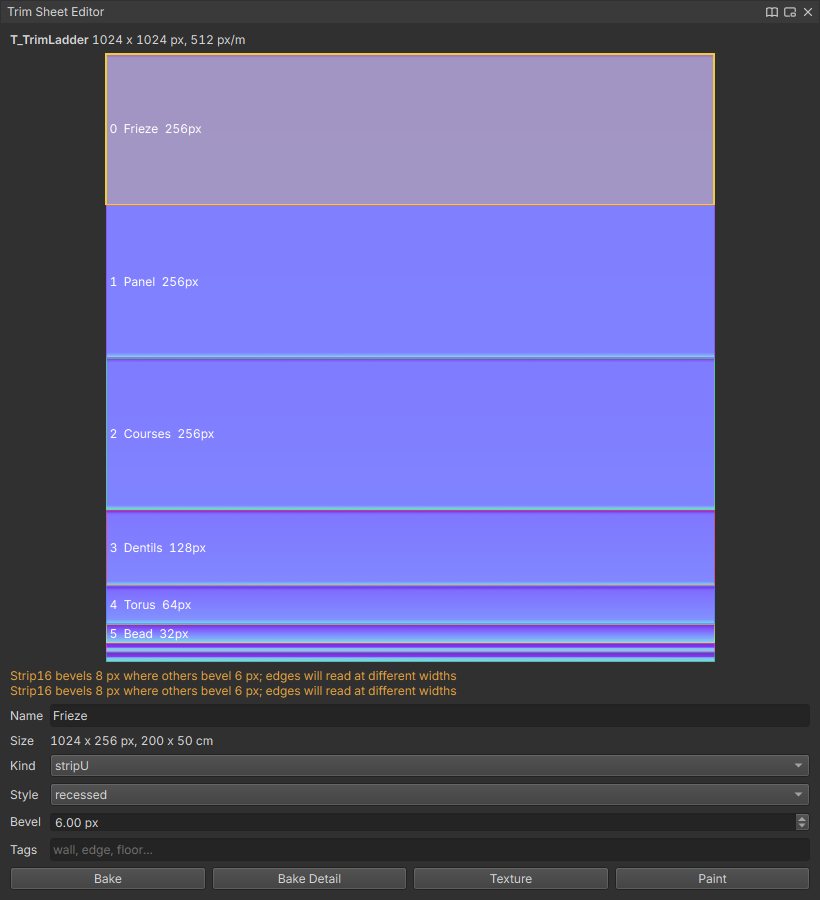
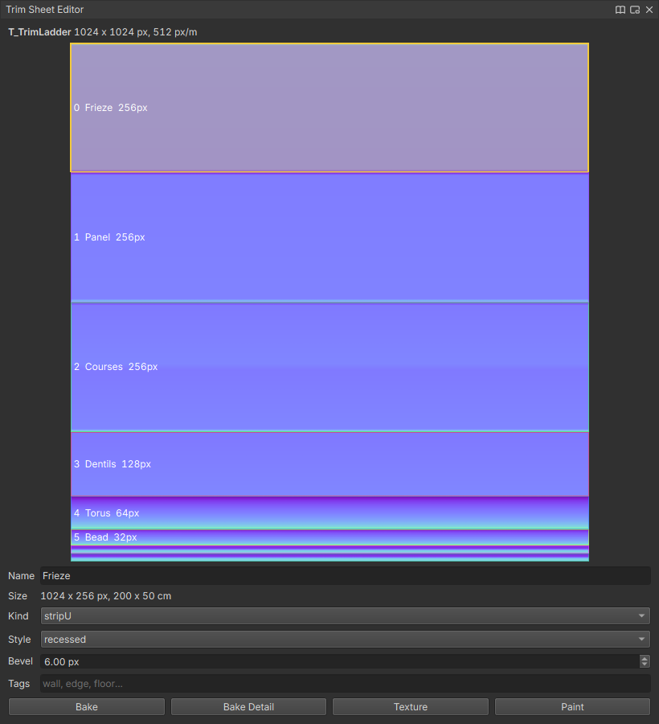
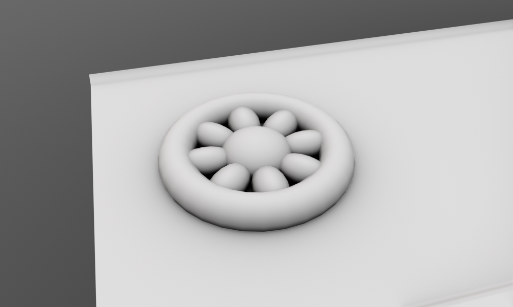
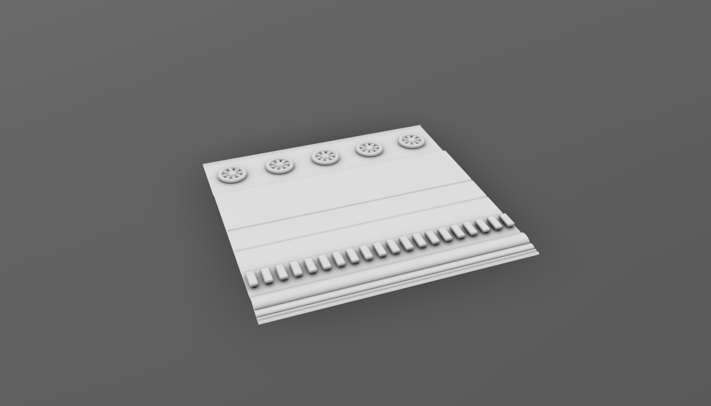
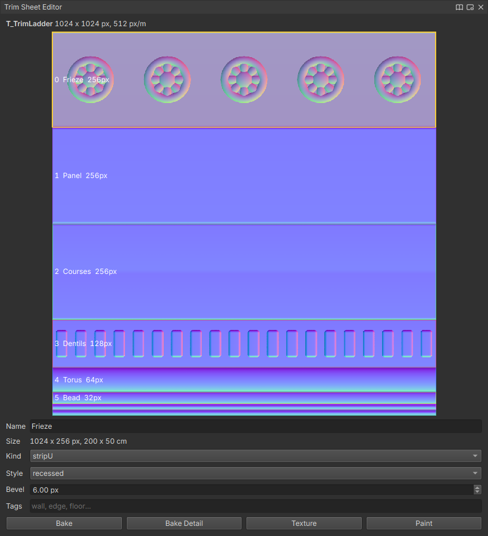
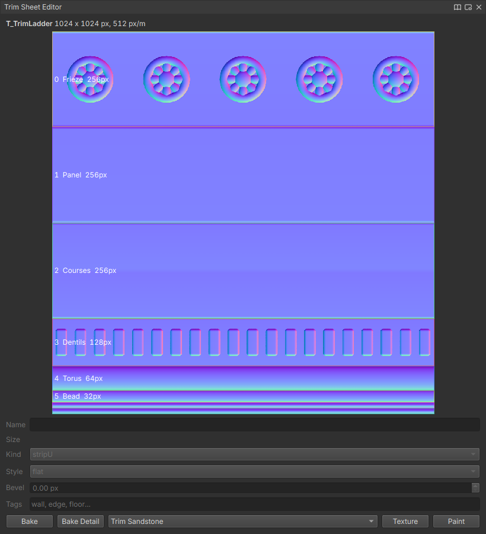
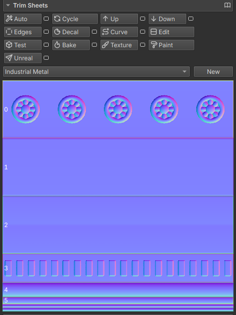

# Trim Sheets

One tiling texture of bevelled strips and panels, shared by every mesh that maps onto it: made from a preset, baked, textured, applied by hand or automatically, and sent to Unreal.

## Get it working

1. In the Level Toolkit's **Trim Sheets** section, pick a preset and press **New**. The sheet is generated and baked (normal, AO, curvature, height, cavity); the first time takes a few seconds.
2. Press **Texture** to put the preset's smart material on it. Wear, dirt and chips follow the baked bevels.
3. Press **Test** to see it on a blockout (wall, beam, steps, pillar, slab) at real sizes before mapping your own meshes.
4. Select faces or meshes and press **Auto**. Each island goes to the trim that fits its shape and world size, running up the trim where its faces stand up. Faces taller than every strip are cut into courses at the tallest strip's height, so a wall becomes rows of boards or panels at true scale (`trimAuto(sliceOversized=False)` keeps them whole). Press **Cycle** for the next-best fit, or click a trim in the palette to put the selection on that one.
5. Press **Unreal** to send it (connected with `unrealConnect()`).

```python
trimSheetCreate(preset="industrialMetal")
trimSheetTexture()
trimAuto()                      # on the selection
trimSheetSend(wait=True)
```

<!-- TODO image: a blockout building trimmed in one click, next to the sheet (images/trim-sheets/auto.png) -->

Sheets are `.lilatrim` files in `<workspace>/TrimSheets`, textures beside them in `<name>_Textures`. Every mesh mapped onto a sheet uses the material `M_<name>`, so one change to the sheet shows everywhere.

### Lay out your own

**Level > Trim Sheets > Trim Sheet Editor** shows the current sheet over its bake. Drag a border to resize a strip or a row (it snaps to the mip grid; hold Shift for single pixels), right-click a trim to split or delete it, and set its kind, bevel style, bevel width and tags below. Press **Bake** when done: profile changes rebake only the trims you changed. Double-click a trim to map the selection onto it.

Start from **Power-of-Two Ladder** for a plain layout to divide up, or import one: `trimSheetImport("layout.rect", width=2048, height=2048)` reads a Valve `.rect`, an SVG of rectangles, an ID map image, or a mesh's UV islands.

### Texture and paint

`trimSheetTexture(material=...)` adds a smart material on top of the last, and `trims=` keeps it to some trims by index, name or tag:

```python
trimSheetTexture(material="Rusty Iron", trims=["edge"])   # only the thin edge strips rust
trimSheetTexture(replace=True)                            # start over from the sheet's own material
```

The texture set is `TS_<name>` in the Texture Set panel, with a **Sheet Bake** layer at the bottom carrying the baked normal and AO. Edit it like any other set. Three texture nodes read the sheet: **Trim Mask** (white on trims first to last), **Trim Gradient** (where a texel sits inside its trim, plus a random value per trim) and **Trim Sheet Normal**.

**Paint** puts a flat `<name>_Sheet` plane in the scene and starts texture painting on it. Strokes land on the sheet itself, so every mesh using it shows them. The UV editor paints the sheet too.

### Edges, curves and decals

| Tool | What it makes |
| --- | --- |
| **Edges** (`trimEdges`) | Chamfers the selected edges and maps the chamfers onto a thin edge strip, with weighted normals so the big faces stay flat. |
| **Decal** (`trimDecal`) | A strip floating over the selected edges, half on each face, its crest on the edge. A separate `<mesh>_Decal`. |
| **Trim Cut** (`trimDecal(cut=True)`) | The same strip carved into the mesh as a groove `depth` cm deep. |
| **Curve** (`trimAlongCurve`) | A strip along the selected curves, tiling without stretching, with caps from the sheet's `cap`-tagged trim at the ends. `orient="wall"` stands it up. |

### Live in geometry nodes

The **Hotspot UV** node re-maps its input onto a sheet whenever the input changes, so procedural blockouts stay trimmed while you edit them. **Trim Sheet Generator** outputs a sheet's high and low.

## Troubleshooting

**Auto puts a face on a trim that is far too big or small.** Nothing on the sheet is near its world size; `trimAuto(showError=True)` paints poor matches red in the colour set `trimError`. Change the sheet's **pxPerM** (`trimSheetEdit(values={"pxPerM": 1024})`) or add a strip of that height.

**Strips show a seam where the texture repeats.** Rebake: `trimSheetBake()` reports `seamError`, and anything above about 0.02 means the sheet was baked without tiling (a hand-made high that doesn't run past the sheet's sides).

**The smart material covers the whole sheet when it should be on some trims.** `trims=` was a tag no trim has. `trimSheetInfo()` lists each trim's tags.

**Unreal shows the plain procedural paint, not the textured sheet.** Send again after **Texture**: the instance's **UsePaintedMaps** switch turns on only when the sheet has a texture set.

**"the LilaLink plugin in this editor is too old for trim sheets".** Rebuild LilaLink from Lila's `ue/LilaLink`.

## Options

| Option | Default | What it does |
| --- | --- | --- |
| `pxPerM` | per preset | Texels per metre; sets every trim's world size. |
| `padding` | 8 | Texels dilated past each trim when baking. |
| `mipLevel` | 3 | Borders on multiples of 2^mipLevel px stay clean down to that mip; the editor snaps to it. |
| `maps` | normal, ao, curvature, height, cavity | What the bake writes. |
| `supersampling` | 16 | Samples per texel when baking. |
| `high` | none | Scene meshes baked as extra high poly detail (see the tutorial below). |
| `highReplaces` | `false` | The `high` meshes are the whole high poly instead of adding to the generated relief. |

Change any of them with `trimSheetEdit(values={...})` and rebake. In Unreal, `M_LilaTrim` in `/Game/LilaLink/Masters` is made once and then yours to edit; `trimSheetSend(regenerateMaster=True)` rebuilds it.

---

# Tutorial: a carved stone frieze



The presets are a starting point. To make a sheet look the way you want, there are four ways to change it, quickest first: the strips' layout and profiles, the smart material, painting, and your own modelled detail. This tutorial uses them to build the sheet behind the wall above, then the wall itself.

## 1. Start a new sheet

Open **Level > Level Toolkit** and expand **Trim Sheets**. Pick **Power-of-Two Ladder** in the preset list and press **New**. You get plain strips of 512 down to 16 px on a sheet 200 cm across, already baked.



## 2. Lay out the strips

Press **Edit** to open the Trim Sheet Editor.

1. Right-click the top strip and choose **Split Across**: it becomes two 256 px strips.
2. Click each strip, then set its **Name**, **Style** and **Bevel** below the canvas:

| Strip | Name | Style |
| --- | --- | --- |
| 0 | Frieze | recessed |
| 1 | Panel | raised |
| 2 | Courses | groove |
| 3 | Dentils | step |
| 4 | Torus | halfPipe |
| 5 | Bead | halfPipe |

Give every strip, the two thin edge strips at the bottom included, the same **Bevel** (6 px here). The editor warns in orange until they match: the edges would read at different widths on the same model.



3. Press **Bake**. The strips get their new profiles.



## 3. Model the carved detail

Profiles are cross sections only. For anything that repeats along a strip, such as rosettes, studs, dentils or carving, you model it.

Choose **Level > Trim Sheets > Show Trim Sheet High/Low**. The sheet's high poly appears lying flat at the origin: its width along X, its strips running down Z from the top one at Z 0, 200 cm square. Hide `T_TrimLadder_Low` and model on top of the high with any tools. Whatever you put on it gets baked into the texture.

**A rosette on the frieze.** The Frieze strip covers Z 0 to 50 cm.

1. **Create > Torus**. In the Channel Box set **Radius** 10, **Section Radius** 2.2 and **Translate** 20, 0, 25.
2. **Create > Sphere** with **Radius** 4.5 and **Scale Y** 0.6, at the same place: the boss.
3. **Create > Sphere** with **Radius** 2.4 and **Scale** 1.6, 0.7, 0.9, at 26.5, 0, 25: one petal.
4. With the petal selected, press **Ctrl+D**. In the popup set **Count** 7, **Rotate** 0, 45, 0, **Pivot** to point and **Pivot Point** to 20, 0, 25, the rosette's centre.
5. Select the ring, the boss and the petals, and **Mesh > Combine** them.



6. **Ctrl+D** the rosette with **Count** 4 and **Move** 40, 0, 0: five rosettes, one every 40 cm.

**Dentils on the Dentils strip**, which covers Z 150 to 175 cm:

1. **Create > Cube** with **Width** 6, **Height** 3, **Depth** 14 and **Base at Origin** on, at 5, 3.5, 162.5.
2. **Model > Bevel** it with **Offset** 1.2 and **Segments** 3.
3. **Ctrl+D** with **Count** 19 and **Move** 10, 0, 0.



Three rules decide whether detail survives the bake:

- **Repeat it a whole number of times across the sheet**: here 200 / 40 = 5 rosettes and 200 / 10 = 20 dentils. Strips tile along their length, so any other spacing shows a seam where the texture repeats.
- **Sit it on the profile, not inside it.** The Step profile stands about 3.5 cm tall, which is why the dentils start at a height of 3.5. Detail buried in the profile bakes to nothing.
- **Round or bevel its edges.** The bake looks straight down at the sheet, so vertical sides don't show. Unbevelled blocks come out as faint flat squares.

## 4. Bake the detail in

Select the rosettes and dentils and press **Bake Detail** in the Trim Sheet Editor (or **Level > Trim Sheets > Bake Selection as Sheet Detail**).



The sheet keeps the detail: every later **Bake** uses it, in this scene or any other, from a copy saved beside the sheet's textures. To change it, edit the meshes and press **Bake Detail** again. **Level > Trim Sheets > Bake Without Detail** goes back to the plain profiles.

## 5. Texture it

In the Trim Sheet Editor, pick **Trim Sandstone** in the material list next to **Texture**, then press **Texture**. Wear, grime and moss follow the bevels and the carving. Try others from the list: each press replaces the last.



## 6. Build the wall

A wall built for a trim sheet is a stack of bands, each as tall as the strip it carries. Make each band with **Create > Cube** (**Width** 400, **Base at Origin** on) and move it up to sit on the one below. Then, with it selected, click its strip in the Trim Sheets palette:

| Band | Height | Depth | Sits at | Strip |
| --- | --- | --- | --- | --- |
| Plinth | 50 | 48 | 0 | Panel |
| Base torus | 12.5 | 46 | 50 | Torus |
| Base bead | 6.25 | 43 | 62.5 | Bead |
| Three ashlar courses | 50 each | 40 | 68.75, 118.75, 168.75 | Panel |
| Dentil course | 25 | 44 | 218.75 | Dentils |
| Frieze | 50 | 42 | 243.75 | Frieze |
| Cornice | 12.5 | 50 | 293.75 | Torus |
| Cap | 6.25 | 54 | 306.25 | Bead |



Clicking a strip lines each face up with the strip's motifs: a short end shows one motif in its middle, a long face ends between motifs, so corners stay tidy. The mouldings at the base and the bands stepping out towards the top throw the shadow lines that make it read as stone. Hide the high poly and the motifs, and you have the wall at the top of this tutorial.

For walls you trim with **Auto** instead, click the Frieze in the editor and tick **Reserved**: Auto never picks a reserved strip, so it goes only where you click it.

The finished scene is in Lila's examples as **Trim Frieze**.
