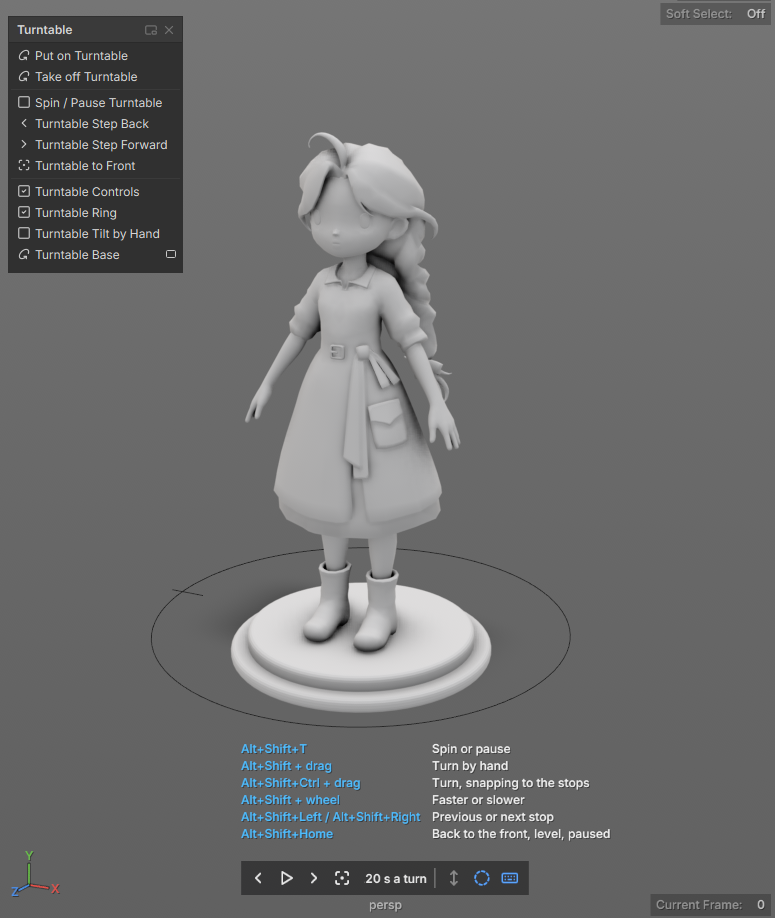

# Turntable

Turn the model in front of a still camera, for streams and reviews: the background, grid and lights stay put and only the model moves.



## Get it working

1. Select the model and choose **Modify > Turntable > Put on Turntable**. A ring appears on the ground around it.
2. Press **Alt+Shift+T** to spin it. Press it again to ease it to a stop.
3. Hold **Alt+Shift** and drag left or right in the view to turn it by hand. Let go mid-drag and it keeps turning for a moment.

Exports and **Send to Unreal** never see the turn: the model leaves Lila exactly where it stands unturned. Renders show it turned.

```python
turntable("statue", secondsPerTurn=30)
turntablePlay()
```

## Keys

| Keys | Does |
| --- | --- |
| **Alt+Shift+T** | Spin or pause |
| **Alt+Shift**+drag | Turn by hand; up and down tilts it toward or away from the camera; add **Ctrl** to snap to the stops |
| **Alt+Shift**+wheel | Faster or slower |
| **Alt+Shift+Left** / **Right** | Ease to the previous or next stop (front, side, back, side) |
| **Alt+Shift+Home** | Ease back to the front, level, and pause |

The keys work on the selected turntable or the one the selection is on, else the one used last. The keyboard button on the controls at the bottom of the view lists them on screen; the buttons next to it switch tilting and the ring on and off.

## Add a base

**Create > Turntable Base** builds a stepped base under the selection and puts both on a turntable. It's a revolved profile curve with live history: select the hidden `turntableBaseMeshProfile` curve in the Outliner and edit it to reshape the base. The option box picks the style (plinth, stepped, record, pedestal, lazy susan) and a material. Run it again with the base, the model or the turntable selected to rebuild that base with new options.

## Troubleshooting

**The spin stops while I work.** Editing anything on a spinning turntable holds it still; it spins on after `resumeAfter` seconds without an edit. Turn off `holdWhileEditing` on the turntable to keep it spinning.

**The scene opened with the model facing front again.** Scenes always open paused at `restAngle`; the live angle isn't saved.

**A render doesn't show the turn.** `includeInRenders` is off on that turntable.

**The model leaves the view as it turns.** Press **F**: framing anything on a turntable fits the whole turn.

## Options

The turntable's own fields are in the Attribute Editor. `lightsFollow` turns the scene's lights and the environment with the model, so the lighting stays fixed on it; off, highlights travel across the surface as it turns.

**Render > Render Turntable** with `spin` set to `turntable` renders one loop of the turntable through your current view.

To export the spin as animation, `turntableBake()` keys a real rotation on a new transform and parents the members under it.
