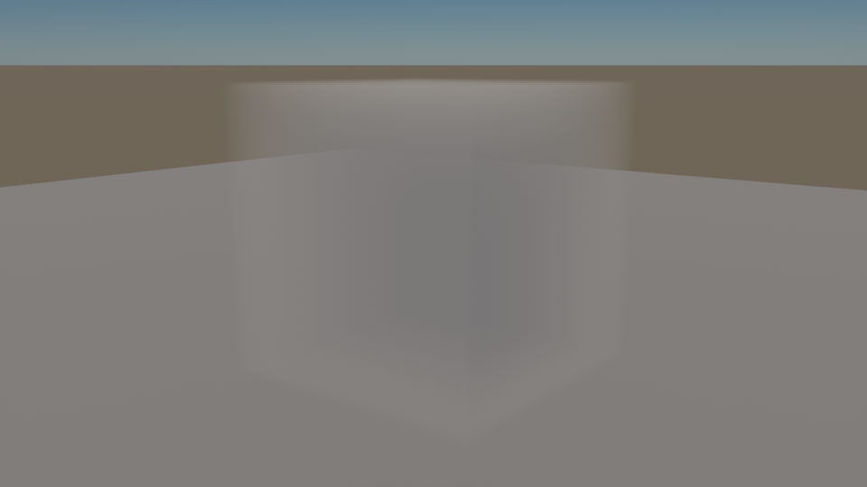

# Volumes

Fog, smoke and clouds that fill a mesh or a geometry nodes density grid, lit by the scene's lights and sky, in the viewport, the path tracer and Unreal.



## Get it working

1. **Create > Fog Volume**. You get a box with a new `M_Fog` material whose **Shading Model** is **Volume**.
2. In the **Material Editor**, raise **Density** for thicker fog. **Scatter Color** is its colour; **Absorption Color** darkens it like smoke.
3. Any closed mesh works the same way: give it a material, set **Shading Model** to **Volume**, and the mesh fills with the medium instead of drawing a surface.

```python
fogVolume(size=600, density=1.0)
```

For a grid from geometry nodes, put the nodes on a mesh with a volume material: a density grid draws as it is, and a signed distance fills with density 1. **Read VDB** in a geometry nodes graph brings in an OpenVDB file the same way.

## Troubleshooting

**The volume is a hard-edged box or blob.** A mesh is filled at about 64 voxels across its longest side. Set **Voxel Size** for finer edges, or shape the density with geometry nodes.

**A mesh with a volume material draws nothing.** The mesh has to be closed to fill. Close its holes (**Mesh > Fill Hole**), or make a grid with geometry nodes.

**Only some volumes draw.** The viewport draws the first 8 volumes in the scene and warns about the rest.

**Emission Color is greyed out.** Raise **Emission Strength** first; colour does nothing at 0.

**Grids look blockier than in Houdini or Blender.** The viewport averages grids down to 160 voxels on their longest side. The file you export and send keeps its full resolution.

**Sunlit volumes look dim next to Blender's.** The viewport scatters light once; the path traced view (**Display > Path Traced**) follows light through many bounces.

## Unreal

**File > Send Volumes to Unreal** writes each volume as OpenVDB, imports it as a Sparse Volume Texture and places a Heterogeneous Volume with a material instance of `M_LilaVolume`. Select volumes to send only those. It needs the NanoVDB extension.

`M_LilaVolume` is built on the material function `MF_LilaVolume`, which turns density and colours into the Albedo, Extinction and Emissive a Volume-domain material takes. Use the function in your own Volume materials.

```python
unrealSendVolumes()
exportVDB("fogVolume", "C:/fx/fog.vdb")
```
