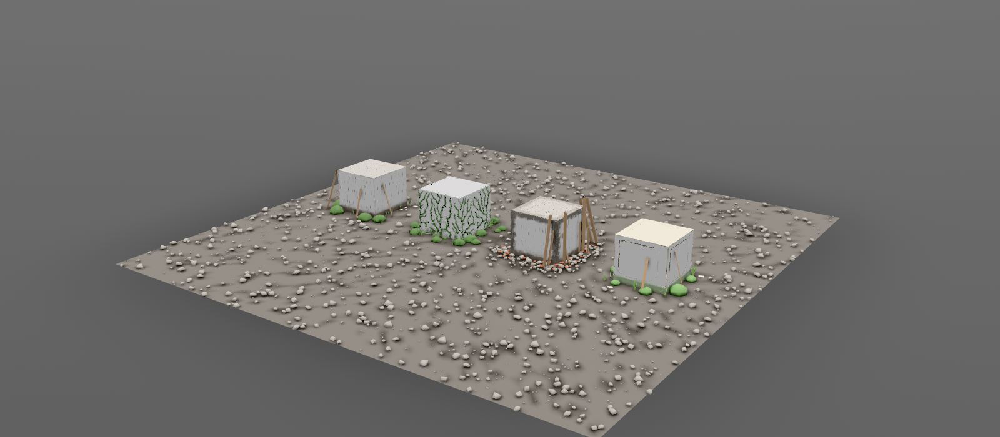
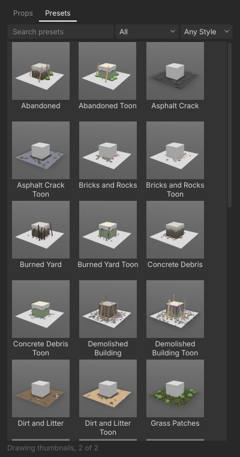

# Weathering

Drag rubble, grunge, worn edges, ivy and roofs onto anything (a mesh, a Blockwork level, a Masonry wall), one effect at a time, in realistic or toon style, from your own pieces.



## Get it working

1. Open **Level > Weathering > Library Presets**.
2. Drag a preset onto an object in the viewport. Drop on empty space, or double-click the preset, to apply it to the selection.
3. Drag on the next one. Each drop is one effect and one undo step, and stays live: move or edit the block and it rebuilds.



```python
weather("Shed", preset="Concrete Debris")           # rubble round the base
weather("Shed", preset="Grunge")                    # dirt, streaks and wear on the surface
weather("Ruins", preset="Ivy", style="toon")        # ivy in the toon look
groundDressing("Yard", preset="Asphalt Crack")      # scatter, ground material and tint
```

**Use your own pieces.** Every preset fills its pieces (rubble, planks, ivy leaves, roof tiles) from the library by role. Select your meshes and run **Level > Weathering > Add Pieces** with a role, and every preset uses them instead of the placeholders. To use them once, pass them in the `pieces` slot:

```python
weatheringAddPieces(["Chunk1", "Chunk2", "Chunk3"], role="rubble", style="toon")
weather("Shed", preset="Concrete Debris", slots={"pieces": ["MyRubble_grp"]})
```

Roles: `rubble`, `rock`, `brick`, `plank`, `beam`, `charred`, `plant`, `grass`, `moss`, `bush`, `pebble`, `litter`, `leaf`, `ivy-leaf`, `ivy-flower`, `roof-sheet`, `roof-tile`, `roof-plank`, `ridge-cap`, `window-frame`, `window-sill`, `window-glass`, `window-board`, `wire-insulator`, `wire-bracket`, `pole`, `roof-vent`, `ac-unit`, `roof-pipe`, `railing`, `tower`, `edge-trim`.

**Weather a whole level.** Drop a preset on the level group or a visgroup. More than 12 meshes are dressed in tiles, so editing one block rebuilds only its tile. The result joins the `Weathering` visgroup.

**Send to Unreal.** Run **Level > Weathering > Build Unreal Materials** once per project, then send as usual. Ground tint, grunge, ivy and window interiors each ship a material function (`MF_LilaGroundTint`, `MF_LilaGrunge`, `MF_LilaFoliageWind`, `MF_LilaInterior`) to drop into your own materials, and a generated material built on it.

## Troubleshooting

**The result says "edge decals skipped".** Edge decals need the Trim Sheets extension. Turn it on in **Windows > Extension Manager** and drop the preset again.

**Editing blocks is slow while blocking out.** Select the weathered objects and run **Level > Weathering > Pause Weathering**. **Resume Weathering** brings it back, rebuilt for the blocks as they are now.

**The ground tint result lists `static` sources.** Those sources read the ground themselves (their grunge sees it, or they stand on it as a scatter), so they are taken as they stand. Run `groundTint` again after moving them.

**Pieces are simple shapes or the wrong style.** Placeholders fill any role you haven't supplied. Add your own with Add Pieces, tagged with the style (`realistic` or `toon`) your preset uses.

**Edge wear covers a whole smooth mesh.** Grunge edge wear follows sharp edges. On a smooth-shaded mesh without hard edges, add hard edges or lower the edge angle in the Grunge Masks option box.

## Options

| Kind | Presets |
| --- | --- |
| Scatter | Concrete Debris, Heavy Rubble, Bricks, Rocks, Leaning Planks, Charred Timber, Weeds, Moss Clumps, Bushes, Litter |
| Ground | Rubble Ground, Asphalt Crack, Dirt and Litter, Grass Patches, Moss Floor |
| Surface | Grunge, Worn Edges, Corner Dirt, Chipped Edges, Broken Edges |
| Growth | Ivy, Vines, Roots, Moss Strands |
| Generators | Roof Sheets, Roof Tiles, Roof Planks, Windows, Rooftop Clutter |

Each has a Toon version. Save your own from Python with `arrangementSave` and `"category": "Weathering"`; it shows in the Presets tab.

The same effects run with every setting from **Level > Weathering**: Base Dressing, Ground Dressing, Ground Tint, Pile, Rooftop Clutter, Grunge Masks, Edge Decals, Edge Chip, Ivy, Ivy Brush, Roofing, Windows, Wires and Curve to Truss. **Masonry** buildings take `weather=` to apply one preset to a new building as it is made.
